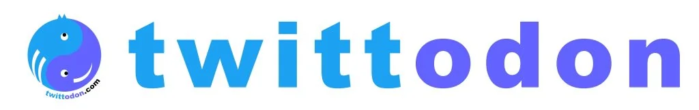
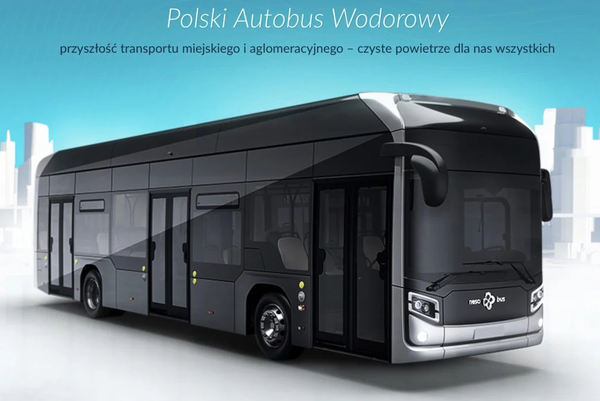

Spis treści:
* TOC
{:toc}

Na wstępie pozwolę sobie zacytować piosenkę zespołu Elektryczne Gitary - "I co ja robię tu, u-u, co Ty tutaj robisz". Na to co Ty, drogi Czytelniku, tutaj robisz musisz odpowiedzieć sobie sam. Natomiast na część pytania o mnie odpowiedziałbym krótko, że od zawsze szukałem swojego, ale takiego naprawdę swojego, miejsca w Internecie, gdzie mógłbym pisać dosłownie o wszystkim co w danym momencie wyda mi się interesujące i będzie zasługiwało na sklecenie kilku słów. Częściowo realizowałem to poprzez Twittera, a po jego upadku dalej robię to w Fediverse, a konkretnie na Mastodonie. Jednak media społecznościowe nigdy nie dają poczucia bycia w pełni u siebie. Co innego jeżeli chodzi o skromny blog, który będzie istniał tak długo jak będę tego chciał, a będzie aktywny na tyle na ile wystarczy mi chęci.

Tak więc oto jestem i już na samym początku ustanawiam pierwszą zasadę mojego blogowania - **nie będę robił niczego na siłę**. Jak będę miał wenę to będę pisał dużo, a jak nie będę jej miał to będzie tego mniej, trudno. **Nie planuję także wprowadzać tutaj chronologicznego podejścia**, więc możliwe, że będę dość intensywnie skakał pomiędzy tematami. Jest to zdrowe podejście dla autora, ale na pewno nie jest to polecany sposób na stworzenie miejsca, do którego Czytelnik będzie chciał wracać, bo kluczem do stworzenia takich warunków jest ustalenie sensownego interwału publikacji i trzymanie się go, a tego na pewno tutaj nie zagwarantuję. Cóż... Jakby nie o to mi tutaj chodzi, ale też nie chcę od razu na wstępie całkowicie zniechęcić osób, które to czytają, dlatego powiem, że postaram się tutaj pisać po pierwsze **merytorycznie**, po drugie **ciekawie**, a po trzecie **zwięźle**, choć jak widać to ostatnie już mi niezbyt wychodzi, dlatego przejdźmy do czegoś bardziej konkretnego!

## O czym będę tutaj prawił?

Miały być konkrety, a pierwsza odpowiedź na powyższe pytanie jaka przychodzi mi do głowy to "nie mam kompletnie pojęcia"! A tak całkiem serio to mam w głowie wiele rzeczy, którymi chciałbym się podzielić ze światem i to bez względu na to jaki będzie miało tego efekt, tj. czy ktokolwiek będzie to czytał.

> TL;DR  
> Projekty w PHP, Open-Source, Praca jako konstruktor autobusów, Self-hosting, Apple, iPad Only, Linux

Na pewno chciałbym się tutaj dzielić moimi pomysłami na projekty, a także opisywać te, które już zrobiłem i przy okazji dzielić się wiedzą jaką udało mi się przyswoić przy pracy nad nimi. Hobbistycznie programuję w PHP, tworzę strony internetowe, ale nie takie ładne tylko takie funkcjonalne, którym z uwagi na mój brak gustu brakuje designerskiego sznytu, ale każda z nich robi coś co przydaje się mi, a jak się nimi podzielę to i innym. Dla przykładu, jako że jednym z moich zainteresowań jest także strzelectwo sportowe to interesuję się bronią, więc stworzyłem kiedyś, już teraz dość popularną, porównywarkę cen broni i amunicji w Polsce. Takie Ceneo, ale dla strzelców. Dostępna jest pod adresem [CenyBroni.pl](https://cenybroni.pl). Aktualnie pracuję nad jej odświeżoną wersją, gdyż z programowaniem jest tak, że najpierw coś piszesz, a później za parę miesięcy dochodzi do Ciebie, że teraz zrobiłbyś to kompletnie inaczej. Innym projektem jest [Grażdanka.pl](https://grazdanka.pl). To z kolei edukacyjna gra, której zadaniem jest nauczenie się alfabetu używanego m.in. w Ukrainie i Rosji. Trzecim i ostatnim projektem z tych "ciekawszych", którym chcę się tutaj podzielić, jest [Twittodon.com](https://twittodon.com). Jest to ultra proste, ale skuteczne, narzędzie pozwalające zweryfikować połączenie pomiędzy swoimi kontami na Twitterze i Mastodonie.

Programowanie jest moim hobby, które realizuję po pracy, choć po narodzinach dziecka to raczej nocami, co często przypłacam skrajnym niewyspaniem. Cóż nic nie poradzę na to, że często jak mam pomysł, który wydaje mi się ciekawy, to muszę go zrealizować jak najszybciej, bo inaczej nie jestem w stanie skupić się na niczym innym. Jestem także ogromnym zwolennikiem oprogramowania open-source (otwartoźródłowego), więc kod znacznej większości moich projektów publikuję jako w pełni dostępne do wglądu, a nawet powielania, na [GitHub](https://github.com/to3k). Słowa hobby i open-source raczej jasno określają, że nie jest to dla mnie źródło dochodu, a więc z czego utrzymuję rodzinę? Zawodowo jestem głównym konstruktorem w firmie PAK-PCE Polski Autobus Wodorowy Sp. z o.o., która należy do Grupy Polsat Plus i zajmuje się produkcją autobusów wodorowych (patrząc po nazwie niewiarygodne, prawda?) pod marką Neso Bus, ale także innymi rzeczami w obrębie tematyki wodoru, odnawialnych źródeł energii (OZE), elektromobilności i energetyki. W skrócie wszystko co zielone i dbające o przyszłość kolejnych pokoleń.

Projekty oparte o język PHP to jedno, ale mam także zajawkę na stawianie swoich rozwiązań self-hosted, czyli takich, które uruchamia się na swoim sprzęcie niepolegając przy tym na cudzej infrastrukturze serwerowej. Robię to na różnego typu serwerach zaczynając od płytek Raspberry Pi, przez kopie pokroju ODROID aż po mini komputer Fujitsu Q920, który nie tak dawno zakupiłem. To jak stworzyć swój serwer domowy opisałem na oddzielnym blogu [odroid.pl](https://odroid.pl/blog), ale na pewno i tutaj będę do niego nawiązywał i pewnie też częściowo dublował tematy, bo chcę mieć to wszystko w jednym miejscu, żeby później móc linkować, gdy wystąpi potrzeba wyjaśnienia komuś czegoś co już opisałem. Mówiąc o rozwiązaniach self-hosted nie sposób nie wspomnieć o inteligentnym domu (smart home). Ten temat zgłębiam już od jakiegoś czasu, mam postawiony dedykowany do tego serwer z zainstalowanym Home Assistant OS, więc na pewno będę chciał również i o tym wspomnieć parę słów.

Poza tym wszystkim jestem fanboyem produktów firmy Apple i nie boję się tego stwierdzenia. Ze względu na wymagania oprogramowania, w którym pracuję, służbowo korzystam z systemu Windows. Na wszystkich moich serwerach bazuję na różnych dystrybucjach Linuxa. Natomiast głównym ekosystemem jest właśnie ten od Apple (iOS, iPadOS i macOS). Logo jabłka widnieje na moim telefonie, laptopie i nawet zegarku, ale ostatnio na odkrywam coraz to kolejne plusy używania iPada jako głównego urządzenia, na którym robie rzeczy. Słyszeliście kiedyś o ideologii (może to zbyt duże słowo, ale niech już zostanie) "iPad Only"? Jeżeli nie to świetnie, bo na pewno będzie to temat przewodni wielu wpisów na tym blogu. Założyłem sobie, że ten blog zostanie w całości stworzony i będzie prowadzony przy pomocy jedynie iPada, więc zobaczymy jak to wyjdzie na dłuższą metę.

## Miało być krótko...

Mam w głowie jeszcze wiele myśli, które mógłbym tutaj przelać, ale mam też świadomość, że ten wpis stał się niebezpiecznie obszerny. Dopiero zaczynam, więc dziesięć oddechów i odklejam się od klawiatury, bo skończy się tym, że w jednym wpisie zawrę całą historię swojego życia i pozostanie tylko zamknąć bloga oraz zgasić światło. Na koniec zostawiam utwór, który gra w mojej głowie od początku pisania tego wpisu.

https://open.spotify.com/track/4CRaUcTyhusMjMm2cw3PSt
