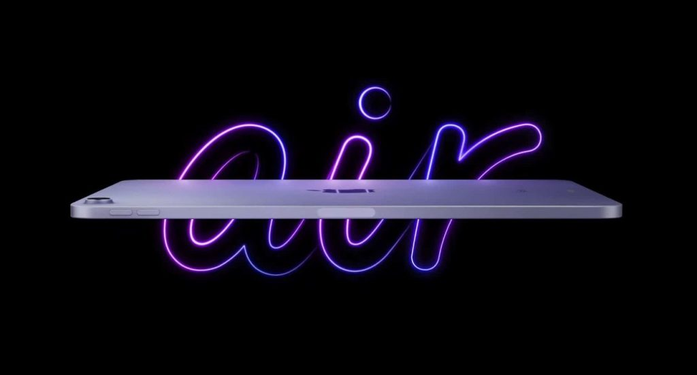
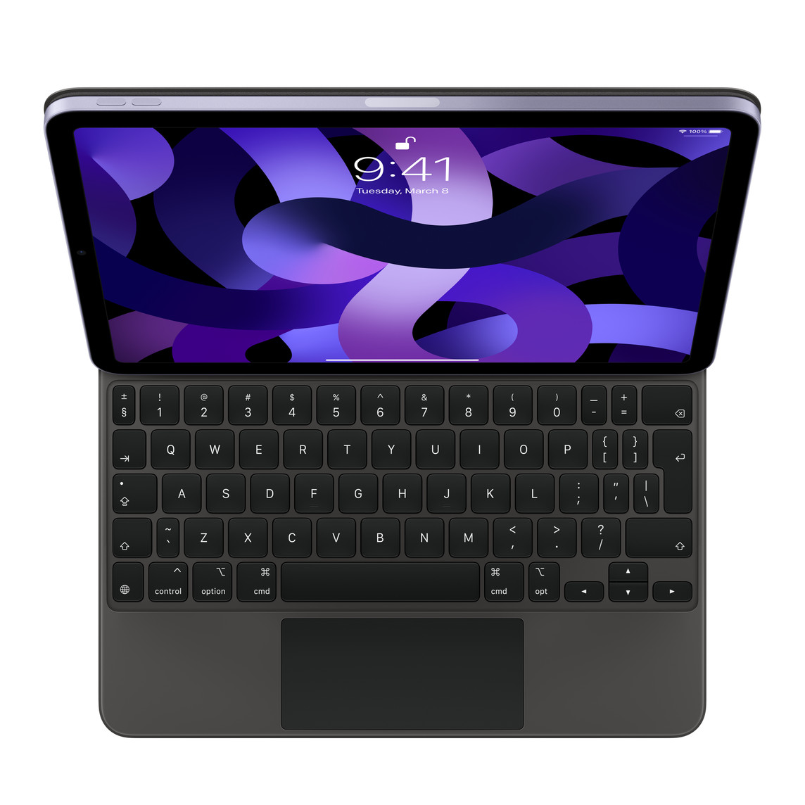
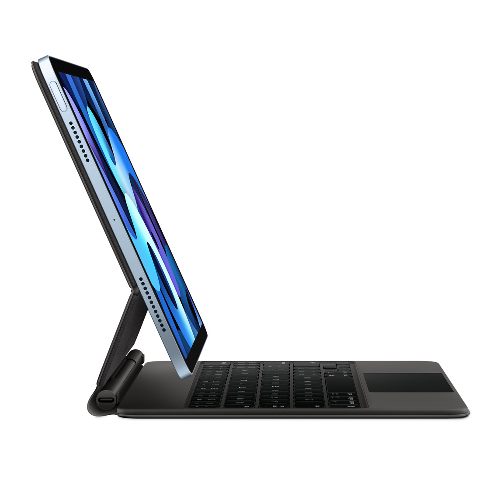
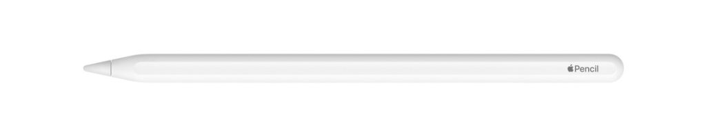
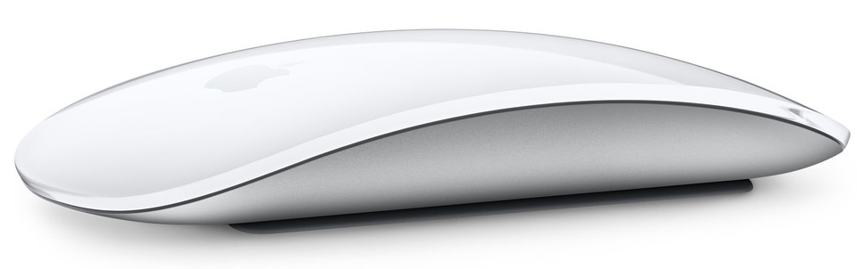

Spis treści:
* TOC
{:toc}

W poprzednim i jednocześnie pierwszym wpisie wspomniałem pokrótce, że jednym z głównych założeń jakie przyjąłem przy uruchamianiu tego bloga jest to, że od początku stworzę i będę prowadził go przy użyciu mojego iPada. Na jakim konkretnie sprzęcie to robię? Temu właśnie poświęcę ten wpis.

## Jakiego iPada używam?

W połowie 2022 roku kupiłem iPada Air 5 gen., wyposażonego w 64GB pamięci, w wariancie jedynie z WiFi (bez Cellural, tj. komunikacji GSM). Jest to w istocie bardzo podstawowa wersja, jednak w zupełności mi wystarcza, gdyż wszystkie pliki trzymam na serwerze NAS, a wszędzie tam gdzie jestem mam dostęp do WiFi lub w nielicznych przypadkach zawsze mogę skorzystać z przenośnego routera albo hotspotu uruchomionego na telefonie. Przed zakupem używałem dość aktywnie iPada 9 gen. z 2021 roku, więc przesiadałem się z dość świeżego sprzętu. Dlaczego więc zdecydowałem się na taki upgrade? Do zakupu przekonało mnie kilka czynników:

- **cena**, bo udało mi się zakupić jeszcze zafoliowany produkt od osoby prywatnej, dzięki czemu przyszło mi za niego zapłacić jedynie 2500 zł,

- wyposażenie tego modelu w procesor **Apple Silicon M1**, który mam w moim MacBooku Air z 2020 roku i od samego początku jestem oczarowany przeskokiem wydajnościowego jaki Apple osiągnęło względem jednostek z procesorami od Intela czy też innej konkurencji,

- **ilość RAMu 8GB** vs 3GB, co robi kosmiczną różnicę szczególnie jeżeli chcemy rozmawiać o jakimkolwiek multitaskingu, który na iPadzie z 8GB RAMu jest jak najbardziej możliwy, a przy 3GB już niekoniecznie, bo nawet kilka zakładek w Safari potrafi spowodować ciągłe przeładowywanie tej, w której odpalony jest np. filmik na Youtube, co jest bardzo uciążliwe,

- kompatybilność iPada Air 5 z **klawiaturą Magic Keyboard**,

- nieco **większy ekran**,

- nowy, odświeżony **wygląd**,

- **złącze USB-C** zamiast ochodzącego już do lamusa Lightninga.

_foto: apple.com_

Urządzenie o takich parametrach dla większości osób będzie zdecydowanie wystarczające do użytku jako główny "komputer". Kluczową rolę robi tutaj procesor M1, który jest desk**topowym** rozwiązaniem i jest naprawdę potężny.

## Czy iPadOS można uznać za ekwiwalent macOS?

Niestety odpowiedź (przynajmniej na razie) brzmi - nie. W ostatnich latach nastąpił naprawdę spory rozwój tego systemu w odpowiednim kierunku, jednak to dalej nie do końca jest "to" i mam wrażenie, że Apple celowo nieco to wstrzymuje, bo gdyby iPadOS miał takie możliwości jak macOS to jaki byłby sens rozdzielać to na dwa systemy? Pewnie dlatego iPadOS sztucznie utrzymywany jest jako rozwiązanie dla pracy o nieco innej specyfice. Jednak wszystko zależy od tego do czego potrzebujemy go wykorzystywać, bo na pewno oferuje też rzeczy, których niesposób zrobić na macOS. Do tego wystarczy trochę pogłówkować i w odpowiedni sposób rozszerzyć możliwości swojego iPada np. poprzez VPS (Virtual Private Server). Ja tak zrobiłem stawiając domowy serwer na bazie pochodnej Raspberry Pi, na którym uruchomione mam narzędzia, których brakuje mi w iPadOS. Na pewno napiszę tutaj o tym oddzielny wpis, a może nawet kilka.

## Ważne są akcesoria

Sam iPad to nie wszystko co jest nam potrzebne, aby zrobić z niego (prawie) pełnoprawny komputer potrzebujemy akcesoriów! Najistotniejsza jest klawiatura. Ja postawiłem na Magic Keyboard, bo jestem zafascynowany efektem niejako lewitowania iPada nad klawiaturą. Jest to solidnie wykonane urządzenie. Rozmiar oraz skok klawiszy, a także odstępy pomiędzy nimi są stworzone do wygodnego pisania i na pewno docenią to ludzie, którzy płodzą sporo tekstów. Jest też gładzik, a jego wymiary są optymalne względem tego ile dostępnego miejsca dla niego pozostało. Nie ma co się nadmiernie rozwodzić nad jakością touchpadów od Apple, bo każdy kto kiedykolwiek miał z nimi styczność na pewno wie, że jest to doznanie nieporównywalne do czegokolwiek innego na rynku. Odwracając monetę mamy też minusy, którymi są brak klawiszy funkcyjnych (np. do regulacji głośności i jasności ekranu) oraz brak możliwości używania takiego zestawu na powierzchni innej niż płaska, bo środek ciężkości jest zlokalizowany tak, że dla przykładu na kolanach iPad wpięty w klawiaturę Magic Keyboard przewraca się do tyłu lub po prostu nie jest stabilny na tyle, żeby możliwe było naciskanie na ekran bez konieczności trzymania podstawy drugą ręką. Oczywiście klawiatury od Apple to nie jedyny słuszny wybór. Do iPada 9 gen. używałem klawiatury Logitech Combo Touch i też chwaliłem sobie ten produkt.

_foto: apple.com_

Dla bardziej kreatywnych i uzdolnionych manualnie (czyli nie dla mnie...) jest jeszcze świetne rozwinięcie możliwości w postaci rysika Apple Pencil. Mój model iPada obsługuje Pencila drugiej generacji, więc można go ładować indukcyjnie z samego tabletu i transportować poprzez magnetyczne mocowanie na jego dłuższym boku, co z jednej strony jest stylowe i wygodne, ale niesie za sobą także wadę w postaci możliwości łatwego jego odczepienia np. w torbie czy zgubienia poprzez rozłączenie podczas jego wkładania. Niemniej jednak dla rysowników czy chociaż grafików jest to na pewno niesamowite narzędzie do pracy.

_foto: apple.com_

Jeżeli chodzi o mysz to w moim przypadku nie miałaby ona zastosowania, bo nawiguje mi się najlepiej przy użyciu ekranu dotykowego samego iPada. Mam Logitech MX Master 3, ale pomimo tego, że to świetna mysz z genialnym, magnetycznym kółkiem do przewijania to nie używam jej do iPada. Wydaje mi się, że jak miałbym już używać tego typu akcesorium to musiałaby to być myszka Magic Mouse, a powodami tego wyboru byłyby obsługa gestów i przewijanie, które swoją specyfiką podobne jest do tego na touchpadzie. Niestety jej kształt nigdy nie był dla mnie ergonomiczny, dlatego podtrzymuję moje stanowisko z pierwszego zdania tego akapitu.

_foto: apple.com_

## Podsumowanie

iPad Air 5 (lub mocniejszy) w zestawie z klawiaturą nawet pomimo ograniczeń iPadOS stanowi już potężne narzędzie, które śmiało można wykorzystywać do pracy, a także jest jednocześnie urządzeniem, które umili nam czas wolny, który możemy spędzić na komfortowym konsumowania treści w Internecie, pisaniu bloga, oglądaniu treści VOD, czytaniu i wielu innych aktywnościach. Jest to urządzenie wszechstronne, którego możliwości można wedle życzenia użytkownika wzbogacić jeszcze o rysik i/lub mysz.

Ten wpis to jedynie wstęp do serii, którą będę publikował w kategorii o nazwie #iPadOnly, w której opiszę jak u mnie wygląda korzystanie z iPada jako daily drivera. Na koniec proszę zwróćcie uwagę na logo tego bloga i doceńcie mój kunszt graficzny (he-he). Obrazek nie jest przypadkowy i przedstawia rzut boczny iPada wpiętego w Magic Keyboard, a napis miał wyjść jako świeżutko napisany przy użyciu Apple Pencila. Wiecie, taka statyczna dynamika, inwencja na poziomie 9000! Wszedłem na wyżyny mojej kreatywności. WOW! 😆 Do tego grafika powstała oczywiście przy użyciu iPada i narzędzia o nazwie [Photopea](http://photopea.com/), które jest przeglądarkową, okrojoną wersją, ale bardzo przydatną i rozsądnie działającą przy niezbyt wymagających czynnościach, Photoshopa czy może bardziej Gimpa.
