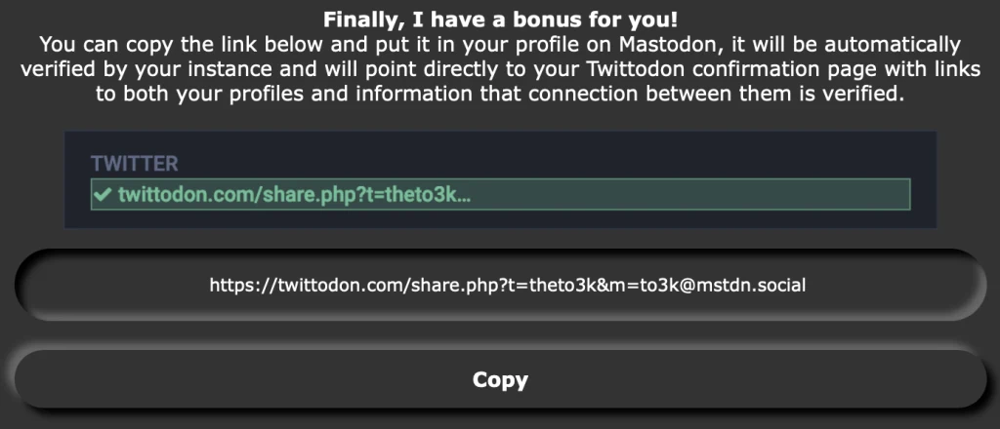

Spis treści:
* TOC
{:toc}

[Twittodon](https://pl.twittodon.com) to moja odpowiedź na masową migrację ludzi z Twittera, przejętego i powoli niszczonego przez Elona Muska, którzy uciekają właśnie na Mastodona. Projekt lekko przekroczył moje oczekiwania, bo nie dość, że jest dość popularny to napisał o nim takie media jak [Forbes.com](https://www.forbes.com/sites/daveywinder/2022/12/15/how-to-get-twitter-verified-on-mastodon-8-elon-musk-tax-not-required/), [Spider's Web](https://spidersweb.pl/2022/12/twittodon-twiter-mastodon-narzedzie.html), czy [iMagazine](https://imagazine.pl/2023/01/13/nadgryzieni-397-nowosci-z-ces-2023-roborock-zapomnial-gdzie-mieszka-i-oreo/).

## Czym jest Twittodon?

Jest to narzędzie do weryfikacji połączenia pomiędzy kontami na Mastodonie i Twitterze. Celem jest stworzenie ogólnodostępnej bazy takich połączeń, żeby umilić ludziom migrację do Fediverse (a konkretnie Mastodona) poprzez ułatwienie im odtworzenia sieci kontaktów z Twittera. Są podobne narzędzia do tego, ale moje odróżnia się tym, że jest bezpieczne, bo nie wymaga podawania poświadczeń do swoich kont aplikacjom trzecim i do tego jest dostępne w modelu open-source.

## Trochę statystyk

Muszę przyznać, że to jak popularne stało się moje narzędzie lekko mnie zaskoczyło. W momencie pisania tego wpisu w bazie Twittodon jest **ponad 1400 zweryfikowanych połączeń**, a średnia dzienna **liczba odwiedzin strony to ok. 30 tysięcy odsłon**. Zdarzają się oczywiście bardziej i mniej aktywne dni, ale **rekord to ponad 84 tysiące odsłon**. Pełne statystyki, o których mowa powyżej, dostępne są do wglądu [pod tym linkiem](https://twittodon.com/stats.php).

## Zalety

- Jest to **w pełni darmowe** narzędzie i mogę z czystym sercem obiecać, że na zawsze takie pozostanie.

- **Charakteryzuje się prostotą działania oraz obsługi**. Proces weryfikacji kont jest uproszczony do minimum, więc w praktyce wystarczy jedynie wskazać dwa swoje konta, pierwsze na Twitterze i drugie na Mastodonie, opublikować na nich posty o określonej treści i rozpocząć proces weryfikacji. Skrypt Twittodon sam odszuka opublikowane posty i przeprowadzi weryfikację.

- Jak już wcześniej wspomniałem, nie jest wymagane udostępniania żadnych poświadczeń do swoich kont, a więc jest to rozwiązanie **nastawione na bezpieczeństwo użytkowników**. Jest wiele rozwiązań pozwalających uzyskać podobne efekty, ale każde z nich wymaga nadania uprawnień do dostępu do swoich kont aplikacjom/osobom trzecim. Z pewnością jest to wygodne, bo wystarczy tylko się zalogować i wyrazić zgodę na dostęp do konta, a wszystko zadzieje się automatycznie. Jednak patrząc na to jako osoby zorientowane w temacie bezpieczeństwa w Internecie na pewno widzicie, że coś tutaj nie gra.

- **Niezależność od API Twittera**. Ten aspekt jest o tyle istotny, że patrząc po tym co się ostatnio dzieje, tj. przykładowo zablokowanie przez Twittera dostępu do API dla większych klientów nieoficjalnych, każda aplikacja oparta na tymże API może już jutro nie działać. Twittodon nie używa API, bo weryfikacja przeprowadzana jest w inny sposób, więc znacznie ciężej będzie o potencjalne odcięcie dostępu. Od powstania Twittodon nie działał jedynie przez kilka godzin, gdy Elon zablokował możliwość publikowania tweetów z linkami do innych portali społecznościowych. Stało się to gdy spałem, ale jak tylko się obudziłem i zorientowałem się co się dzieje to obszedłem ten problem w 30 minut, więc Twittodon relatywnie szybko wrócił do prawidłowego funkcjonowania.

- **Transparentność**, czego potwierdzeniem jest fakt, że jest to projekt open-source, którego pełny kod jest dostępny na [moim GitHub pod tym linkiem](https://github.com/to3k/twittodon).

- **Pełny dostęp do tworzonej bazy dla wszystkich**. Bazę można przeglądać i łatwo przeszukiwać z poziomu strony [Lista zweryfikowanych](https://pl.twittodon.com/verified.php) lub przy pomocy jednego przycisku pobrać ją w postaci pliku .CSV na swój komputer i dalej obrabiać w dowolny sposób.

- Strona Twittodon.com **nie używa ciasteczek**, **nie ma na niej absolutnie żadnych skryptów śledzących**, a także jako autor **nie wyświetlam na niej reklam**, choć miałem już takie propozycje.

- Strona jest **dostępna w dwóch językach** - polskim i angielskim.

- Po pomyślnie zakończonym procesie weryfikacji Twittodon generuje specjalny link do strony z potwierdzeniem weryfikacji, **który po wrzuceniu do swojego profilu zostanie potraktowany przez Mastodon jako zweryfikowany**.



## Jak to wygląda od kuchni?

Kod Twittodon jest zbyt obszerny, aby przejść przez wszystkie jego elementy i omówić je jeden po drugim, dlatego skupię się w tym wpisie jedynie na dwóch najciekawszych aspektach, czyli **jak przebiega weryfikacja konta po stronie Twittera i Mastodona**.

**Zacznijmy od Twittera**. Proces zaczyna się od podania przez użytkownika swojego nicku. Następnie proszony jest o opublikowanie tweeta o następującej treści:

> This is my account on Mastodon - \[LINK DO MASTODONA\] - verified by @twittodon\_com Twittodon.com

Po publikacji tweeta użytkownik naciska przycisk _Zweryfikuj_ i zasadnicza część skryptu rozpoczyna pracę. Zadanie tej części kodu to uzyskać dostęp do Twittera, odczytać ostatnie tweety użytkownika i sprawdzić czy znajduje się wśród nich tweet zawierający treść zdefiniowaną powyżej.

Do uzyskania dostępu do Twittera (czytania zawartości) użyjemy narzędzia [Nitter](https://github.com/zedeus/nitter), które jest front-end'em służącym właśnie do podglądania zawartości Twittera bez wchodzenia na niego. Potraktujcie to jak takie proxy, czy też bramkę pośredniczącą pomiędzy Wami, a Twitterem. Nitter też ma wiele instancji (tak samo jak Mastodon) i można z nich publicznie korzystać. Twittodon dla zachowania redundancji korzysta z kilku instancji ([nitter.net](https://nitter.net), [nitter.it](https://nitter.it) i jeszcze kilku innych). Myślałem też nad postawieniem swojej własnej instancji Nittera, na potrzeby chociażby Twittodonu, ale po akcjach z blokowaniem dostępów do API postanowiłem się na razie wstrzymać i poczekać na rozwój sytuacji, bo używając tylko jednej (swojej) instancji wystarczyłoby zablokować tylko mój klucz API i instancja przestanie działać. Konwertowanie adresów z Twittera na nitterowe jest banalnie proste, bo praktycznie cały adres zostaje taki sam, a zmienia się jedynie _twitter.com_ na np. _nitter.net_. Dla przykładu link do mojego profilu:

> https://twitter.com/theto3k  
> https://nitter.net/theto3k

Przejdźmy do opisania zasady działania skryptu. Będzie wyglądać to tak, że na Nitterze wczytamy profil użytkownika, następnie pobierzemy kod źródłowy strony przy użyciu _cURL_, przeszukamy jego odpowiednią część w poszukiwaniu wyrażenia regularnego (polecam doczytać o [regexp](https://pl.wikipedia.org/wiki/Wyra%C5%BCenie_regularne)) przy użyciu funkcji _preg\_match()_ i jeżeli znajdziemy odpowiednią frazę to zmienimy w bazie rekord, co będzie oznaczało, że dane konto na Twitterze zostało zweryfikowane.

Stwierdziłem, że najwygodniej będzie mi omówić kod poprzez umieszczenie w nim komentarzy. W języku PHP komentarze umieszcza się po _//_ lub jeżeli komentarz musi zawierać się w więcej niż jednej linijce to umieszcza się go pomiędzy _/\*_ i _\*/_.

```php
// Jeżeli przycisk o nazwie "verify_twitter" został naciśnięty to...
if(isset($_POST['verify_twitter']))
{
    // Tworzy link do nittera (w zmiennej $twitter przechowany jest login użytkownika)
    $nitter_link = "https://nitter.net/".$twitter;
    // Inicjalizacja zapytania cURL
    $curl = curl_init($nitter_link);
    // URL do którego ma zostać skierowane zapytanie
    curl_setopt($curl, CURLOPT_URL, $nitter_link);
    // Nakazuje cURL zwrócić wynik zapytania
    curl_setopt($curl, CURLOPT_RETURNTRANSFER, 1);
    // Ustawia to jak skrypt ma się przedstawić (useragent standardowej przeglądarki)
    curl_setopt($curl, CURLOPT_USERAGENT, 'Mozilla/5.0 (Windows NT 10.0; Win64; x64) AppleWebKit/537.36 (KHTML, like Gecko) Chrome/88.0.4324.182 Safari/537.36');
    // Timeout zapytania czyli po jakim czasie bez powodzenia ma odpuścić
    curl_setopt($curl, CURLOPT_TIMEOUT, 30);
    // Nie ustawiamy nagłówka, więc wartość header zero
    curl_setopt($curl, CURLOPT_HEADER, 0);
    // Wykonanie zapytania
    $site_source_code = curl_exec($curl);
    // Pętla for ustawiona na 5 uruchomień
    for($i=1; $i<=5; $i++)
    {
        // Jeżeli nie udało się pobrać kodu źródłowego...
        if($site_source_code == "")
        {
            // ...to wykonuje zapytanie cURL jeszcze raz
            $site_source_code=curl_exec($curl);
        }
        // Jeżeli jednak się udało...
        else 
        {
            // ...to przerywa działanie pętli for
            break;
        }
    }
    // Funkcja szuka tweetów z określonym wyrażeniem regularnym
    preg_match("(<div class=\"tweet-content media-body\" dir=\"auto\">.+?".$mastodon_link.".+?Twittodon.com)is", $site_source_code, $phrase);
    // Jeżeli poszukiwana fraza została znaleziona to...
    if(!empty($phrase[0]))
    {
        // Zapisuje dzisiejszą datę w zmiennej (potrzebne do zapytania MySQL)
        $today = date("Y-m-d");
        // Zapytanie MySQL, które zmodyfikuje odpowiedni rekord w bazie
        // W skrócie zmienia wartość twitter_verified na 1 (zweryfikowany) dla konkretnego konta na Twitterze
        $update = "UPDATE connections SET twitter_verified='1', date='".$today."' WHERE twitter_login='".$twitter."' AND mastodon_login='".$mastodon."'";
        // Wykonuje powyższe zapytanie
        mysqli_query($mysqli, $update);
    }
    // Jeżeli nie udało się znaleźć szukanej frazy...
    else
    {
        // ...to znaczy, że weryfikacja zakończyła się niepowodzeniem
        $twitter_verified_error = true;
    }
}
```

Chciałbym się jeszcze pochylić nad najciekawszym z powyższego kodu, czyli tej linijce, w której użyliśmy funkcji _preg\_match()_. Uproszczona składnia tej funkcji wygląda następująco:

> preg\_match("(\[WYRAŻENIE REGULARNE\])is", \[PRZESZUKIWANY TEKST\], \[WYNIK\]);

W wyrażeniu regularnym użyłem dwa razy pewnej frazy specjalnej _.+?_, która oznacza ciąg dowolnych znaków o dowolnej długości. Dla przykładu napiszmy takie wyrażenie regularne "Ala .+? kota" i wyrażenie to będzie spełnione zarówno dla zdania "Ala ma kota" jak i dla "Ala nie ma psa ale ma kota". To taki ultra przyspieszony kurs regexp 😁 Jednak po raz kolejny polecam poczytać o tym temacie, bo **regexp to naprawdę potężne narzędzie**.

Pora przejrzeć analogiczny kod, ale **służący do weryfikacji konta na Mastodonie**. Zasada działania z grubsza jest ta sama z tym, że użytkownik publikuje na Mastodonie toot o nieco innej treści:

> This is my account on Twitter - \[LINK DO TWITTERA\] - verified by @twittodon@fosstodon.org https://Twittodon.com

Po udanej publikacji i naciśnięciu przycisku _Zweryfikuj_ uruchamia się skrypt do weryfikacji konta na Mastodonie. W tym przypadku jest łatwiej niż z Twitterem, bo zamiast używać czegoś pokroju Nittera, wystarczy wczytać **kanał RSS profilu danego użytkownika**. Tak, każdy profil na Mastodonie ma swój kanał RSS z prosto wylistowanymi tootami! Adres URL do tego feedu można uzyskać poprzez dopisanie _.rss_ na końcu linka do profilu.

```php
// Jeżeli przycisk o nazwie "verify_mastodon" został naciśnięty to...
if(isset($_POST['verify_mastodon']))
{
    // Tworzy link do feedu RSS (w zmiennej $mastodon_link przechowany jest kompletny link do profilu)
    $mastodon_rss = $mastodon_link.".rss";
    // Inicjalizacja zapytania cURL
    $curl = curl_init($mastodon_rss);
    // URL do którego ma zostać skierowane zapytanie
    curl_setopt($curl, CURLOPT_URL, $mastodon_rss);
    // Nakazuje cURL zwrócić wynik zapytania
    curl_setopt($curl, CURLOPT_RETURNTRANSFER, 1);
    // Ustawia to jak skrypt ma się przedstawić (useragent standardowej przeglądarki)
    curl_setopt($curl, CURLOPT_USERAGENT, 'Mozilla/5.0 (Windows NT 10.0; Win64; x64) AppleWebKit/537.36 (KHTML, like Gecko) Chrome/88.0.4324.182 Safari/537.36');
    // Timeout zapytania czyli po jakim czasie bez powodzenia ma odpuścić
    curl_setopt($curl, CURLOPT_TIMEOUT, 30);
    // Nie ustawiamy nagłówka, więc wartość header zero
    curl_setopt($curl, CURLOPT_HEADER, 0);
    // Wykonanie zapytania
    $site_source_code = curl_exec($curl);
    // Pętla for ustawiona na 5 uruchomień
    for($i=1; $i<=5; $i++)
    {
        // Jeżeli nie udało się pobrać kodu źródłowego...
        if($site_source_code == "")
        {
            // ...to wykonuje zapytanie cURL jeszcze raz
            $site_source_code=curl_exec($curl);
        }
        // Jeżeli jednak się udało...
        else 
        {
            // ...to przerywa działanie pętli for
            break;
        }
    }
    // Funkcja szuka tootów z określonym wyrażeniem regularnym
    preg_match("(<description>.+?twitter.com\/".$twitter.".+?Twittodon.com)is", $site_source_code, $phrase);
    // Jeżeli poszukiwana fraza została znaleziona to...
    if(!empty($phrase[0]))
    {
        // Zapisuje dzisiejszą datę w zmiennej (potrzebne do zapytania MySQL)
        $today = date("Y-m-d");
        // Zapytanie MySQL, które zmodyfikuje odpowiedni rekord w bazie
        // W skrócie zmienia wartość mastodon_verified na 1 (zweryfikowany) dla konkretnego konta na Mastodonie
        $update = "UPDATE connections SET mastodon_verified='1', date='".$today."' WHERE twitter_login='".$twitter."' AND mastodon_login='".$mastodon."'";
        // Wykonuje powyższe zapytanie
        mysqli_query($mysqli, $update) or die('ERROR TD03');
    }
    // Jeżeli nie udało się znaleźć szukanej frazy...
    else
    {
        // ...to znaczy, że weryfikacja zakończyła się niepowodzeniem
        $mastodon_verified_error = true;
    }
}
```
