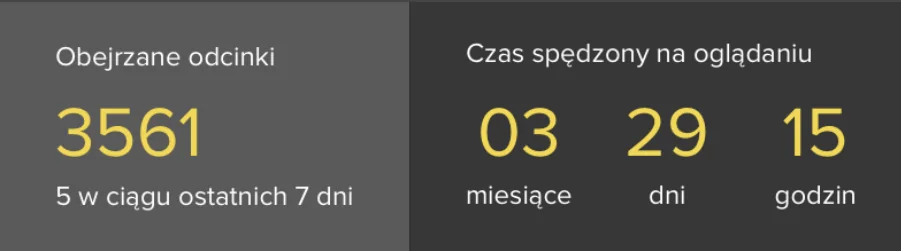
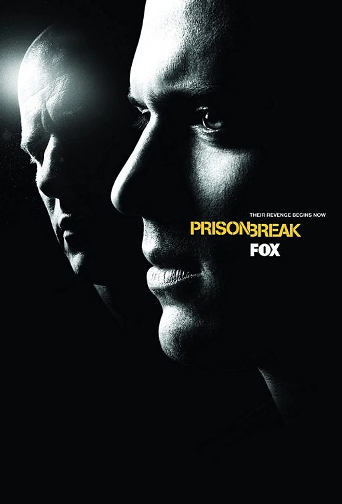
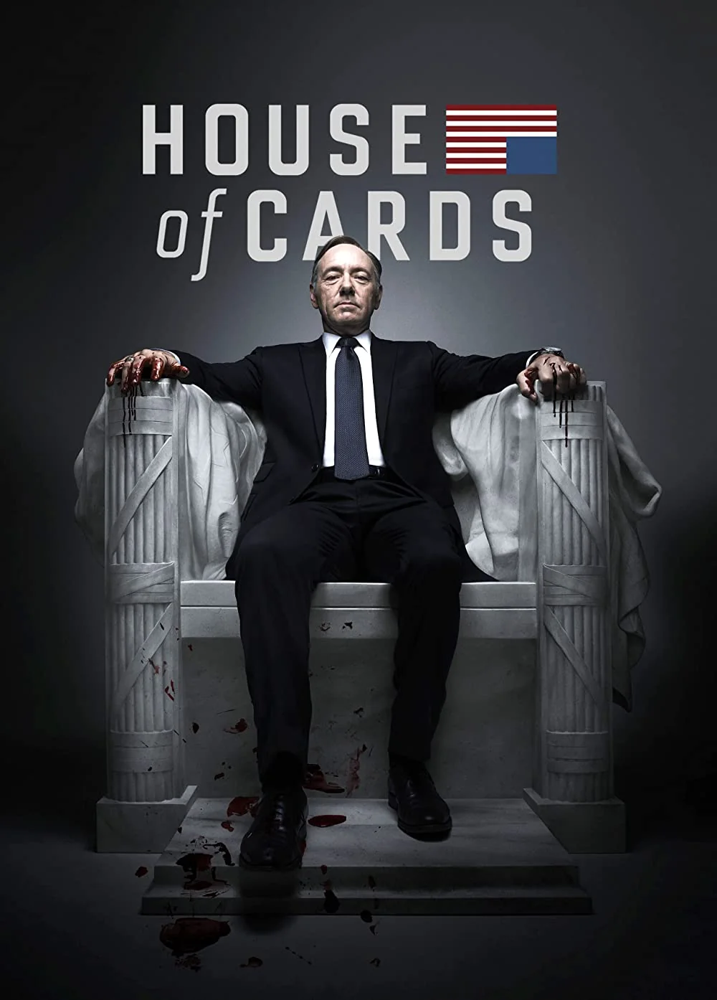
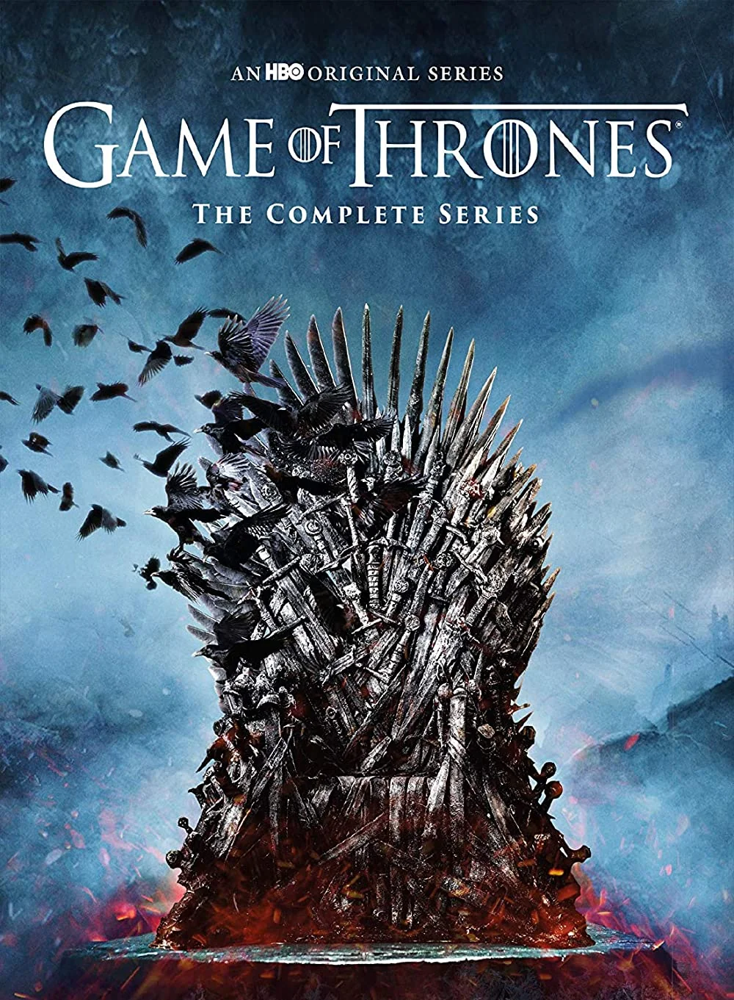
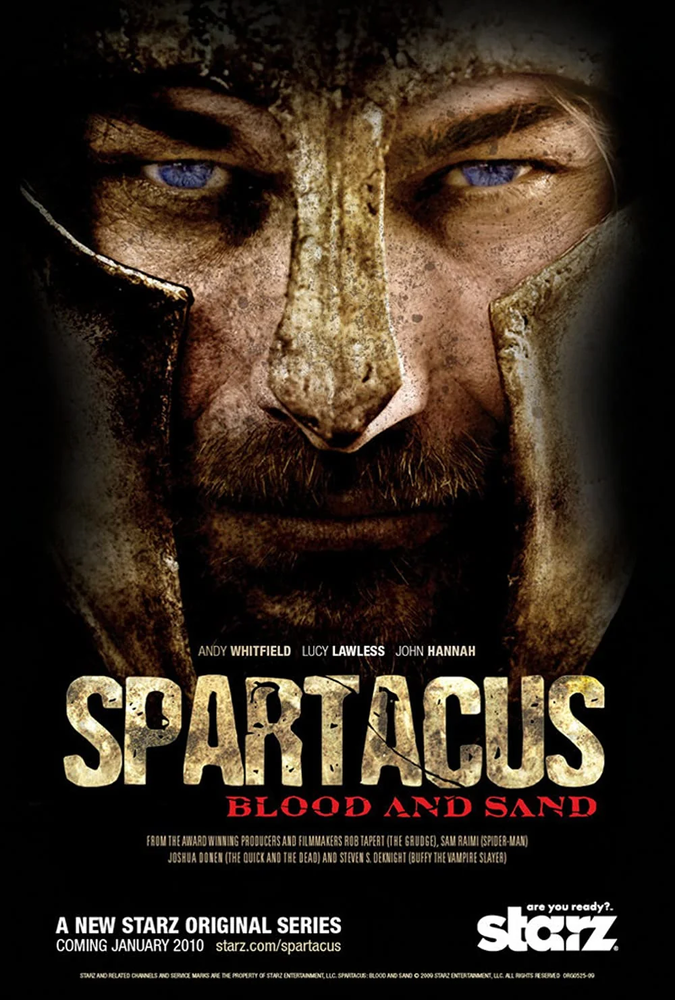
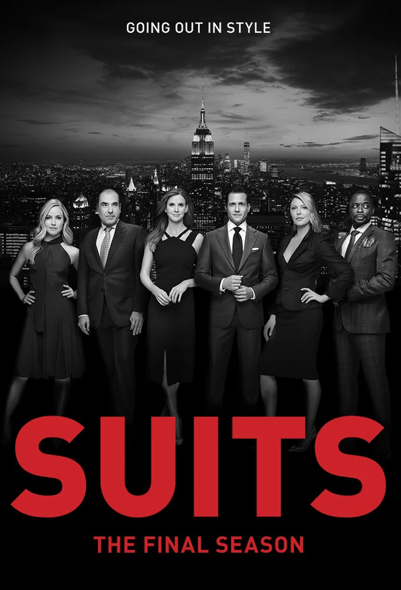

Spis treści:
* TOC
{:toc}

Jako, że jest to blog bardzo personalny to postanowiłem, że nie może się obejść bez kącika serialowego. Muszę się przyznać, że jestem ogromnym fanem seriali. Jest to jedna z moich form spędzania wolnego czasu, którą uskuteczniam mniej więcej od czasów gimnazjalnych (pozdrawiam wszystkich, którzy jeszcze wiedzą co to jest 😁), czyli ładnych **15-16 lat**! Wyobrażacie sobie ile odcinków przeróżnych seriali obejrzałem w tym czasie? Ja nie byłem sobie w stanie tego wyobrazić, aż do momentu zajrzenia w statystyki aplikacji [TV Time](https://www.tvtime.com/), której używam do organizacji co już obejrzałem, a czego jeszcze nie. To jakie wartości tam zobaczyłem mnie lekko przeraziły, a chciałbym zaznaczyć, że nie używam tej aplikacji od samego początku mojej przygody z serialami, więc możliwe, że nie ma tam podsumowanych wszystkich pozycji, które obejrzałem.

Tak, to co widzicie powyżej to zrzut ekranu moich statystyk z aplikacji TV Time. **3561 obejrzanych odcinków** i prawie **4 miesiące spędzone na oglądaniu**... Czy według mnie zmarnowałem ten czas? Nigdy w życiu! To był dobrze spędzony czas 😉 No dobrze, ale w takim razie co oglądałem przez te 15 lat? Właśnie o tym będzie ta seria, której rozpoczęciem jest właśnie ten wpis. Dzisiaj podchodzę do tematu nostalgicznie. Przytoczę raczej stare i już zakończone seriale. Ale za to takie, które znaczą dla mnie coś więcej i to nie pod kątem tego, że są jakimiś arcydziełami. W dzisiejszym wpisie przedstawię ich pięć, ale w przyszłych odsłonach tej serii wpisów postaram się ograniczać do trzech pozycji, żeby nie tworzyć nadmiernie długich tekstów.

## Prison Break

Pomijając wszystkie Klany, Złotopolskich i inne M jak Miłość, to właśnie _Prison Break_ (lub jak ktoś woli _Skazany na śmierć_) był moim pierwszym serialem zagranicznym, od którego zaczęła się moja przygoda. Tak mi się przynajmniej wydaje. Premiera tego serialu była w 2005 roku, ale wtedy czasy były takie, że seriale najpierw zdobywały popularność w USA, następnie miały globalną premierę i w tym momencie były dwie opcje: spiracić z eMule/Kazaa i czekać na amatorskie spolszczenie (napisy) lub poczekać dłużej aż będzie wyemitowane w polskiej telewizji z nijakim i nudnym jak flaki z olejem lektorem. Reasumując, chciałem przez to powiedzieć, że nawet jeżeli na Filmweb jest podawana data premiery jako 2005 to nie oznacza, że w tym roku dałem radę obejrzeć ten serial i nawet jeżeli obejrzałem go w 2006 czy 2007 to i tak było to uznawane za nowość w Polsce. Pamiętam też, że seriale tak naprawdę umożliwiły mi wykładniczy wzrost umiejętności porozumiewania się językiem angielskim. Żadne lekcje i mądre podręczniki nie nauczą Cię angielskiego tak jak konieczność oglądania serialu bez polskich napisów, a tym bardziej bez lektora. Zauważyliście, że od rozpoczęcia tematu _Prison Break_ nie napisałem ani słowa o czym jest ten serial? To właśnie oznacza, że jest on dla mnie czymś więcej. Poza tym nie wydaje mi się, aby znalazła się osoba, która by go nie znała lub chociażby po samym tytule nie była w stanie się domyślić 😁 Jednak z kronikarskiego obowiązku w skrócie napiszę, że serial jest o gościu, który mając plan i wytatuowaną na ciele mapę więzienia daje się celowo w nim zamknąć, aby uwolnić z niego swojego brata. Co ciekawe w 2017 roku serial doczekał się jedno sezonowego sequela.

## House of Cards

Kevin Spacey grał główną rolę zarówno w tym serialu jak i w aferze (może powinienem użyć liczby mnogiej?), która pogrzebała całkowicie jego zakończenie. Wszystko rozchodzi się o liczne oskarżenia Spacey’a o molestowanie (pomijam już czy słuszne czy też nie), przez które został wykluczony z zagrania w ostatnim sezonie. Pomijając to wszystko, HoC to opowieść o bezwzględnej drodze po władzę, podczas której główny bohater nie zatrzyma się przed niczym. Historia naprawdę mocno trzyma w napięciu. Ale dla mnie to serial, który grubą kreską oddziela moje pirackie serialowe życie od okresu trwającego do dziś, czyli w pełni legalnego korzystania z treści VOD. To właśnie dla HoC zakupiłem swoją pierwszą subskrypcję. House of Cards to chyba pierwszy serial produkcji Netflix i mam wrażenie, że mniej więcej od czasu jego premiery Netflix zyskał globalną popularność, stając się tym samym hegemonem rynku VOD. Trzeba przyznać, że jego obecność w znacznym stopniu zmieniła świat seriali i to o dziwo w Polsce, bo dostaliśmy łatwy dostęp do treści zza oceanu.

## Game of Thrones

To już klasyka, bo o ile wielu czuje mocny niedosyt czy wręcz niesmak po zakończeniu tego serialu, tak nie można odmówić, że przez cały czas, gdy był on „emitowany” znajdował się na ustach dosłownie każdego. Ostatnio nawet ponownie wrócił za sprawa prequelu House of the Dragon. Jeżeli dobrze pamiętam, nowe odcinki GoT były emitowane zawsze w poniedziałki. To był okres moich studiów, więc odwalałem poranne laboratoria i zasiadałem do pozyskanego niekoniecznie legalnym sposobem odcinka, idealny początek tygodnia. Co ciekawe był to jeden z przypadków, w których pirat ma niestety lepiej, mówię to teraz kiedy oglądam tylko legalnie, bo wtedy byłem zachwycony. Cały myk polegał na tym, że emisja w USA odbywała się rano w poniedziałek naszego czasu, a oficjalna premiera w Polsce była ustawiona dopiero na poniedziałkowy wieczór. W tym czasie wprawny pirat mógł spokojnie pobrać odcinek i to w nie byle jakiej jakości. Polskie napisy były przeważnie gotowe niemalże natychmiast. W ten sposób dało się nielegalnie obejrzeć dany odcinek conajmniej kilka godzin wcześniej… Słabo, ale takie niestety były realia. BA któryś sezon Gry o Tron w ogóle wyciekł w dniu premiery bodaj pierwszego odcinka! To dopiero generowało spoilery, na które trzeba było piekielnie uważać. A Game of Thrones to serial bardzo spoilerogenny! Ileż tam było zwrotów akcji i kontrowersji. Odcinki wychodziły co tydzień, a pomiędzy nimi hype przeważnie trwał nieprzerwanie.

## Spartacus

_Spartakus Krew i Piach_, a raczej według mnie Krew i Cycki 😂 Bardzo brutalny i jednocześnie wulgarny pod względem seksualnym serial, ale opowiadający dość wzruszającą i dobrze wszystkim znaną historię bliźniaczą do tej z filmu _Gladiator_ z _Russellem Crowe_. Stosunkowo prosta sceneria, obsada bez większych sław, a jednak według mnie ten serial to było bardzo dobre widowisko. Chyba działają na mnie takie opowieści o braterstwie. Co ciekawe po pierwszym sezonie konieczna była zmiana aktora odgrywającego rolę głównego bohatera ([_Andrew Whitfield_](https://pl.wikipedia.org/wiki/Andy_Whitfield)), gdyż tenże zmarł po walce z rakiem (o ile dobrze pamiętam). Obawiałem się tego jak na serial wpłynie zmiana najważniejszego aktora, ale finalnie okazało się, że tylko początkowe przestawienie się jest trudne, a później już człowiek się przyzwyczaja. To chyba pierwszy tego typu zabieg z jakim miałem do czynienia. Na szczęście udało się dokończyć serial w 3 sezonach, a później doczekał się on również prequelu o nazwie _Spartacus Gods of the Arena_ (_Bogowie Areny_).

## Suits

Angielski tytuł tego serialu jest dość trudny dla Polaka, natomiast polski jest po prostu jakiś taki niepasujący - _W garniturach_. Nie jest to niedopasowanie pokroju _Die Hard_ i _Szklana Pułapka_, ale i tak coś mi w nim nie gra. Tak czy siak jest to serial pokroju tych, które zacząłem oglądać przez przypadek i tak się wciągnąłem w losy jego bohaterów, że nie sposób było przestać go oglądać. Tematycznie to z pozoru kompletnie nie moje klimaty, za to raczej powinny pasować mojej żonie, która jest adwokatem. Jednak stało się całkowicie odwrotnie - ja stałem się fanem Suits, a moja żona nigdy nawet nie zmusiła się do obejrzenia jednego odcinka, pomimo moich licznych prób namówienia jej na to. Suits to serial, dla którego bardzo ciężko mi określić co tak naprawdę mnie w nim urzekło. Jednak zawsze chętnie do niego wracałem, a moment jego zakończenia był dla mnie trudny, bo czułem się tak, jakby bezpowrotnie zakończyła się pewna epoka w moim życiu.

Na koniec refleksyjne pytanie - czy też mieliście kiedyś tak, że oglądanie finału serialu, który oglądaliście od bardzo długiego czasu, było dla Was bardzo silnym emocjonalnie przeżyciem?
