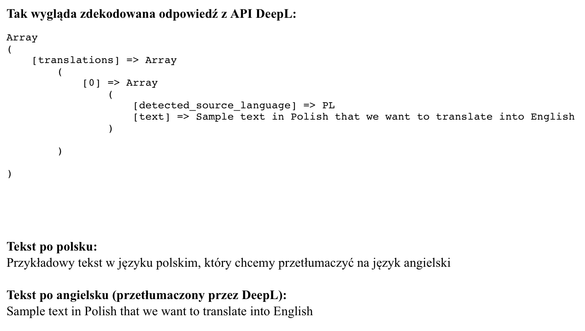

Spis treści:
* TOC
{:toc}

_DeepL_ to usługa przekładu maszynowego, co w normalnych słowach można określić po prostu jako **tłumacz**, działająca w oparciu o sieci neuronowe. Co ciekawe dyrektorem zarządzającym spółki stojącej za tym tłumaczem jest **Polak** - Jarosław Kutyłowski. Wydaje mi się, że już od blisko 5 lat używam _DeepL_, a nie powszechnie znanego _Google Translate_, bo po prostu daje mi lepsze wyniki, a i przy okazji trzymam swoje dane nieco dalej od _Google_. Do normalnego użytku _DeepL_ jest **darmowy** i dostępny z poziomu strony internetowej. Można także założyć konto i uzyskać dostęp do dwóch planów dostępowych poprzez _API_ - _Free_ i _Pro_. Nas oczywiście interesuje ten **darmowy, który obarczony jest ograniczeniem 500 000 znaków na miesiąc**. Do podstawowych zastosowań jednego użytkownika taki limit powinien być wystarczający.

## Jak pozyskać swój klucz API

Skrócę to do niezbędnego minimum, żeby zbytnio nie rozwodzić się nad tak prostym procesem. Rozpoczynamy oczywiście od **założenia konta** - [bezpośredni link do rejestracji](https://www.deepl.com/pl/pro-checkout/account?productId=1200&yearly=false&trial=false). W panelu swojego konta przechodzimy do zakładki _Konto_, na samym dole w sekcji _Klucz identyfikacyjny dla API DeepL_ jest podany _token API_, który będzie nam potrzebny w dalszej części tego wpisu. Jak już jesteśmy w tym miejscu to dla bardziej dociekliwych polecam także zapoznać się z [dokumentacją dotyczącą _API_](https://www.deepl.com/docs-api).

## Komunikacja z API DeepL

Cała komunikacja z _API DeepL_ wygląda bardzo podobnie do tej opisanej przeze mnie we wpisie _[MEWS Bot = Mastodon nEWS](https://blog.tomaszdunia.pl/mews/)_, w którym przy użyciu _cURL_ komunikowaliśmy się z _API_ _Mastodona_. Różnica w tym przypadku będzie taka, że do _Mastodona_ jedynie wysyłaliśmy dane, natomiast **do _DeepL_ dane wyślemy (będzie to tekst do przetłumaczenia), ale będziemy także oczekiwali odpowiedzi (tekstu przetłumaczonego)**. Cały kod standardowo opisałem krok po kroku poprzez umieszczenie w nim komentarzy. Treść skryptu jest dostępna pod koniec wpisu.

Zanim przejdziemy do skryptu chciałbym jednak omówić szerzej pewne jego fragmenty, aby nakreślić perspektywę. Jedną z najbardziej kluczowych rzeczy w komunikacji z _API_ poprzez _cURL_ są odpowiednio skonstruowane _**nagłówki**_ (_headers_), które **są swego rodzaju zapowiedzią żądania**, które wyślemy do serwera. W przypadku _API_ _DeepL_ jedyna informacja, która musi być zawarta w nagłówku to prawidłowe dane do autoryzacji, tj. przedstawienie swojego klucza do _API_, na podstawie którego uzyskujemy prawo do komunikacji. Nagłówek ten powinien mieć następującą formę:

> Authorization: DeepL-Auth-Key \[TOKEN/KLUCZ API\]

Drugim istotnym elementem zapytania _cURL_ jest **_adres URL_**, do którego należy kierować zapytania. W przypadku _DeepL_ jest to:

> https://api-free.deepl.com/v2/translate

Trzeci element, bez którego zapytanie nie miałoby sensu, to **dane właściwe**, a więc samo żądanie. Dane te najlepiej wysłać w postaci _tablicy_ (_array_). Będziemy wysyłać w niej trzy rzeczy:

- ciąg (tekst) do przetłumaczenia,

- deklarację na jaki język życzymy sobie go przetłumaczyć,

- deklarację w jakim języku napisany jest ów tekst, który podaliśmy w punkcie pierwszym.

Ten ostatni punkt nie jest konieczny, gdyż _DeepL_ sam jest w stanie rozpoznać w jakim języku zaserwowaliśmy mu tekst do przetłumaczenia. Niemniej jednak z doświadczeń z używania wersji webowej _DeepL_ wiem, że algorytm rozpoznawania języka nie jest nieomylny, a więc zdecydowanie rekomenduję dla pewności jasno określić ten parametr.

OK, wysyłamy odpowiednio skonstruowane zapytanie _cURL_ do _API_ _DeepL_ i co dalej? Otrzymujemy **informacje zwrotne** w postaci ciągu w formacie [_JSON_](https://pl.wikipedia.org/wiki/JSON) (_JavaScript Object Notation_). Dekodujemy go przy użyciu funkcji _json\_decode()_. Na marginesie, jako drugi argument przy wywołaniu tej funkcji podajemy wartość _true_, co informuje funkcję, aby nie tylko przekonwertować nam ciąg _JSON_ na obiekt _PHP_, ale też aby ten obiekt przekonwertować na tablicę. W ten oto sposób otrzymujemy następujący wynik:

```php
Array
(
    [translations] => Array
        (
            [0] => Array
                (
                    [detected_source_language] => PL
                    [text] => Sample text in Polish that we want to translate into English
                )
        )
)
```

Jak widać otrzymaliśmy zagnieżdżoną tablicę, a wynik, którego oczekujemy jest zapisany pod indeksem _\[translations\]\[0\]\[text\]_. I tym oto sposobem uzyskaliśmy dostęp do przetłumaczonego tekstu, którego oczekiwaliśmy.

## Kod skryptu PHP

Tak jak pisałem wcześniej, poniżej znajduje się **cały kod skryptu**, o którym mowa w niniejszym wpisie. Jest on standardowo omówiony poprzez **komentarze w treści**.

```php
<?php
// Klucz skopiowany z profilu DeepL
$token = "[Tu wpisz swój klucz API DeepL]";
// Przykładowy tekst, który będziemy tłumaczyć
$tekstPL = "Przykładowy tekst w języku polskim, który chcemy przetłumaczyć na język angielski";

//Nagłówki
$headers = [
    "Authorization: DeepL-Auth-Key ".$token
];
//Dane właściwe
$data = array(
    "text" => $tekstPL, // Tekst do tłumaczenia
    "target_lang" => "EN", // Język docelowy
    "source_lang" => "PL" // Język źródłowy
);

// Inicjalizuje zapytanie cURL
$translate = curl_init();
// Określa URL do którego ma zostać skierowane zapytanie
curl_setopt($translate, CURLOPT_URL, "https://api-free.deepl.com/v2/translate");
// Deklaruje, że ma to być zapytanie typu POST
curl_setopt($translate, CURLOPT_POST, 1);
// Nakazuje cURL zwrócić wynik zapytania
curl_setopt($translate, CURLOPT_RETURNTRANSFER, true);
// Ustawia nagłówki
curl_setopt($translate, CURLOPT_HTTPHEADER, $headers);
// Definiuje dane do przekazania
curl_setopt($translate, CURLOPT_POSTFIELDS, $data);
// Wysyła zapytanie i zapisuje zdekodowany wynik do zmiennej
$return = json_decode(curl_exec($translate), true);
// Zamyka połączenie
curl_close ($translate);

//Wyciąga przetłumaczony tekst z odpowiedzi API
$tekstENG = $return['translations'][0]['text'];

// Wyświetlenie wyników
echo "<b>Tak wygląda zdekodowana odpowiedź z API DeepL:</b><br>";
echo "<pre>";
print_r($return);
echo "</pre>";
echo "<br><br><br>";

echo "<b>Tekst po polsku:</b><br>";
echo $tekstPL;
echo "<br><br>";
echo "<b>Tekst po angielsku (przetłumaczony przez DeepL):</b><br>";
echo $tekstENG;
?>
```

Wynik powyższego skryptu jest następujący:



## BiLangPost

Ten wpis został napisany przy okazji wypuszczenia przeze mnie mojego kolejnego, małego projekciku jakim jest [_BiLangPost_](https://bilangpost.tomaszdunia.pl). Jest to **narzędzie, które ułatwia pisanie dwujęzycznych postów** w mediach społecznościowych, a zostało napisane z myślą konkretnie o _Mastodonie_. Kolejny projekt narzędzia, które pierwotnie robiłem dla siebie, ale w pewnym momencie doszedłem do wniosku, że wystarczy zmienić/dodać jedynie kilka linijek i można udostępnić go szerszemu gronu. Przy okazji tego wpisu nie będę się więcej rozpisywał, bo pewnie zrobię całkowicie oddzielny wpis jedynie na temat _BiLangPost_.
