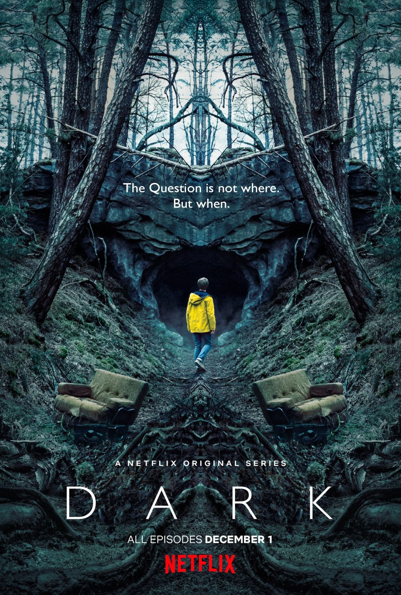
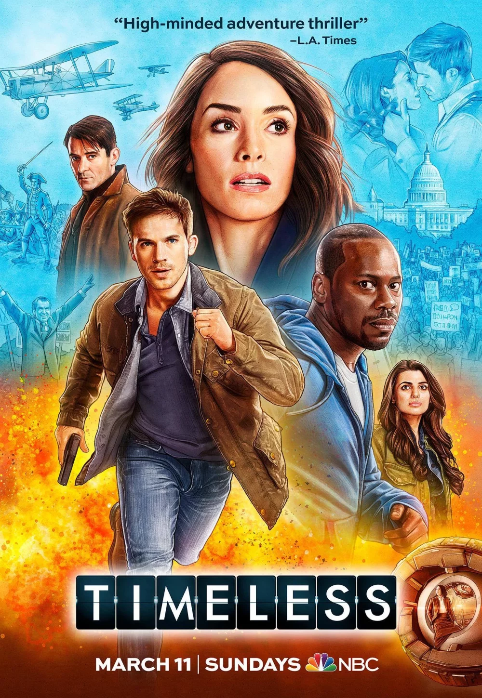
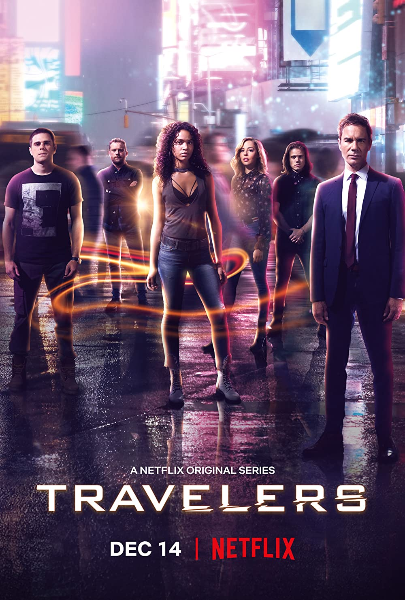
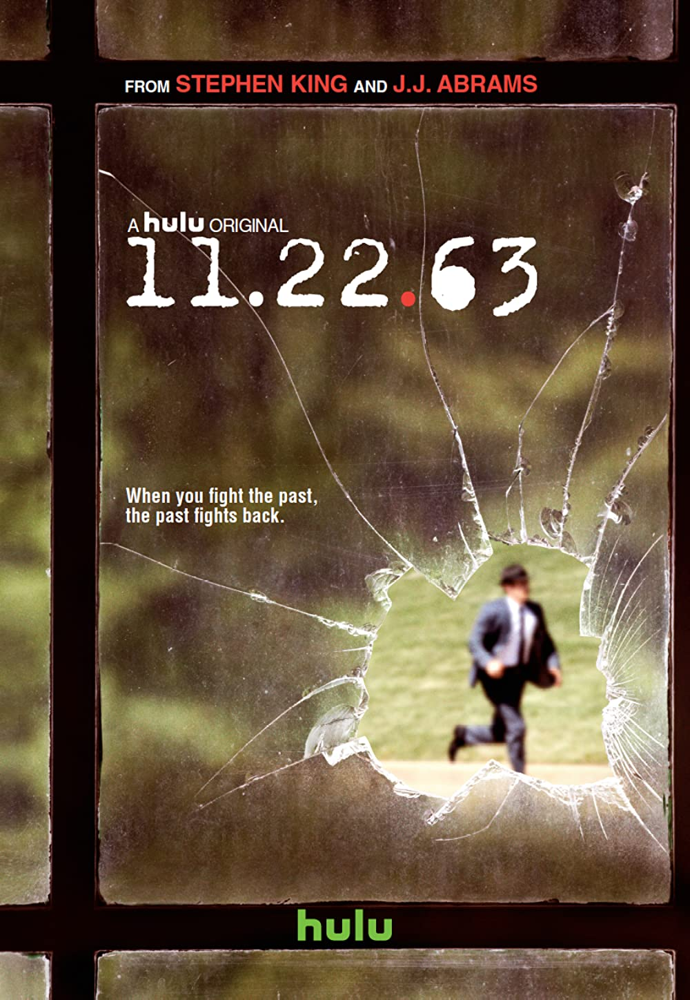

Spis treści:
* TOC
{:toc}

Co łączy seriale wypisane w tytule? Ich główna tematyka to podróże w czasie, czyli jeden z gatunków seriali i filmów, które oglądam z wyjątkową przyjemnością. Podróże w czasie to dość chodliwy temat w kinematografii, więc nie brakuje produkcji skupiającej się na tym motywie przewodnim. Sposród tego wszystkie wybrałem kilka pozycji, które w mojej ocenie są warte uwagi.

## Dark

Nie przepadam za niemieckimi produkcjami. Nie mam nic do Niemców, bywam w Niemczech dość często, ale jakoś przy produkcjach filmowych nie jestem kompletnie w stanie się skupić kiedy w tle słyszę język inny niż angielski, a w szczególności niemiecki przeszkadza mi najbardziej. Jednak _Dark_ to tak genialny serial, że nic nie było mi w stanie przeszkodzić w jego oglądaniu. Trzy sezony historii, która bierze mózg, mieli go w maszynce, potem odwraca ten proces i mieli jeszcze raz. To wszystko do tego stopnia, że potrzebna jest [strona z diagramem](https://dark.netflix.io/) pokazującym kto, z kim, co i kiedy. W dodatku konieczne jest podanie dokładnego sezonu i odcinka, który się aktualnie ogląda, aby uniknąć spoilerów. Historia jest tak skomplikowana, że aby wyłapać wszystkie smaczki konieczne jest wielokrotne oglądanie poszczególnych odcinków, a czasem nawet wracanie do poprzednich. Jakbym miał wskazać jak powinny wyglądać seriale o tematyce podróży w czasie to wskazałbym jako przykład właśnie _Dark_. Nie będę nawet próbował pisać o czym jest ten serial, bo to po prostu trzeba zobaczyć, żeby zrozumieć.

## Timeless

_Timeless_ to serial, w którym można doszukać się waloru edukacyjnego, gdyż odwołuje się do wydarzeń historycznych, które faktycznie miały miejsce. Niestety są to wydarzenia związane z historią USA, więc dla kogoś kto nie jest obywatelem Stanów lub nie interesuje się ich historią może to nie być zbyt wielka zaleta. Jakbym w skrócie miał scharakteryzować _Timeless_ to powiedziałbym, że posiada niewielką, ale dobrze dobraną obsadę bohaterów, którzy w każdym odcinku cofają się do jakiegoś okresu w historii, aby pod wodzą _Lucy_ - profesor historii, zapobiec próbie sprawienia, aby jej bieg potoczył się zupełnie inaczej za sprawą grupy osób, które za wszelką cenę chcą zmienić to jak aktualnie wygląda USA poprzez zmiany w przeszłości. Poza zmianą wątku co odcinek mamy też główny plot historii, który nadaje serialowi dodatkowego sensu w szerszej perspektywie.

## Travelers

Przepis na dobrą historię o podróżach w czasie to wymyślenie odpowiedniej koncepcji, która będzie miała sens, i utrzymanie jej w spójnej całości. W _Travelers_ tą koncepcją jest wysyłanie świadomości osób z przyszłości wyniszczonej przez wojny do ciał w XXI wieku (załóżmy, że możemy używać sformułowania teraźniejszość). Ale jak to? Poprzez nadpisywanie ludzi żyjących w teraźniejszości? Otóż zamysł jest taki, że faktycznie nadpisywane są świadomości osób, ale specjalnie wyselekcjonowanych, takich które w najbliższych sekundach w jakiś sposób stracą życie, np. w wypadku, którego da się uniknąć. Z przyszłości jest dość łatwo ustalić datę śmierci konkretnej osoby, a także to w jaki sposób do niej doszło i jak temu zapobiec. W ten sposób wysyłane są grupy _bojowników_, które składają się z pięciu osób, o określonych umiejętnościach i pełniących konkretne funkcje w zespole - _lider_, _lekarz_, _taktyk_, _inżynier_ i _historyk_. Najciekawszą profesją w kontekście serialu są _historycy_, którzy od najmłodszych lat szkoleni są tak, aby pamiętać daty i wszystkie związane z nimi wydarzenia, które mogą zostać użyte po cofnięciu się do XXI wieku. Dodatkowo ich wiedza z przyszłości dezaktualizuje się w momencie, gdy jakaś znacząca zmiana w teraźniejszości wpłynie na przyszłość, dlatego wymieniają się oni swoją wiedzą przez pewien zaawansowany sposób komunikacji. Nie mogę zbyt wiele więcej napisać, aby nie spoilerować historii. Ogólnym planem jest tak wpłynąć na przeszłość, aby przyszłość nie wyglądała tak tragicznie jak ma to miejsce w czasie, z którego pochodzą _Podróżnicy_.

## Seven Days

Kolejna pozycja z tych nostalgicznych. _Misja w czasie_, bo pod takim polskim tytułem emitowany był w polskiej telewizji serial _Seven Days_, to zdaje się serial, który zapoczątkował moje zamiłowanie do tematyki podróży w czasie w kinematografii. Był puszczany na _Polsacie_ na przełomie tego i poprzedniego tysiąclecia, czyli w okresie, który zaliczam do mojego dzieciństwa. Fabuła skupia się na byłym członku sił specjalnych, który dzięki specjalnej kapsule jest w stanie cofnąć się maksymalnie 7 dni w przeszłość, aby zapobiec katastrofie, która miała miejsce. Nie brzmi to zbyt ambitnie jak na serial o podróżach w czasie, a i nie występują w tym serialu raczej głębsze rozważania, niemniej jednak z samej nostalgii nie mogę powiedzieć złego słowa na jego temat. Przyznam, że oglądałem go tak dawno, że niewiele pamiętam, więc może warto odświeżyć sobie tę pozycję, bo jednak jest to fajna produkcja, szczególnie patrząc w kontekście czasów, w których powstała.

## 11.22.63

Na koniec moje najświeższe odkrycie, czyli serial _11.22.63_, który właśnie skończyłem oglądać. Skąd taka dziwna nazwa? Jest to data w notacji amerykańskiej 🙄, która oznacza 22 listopada 1963 roku, czyli datę udanego zamachu na prezydenta USA _Johna F. Kennedy_. Zatem jak można się domyślić cała historia polega na tym, że główny bohater cofa się z lat współczesnych do lat 60-tych, aby zapobiec zabójstwu prezydenta. Na pierwszy rzut oka brzmi niespektakularnie i sztampowo, prawda? Dla mnie też i do tego jeszcze mocno amerykańsko. Jednak ten, składający się z jednego sezonu, serial prowadzony jest w taki sposób, że wcale nie _JFK_ jest najważniejszy. Super pokazano realia tamtych czasów, kostiumy i przede wszystkim scenerię. Największe wrażenie zrobiły na mnie samochody. Ciekawe czy większość z nich to były jedynie makiety czy też użyto realnych odrestaurowanych pojazdów. Jeżeli tak było to ogromny szacun! Do tego wszystkiego mamy całkiem przyjemne i nie tak banalne love story.

## Znowu w życiu mi nie wyszło...

Przed rozpoczęciem tej serii wpisów założyłem sobie, że będę się starał ograniczyć do jedynie trzech pozycji na wpis, ale po raz kolejny okazało się, że jest to dla mnie niewykonalne. Po krótkiej refleksji chyba zmienię zdanie i nie będę się ograniczał do trzech, ALE już do pięciu się postaram 😁

Na koniec chciałbym zachęcić do polecenia mi jakiejś pozycji w tej tematyce. Na pewno nie widziałem wszystkich produkcji, a na pewno zawsze z chęcią siądę do kolejnego filmu lub serialu o podróżach w czasie.
