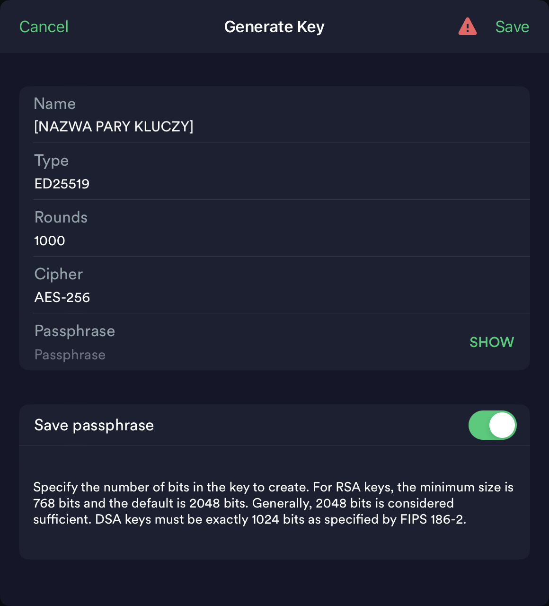

Spis treści:
* TOC
{:toc}

Kontynuujemy temat z [poprzedniego wpisu](https://blog.tomaszdunia.pl/serwer-domowy/), w którym opisałem co jest potrzebne do stworzenia swojego domowego serwera za rozsądne pieniądze, jak zainstalować na nim system oraz jak się z nim połączyć przez SSH. W tym wpisie przejdę przez **wszystkie fundamentalne działania jakie należy wykonać na świeżo uruchomionym serwerze**. Dla ludzi znających temat zapewne będą to oczywiste oczywistości, ale jeżeli czytasz ten wpis to na 99% nie jesteś taką osobą, więc łap za _iPada_ (lub dowolne urządzenie jakim dysponujesz) i konfigurujemy razem 😉

## Zmiana hasła domyślnego

W pierwszej kolejności pozbywamy się (zmieniamy) domyślnego hasła do użytkownika zarządzającego naszym serwerem. Realizuje się to poleceniem:

```bash
passwd
```

Zostaniemy poproszeni o podanie aktualnego hasła, a następnie o dwukrotne wprowadzenie nowego. To nie musi być nic wykwintnego, bo za chwilę to hasło nie będzie nam potrzebne do dostępu do serwera (spoiler - skonfigurujemy dostęp na podstawie kluczy SSH), a będziemy je jedynie wykorzystywać do uwierzytelnienia przy wykonywaniu działań wymagających uprawień administratora (jak np. aktualizacje). Hasło zmieniamy tylko po to, żeby do momentu zakończenia konfiguracji zabezpieczyć serwer chociaż w najmniejszym stopniu, co w zupełności wystarczy, bo nie potrwa to długo.

Ważne, aby zmienić hasła dla **wszystkich użytkowników**. Mówię o tym dlatego, że o ile niektóre dystrybucje zaraz po instalacji mają tylko użytkownika _root_, tak np. system Ubuntu Mate dedykowany do płytek _ODROID_, tworzy nam od razu dwóch użytkowników - _root_ i _odroid_. Pomiędzy użytkownikami skacze się przy pomocy polecenia:

```bash
su [nazwa_użytkownika]
```

A na konto root ze zwykłego użytkownika przeskakuje się poprzez polecenie:

```bash
sudo su
```

## Aktualizacja to podstawa!

**Świeżo zainstalowany system zawsze należy zaktualizować**. Po pierwsze dlatego, że może wystąpić konieczność "dociągnięcia" z internetu dodatkowych składników, które nie były zawarte w bazowej części systemu (instalatorze), a są niezbędne do późniejszej eksploatacji. Po drugie dlatego, że niektóre składniki mogły zostać zaktualizowane w czasie pomiędzy kompilacją (utworzeniem) pobranego przez nas obrazu systemu, a jego instalacją na naszym serwerze.

Dwa podstawowe polecenia do aktualizacji to:

```bash
sudo apt update
sudo apt upgrade -y
```

Wpisywanie tego ręcznie może być przyjemne za pierwszym razem, ale uwierzcie, że na dłuższą metę takie nie będzie, więc jak każdy leniwy ogarnięty administrator napiszemy sobie do tego skrypt! Tworzymy plik _aktualizacja.sh_ i otwieramy go w edytorze tekstowym _nano_ (lub innym w zależności od tego co preferujecie).

```bash
sudo nano /usr/local/sbin/aktualizacja.sh
```

Do środka kopiujemy treść skryptu:

```bash
#!/bin/bash
#Skrypt do aktualizacji systemu i pakietow z blog.tomaszdunia.pl
echo 'Krok 1 - update'
sudo apt update
echo 'Krok 2 - upgrade'
sudo apt upgrade -y
echo 'Krok 3 - autoremove'
sudo apt autoremove -y
echo 'Krok 4 - clean'
sudo apt clean
```

Z edytora _nano_ wychodzi się kombinacją klawiszy _control + x_, następnie potwierdzamy chęć zapisu klawiszami _y_ lub _t_ i na koniec potwierdzamy _ENTERem_ nazwę pod jaką ma zostać zapisany plik. Stworzony skrypt musimy jeszcze uczynić _wykonywalnym_ (nadać uprawnienia do uruchamiania się).

```bash
sudo chmod +x /usr/local/sbin/aktualizacja.sh
```

Taki skrypt można uruchomić poprzez wpisanie w terminal _/usr/local/sbin/aktualizacja.sh_. Można sobie tą ścieżkę podpiąć jako [alias](https://pl.wikipedia.org/wiki/Alias_\(Unix\)) lub wrzucić jako zadanie crona, które będzie się wykonywało co określony czas (np. codziennie o 3 w nocy). Kiedyś może się nad tym pochylę, ale na ten moment tyle nam wystarcza.

## Zapora sieciowa - firewall

Istotną rzeczą jest określenie konkretnych reguł, które będą stanowiło o tym **jaki ruch może być realizowany do serwera i jaki ruch może z niego wychodzić**. Mimo, że raczej nie planujemy wystawiać naszego serwera na świat inaczej niż poprzez _VPN_ to i tak warto go zabezpieczyć chociażby przed innymi urządzeniami w sieci lokalnej, nad którymi możemy nie mieć pełnej kontroli. Przykład na szybko - chińskie urządzenia IoT a.k.a. inteligentnego domu. Zalecane podejście tutaj jest takie, że zezwalamy na cały ruch wychodzący z serwera, natomiast ruch przychodzący do serwera zamykamy kompleksowo, ale otwieramy tylko niektóre potrzebne nam furtki do konkretnych usług. Podstawową furtką tego typu jest port _22_, czyli port przez który nawiązujemy połączenie _SSH_ z serwerem.

Wykorzystamy narzędzie _ufw_, które jest domyślnie zaimplementowane w większości dystrybucji Linuxa. Rozwinięciem skrótu jest _Uncomplicated FireWall_ (nieskomplikowana zapora sieciowa), czyli jak sama nazwa wskazuje jest to bardzo przyjazny interfejs do modyfikacji ustawień zapory. Gdyby jakimś cudem na Waszym serwerze nie było narzędzia _ufw_ to wystarczy je zainstalować poleceniem:

```bash
sudo apt install ufw
```

Nie będę zbytnio zagłębiał się w jego obsługę, a jedynie wypiszę polecenia, które należy użyć jedno po drugim, aby przeprowadzić podstawową konfigurację.

```bash
sudo ufw disable
sudo ufw reset
sudo ufw default deny incoming
sudo ufw default allow outgoing
sudo ufw allow 22
sudo ufw enable
```

Teraz upewnijmy się, że usługa _ufw_ będzie uruchamiana wraz ze startem systemu (np. po restarcie). Ta opcja powinna się włączyć sama, ale zawsze dobrze sprawdzić to we własnym zakresie. Wchodzimy do pliku konfiguracyjnego _ufw_:

```bash
sudo nano /etc/ufw/ufw.conf
```

Interesuje nas tutaj, aby zmienna _ENABLED_ była ustawiona na _yes_:

```
# Set to yes to start on boot. If setting this remotely, be sure to add a rule 
# to allow your remote connection before starting ufw. Eg: 'ufw allow 22/tcp' 
ENABLED=yes
```

Na koniec sprawdźmy status firewalla:

```bash
sudo ufw status verbose
```

  
Odpowiedź serwera powinna wyglądać następująco:

```bash
Status: active
Logging: on (low)
Default: deny (incoming), allow (outgoing), disabled (routed)
New profiles: skip
To Action From
22 ALLOW IN Anywhere
22 (v6) ALLOW IN Anywhere (v6)
```

## Klucze SSH

Używanie kluczy SSH zamiast hasła to po pierwsze znaczne **zwiększenie bezpieczeństwa**, a po drugie spore **ułatwienie procesu logowania**, bo posiadając prawidłowo wymieniony klucz publiczny do logowania do serwera nie potrzebujemy hasła, gdyż uwierzytelniamy się kluczem prywatnym przechowywanym w bezpiecznym miejscu naszego hosta. To czym są klucze SSH opisałem w przystępnych słowach w [tym wpisie na odroid.pl](https://odroid.pl/blog/klucze-ssh/). Znajduje się tam również instrukcja jak ręcznie wygenerować parę kluczy i wymienić je pomiędzy serwerem i hostem. Jednak w tym wpisie jesteśmy bardziej nakierowani na #iPadOnly, więc pokażę jak wygodnie można zrobić to samo przy użyciu aplikacji Termius, która jest moim głównym terminalem na iPadzie. Otwieramy aplikację, przechodzimy do zakładki _Keychain_ (w wolnym tłumaczeniu pęk kluczy), naciskamy _+_ w prawym górnym rogu i wybieramy opcję _Generate Key_.



Wyskoczy nam kreator pary kluczy, w którym nadajemy (dowolną) nazwę dla tej pary kluczy, zmieniamy opcję _Rounds_ na 1000 (nie zaszkodzi), a _Type_ i _Cipher_ pozostawiamy domyślnie. Pozostaje jeszcze pole tekstowe o nazwie _Passphrase_. Jest to pole, w którym można wpisać dodatkowe hasło, którym zabezpieczony będzie klucz prywatny i bez którego jego użycie będzie niemożliwe, tj. nawet jeżeli ktoś uzyska dostęp do naszego klucza prywatnego to bez _Passphrase_ będzie on dla niego bezużyteczny. Używanie _Passphrase_ jest dobrowolne i jest mieczem obosiecznym, gdyż jeżeli nie zapamiętamy tego hasła to również i sobie odetniemy dostęp do serwera. Kończymy proces generowania kluczy poprzez potwierdzenie przyciskiem _Save_.

Na tak utworzonym kluczu przytrzymujemy dłużej palcem (odpowiednik naciśnięcia PPM) i wybieramy opcję _Share_, a następnie _Export to Host_, po czym wybieramy wcześniej zdefiniowany serwer, do którego Termius sam prześle niezbędne składniki poprzez tunel SSH. Teraz już możemy połączyć się z naszym serwerem domowym przy użyciu nowej metody uwierzytelnienia, jednak to jeszcze nie koniec działań związanych z jej implementacją. Konieczna jest jeszcze zmiana ustawień _ssh_ naszego serwera, a konkretnie wyłączenie możliwości logowania przy użyciu hasła, bo jaki sens miałoby wprowadzanie bezpieczniej formy uwierzytelnienia, gdy jednocześnie dostępna byłaby również ta mniej bezpieczna? Realizujemy to poprzez edycję pliku:

```bash
sudo nano /etc/ssh/sshd_config
```

Musimy znaleźć następujące parametry i ustawić ich wartość tak jak pokazano poniżej. Mogą być one porozrzucane po całym pliku, więc może przydać się funkcja szukania zaimplementowana w edytorze _nano_, którą wywołuje się kombinacją przycisków _control + W_. Parametry mogą być też w innej kolejności. Jeżeli którykolwiek z parametrów jest "zakomentowany" to należy usunąć sprzed niego znak „#” i tym samym go "odkomentować". Tak samo jeżeli nie ma w pliku któregoś z parametrów to należy go dopisać.

```bash
PubkeyAuthentication yes
AuthorizedKeysFile .ssh/authorized_keys
PasswordAuthentication no
```

Plik standardowo zapisujemy i wychodzimy z edytora. Teraz musimy jeszcze zrestartować proces _ssh_ tak, aby zmiany zostały wprowadzone:

```bash
sudo service ssh restart
```

EDIT: MiKlo słusznie zauważył w komentarzu, że wyłączanie możliwości logowania hasłem bez sprawdzenia czy klucze SSH zostały prawidłowo skonfigurowane mogą zakończyć się problemem z dostępem do serwera. Jeżeli robicie to tak jak ja, czyli poprzez Termius i zautomatyzowany eksport klucza, to szanse, że coś pójdzie nie tak, są niewielkie. Dodatkowo w przypadku serwera lokalnego nie jest to tragedia, bo zawsze możemy podłączyć się do niego fizycznie i naprawić swój błąd. Jednakże przy serwerach zdalnych to praktycznie game over. Dlatego dobrą praktyką jest po wprowadzeniu powyższych zmian otworzyć równolegle drugi terminal i spróbować połączyć się z serwerem wykorzystując jedynie klucz SSH, bez podawania hasła.

## Podsumowanie

Cztery zagadnienia przedstawione powyżej to **jedynie podstawowe podstawy**, których wykonanie na świeżo podstawionym serwerze jest w mojej ocenie niezbędne. Te działania są wystarczające do podstawowego zabezpieczenia serwera, którego nie planujemy wypuszczać na świat, tj. utrzymać schowanego w obrębie naszej domowej sieci lokalnej. Jakby chcieć wejść w szczegóły to byłoby tego sporo więcej, ale to już nie temat na ten wpis. Dla dociekliwych mogę polecić research hasła _**linux hardening**_ (w wolnym tłumaczeniu utwardzanie linuxa, czyli sposób zabezpieczenia systemu) w [Google](https://letmegooglethat.com/?q=linux+hardening).
