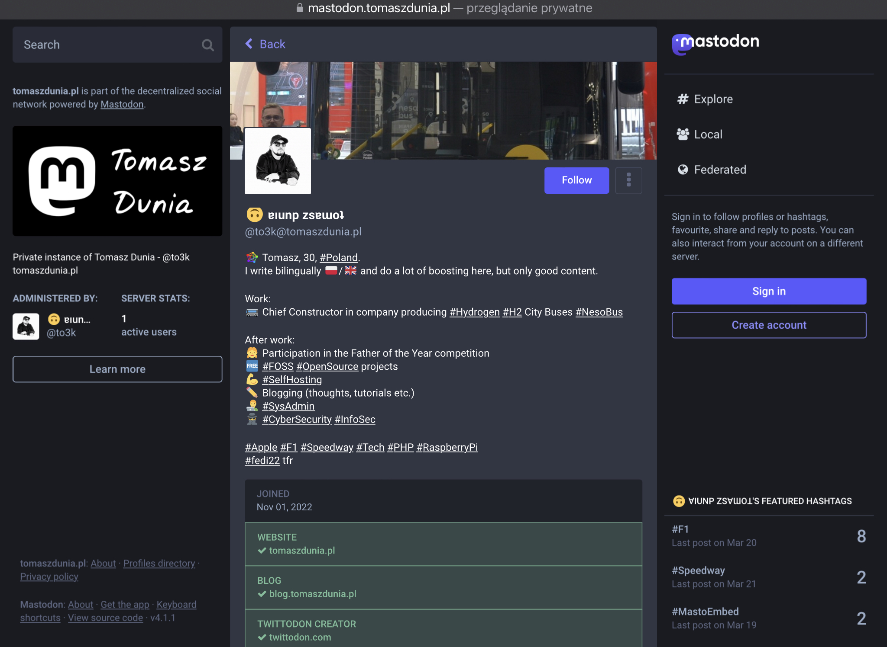
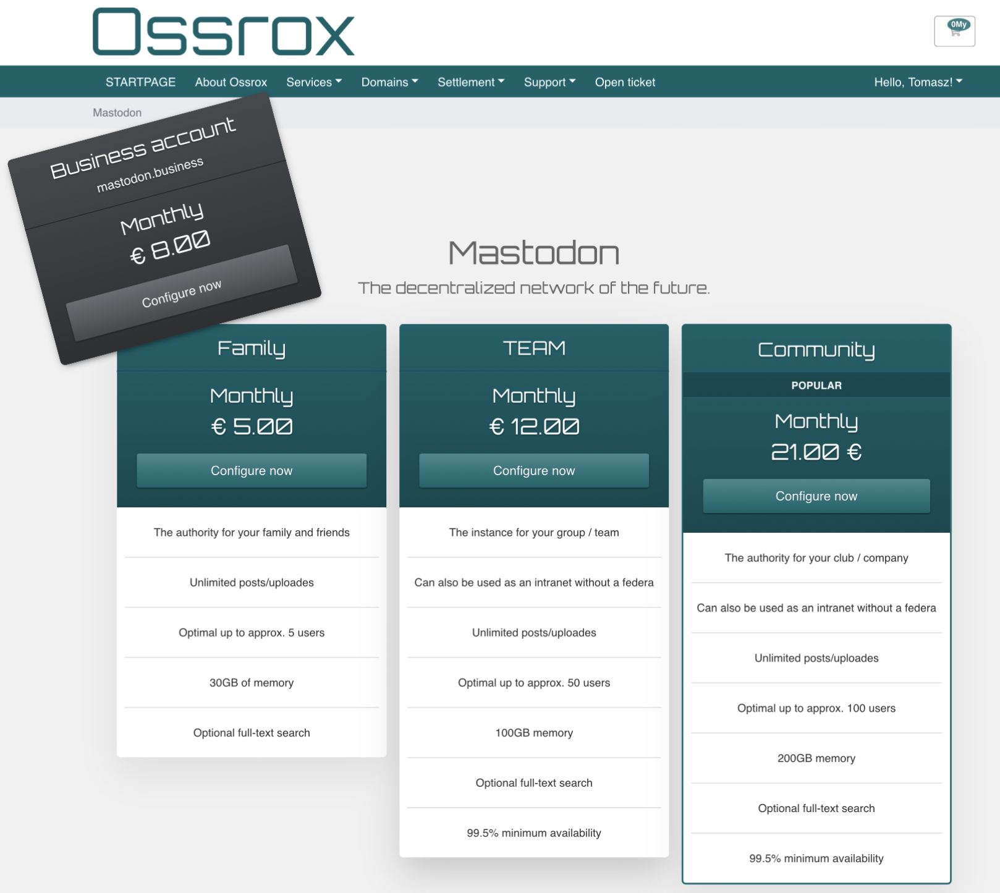

Spis treści:
* TOC
{:toc}

Popularność sieci społecznościowej _Mastodon_ stale rośnie, a kolejni ludzie uciekają z tonącego _Twittera_ właśnie do zdecentralizowanego _Fediverse'u_. Jeżeli czytasz ten wpis, a jeszcze nie do końca rozumiesz ideę _Fediverse_ czy nawet _Mastodona_ to odsyłam do [mojego wpisu na ten temat](https://blog.tomaszdunia.pl/mastodon/). Muszę przyznać, że bardzo, ale to bardzo, wsiąknąłem w _Fedi_, więc w pewnym momencie postanowiłem, że uruchomię swoją własną _instancję_. Oczywiście nie mówimy tutaj o czymś dużym, bo nie mógłbym sobie czasowo pozwolić na zapewnienie konserwacji serwera i chociażby moderacji treści na odpowiednim poziomie. Od początku myślałem o przestrzeni jedynie dla siebie, taka _**Single User Instance**_. Tak się składa, że jakiś tydzień temu **[uruchomiłem taką instancję](https://mastodon.tomaszdunia.pl)**, zrobiłem to **najniższym możliwym nakładem pracy** przy zachowaniu przy tym **najniższego możliwego kosztu**. W tym wpisie podzielę się jak to dokładnie wyglądało w moim przypadku.

_[https://mastodon.tomaszdunia.pl](https://mastodon.tomaszdunia.pl)_

## Dostępne sposoby

Jest wiele sposobów na uruchomienie swojej instancji. Można to zrobić na serwerze postawionym u siebie w domu (np. _Raspberry Pi_, _Terminal_ czy też po prostu stary komputer) lub na wynajmowanym _VPSie_. Można przejść przez całą instalację krok po kroku tak jak to jest w dokumentacji lub też skorzystać z gotowego środowiska do uruchamiania takich rzeczy jakim jest np. _[Yunohost](https://yunohost.org/)_, który jest znacznie przyjaźniejszy, szczególnie dla niezbyt technicznych osób. Ciekawą opcją jest także skorzystanie z oferty _DigitalOcean_, a konkretnie czegoś co się nazywa _1-Click App Marketplace_, który jest swego rodzaju sklepem z aplikacjami, które uruchamia się w chmurze przysłowiowym jednym kliknięciem, a nazywane są one _Droplets_ (z ang. _kroplami_). Dla _Mastodona_ istnieje właśnie [taki _Droplet_](https://marketplace.digitalocean.com/apps/mastodon). Jest to bardzo fajna opcja, bo **z jednej strony łatwo się ją uruchamia, a z drugiej po wszystkim otrzymujemy pełen dostęp do serwera** i działającego na nim oprogramowania, co pozwala nam na pełną konfigurację naszej _instancji_, oczywiście o ile mamy umiejętności i wiedzę jak to zrobić. Haczyk jest taki, że to rozwiązanie kosztuje niemało, bo **koszt uruchomienia najtańszej _instancji_ to $12 miesięcznie** (1vCPU, 2GB RAM, 50GB przestrzeni dyskowej i limit 2 TB transferu miesięcznego).

Jednakże istnieje jeszcze jeden sposób, który nazwałbym dedykowanym **dla osób nietechnicznych**, lub po prostu nie mających ochoty poświęcać kilku wieczorów na walkę z ciągle niedziałającą konfiguracją, czytanie dokumentacji czy też szukanie rozwiązania problemu na _StackOverflow_ i wkurzania się, że tak naprawdę był banalny do rozwiązania. Tym sposobem jest skorzystanie z tzw. _**Managed Hosting'u**_ (z ang. _hosting zarządzany_). Polega to na tym, że płacimy komuś za uruchomienie dla nas _instancji_, wykonanie podstawowej konfiguracji i późniejsze pilnowanie jej prawidłowego działania. Plusem tego rozwiązanie jest to, że zostaniemy poprowadzeni za rączkę, a więc **nie jest od nas wymagana praktycznie żadna wiedza techniczna**. Do tego nie wychodzi to bardzo drogo, bo na moim przykładzie mogę powiedzieć, że **kosztuje to 5 euro miesięcznie** (w przeliczeniu na złotówki to niecałe 25 zł). Minus to **brak dostępu do maszyny**, na której stoi _instancja_, a także brak dostępu do jej kodu. **Odbiera to możliwość bardziej zaawansowanej konfiguracji i personalizacji**.

## Przebieg tworzenia mojej instancji

Na samym wstępie chciałbym rozwiać wszelkie wątpliwości, które mogą się pojawić, i zadeklarować, że żaden z linków zawartych w tym wpisie nie jest afiliacyjny, nie czerpię żadnych korzyści finansowych z polecenia tego, a nie innego sposobu.

Jako _managed hosting_ dla mojej _instancji_ wybrałem [ossrox.org](https://ossrox.org), który po krótkim badaniu rynku okazał się dostawcą z **najlepszym stosunkiem ceny do jakości**, a może raczej oferowanych parametrów. Dodatkowo wygląda na to, że jest to dość mała firemka prowadzona przez dwóch Niemców, więc stwierdziłem, że jest szansa iż będą bardziej elastyczni od większych dostawców. Z perspektywy czasu już mogę powiedzieć, że w sporej części miałem rację, bo w _Ossrox_ dało się ustawić parę rzeczy, które są niekonfigurowalne np. w [masto.host](https://masto.host/). Wybrałem **najniższy pakiet _Familie_, który kosztuje 5 euro za miesiąc.** Przy wybieraniu _hostingu zarządzanego_ najważniejsze na co trzeba zwracać uwagę to ilość oferowanej przestrzeni dyskowej. W pakiecie _Familie_ w _Ossrox_ mam **30GB**, to w mojej ocenie OK, ale pełnią szczęścia byłoby mieć ok. 100GB lub chociaż nawet 50GB. Oczywiście to wszystko zależy od tego jak korzysta się z _Mastodona_, a konkretnie od tego ile osób się obserwuje i ile danych te osoby generują (głównie mowa tutaj o filmach i zdjęciach, które najbardziej zapychają dysk _instancji_). Patrząc na własnym przykładzie - mam ok. 300 obserwowanych, którzy przy 3 dniowej retencji danych (o tym szczegółowo jeszcze później) generują ok. 6 GB danych. A więc można przyjąć, że **jedna osoba przez jeden dzień** generuje ok. _(6000 / 3 / 300 =)_ **6.6MB danych**. Zatem 30GB pamięci powinno mi, przy zachowaniu tych ustawień, wystarczyć na wariant, w którym obserwuję 1500 osób (5 razy więcej niż tego potrzebuję). W razie jakby to było mało to można jeszcze retencję danych ograniczyć z 3 do 2 dni i wtedy maksymalna możliwa liczba obserwowanych mogłaby w teorii sięgnąć 2250 kont.

Przed rozpoczęciem procesu zakupu usługi w _Ossrox_ proponuję nabyć domenę, która zostanie podpięta pod naszą _instancję_. Ja w tym celu stworzyłem subdomenę dla mojego adresu bazowego - [mastodon.tomaszdunia.pl](https://mastodon.tomaszdunia.pl). Nie ma znaczenie jaką domenę będziecie mieli, **grunt to mieć możliwość zmiany jej konkretnych _rekordów DNS_** - _**A**_ (dla _IPv4_) oraz _**AAAA**_ (dla _IPv6_) lub **_CNAME_**. Chodzi o to, żeby wskazać w ustawieniach domeny adres serwera, do którego ma ona kierować. W takim przypadku domena może być zarejestrowana u dostawcy numer 1, a serwer być wykupionym u dostawcy numer 2 i poza odpowiednim przekierowaniem nie muszą oni mieć ze sobą nic wspólnego.

Strona _Ossrox_ jest niestety **w całości po niemiecku**. Wymieniłem nawet kilka maili w tej sprawie z właścicielami oferując im, że pomogę w tłumaczeniu. Są oni jednak mocno zapracowani, a do tego chcą rozpocząć cały proces od przetłumaczenia polityki prywatności (w sumie rozsądne podejście), a z tym raczej nie byłbym w stanie im pomóc. Tak czy owak, każdy **translator daje sobie świetnie radę** z tłumaczeniem niemieckiego na angielski i to w locie. Ważne jest, że późniejsza komunikacja w sprawie wsparcia, czy konfiguracji posprzedażowej, może odbywać się już normalnie **po angielsku**.

Proces zakupu to zaledwie parę kliknięć i konieczność podpięcia karty kredytowej (lub debetowej). Należy pamiętać, że **będziemy płacić walutą zagraniczną**, więc nasz bank musi nam pozwalać na takie działania. Ja skorzystałem z [Revoluta](https://www.revolut.com/pl-PL/). Istotne jest to, że **najkrótszy okres na jaki można dokonać zakupu to kwartał**, a więc płacimy z góry za minimum 3 miesiące. Aby przyspieszyć proces dobrze jest już w uwagach do zamówienia zawrzeć podstawowe informacje takie jak:

1. Domena do jakiej chcielibyśmy podpiąć _instancję_ - w moim przypadku była to domena [mastodon.tomaszdunia.pl](https://mastodon.tomaszdunia.pl)

3. Zależało mi na tym, aby moim _handle_ (z ang. _uchwyt_) było _@to3k@tomaszdunia.pl_, a nie _@to3k@mastodon.tomaszdunia.pl_, czyli aby w handle użyta była domena główna, a nie subdomena. Da się to zrealizować poprzez ustawienie dwóch parametrów:
    - _LOCAL\_DOMAIN=tomaszdunia.pl_
    
    - _WEB\_DOMAIN=mastodon.tomaszdunia.pl_

5. Chęć, aby został włączony _Single User Mode_, który sprawia, że po wejściu na stronę główną _instancji_ [mastodon.tomaszdunia.pl](https://mastodon.tomaszdunia.pl) zamiast lokalnej osi czasu (co nie ma sensu dla _instancji_ jednoosobowej) zostanie wyświetlony profil administratora.

7. Ja dodatkowo chciałem też, aby Ossrox zmieniło mi domyślny limit 500 znaków w jednym toocie (_rate\_limit_) na najwyższy jaki mogą ustawić. Nie ma sensu wprowadzać sobie tego typu limitów dla jednoosobowej _instancji_. Jednak w odpowiedzi na _ticket_ dostałem informację, że taka zmiana wiąże się z koniecznością modyfikacji kodu i będzie dla nich problematyczna, bo inni użytkownicy wykazują małe zainteresowanie tego typu zmianą i dla mnie specjalnie musieliby robić _fork_ kodu z tą zmianą. Jednak za dodatkową opłatą 5 euro miesięcznie zgodziliby się na zrobienie tego i zmianę na 2000 lub 5000 znaków. Nie zdecydowałem się na taki deal, bo nie jest to dla mnie aż tak istotna funkcja, żeby płacić za nią drugie tyle co płacę za serwer. Jednak informuję, że istnieje taka opcja jakby ktoś był zainteresowany.

9. Do tego zapytałem czy jest możliwosć, aby znieśli mi limit znaków w bio w profilu oraz zwiększyli liczbę linków jakie mogę podpiąć do profilu. Jednakże na obie te prośby dostałem informację, że nie mogą tego zrealizować, bo jest to zbyt duża ingerencja w kod _Mastodona_. Cóż, trudno... Wiem, że da się to zrobić, ale i tak jak na _managed hosting_ udało mi się dogadać sporo konfiguracji, niemożliwych u innych dostawców (nawet droższych).

Korzystając z moich doświadczeń proponuję w uwagach do zamówienia zawrzeć jedynie tematy z punktów 1-3 oraz ewentualnie jeżeli chcecie się decydować na dodatkowy koszt za zwiększenie limitu znaków to napisać do nich również w sprawie punktu 4.

Po prawidłowej płatności pozostaje czekać na odpowiedź od _Ossrox_ z instrukcjami dotyczącymi konfiguracji. Ja do zrobienia miałem w zasadzie **tylko dwie rzeczy**:

1. **Ustawić odpowiednio rekordy _DNS_** dla mojej domeny. Tutaj mogłem zrobić to dwojako (obstawiam, że wartości dla Was będą takie same, ale na pewno poczekajcie na potwierdzenie):
    - A = 49.12.191.254 / AAAA = 2a01:4f8:c012:5147::1
    
    - CNAME = cname.ossrox.org

3. **Skonfigurować przekierowanie** 301 z domeny _tomaszdunia.pl_ na subdomenę _mastodon.tomaszdunia.pl_. Realizuje się to poprzez edycję (lub utworzenie jeżeli nie istnieje) pliku _.htaccess_ w domenie głównej. Należy na jego początku dopisać taką linijkę:
    - _Redirect 301 /.well-known/webfinger https://mastodon.tomaszdunia.pl/.well-known/webfinger_

Po wykonaniu niezbędnych działań trzeba niestety czekać aż zmiany w _DNSach_ się rozpropagują, co może potrwać nawet 24 godziny. Jednak tu już rolą _Ossrox_ jest pilnować kiedy możliwe będzie dokończenie konfiguracji _instancji_. Po zakończonym procesie konfiguracji otrzymamy maila z loginem i hasłem do użytkownika będącego administratorem _instancji_.

## Panel administratora instancji

Przejdźmy sobie jeszcze przez wszystkie zakładki ustawień dostępnych dla administratora.

- **Dashboard** - panel z podsumowaniem i statystykami. Jest on zapewne istotny dla administratorów instancji, które posiadają więcej niż jednego użytkownika. W naszym przypadku jedyna istotna informacja jaka jest tam zawarta znajduje się na samym dole i jest to sekcja _SPACE USAGE_, która podaje ile aktualnie przestrzeni dyskowej wykorzystuje nasza _instancja_. Parametr, którym wcześniej operowałem nazywa się _Media storage_ i jest to ilość miejsca jaką zajmują dane multimedialne (głównie - filmy, zdjęcia, awatary) nasze oraz pobrane z instancji osób, które obserwujemy. Ten parametr warto monitorować i na jego podstawie ustawiać odpowiednią wartość retencji danych, o której będzie za chwilę, bo znajduje się w jednej z zakładek poniżej.

- **Server Settings** - najważniejsza zakładka, w której ustawiamy praktycznie wszystko co istotne.
    - **Branding** - Zakładka, w której możemy ustawić podstawowe informacje o instancji, które wyświetlane są na stronie głównej, która w przypadku włączonego _Single User Mode_ w teorii nie istnieje, bo z automatu przekierowuje do naszego profilu. Niemniej jednak dobrze jest wypełnić te dane.
    
    - **About** - Zakładka z bardziej szczegółowymi informacjami jak rozszerzony opis czy polityka prywatności. Tutaj już naprawdę nie ma sensu tego wypełniać dla jednoosobowej instancji.
    
    - **Registrations** - Zakładka, w której należy wyłączyć możliwość rejestracji (oczywiście jeżeli chce się mieć jednoosobową _instancję_). Realizuje się to poprzez wybranie opcji _Nobody can sign up_ w menu rozwijanym _Who can sign-up_. Jako _Custom message_ wpisałem _This is a private server. Sign-ups are not available. If you want to join Mastodon use this https://joinmastodon.org_.
    
    - **Discovery** - Zakładka dotycząca polecania treści na zasadzie _Odkryj_. Na Mastodon ma to niewielkie znaczenie, gdyż decentralizacja robi swoje i nie ma jednej listy z trendami, a i przy jednoosobowej instancji ma to jeszcze mniej sensu. Niemniej jednak według mnie dobrze jest zaznaczyć następujące opcje: _Enable trends_, _Allow trends without prior review_, _Allow unauthenticated access to public timelines_, _Publish aggregate statistics about user activity in the API_, _Publish list of discovered servers in the API_, _Enable profile directory_. Resztę można śmiało oznaczyć lub zostawić puste.
    
    - **Content retention** - To chyba najważniejsza zakładka dla każdego administratora _instancji_, choć określa się w niej jedynie trzy parametry. Retencja oznacza zachowywanie danych. Określenie czasu retencji danych oznacza w praktyce określenie ile dni dane mają być przechowywane na serwerze i następnie z niego usuwane. Zacznijmy od tego jak to działa w _Fediverse_. Otóż _instancje_ się ze sobą _federują_ to znaczy wymieniają dane. Ja zaczynając obserwowanie kogoś mówię mojemu serwerowi, że od tej pory chcę, aby pobierane na dysk serwera były wszelkie dane generowane przez tego użytkownika. W ten sposób jak obserwowany przeze mnie użytkownik opublikuje toota ze zdjęciem to jego serwer rozgłosi to i roześle do wszystkich zainteresowanych (w tym mojej _instancji_) tą treść. Następnie ja łącząc się ze swoim serwerem mogę te dane wyświetlić w swoim kliencie (np. _Ivory_). To ile te dane będą przechowywane na moim serwerze określają właśnie dwa pierwsze parametry w tej zakładce. _Media cache retention period_ określa jak długo mają być przechowywane dane multimedialne (filmy, zdjęcia itp.) z innych _instancji_. Ja mam tutaj ustawione 7 dni i jest to dla mnie w zupełności wystarczający okres. Ba, nawet testowałem ustawienie tego na 3 dni i też okazało się wystarczające. Istotne jest, że nawet jeżeli usuniemy te dane po np. 3 dniach i później będziemy chcieli do nich wrócić to zostaną ode pobrane jeszcze raz. Różnica jest tylko taka, że może to nie być natychmiastowe i na ich wyświetlenie trzeba będzie chwilę zaczekać. Natomiast parametr _Content cache retention period_ określa jak długo mają być przechowywane posty z innych instancji. Same posty (tooty) nie zajmują wiele miejsca, więc na ten moment to pole zostawiłem puste, co oznacza, że nie mają być nigdy usuwane. Zobaczę co z tym zrobić po dłuższym czasie. Ostatni parametr to _User archive retention period_ i w przypadku jednosobowej _instancji_ nie jest zbytnio istotny, bo jego ustawienie określa ilość dni po jakich będą usuwane archiwa wygenerowane na prośbę użytkowników. Archiwa to taka kopia zapasowa naszych danych jak lista obserwowanych, lista zablokowanych lub wyciszonych, zakładki itp.
    
    - **Appearance** - Zakładka dotycząca aspektów wizualnych, tj. dająca możliwość zmiany domyślnej szaty graficznej (kolorystyki) oraz modyfikację wyglądu strony _instancji_ poprzez wprowadzenie swojego kodu CSS.

- **Server rules** - W tej zakładce definiuje się zasady panujące na _instancji_. Jest to swego rodzaju regulamin, który ma być przestrzegany przez użytkowników. W przypadku jednoosobowej instancji raczej nie ma to znaczenia, więc na swojej _instancji_ dodałem jedynie jedną zasadę _This is a private instance, so I don’t need to write rules only for me :)_.

- **Roles** - Zakładka do zarządzania rolami użytkowników. Można w niej mianować moderatorów i nadawać im uprawnienia. Kompletnie nieistotna przy jednoosobowej _instancji_.

- **Announcements** - Komunikaty do użytkowników np. o jakimś wydarzeniu. Nieistotne.

- **Custom emojis** - Na _Mastodonie_ mamy możliwość definiowania swoich niestandardowych _emoji_. Jest to dość fajna funkcja. Po pewnym czasie, gdy nasz serwer sfederuje się z innymi, lista w tej zakładce zacznie się znacząco powiększać. Z poziomu tej zakładki można decydować, które niestandardowe _emoji_ chcemy widzieć (_allow_), a których nie. Do tego jeżeli któreś z tych _emoji_ przypadną nam do gustu i sami będziemy chcieli z nich korzystać to można je zaznaczyć i użyć funkcji _Copy_, co spowoduje, że dane _emoji_ zostaną zaimportowane do naszej _instancji_ i możliwe do użytku w naszych _tootach_ czy też bio profilu.

- **Webhooks** - Szczerze powiedziawszy jeszcze się tym nie bawiłem, ale zakładam, że to coś w rodzaju automatyzacji. Definiuje się serwer, na który mają być wysyłane komunikaty na temat jakichś zdarzeń występujących na naszej _instancji_. Prawdopodobnie można też w odpowiedzi na te komunikaty odesłać informację jaka ma być na nie reakcja.

- **Relays** - czyli w wolnym tłumaczeniu _przekaźniki_. To jest trochę temat rzeka. W telegraficznym skrócie _przekaźniki_ to takie serwery pośredniczące, które zbierają subskrybujące je _instancje_ w grupy i umożliwiają im wymianę danych. Członkostwo w takim grupie oznacza, że na naszej globalnej osi czasu będziemy widzieli _tooty_ z innych _instancji_ należących do grupy danego _przekaźnika_. Działa to również w drugą stronę, bo nasze _tooty_ będą też wysyłane i wyświetlane na globalnych osiach czasu innych _instancji_. Jest to pewnego rodzaju sposób na znalezienie nowych osób do obserwowania, a także pokazanie się światu. _Relays_ są odpowiedzą na zjawisko odizolowania małych _instancji_ od reszty _Fediverse'u_. Czy działa to dobrze? W mojej ocenie średnio, bo ciężko o tak naprawdę dobre _przekaźniki_, w których nie ma podpiętych po prostu słabych lub dziwnych _instancji_, z którymi normalnie raczej nie chcielibyśmy się _federować_. Trzeba też przyznać, że korzystanie z większego przekaźnika kosztuje bardzo dużo przestrzeni dyskowej. Ja aktualnie eksperymentuję będąc podłączonym pod dwa _przekaźniki_: [101010.pl](https://relay.101010.pl/) i [infosec.exchange](https://relay.infosec.exchange/). Zobaczymy co z tego wyjdzie. Aby dodać _przekaźnik_ należy po naciśnięciu przycisku _ADD NEW RELAY_ podać adres _przekaźnika_ zakończony frazą _/inbox_ (np. _https://relay.infosec.exchange/inbox_). Następnie trzeba czekać na zaakceptowanie naszej prośby o dodanie. Bycie subskrybentem dużego _przekaźnika_ oznacza konieczność intensywniejszego zarządzania przestrzenią dyskową naszego serwera, dlatego ja na czas wyżej wspomnianych testów zmieniłem parametr _Media cache retention_ period na 1 dzień.

To w zasadzie wszystko do czego otrzymujemy dostęp jako administrator. Pozostałe ustawienia są takie same jak dla zwykłego użytkownika i tożsame z tym do czego jesteśmy przyzwyczajeni będąc na innych _instancjach_.

## Podsumowanie

Starałem się wszystkie powyższe zagadnienia opisać jak najbardziej zwięźle i prosto. Jak widać **stworzenie swojej własnej _instancji_ to nic trudnego** i na pewno nie wymaga posiadania ekstremalnej wiedzy technicznej. Nie jest to niestety bardzo tani czy nawet darmowy interes, jednak nie można też powiedzieć, że 5 euro miesięcznie to kosmiczne pieniądze. Posiadanie własnej _instancji_ na pewno nie będzie atrakcyjne dla wszystkich, ale skoro czytasz ten wpis to zakładam, że dla Ciebie, drogi Czytelniku, jest czymś interesującym i wartym rozważenia. Mam nadzieję, że mój wpis pomoże Ci w procesie decyzyjnym.

W przyszłości planuję przykucować i uruchomić własną _instancję_ całkowicie od zera, bez użycia _managed hostingu_, który całą część techniczną wykonał za mnie. Jeszcze nie wiem czy zrobię to na domowym serwerze (_Raspberry Pi_ lub może _terminalu_ ze środowiskiem _Proxmox_, o którym będą następne, planowane wpisy), w chmurze _[Oracle Free Tier](https://signup.cloud.oracle.com/?sourceType=_ref_coc-asset-opcSignIn&language=en_US)_, czy może na [Mikrusie](https://mikr.us/). Jednak na ten moment uważam, że moja bazowa _instancja_ pozostanie na dłużej na _hostingu zarządzanym Ossrox_, bo jest po prostu pewnym rozwiązaniem, a ewentualny self-hosting pozostawię sobie jako eksperyment, ciekawostkę, rozszerzenie umiejętności i zabawę.
