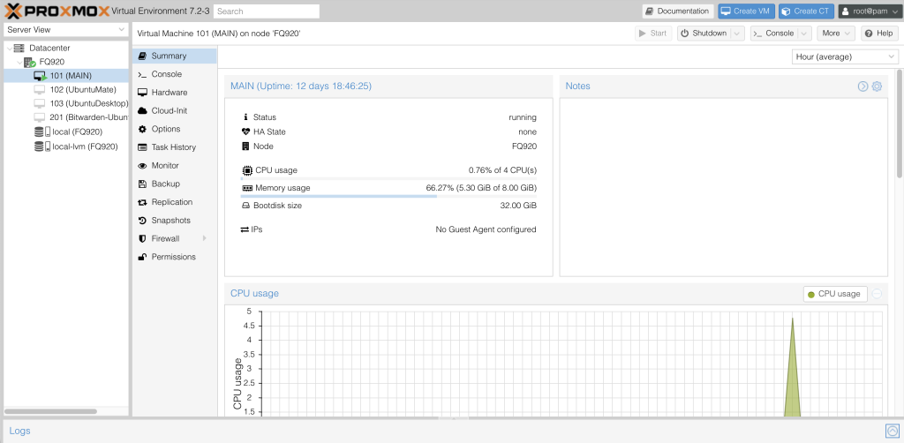
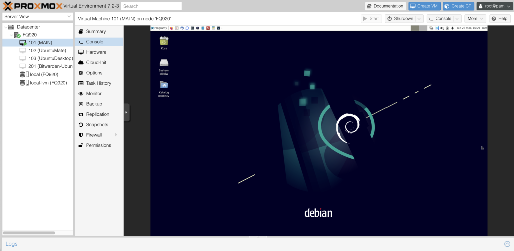

Spis treści:
* TOC
{:toc}

Jest to kontynuacja [poprzedniego wpisu](https://blog.tomaszdunia.pl/terminal-proxmox/), w którym przedstawiłem narzędzie o nazwie _Proxmox_, które jest środowiskiem do wirtualizacji. Omówiłem jego instalację na _terminalu_, czyli komputerze typu _mini PC_. Poniżej opiszę jak stworzyć swoją pierwszą **_maszynę wirtualną_** (ang. _Virtual Machine_ - _VM_) w _Proxmox_.

## Tworzenie maszyn wirtualnych

Po wejściu do panelu zarządzania środowiskiem _Proxmox_ dostaniemy na dzień dobry okienko wymagające uwierzytelnienia się. Login to _root_, a hasło to to, które podaliśmy podczas instalacji. Następnie dostaniemy kolejny popup, tym razem o tym, że nie posiadamy subskrypcji. _Proxmox_ jest rozwiązaniem _open-source_, ale posiada też płatne subskrypcje, które oczywiście są nieobowiązkowe. Jako zwykły użytkownik prywatny po prostu przeklikujemy to okienko przyciskiem OK. Niestety będziemy musieli to robić przy każdym logowaniu, co trzeba przyznać jest nieco upierdliwe.

Przechodząc do sedna, na wstępie chciałbym zaznaczyć, że nie planuję omawiać wszystkich ustawień, bo mogłoby mi nie wystarczyć życia. Skupię się jedynie na pokazaniu jak uruchomić swoją pierwszą _**maszynę wirtualną**_. W pierwszej kolejności musimy pobrać obraz _ISO_ systemu, który chcemy zainstalować na tej maszynie. Takim systemem może być Ubuntu Server w wersji 22.04 LTS, który można pobrać z [oficjalnej strony dystrybucji](https://ubuntu.com/download/server). Obraz do _Proxmoxa_ można wgrać na dwa sposoby. Pierwszym jest pobranie obrazu najpierw na komputer, a następnie jego _upload_ na serwer, a drugim wskazanie serwerowi linku do obrazu i pobranie go bezpośrednio z poziomu serwera. Oba te działania można wykonać poprzez rozwinięcie drzewa w kolumnie po lewej, wybranie _wolumenu local_ i wejście w zakładkę _ISO Images_. W górnej części menu pojawią nam się dwa przyciski, odpowiednio _Upload_ (opcja z komputera) i _Download from URL_ (opcja bezpośrednio ze strony dystrybucji).

Teraz możemy już przejść do tworzenia _wirtualnej maszyny_, a najszybszym sposobem jest skorzystanie z niebieskiego przycisku _Create VM_ wyciągniętego na wierzch interfejsu i ulokowanego w prawym górnym rogu. _Proxmox_ otworzy kreator nowej wirtualnej maszyny. Przejdźmy po kolei przez wszystkie kroki.

1. _**General**_: Tutaj ustawiamy podstawowe informacje maszyny. _Node_ to taki jakby klaster, do którego ma przynależeć. Zakładam, że jesteś na początku drogi, więc wybór jest niewielki - jeden _Node_ do wyboru. _VM ID_ to bardzo istotny parametr, który będzie unikatowym identyfikatorem tej maszyny. _Name_ to oczywiście nazwa maszyny, nie jest zbytnio ważne co tutaj wpiszemy, aby tylko potem pomogło nam to w zidentyfikowaniu z jaką maszyną mamy do czynienia. Już na początku swojej drogi warto stworzyć sobie jakiś system nazewnictwa, który docenimy dopiero później, gdy będziemy mieli wiele maszyn wirtualnych. _Resource Pool_ na ten moment nas nie interesuje, bo jeszcze tak owego nie konfigurowaliśmy.

3. _**OS**_: Jako _Storage_ zostawiamy _local_, czyli obrazy szukane są na dysku lokalnym. Natomiast jako _ISO image_ wskazujemy pobrany wcześniej obraz systemu. Istotne jest, żeby w zależności od systemu, który instalujemy prawidłowo wskazać parametry _Type_ i _Version_ w sekcji _Guest OS_.

5. _**System**_: Tutaj nie mamy nic do zmiany, proponuję zostawić wartości domyślne.

7. _**Hard Disk**_: Tutaj interesuje nas w zasadzie tylko parametr _Disk size (GiB)_, w którym oczywiście określamy jak dużo przestrzeni dyskowej zamierzamy przypisać tej maszynie wirtualnej. Warto jednak pamiętać, że tę wartość jest później dość łatwo zwiększyć, natomiast jej zmniejszenie będzie już stanowił większy problem, dlatego najlepiej zacząć od najmniejszej wartości zalecanej przez specyfikację danej dystrybucji (systemu), a później stopniowe rozszerzanie w miarę wystąpienia takiej potrzeby.

9. _**CPU**_: Tutaj ustawiamy ile mocy obliczeniowej chcemy przypisać do tej _maszyny wirtualnej_. _Proxmox_ oferuje nie do końca zrozumiały dla mnie podział na _Sockets_ (gniazda) i _Cores_ (rdzenie). Kiedyś co nieco poczytałem na różnych forach na ten temat i jeżeli dobrze pamiętam to _Sockets_ używa się tylko w przypadku maszyn, które są wyposażone w więcej niż jeden procesor. Pamiętam także, że przewijał się tam jakiś wzór do obliczania optymalnego ustawienia _Cores_, w który wstawiało się ilość rdzeni i wątków procesora naszego serwera i odnosiło się to do wymagań sprzętowych jakie zamierzamy postawić _maszynie wirtualnej_. Niemniej jednak ja w zasadzie operuję tutaj jedynie parametrem _Cores_ i wiem, że dla procesora 4-rdzeniowego mogę tę wartość ustawiać w zakresie 1-4. Jednakże tutaj dobrą radą jest postępowanie podobnie jak z przestrzenią dyskową _Disk size_ zdefiniowaną w poprzednim punkcie. Zawsze najlepiej po prostu przypisać jedynie jeden rdzeń i modyfikować później tę wartość w razie jak zauważy się taką potrzebę. Różnica jest taka, że zmienianie ilości przypisanych rdzeni nie ma ograniczeń, tj. można to robić bez problemu zarówno w górę jak i w dół. W teorii widzę nawet możliwość zrobienia tego podczas, gdy maszyna działa, ale zdrowy rozsądek podpowiada mi, żeby tak tego nie robić. Zawsze lepiej zatrzymać maszynę, zmienić ustawienia i uruchomić ją ponownie z nowymi zasobami.

11. _**Memory**_: Tutaj oczywiście mamy ustawienia dotyczące pamięci operacyjnej. Do ustawienia mamy jeden parametr _Memory (MiB)_, czyli ilość przypisanej pamięci RAM. Ten parametr można zmieniać równie łatwo co ustawienia _CPU_, a wartość _2048_ jest bardzo dobrą bazą wyjściową.

13. _**Network**_: Nic innego jak ustawienia sieciowe. Na potrzeby tego wpisu pozostawmy wszystko domyślne, ale chciałbym tylko zaznaczyć, że mamy tutaj wiele innych możliwości, które należy dostosować do adaptowanego rozwiązania. Możemy całkowicie odciąć dostęp do sieci tej maszynie wirtualnej. Możemy odseparować maszyny wirtualne od siebie lub też od interfejsu zarządzającego. Ogólnie jest to już wyższa szkoła jazdy, na której nie chciałbym się skupiać w tym wpisie.

15. _**Confirm**_: Podsumowanie wszystkich ustawień, które należy sprawdzić i jeżeli jest OK to sfinalizować działanie kreatora przyciskiem _Finish_.

Od razu po zatwierdzeniu na liście po lewej powinniśmy zobaczyć świeżo utworzoną _maszynę wirtualną_, natomiast samo jej uruchomienie i doprowadzenie do stanu używalności może jeszcze chwilę potrwać.

## Panel sterowania maszyną wirtualną

Po wybraniu maszyny z listy po lewej zostanie nam w głównym oknie wyświetlony panel sterujący tejże maszyny. Przejdźmy sobie przez wszystkie zakładki tak samo jak zrobiliśmy to dla kreatora powyżej.

    

    

1. **_Summary_**: Wszystkie najważniejsze statystyki dotyczące _VMki_. Zużycie procesora, pamięci i dysku, do tego ruch sieciowy. Mamy też możliwość dodania notatek dotyczących tej maszyny.

3. **_Console_**: Jak sama nazwa może wskazywać, jest to miejsce, z którego można prowadzić komunikację z serwerem bezpośrednio z poziomu środowiska _Proxmox_. Jeżeli zainstalowaliśmy system z interfejsem graficznym to właśnie tutaj dostaniemy do niego dostęp tak samo jakbyśmy podpięli fizycznie monitor, klawiaturę i myszkę. Jeżeli wybraliśmy jednak system bez _GUI_ to zostanie nam wyświetlony interfejs tekstowy (terminal).

5. **_Hardware_**: Tutaj oraz w zakładce _Options_ można zmienić to co ustawiło się podczas tworzenia maszyny. Dodatkowo istotne jest, że można tutaj zarządzać nośnikami danych, a więc symulować podpięcie do maszyny pamięci przenośnej lub wsunięcie płyty do _CD-ROMu_.

7. **_Cloud-Init_**: Zakładka dla bardziej zaawansowanych, którzy zarządzają całą chmurą maszyn wirtualnych, a to jest tylko kolejny z jej węzłów.

9. **_Options_**: patrz punkt 3.

11. **_Task History_**: Podstawowy rejestr zdarzeń, który czasem pomaga zorientować się co stało się z maszyną, gdy np. niespodziewanie uległa ponownemu uruchomieniu.

13. **_Monitor_**: Szczerze powiedziawszy nigdy nie użyłem tej zakładki i nie mam bladego pojęcia do czego ona służy.

15. **_Backup_**: Super istotna zakładka, w której możemy zrobić kompletną kopię zapasową maszyny. To według mnie robienie kopii zapasowych w ten sposób to jedna z największych zalet _Proxmox_. Nie trzeba się bawić w żadne _tar -cvpf_ i inne tego typu akcje wykonywane na działającym systemie. Tutaj po prostu bierzemy cały dysk maszyny, robimy jego klon i jesteśmy gotowi do przeniesienia jej gdziekolwiek.

17. **_Replication_**: Narzędzie do replikacji (powielenia) magazynów danych pomiędzy _Node'ami_. Nas to nie dotyczy, bo tak jak pisałem wcześniej na poziomie początkowym operujemy jedynie na jednym _Node'zie_.

19. **_Snapshots_**: Jaka jest różnica pomiędzy _snapshot'ami_ a _backup'ami_? _Backup_ to kompletna kopia maszyny, która zawiera wszystkie jej dane, natomiast _snapshot_ to taki punkt przywracania systemu, czyli zbiór informacji o tym w jakim stanie jest maszyna w momencie jego zrobienia. Jest to bardzo szybki i mało inwazyjny, pod kątem zasobów, sposób zabezpieczenia się przed wprowadzeniem większych zmian na maszynie, których efekt nie do końca jest nam znany i możliwy do przewidzenia. Przed wprowadzeniem takiej zmiany zawsze dobrze jest zrobić właśnie _snapshot_, co pozwoli później w każdym momencie wrócić do tego punktu i ewentualnie zacząć od nowa lub całkowicie zrezygnować z tych zmian.

21. **_Firewall_**: Ustawienia zapory sieciowej. Jeszcze nie ustaliłem czy jest to dodatkowa warstwa czy też jest to ten sam poziom co np. _ufw_ odpalone na _maszynie wirtualnej_.

23. **_Permissions_**: _Proxmox_ jest środowiskiem, w którym może pracować więcej niż jeden użytkownik. W tej zakładce można przydzielać dostęp do danej maszyny konkretnemu użytkownikowi lub grupie użytkowników. Dodatkową opcją jest także udostępnienie dostępu poprzez API na podstawie uwierzytelnienia Tokenem.

## Podsumowanie

Jak pewnie sam zauważyłeś, drogi Czytelniku, _Proxmox_ jest naprawdę potężnym i bardzo rozbudowanym narzędziem. Pozwala na konfigurację niesamowitej ilości parametrów i tworzenie przy tym naprawdę potężnych sieci rozwiązań opartych o wirtualizację. To co pokazałem, w napisanych przeze mnie dwóch wpisach, to jedynie ułamek tego do czego można wykorzystać to środowisko. Sam nie jestem ekspertem w tej dziedzinie i przyznam szczerze, że nie umiem w nim zrobić wiele więcej niż to co opisałem. Mimo to _Proxmox_ to zdecydowanie moje rozwiązanie numer jeden dla serwera domowego. Jest na tyle stabilny, że pozwala z czystym sumieniem odpalać naprawdę istotne dla mnie usługi. Może być również jednocześnie używany jako _homelab_, czyli taki domowy poligon doświadczalny, w którym będzie można równie szybko stworzyć maszyny testowe jak i je unicestwiać, gdy przestaną być potrzebne.
