Spis treści:
* TOC
{:toc}

To o dziwo **nie żaden przekręt**, a tytuł mimo że brzmi jak _clickbait_, lub reklama sklepu z elektroniką na M, wcale nimi **nie jest**! Mowa tutaj o _[Oracle Cloud Free Tier](https://www.oracle.com/pl/cloud/free/)_. Nie pytajcie mnie jakim cudem opłaca im się to oferować całkowicie za darmo, szczególnie z takimi parametrami... Czy jest tu jakieś drugie dno? Możliwe, ale ja go nie widzę. Może jedynie takie, że _Oracle_ to kolejna, ogromna korporacja, która czyha, aby wyciągnąć łapy w kierunku naszych danych, a my sami je im oddajemy korzystając z ich pozornie darmowych usług. Tutaj już każdy zrobi sobie własny rachunek i zdecyduje czy korzystać z tej oferty czy nie. Ja w tym wpisie **opiszę krok po kroku jak uzyskać dostęp do takiego _VPSa_** (przypomnijmy jeszcze rozwinięcie skrótu - z ang. _Virtual Private Server_).

## Co Ty z tego masz szemrany typku?!

Pisałem to już wcześniej, ale i przy tej okazji powtórzę, że jak zwykle **nie bawię się** tutaj w żadne linki afiliacyjne, czy programy partnerskie, tj. **nie mam żadnych korzyści finansowych** z tego, że polecam Wam to a nie inne rozwiązanie. **Treści na moim blogu są wolne** od tego typu zagrywek, a tworzę je z myślą jedynie o przekazywaniu wiedzy i jest to dla mnie swego rodzaju odskocznia od codziennych czynności, taki kreatywny relaks. Jednakże jeżeli czujesz, drogi Czytelniku, chęć wsparcia mnie finansowo to będzie mi bardzo miło! Można to zrobić poprzez moje konta na [_Patreon_](https://www.patreon.com/bePatron?u=67755731) i/lub [_Patronite_](https://patronite.pl/patronuj/to3k-za-5pln/128901).

## O co tutaj chodzi?

Wracając do tematu darmowego _VPSa_, chodzi o to, że _Oracle_ posiada coś takiego jak program _Free Tier_, do którego można uzyskać dostęp po rejestracji i potwierdzeniu swojej tożsamości poprzez podpięcie karty kredytowej (lub debetowej). **Nie trzeba robić nic więcej**. Na start dostaje się jeszcze dodatkowo $300 (w przeliczeniu na polskie to 1150PLN) na 30 dni, które można wykorzystać do przetestowania płatnych funkcji. My nie będziemy z tego korzystać, bo skupimy się na samym _Free Tier_, który jest **programem oferującym darmowe (rzekomo na zawsze) _VPSy_**. Oczywiście istnieją tutaj pewne ograniczenia dotyczące tego co jest za darmo a co nie, jednak pochylam się nad tym rozwiązaniem dlatego, że w mojej ocenie **można wyciągnąć z tego o dziwo całkiem niezłą _maszynę_**. Dodatkowy bonus jest taki, że _Oracle_ oferuje także **przypisany dedykowany publiczny adres IPv4**, a to ogromna zaleta, która **nie jest dostępna nawet w przypadku niektórych płatnych VPSów** od innych dostawców. Dzięki takiej opcji nie będziemy musieli się bawić w żadne kombinowanie z [Dynamic DNS](https://pl.wikipedia.org/wiki/DDNS).

Z limitami chodzi o to, że więksi dostawcy rozwiązań chmurowych lubują się w rozliczaniu wszystkiego na godziny. Z jednej strony jest to wygodne i dla nich i dla użytkownika, który po pierwsze ma możliwość elastycznego wynajmowania usług, a po drugie może je łatwo skalować. Jednak z drugiej strony tak naprawdę ciężko jest wyliczyć realny koszt jaki poniesie się np. po miesiącu czy po roku. Oracle ma dwa główne przeliczniki _OCPU godziny_ i _GB godziny_. _OCPU_ oznacza _Oracle Compute Unit_, co na polski można przełożyć jako _Jednostka Obliczeniowa Oracle_. W tym przeliczniku chodzi o to ile miesięcznie mocy obliczeniowej zużywamy. W przypadku darmowego planu Oracle mamy do dyspozycji możliwość używania do 4 _maszyn wirtualnych_ wyposażonych w **procesor _Ampere A1_ w architekturze _ARM_** z maksymalnie 3000 _OCPU godzinami_ miesięcznie. Tutaj zależy od Ciebie jaką strukturę planujesz uruchomić w chmurze Oracle, ale ja skonsoliduję te wszystkie parametry w jednej _maszynie_, a więc **utworzę _VPSa_ z 4x _OCPU_**. Przelicznik _GB godziny_ odnosi się do pamięci RAM jaką zużywamy. W _Free Tier_ dostajemy do dyspozycji 18000 _GB godzin_ miesięcznie, co po podzieleniu przez ilość dni w miesiącu i ilość godzin doby, daje nam 25GB na godzinę, czyli możemy na tym odpalić jedną lub wiele _maszyn_ o łącznej pamięci RAM równej 24GB. Ja oczywiście **wrzucę całe 24GB RAMu do jednej _maszyny_**.

Dodatkowym ograniczeniem jakie _Oracle_ nakłada na program _Free Tier_ jest ilość dostępnej przestrzeni dyskowej. Mamy tutaj łącznie do wykorzystania do **200GB pamięci na dane**. Można je podzielić na części po 50GB pomiędzy _maszyny_ lub przydzielić całość do jednej, co dokładnie zamierzam zrobić.

Istnieje też **opcja równoległego odpalenia do dwóch _instancji_ opartych o procesory _AMD_**, jednak parametrami nie mają one startu do wyżej wspomnianej specyfikacji, bo są to _maszyny_ wirtualne **o mocy 1/8 _OCPU_ i posiadające jedynie 1GB pamięci operacyjnej RAM**. Zostaniemy zatem przy rozwiązaniu opartym o architekturę _ARM_. _ARM_ jest już na rynku od jakiegoś czasu i naprawdę ciężko znaleźć oprogramowanie, które nie zostało jeszcze na tę architekturę przeportowane i na niej nie działa. Dla przypomnienia dodam, że cała platforma Raspberry Pi i jej alternatywy działają właśnie na ARM.

## Rejestracja w Oracle Cloud

Uproszę proces jedynie do punktów, wzbogaconych zrzutami ekranu, opisujących krok po kroku cały proces.

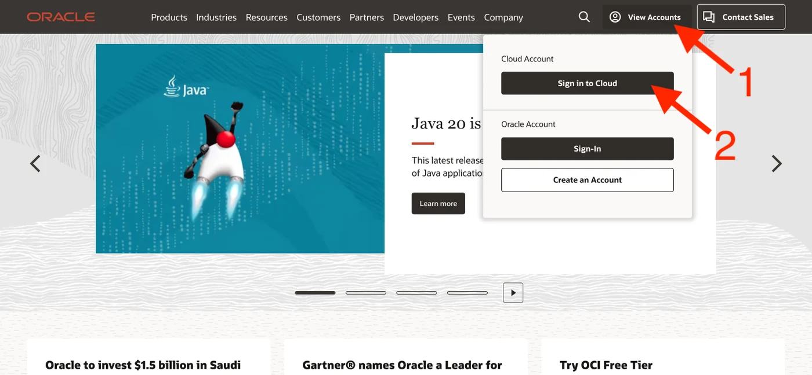
    
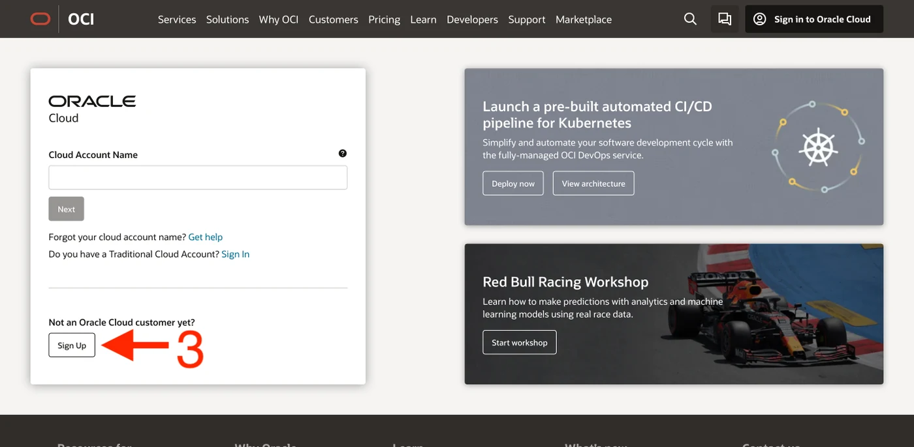
    
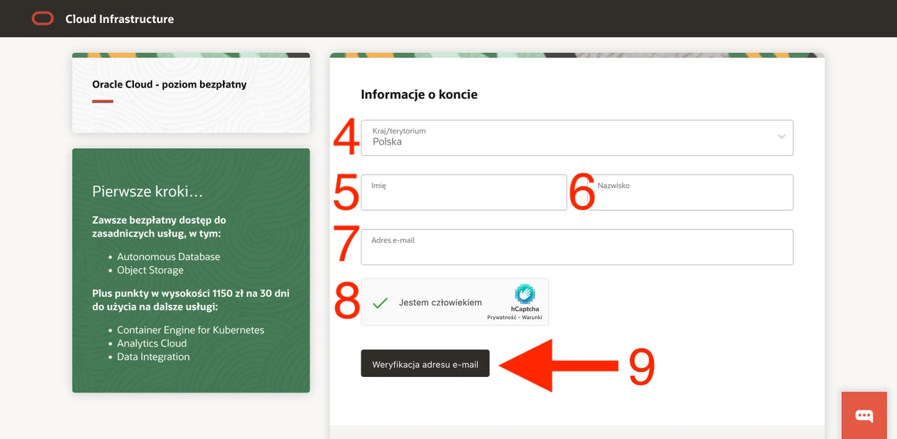
    
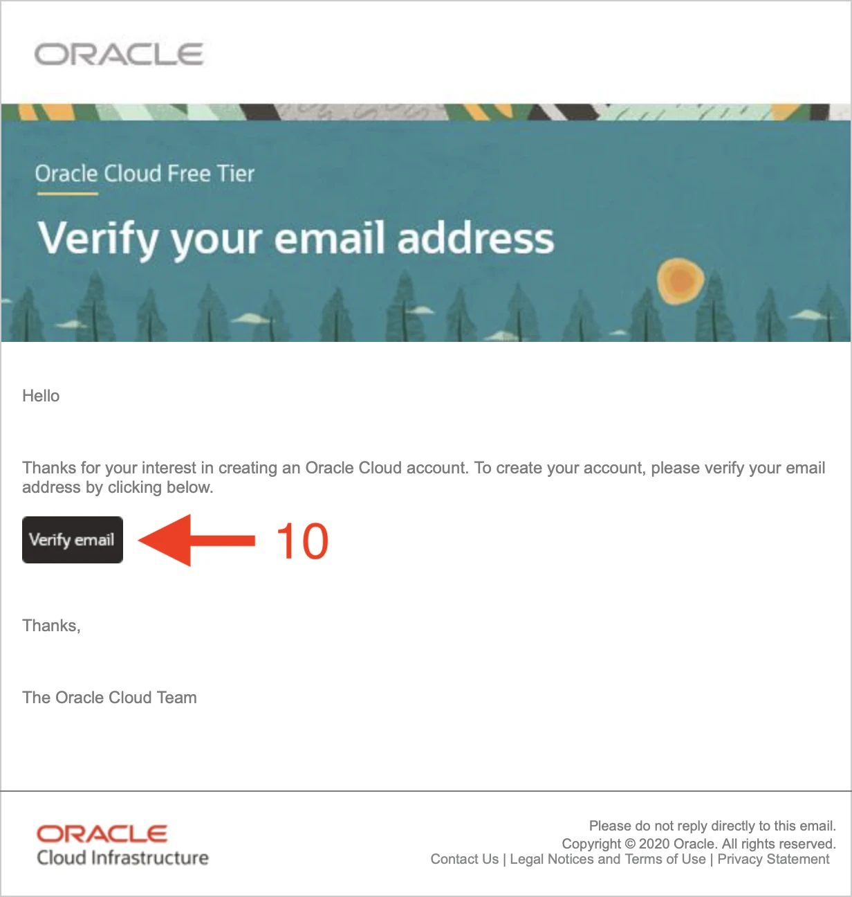
    
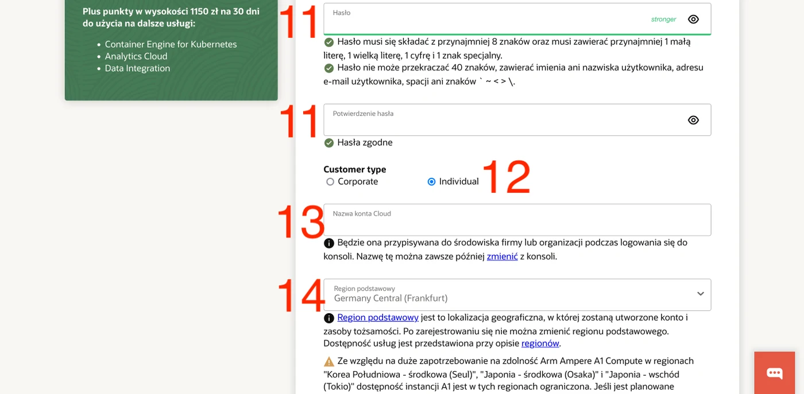
    
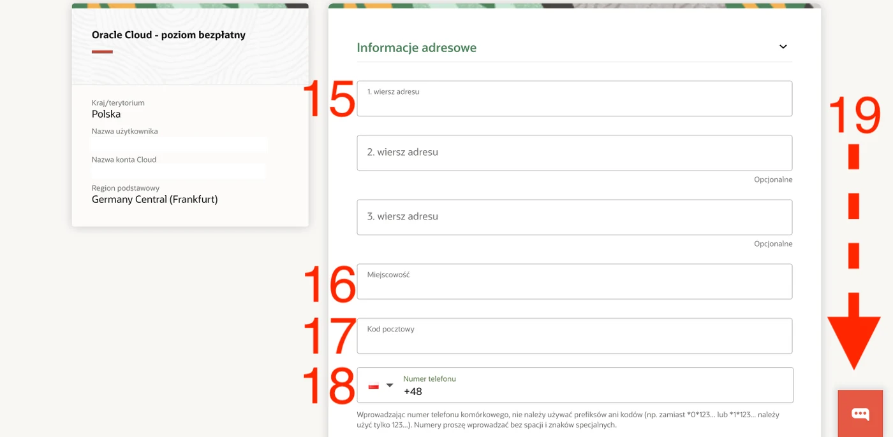
    
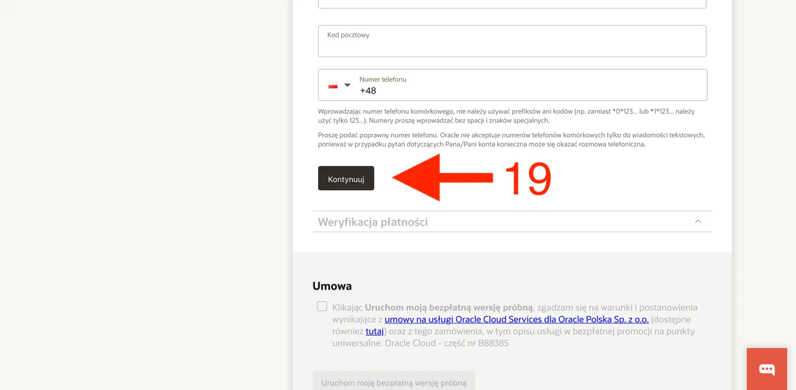
    
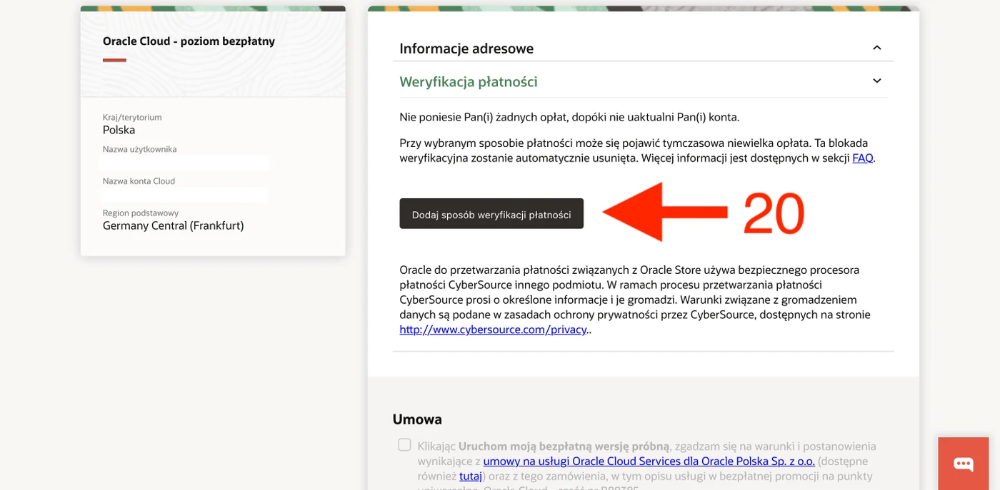
    
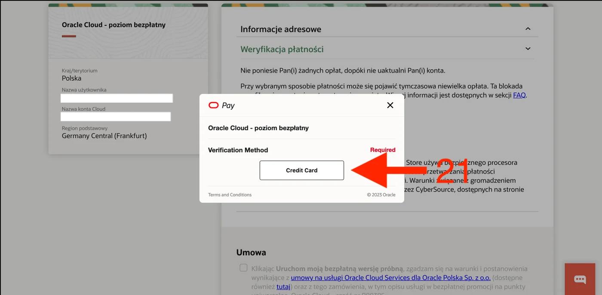
    
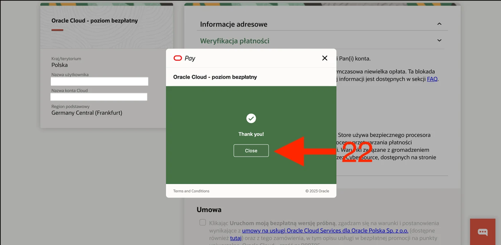
    
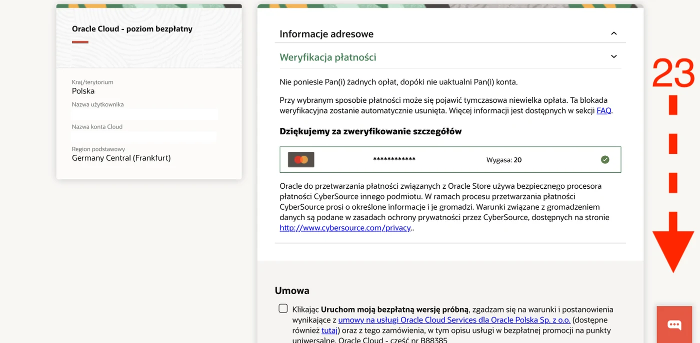
    
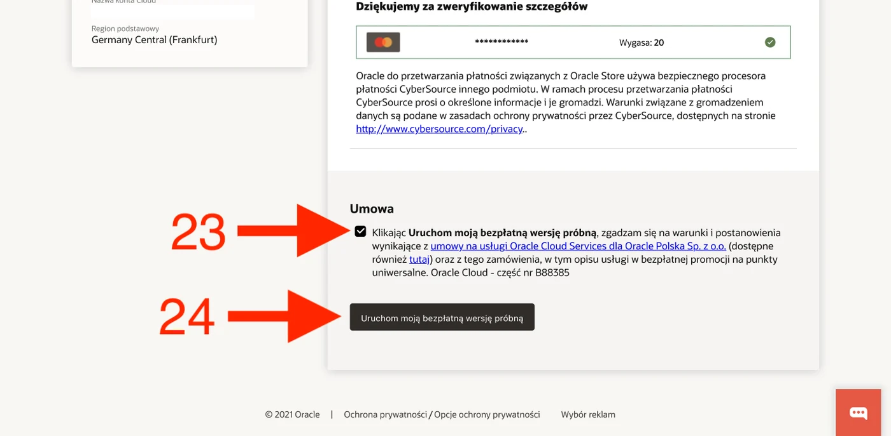
    
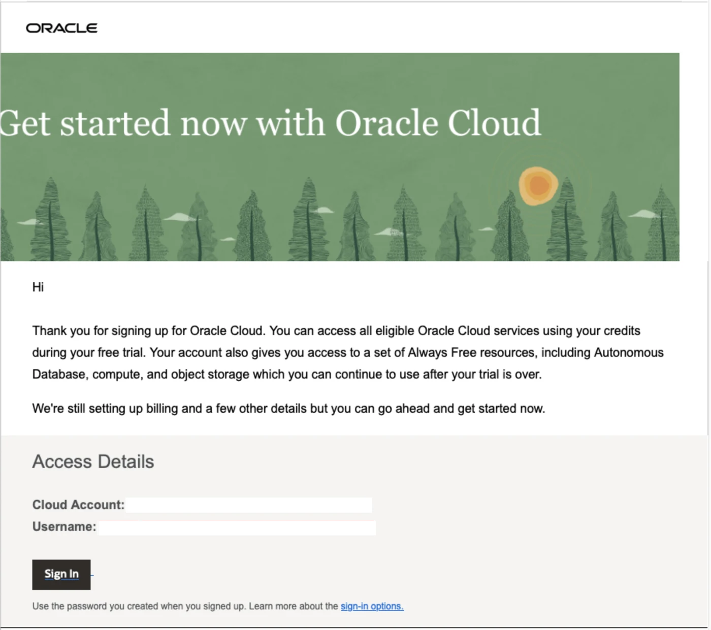
    

1. Wchodzimy na [oracle.com](https://oracle.com), znajdujemy w prawym górnym rogu przycisk _View Accounts_ \[1\], po którego naciśnięciu wysunie nam się okienko, gdzie naciskamy przycisk _Sign in to Cloud_ \[2\].

3. Zostaniemy przekierowani do panelu logowania, pod którym w sekcji _Not an Oracle Cloud customer yet?_ naciskamy przycisk _Sign Up_ \[3\].

5. Strona przenosi nas do formularza rejestracyjnego, w którym podajemy podstawowe informacje jak kraj \[4\], imię \[5\], nazwisko \[6\] i adres e-mail \[7\], na który po zatwierdzeniu dostaniemy maila potwierdzającego, więc musi on być prawdziwy. Uczulam, bo niektórzy lubią w takich przypadkach skorzystać z rozwiązania pokroju tymczasowego maila (np. 10-minutowego) czy coś w tym stylu. Na koniec jeszcze potwierdzenie, że nie jesteśmy robotem \[8\] i zatwierdzamy przyciskiem _Weryfikacja adresu e-mail_ \[9\].

7. Wchodzimy do naszej skrzynki mailowej i czekamy na maila od _Oracle_, w którym będzie przycisk do potwierdzenia swojego adresu e-mail \[10\]. Tutaj sprawa w moim przypadku była o tyle ciekawa, że strasznie długo musiałem czekać aż ten mail dojdzie. Niby podają na stronie, że jego ważność to 30 minut, ale ja na pewno kliknąłem w niego później, a i tak proces się udał. Tak czy siak możliwe, że trzeba będzie uzbroić się w cierpliwość, bo system rejestracji _Oracle_ wydaje mi się mocno _zabugowanym_ narzędziem... Ale spokojnie można przejść w tym czasie do robienia czegoś zupełnie innego i nawet zamknąć kartę z formularzem rejestracyjnym _Oracle Cloud_, bo po kliknięciu w link z maila i tak wrócimy tam gdzie skończyliśmy.

9. Po potwierdzeniu maila i powrocie do formularza rozszerza się jego zakres. Podajemy dwa razy hasło do konta \[11\]. W sekcji _Customer type_ zaznaczamy _Individual_ \[12\] (ciekawe, że to, jako zdaje się jedyne, nie zostało przetłumaczone na polski). W polu _Nazwa konta Cloud_ wpisujemy nasz identyfikator \[13\], którego będziemy używać do logowania, i ważne jest tutaj, że nie jest to login, gdyż podczas logowania loginem jest adres e-mail, a ta nazwa to zupełnie co innego, jednak jest tak samo istotna podczas logowania, dlatego trzeba ją zapamiętać. Na koniec jeszcze pozostaje nam ustawić nasz region podstawowy \[14\]. Wybór regionu jest o tyle ważny, że przy darmowym koncie można rejestrować _maszyny_ jedynie w tym regionie, który deklarujemy podczas rejestracji. Dopiero w planie płatnym jest możliwość posiadania dostępu do wszystkich regionów. Ja polecam tutaj wybrać region, który jest najbliżej naszego miejsca pobytu, a więc dla Polski będzie to niemiecki Frankfurt. Każdy kto kiedykolwiek kupował jakiegoś VPSa wie, że w Europie najbardziej popularne są dwa regiony Helsinki (Finlandia) i właśnie Frankfurt (Niemcy).

11. Następna strona dotyczy danych adresowych, czyli podajemy adres zamieszkania \[15\], miejscowość\[16\], kod pocztowy \[17\] oraz numer telefonu \[18\]. Po wszystkim zatwierdzamy przyciskiem _Kontynuuj_ \[19\].

13. Sekcja dotycząca adresu zostaje zwinięta, a rozwija nam się weryfikacja tożsamości poprzez płatność kartą. Tutaj nie jestem pewien, bo tego nie sprawdzałem, ale zakładam, że dane karty na karcie muszą zgadzać się z tym co podaliśmy wcześniej. Piszę to, bo jeżeli czyta to np. nieletni, który wykonuje to wszystko za zgodą rodzica i skorzysta też z jego karty to musi podawać dane tegoż rodzica od samego początku, a nie dopiero teraz. Po naciśnięciu przycisku _Dodaj sposób weryfikacji płatności_ \[20\] wyświetli się okienko, które chyba miało być oknem wyboru, a w praktyce daje możliwość wybrania tylko opcji _Credit Card_ \[21\], co też oczywiście robimy. W tym momencie otworzy nam się formularz płatności wypełniony wstępnie danymi podanymi wcześniej, a na jego końcu znajdują się pola, w które należy wpisać numer karty, datę wygaśnięcia oraz numer CVV. Rozpoczynamy płatność i tutaj dla każdego banku będzie to wyglądać inaczej. Zakładam, że dla większości będziemy musieli potwierdzić tę transakcję na telefonie lub w serwisie transakcyjnym. Proces weryfikacji jest standardowy i polega na tym, że _Oracle_ pobiera nam kwotę w wysokości ok. $1 (w trakcie gdy ja to robiłem było to 4.80 zł) i następnie po sekundzie zwraca nam tyle samo. W większości banków transakcja od razu traktowana jest jako nieważna i w ogóle nie pojawi się w billingu. Muszę też dodać, że _Oracle_ jest dość wybredne jeżeli chodzi o akceptowanie niektórych kart, co potwierdza się w opiniach, które można znaleźć w Internecie. Wirtualne lub tymczasowe karty raczej na 100% zostaną od razu odrzucone. Tak samo podobno problem jest ogólnie z _Revolutem_. Ja próbowałem na karcie z _mBank_ i nie poszło, więc za drugim podejściem skorzystałem z _Citi Banku_ i przeszło. Po pomyślnej weryfikacji otrzymamy zielone okienko z napisem _Thank you!_, które zamykamy przyciskiem _Close_ \[22\].

15. Po zamknięciu w/w okienka wracamy ponownie do formularza rejestracyjnego, w którym powinna zostać dodana nasza karta. Przewijamy stronę na dół, zaznaczamy wymaganą zgodę na uruchomienie bezpłatnej wersji próbnej \[23\] i finalizujemy wszystko przyciskiem _Uruchom moją bezpłatną wersję próbną_ \[24\].

17. Teraz pozostaje nam już tylko czekać na maila potwierdzającego, że nasze konto zostało pomyślnie utworzone i wszystkie zasoby przysługujące przy darmowym koncie zostały nam przyznane.

## Tworzymy instancję Oracle Cloud

_Oracle_ nazywa _maszyny wirtualne_ _instancjami_. W tym rozdziale stworzymy dokładnie taką _maszynę_ jak w tytule tego wpisu oraz opisaną w jednym z powyższych rozdziałów.

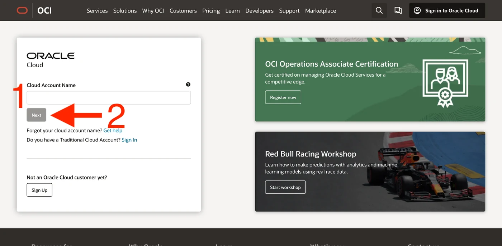
    
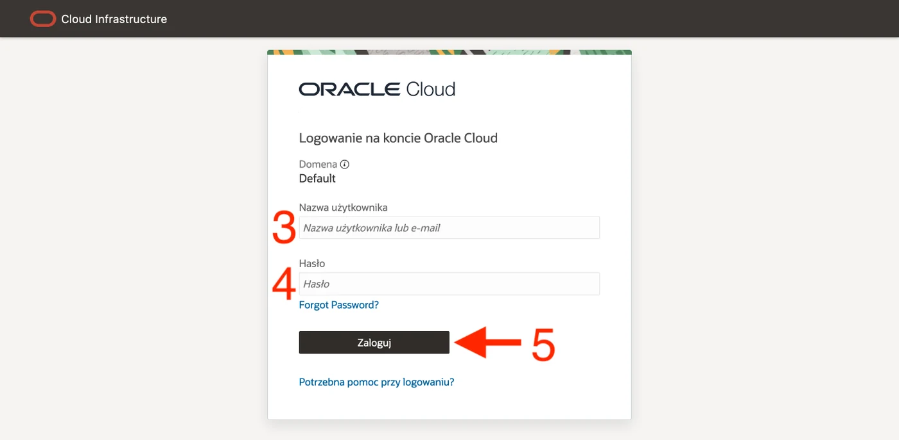
    
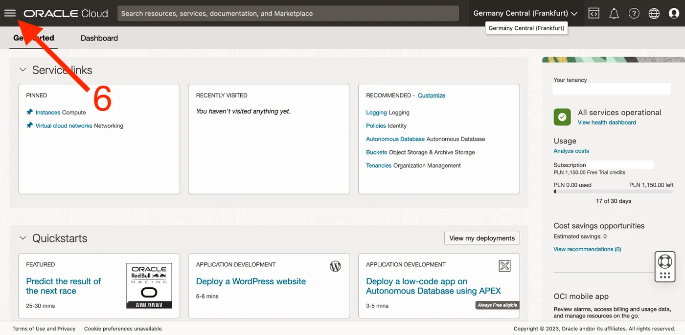
    
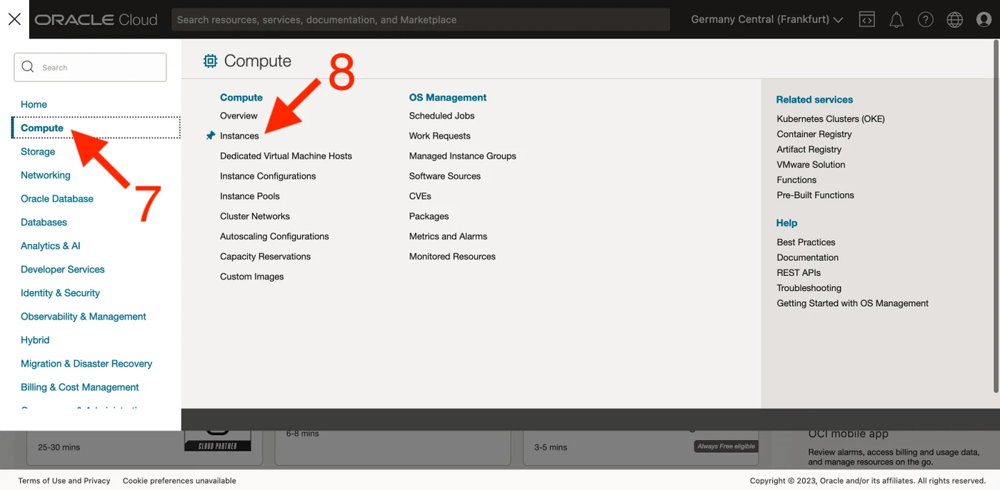
    
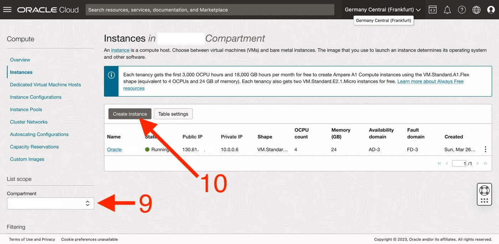
    
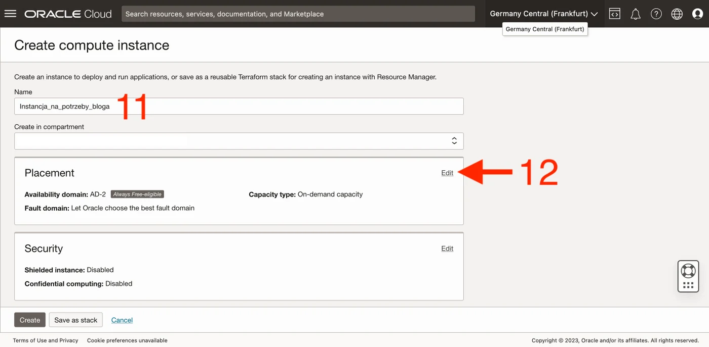
    
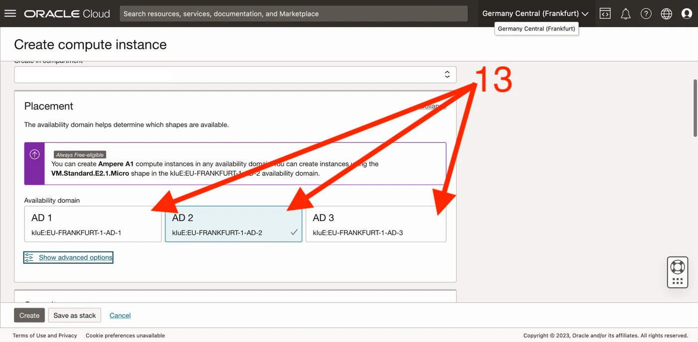
    
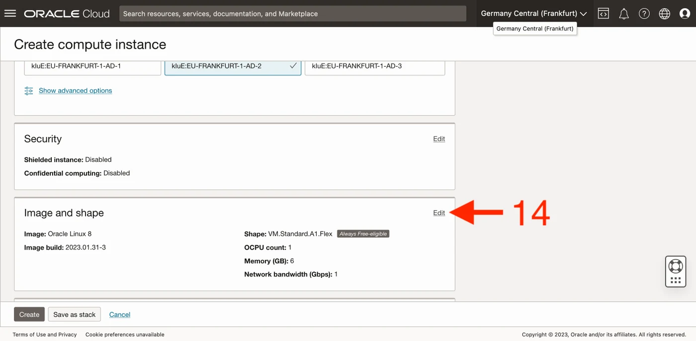
    
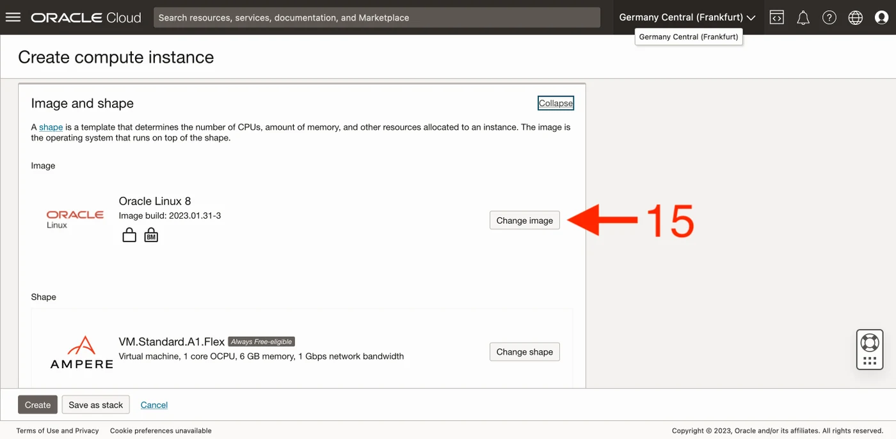
    
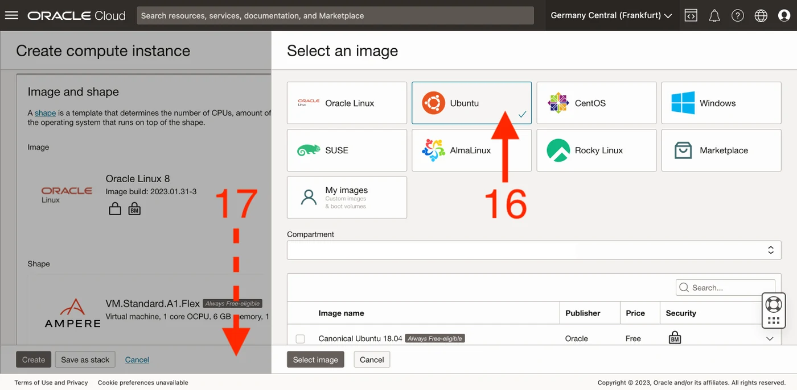
    
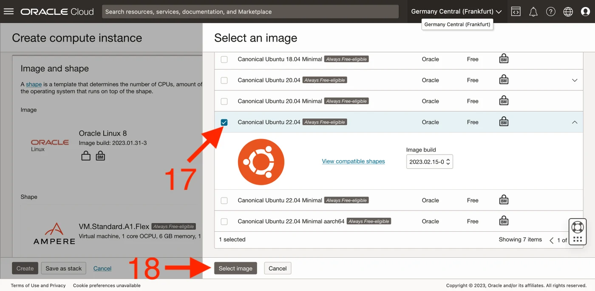
    
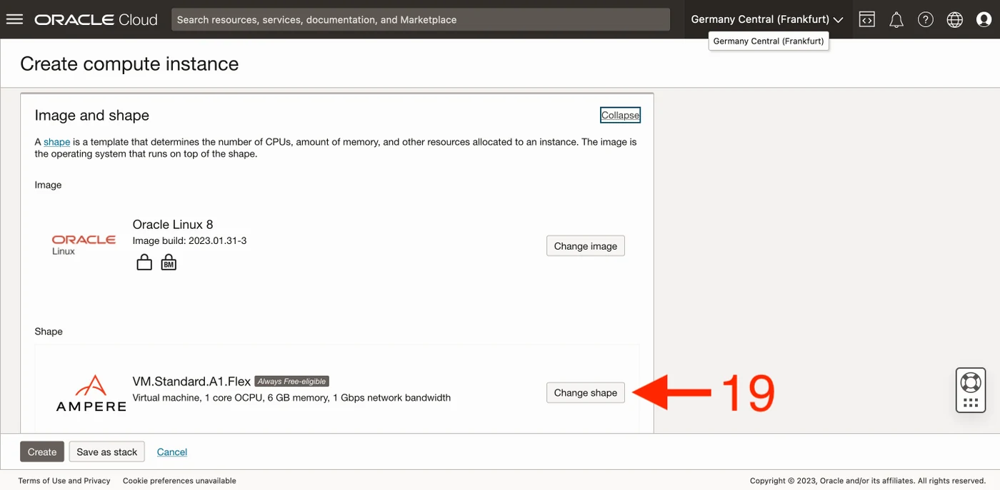
    
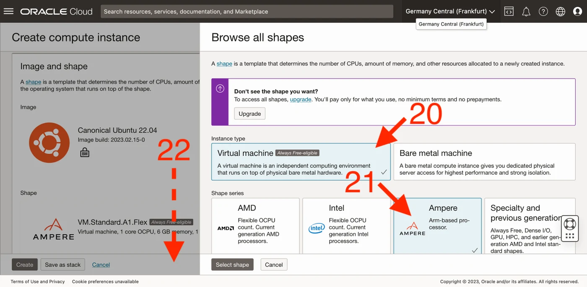
    
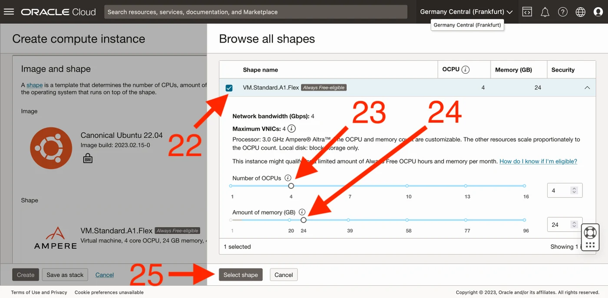
    
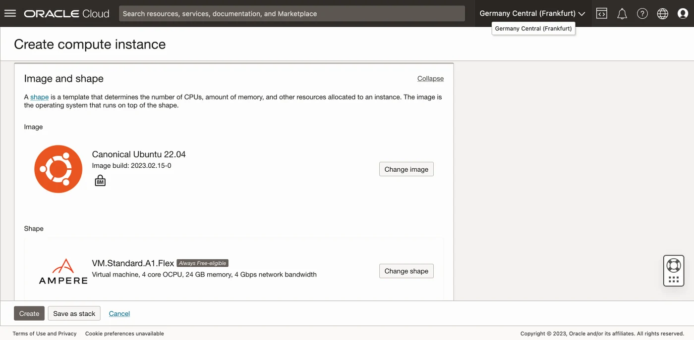
    
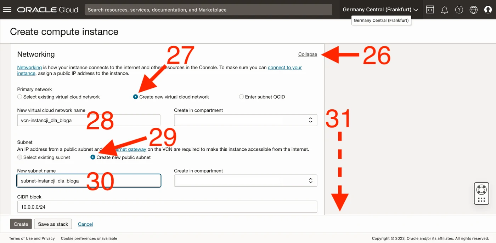
    
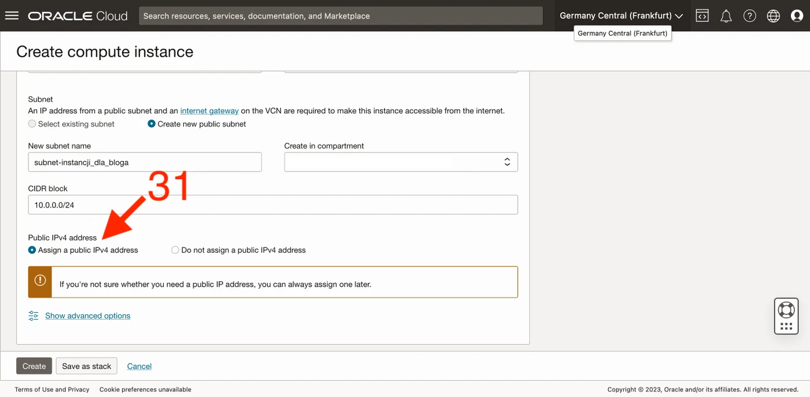
    
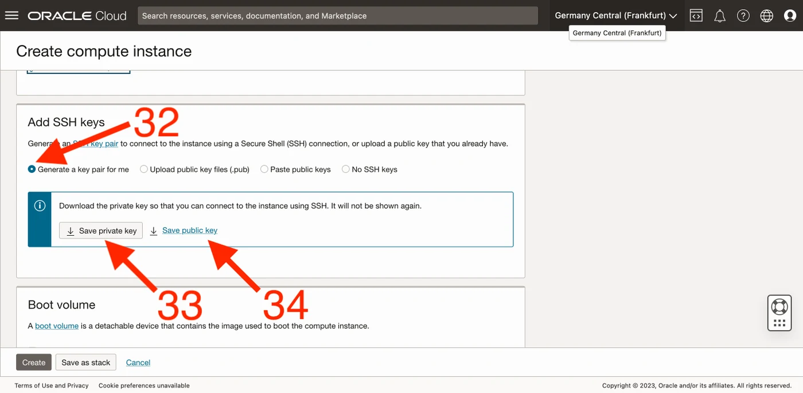
    
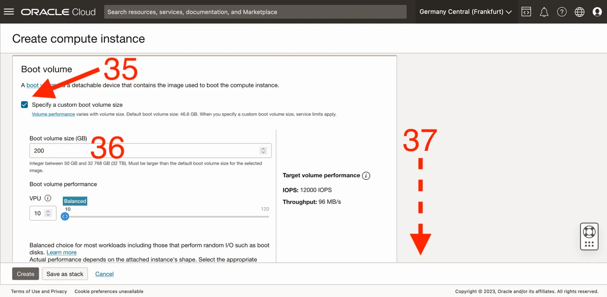
    
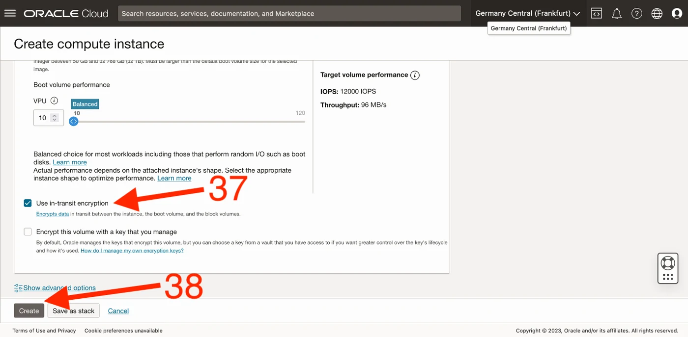
    

1. Tak jak w poprzednim rozdziale, wchodzimy na [oracle.com](https://oracle.com), znajdujemy w prawym górnym rogu przycisk _View Accounts_, po którego naciśnięciu wysunie nam się okienko, gdzie naciskamy przycisk _Sign in to Cloud_.

3. Zostaniemy przekierowani do panelu logowania i tym razem już wypełniamy pole _Cloud Account Name_ \[1\] zgodnie z tym co podczas rejestracji podaliśmy w polu _Nazwa konta Cloud_ (to jest ten istotny identyfikator, o którym pisałem wcześniej). Potwierdzamy przyciskiem _Next_ \[2\].

5. Przechodzimy do standardowej strony logowania, w której podajemy adres e-mail jako login \[3\] oraz hasło \[4\], po czym potwierdzamy przyciskiem _Zaloguj_ \[5\].

7. Jesteśmy w naszym centrum dowodzenia. Aktywujemy menu głównego poprzez naciśnięcie przycisku z trzema poziomymi kreskami w lewym górnym rogu \[6\]. Następnie zakładka _Compute_ \[7\], a w niej _Instances_ \[8\].

9. Zostaniemy przeniesieni do centrum zarządzania naszymi _instancjami_ (_maszynami wirtualnymi_). W pierwszej kolejności, jeżeli nie jest to, musimy wybrać _Compartment_ \[9\], będziemy mieli tylko jeden wybór, którym będzie _\[nasz account name\] (root)_. Na zrobionym przeze mnie zrzucie ekranu widać, że już jest jedna _instancja_, w Twoim przypadku jej nie będzie, bo dopiero zamierzamy ją utworzyć. Naciskamy przycisk _Create instance_ \[10\].

11. Ukaże się nam kreator nowej instancji. Pierwszym krokiem jest nadanie jej nazwy \[11\], może być ona dowolna i chyba nawet nie musi być unikatowa w kontekście globalnym, a jedynie w zakresie naszych _instancji_. Kolejnym krokiem jest rozwinięcie sekcji _Placement_ poprzez naciśnięcie _Edit_ \[12\].

13. W sekcji _Placement_ decydujemy, w której _Domenie_ utworzymy naszą _maszynę_ \[13\]. Jeżeli wcześniej jako region wybraliśmy _Frankfurt_ to będziemy tutaj mieli trzy domeny do wyboru. Wydaje mi się, że nie ma większego znaczenia, którą wybierzemy. Istnieje natomiast szansa, że będziemy musieli później wrócić do tego miejsca i zmienić domenę, bo podczas finalizacji tworzenia _instancji_ może nam wyskoczyć błąd, że w tej, którą akurat wybraliśmy nie ma już wolnych _maszyn_ o wybranych przez nas parametrach. Wtedy z np. AD-2 zmieniamy na AD-3 i próbujemy jeszcze raz.

15. Przechodzimy dalej do sekcji _Image and shape_ i rozwijamy ją tak samo jak poprzednią \[14\]. Po rozwinięciu ukazuje nam się możliwość wyboru systemu operacyjnego i parametrów _instancji_. Zaczynamy od systemu, czyli skorzystajmy z przycisku _Change image_ \[15\]. W oknie, które wyskoczy proponuję wybrać _Ubuntu_ \[16\], zjechać na niżej, wybrać wersję _22.04_ \[17\] i zatwierdzić przyciskiem _Select image_ \[18\]. Teraz naciskamy przycisk _Change shape_ \[19\], który otwiera nam konfigurator parametrów _maszyny_. Wybieramy _Virtual machine_ \[20\], _Ampere_ \[21\], zaznaczamy _VM.Standard.A1.Flex_ \[22\], zmieniamy _Number of OCPUs_ na 4 \[23\], sprawdzamy czy _Amount of memory (GB)_ jest ustawione na 24GB \[24\] i zatwierdzamy przyciskiem _Select shape_ \[25\].

17. Następna interesująca nas sekcja to _Networking_, którą oczywiście rozwijamy \[26\]. W tej sekcji mamy do ustawienia trzy rzeczy. Pierwsza to _Primary network_, którą obrazowo można przedstawić jako domową sieć Wi-Fi, w której znajdują się wszystkie nasze urządzenia. Jesteśmy dopiero na początku drogi, więc po prostu utwórzmy nową, wirtualną sieć chmurową wybierając _Create new virtual cloud network_ \[27\] i nadając jej jakąś nazwę \[28\]. Druga rzecz to _Subnet_, czyli podsieć naszej sieci głównej. To odpowiednik ustawiania na domowym routerze podsieci o adresacji np. od 192.168.0.1 do 192.168.0.255. Tutaj tak samo tworzymy nową podsieć wybierając opcję _Create new public subnet_ \[29\] i nadając jej jakąś nazwę \[30\]. Ostatnią rzeczą jaka pozostała nam w ustawieniach sieciowych to sprawdzenie, że na pewno mamy zaznaczone _Assign a public IPv4 address_ \[31\], co oznacza żądanie przypisania dla naszej _instancji_ dedykowanego, publicznego adresu _IPv4_. Jeszcze raz chciałbym podkreślić, że jest to super opcja, która jest niedostępna dla wielu płatnych _VPSów_.

19. Kolejna sekcja to _Add SSH keys_, która, jak można się domyślić, dotyczy kluczy, którymi będziemy się uwierzytelniać podczas komunikacji po _SSH_. _Oracle_ (słusznie) nie daje możliwości logowania się do serwera przy użyciu jedynie loginu i hasła, wymusza natomiast konieczność korzystania z _kluczy SSH_. Podczas tworzenia nowej _instancji_ proponuję po prostu wybrać opcję _Generate a key pair for me_, czyli pozwolić _Oracle_ wygenerować dla nas parę kluczy i pobrać te klucze - _prywatny_ \[33\] i _publiczny_ \[34\]. Istotne jest, aby nie stracić tych kluczy, bo bez nich nie dostaniemy się do naszego serwera.

21. Ostatnia sekcja to _Boot volume_, w której możemy zwiększyć przestrzeń dyskową jaka zostanie przydzielona do tej _instancji_. Realizuje się to poprzez zaznaczenie opcji _Specify a custom boot volume size_ \[35\] i wpisanie w pole _Boot volume size (GB)_ wartości od 50 do 200 \[36\]. Domyślnie jest to 50GB, ale w zakresie _Free Tier_ można korzystać z 200GB i tę wartość polecam tam wpisać. Proponuję jeszcze w dolnej części tej sekcji zaznaczyć opcję _Use in-transit encryption_ \[37\], bo szyfrowanie podczas transferu danych jest zawsze dobrą opcją.

23. To wszystko. Teraz wystarczy już tylko potwierdzić powyższe ustawienia przyciskiem _Create_ \[38\] i tym samym utworzyć swoją pierwszą _maszynę wirtualną_ w chmurze _Oracle_. Na tym etapie może nam jeszcze zostać wyświetlony komunikat, o którym pisałem w punkcie 7. powyżej. Wtedy wystarczy tylko wybrać inną domenę i spróbować jeszcze raz.

## Połączenie po SSH do instancji

Jak patrzę teraz na ten wpis to widzę, że już wyszedł monstrualny, a będzie jeszcze większy, bo chciałbym z niego zrobić taki mega poradnik dotyczący _Oracle Free Tier_. Obrana przeze mnie forma, czyli pisanie łopatologicznie najbardziej jak się da, też nie sprzyja temu, aby był to zwięzły wpis. Przepraszam!


Wracając do tematu. W tym wpisie omówiłem już jak utworzyć konto w _Oracle Cloud_ oraz jak stworzyć pierwszą _maszynę wirtualną_, wykorzystując przy tym do maksimum możliwości darmowego planu. Teraz przyszedł czas na opisanie jak połączyć się z tą _maszyną_.

To jak łączyć się z serwerami poprzez _SSH_ opisałem w [tym wpisie](https://blog.tomaszdunia.pl/serwer-domowy/#ssh). Natomiast w [tym wpisie](https://blog.tomaszdunia.pl/serwer-domowy-podstawowa-konfiguracja/#kluczessh) to jak używać kluczy SSH. Nie będę tego wszystkie opisywał jeszcze raz. Skupimy się tutaj jedynie na tym co dla konkretnego przypadku jest nieoczywiste. Do połączenia przez SSH potrzebujemy w zasadzie czterech rzeczy:

1. Adresu _IP_ serwera

3. Nazwy użytkownika, na którego się zalogujemy

5. Publicznego klucza _SSH_

7. Prywatnego klucza _SSH_

Pierwsza dwa uzyskamy poprzez wejście do centrum zarządzania instancjami (tak jak to robiliśmy w punkcie 4. rozdziału dotyczącego tworzenia _instancji_). Po poprawnym jej utworzeniu powinniśmy w tym miejscu widzieć ją na liście naszych _instancji_, więc wejdźmy do jej właściwości \[1\].

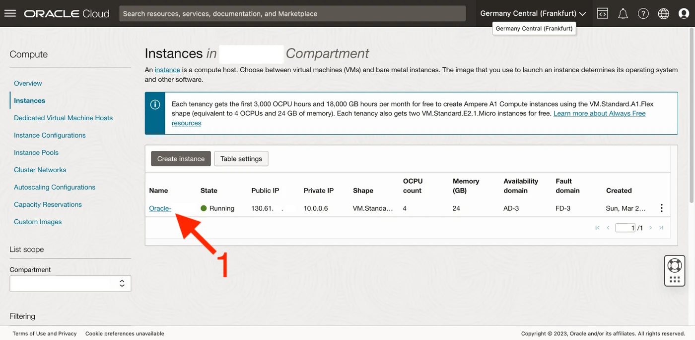

Szukane przez nas informacje (adres IP serwera \[2\] i nazwa użytkownika \[3\]) znajdują się w zakładce _Instance information_ w sekcji _Instance access_ po prawej stronie.

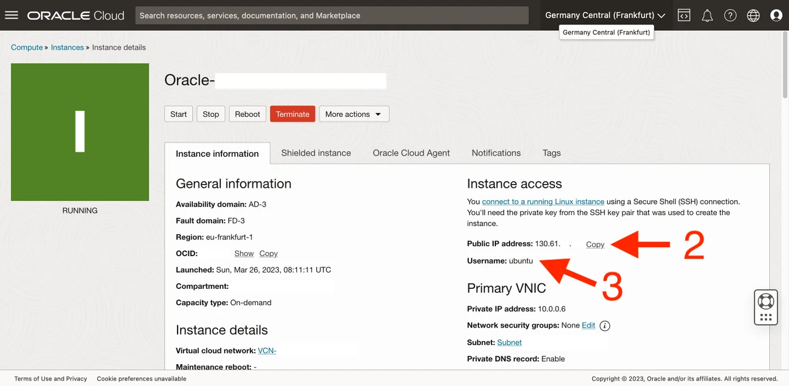

Wymagane do uwierzytelniania klucze _SSH_ pobraliśmy już na dysk podczas tworzenia _instancji_. Mamy już wszystko, więc teraz trzeba tylko to wszystko wrzucić do _Termiusa_ (lub użyć innego sposobu) i połączyć się z naszym nowiusieńkim _VPSem_. Po połączenie przez SSH polecam zmienić (ustawić) hasła dla obecnych użytkowników root i ubuntu.

```bash
sudo su
passwd
   [dwa razy podać hasło dla roota]
sudo passwd ubuntu
   [dwa razy podać hasło dla użytkownika ubuntu]
exit
```

Przy okazji przypominam także o moim wpisie [Serwer domowy – podstawowa konfiguracja](https://blog.tomaszdunia.pl/serwer-domowy-podstawowa-konfiguracja/).

## Otwieranie portów

Trzeba przyznać, że _Oracle_ całkiem aktywnie dba o podstawowe bezpieczeństwo swoich klientów. Poza _firewallem_ (opartym o _iptables_), który możemy skonfigurować na swoich _maszynach_, istnieje również dodatkowa zapora, będąca częścią infrastruktury nadrzędnej. Zakładam, że mając taki serwer planujesz już, drogi Czytelniku, jakie usługi na nim uruchomisz. Jednakże, aby uzyskać do nich dostęp z zewnątrz potrzebujesz otwartych portów swojego serwera, a _Oracle_ **domyślnie otwiera dla każdej _maszyny_ jedynie port _22_**, służący do komunikacji po _SSH_. Pozostałe są zamknięte. Z uwagi na powyższe ostatnią rzeczą jaką postaram się przekazać w tym wpisie jest instrukcja jak otworzyć inne porty swojej _maszyny wirtualnej_. Pokażę to na przykładzie portów _80_ (_HTTP_) i _443_ (_HTTPS_), czyli tych niezbędnych np. do uruchomienia strony internetowej.

W pierwszej kolejności otwórzmy porty we wcześniej wspomnianej zaporze nadrzędnej. Robi się to z poziomu interfejsu webowego, który wcześniej nazwałem potocznie centrum dowodzenia.

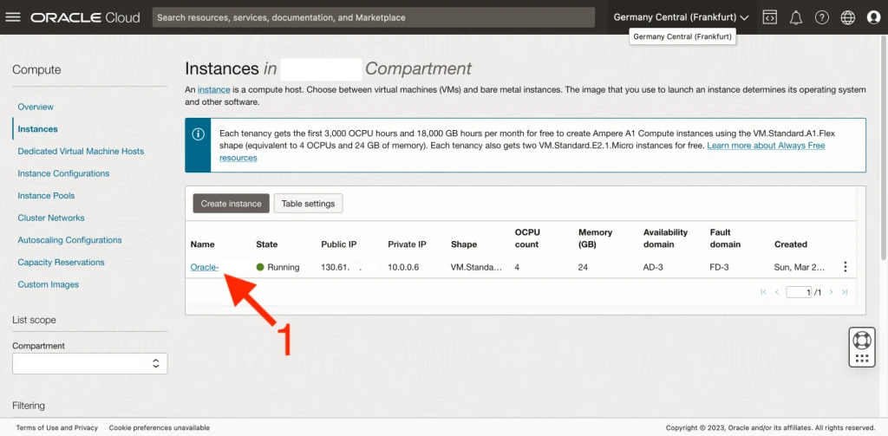
    
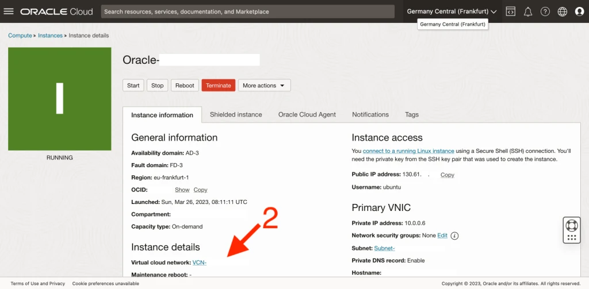
    
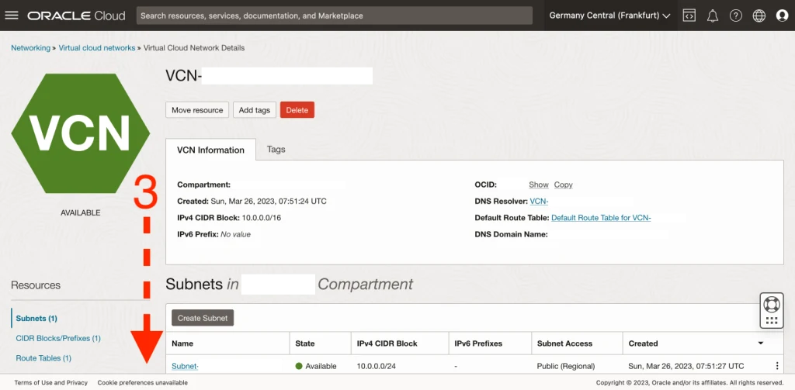
    
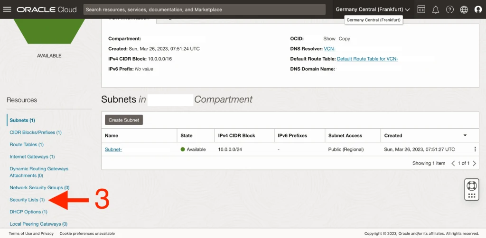
    
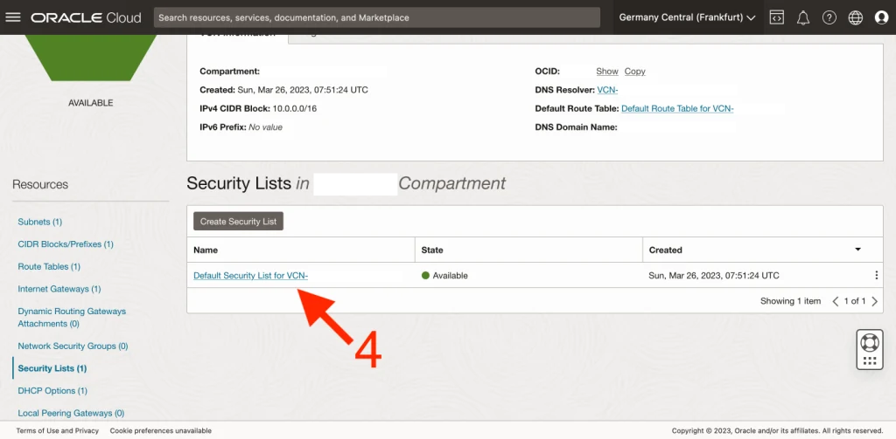
    
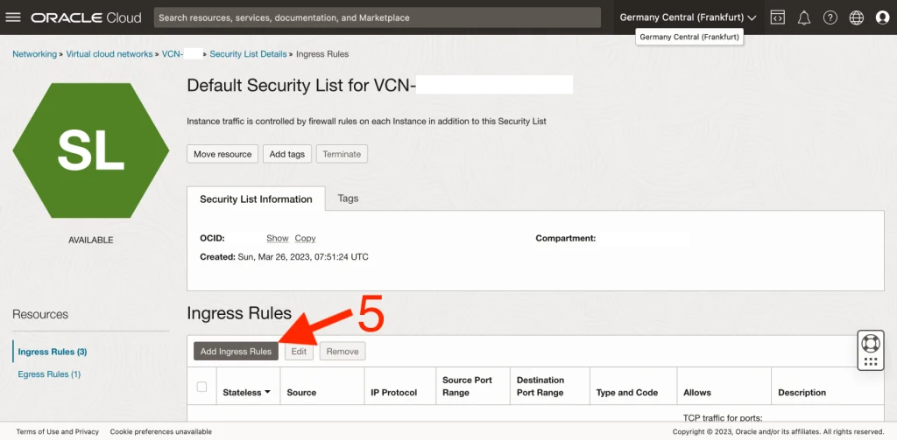
    
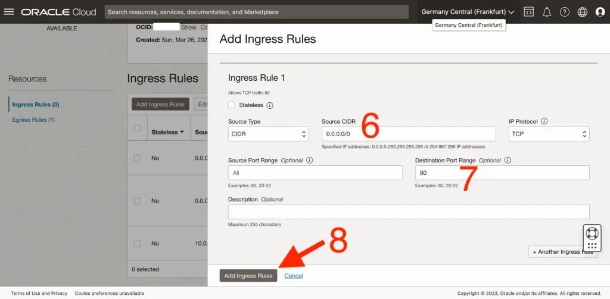
    
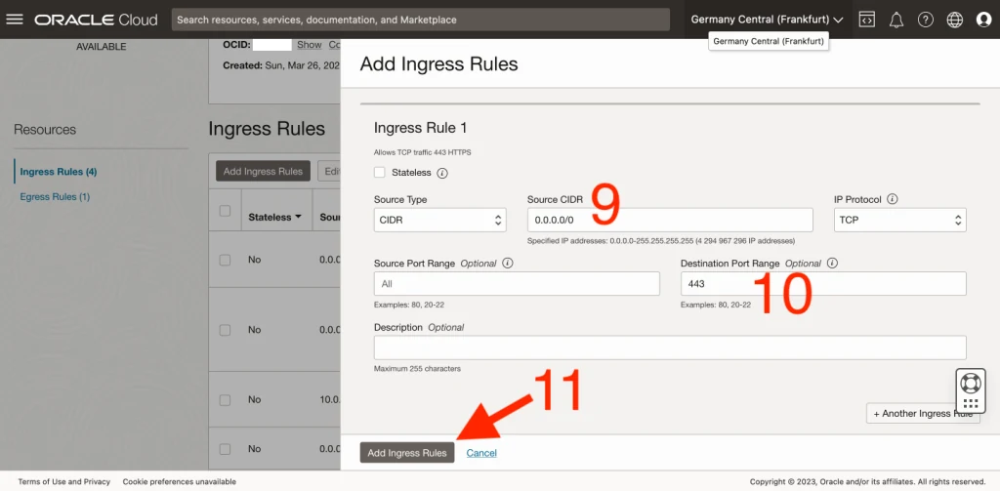
    

1. Aby wejść w ustawienia zapory należy najpierw wejście do centrum zarządzania instancjami (tak jak to robiliśmy w punkcie 4. rozdziału dotyczącego tworzenia _instancji_).

3. Następnie wchodzimy do właściwości naszej _instancji_ \[1\].

5. W sekcji _Instance details_ znajduje się łącze do _Virtual cloud network_ \[2\], czyli odnośnik do wirtualnej sieci chmurowej, w której znajduje się nasza _instancja_. To właśnie w jej ustawieniach znajdziemy to czego szukamy, czyli reguły zapory sieciowej.

7. W ustawieniach sieciowych w panelu po lewej wybieramy _Security Lists_ \[3\].

9. Na liście powinna pojawić się pozycja, której nazwa zaczynać się będzie od _Default Security List for..._ \[4\] wchodzimy w jej właściwości, bo to właśnie ustawienia nadrzędnej zapory sieciowej.

11. Ustawienia zapory dzielą się na reguły dotyczące ruchu przychodzącego _Ingress Rules_ i wychodzącego _Egress Rules_. Dodajemy nową regułę korzystając z przycisku _Add Ingress Rules_ \[5\].

13. W polu _Source CIDR_ \[6\] wpisujemy wartość _0.0.0.0/0_, co oznacza, że nie ma znaczenia z jakiego adresu się łączymy. Następnie w polu _Destination Port Range_ \[7\] wpisujemy wartość _80_ i potwierdzamy przyciskiem _Add Ingress Rules_ \[8\]. Ta reguła otwiera port 80.

15. Analogicznie robimy to samo dla portu _443_. W polu _Source CIDR_ \[9\] wpisujemy wartość _0.0.0.0/0_, następnie w polu _Destination Port Range_ \[10\] wpisujemy wartość _443_ i potwierdzamy przyciskiem _Add Ingress Rules_ \[11\].

Z poziomu zapory nadrzędnej porty _80_ i _443_ zostały otwarte, więc musimy jeszcze otworzyć ostatnie drzwi jakimi jest _firewall_ działający na serwerze. Wykonuje się to poprzez modyfikację _iptables_, czyli wbudowanego w Ubuntu _firewall'a_. Zacznijmy od portu 80:

```bash
sudo iptables -I INPUT 6 -m state --state NEW -p tcp --dport 80 -j ACCEPT
sudo netfilter-persistent save
```

To samo wykonujemy dla portu 443 (HTTPS):

```bash
sudo iptables -I INPUT 6 -m state --state NEW -p tcp --dport 443 -j ACCEPT
sudo netfilter-persistent save
```

Jak widać, aby otworzyć dowolny inny port wystarczy zmienić w pierwszym z powyższych poleceń tylko jedną liczbę oznaczającą numer portu.

Sprawdźmy teraz czy wszystkie powyższe działania się powiodły. Gdy sam to robiłem moim pierwszym pomysłem było skorzystanie ze skanera portów online (np. [tego](https://www.whatismyip.com/port-scanner/)), jednak wyszło mi, że wszystkie porty poza _22_ są dalej zamknięte... Chce mi się śmiać z samego siebie, bo straciłem blisko godzinę zanim ustaliłem, że skaner pokazuje iż port jest zamknięty dlatego, że żadna usługa nie jest na nim uruchomiona. Piszę to, żeby Tobie, drogi Czytelniku, oszczędzić czasu.

W takim razie jak sprawdzić czy prawidłowo otworzyliśmy port _80_? Uruchomimy prosty serwer _HTTP_ przy użyciu _Python'a_. Poniżej przygotowałem gotowy zestaw poleceń:

```bash
mkdir /tmp/port80
echo 'Port 80 jest otwarty!' > /tmp/port80/index.html
sudo python3 -m http.server 80 --directory /tmp/port80/
```

W skrócie: tworzymy folder tymczasowy, w jego środku plik _index.html_ i uruchamiamy serwer _HTTP_ na porcie _80_. Teraz wpisujemy _adres IP_ naszego _VPSa_ w pasek adresu przeglądarki i potwierdzamy _ENTERem_. Jeżeli wyświetli nam się napis _Port 80 jest otwarty!_ to znaczy, że wszystko przebiegło tak jak powinno. Wracamy do terminala i kombinacją klawiszy CTRL+C zatrzymujemy serwer _HTTP_ i czyścimy po nim pliki, żeby nie zostawiać śmietnika na naszej świeżutkiej _maszynie wirtualnej_.

```bash
rm -rf /tmp/port80
```

## Obsługa IPv6

Już po opublikowaniu tego wpisu przypomniałem sobie, że powinienem omówić jeszcze jeden temat jakim jest włączenie obsługi _IPv6_. Bez tego _maszyna_ będzie prawidłowo działała jednak do prawidłowego działania niektórych usług, które możemy na niej uruchomić, obsługa _IPv6_ jest zalecana. Przykładem takiej usługi jest instancja _Mastodona_, która zadziała jedynie na _IPv4_, ale bez _IPv6_ nie będzie mogła się komunikować z innymi instancjami, które działają właśnie w oparciu o tę adresację. _Oracle_ daje nam możliwość włączenia IPv6 i przypisania naszej _instancji_ adresu, więc to właśnie zrobimy.

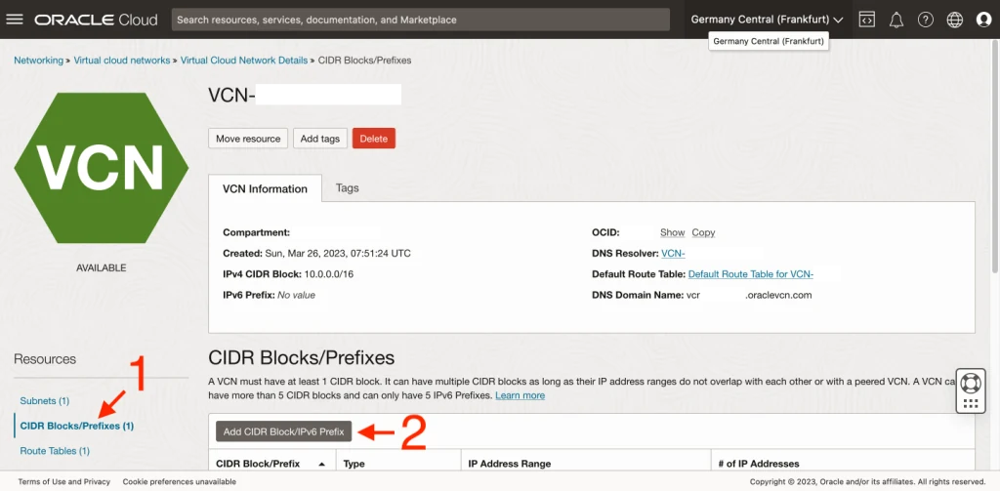
    
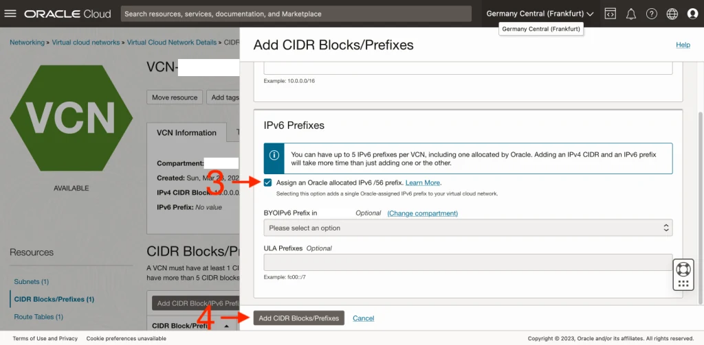
    
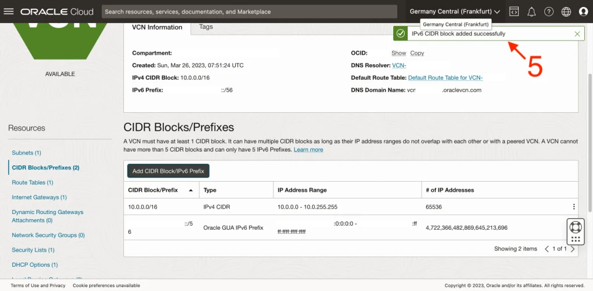
    
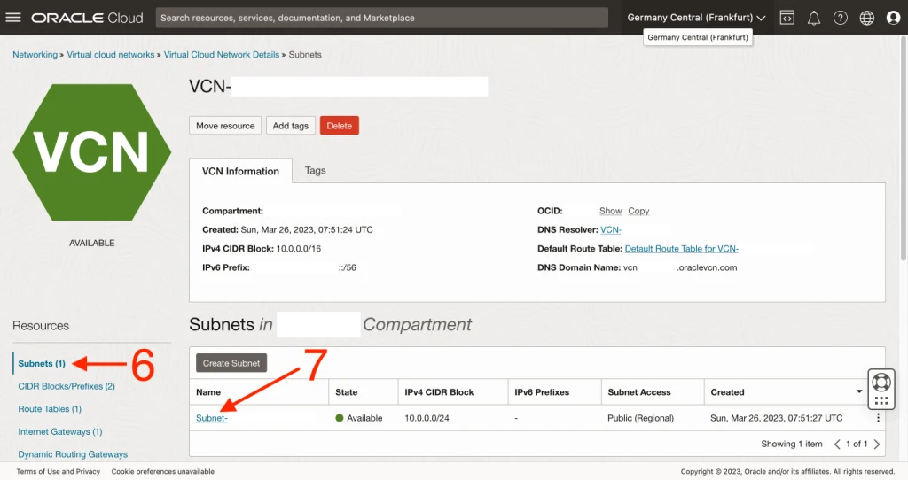
    
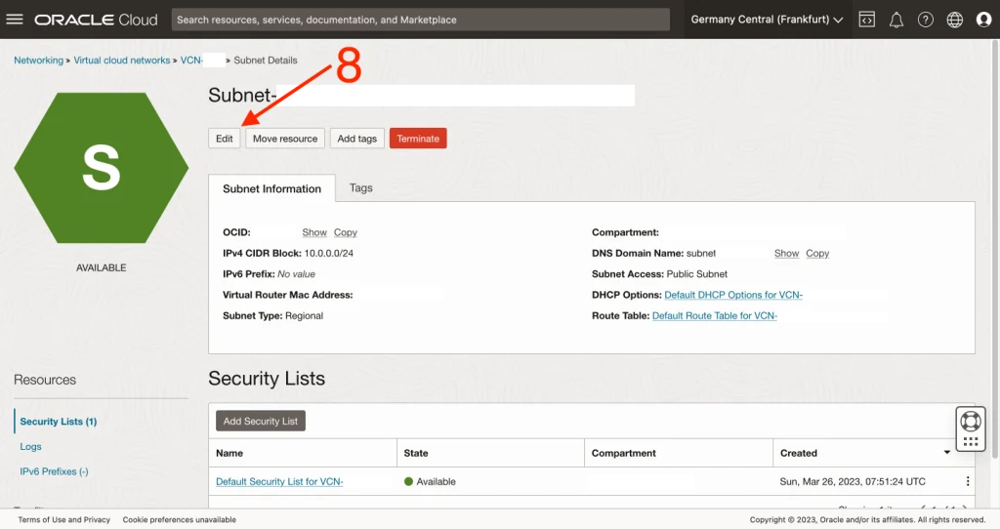
    
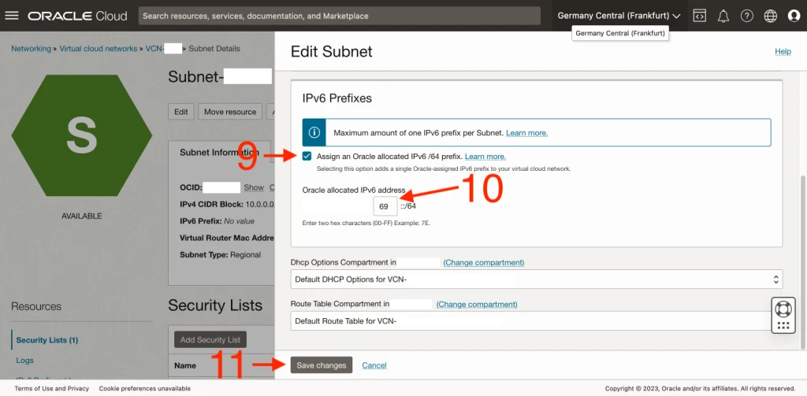
    
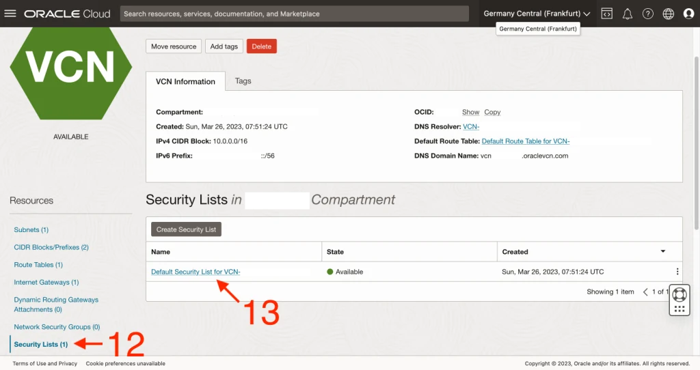
    

    

    

    

    

    

    

    

    

    

    

    

1. Wchodzimy do ustawień wirtualnej sieci chmurowej naszej instancji tak jak to zrobiliśmy w punktach 1-3 rozdziału dotyczącego otwierania portów).

3. W sekcji po lewej stronie znajdujemy na liście _CIDR Blocks/Prefixes_ \[1\].

5. Naciskamy przycisk _Add CIDR Block/IPv6 Prefix_ \[2\].

7. W oknie, które wysunie się z prawej strony, zjeżdżamy na dół, gdzie zaznaczamy opcję _Assign an Oracle allocated IPv6 /56 prefix_ \[3\] i zatwierdzamy przyciskiem _Add CIDR Blocks/Prefixes_ \[4\].

9. Po chwili w prawym górnym rogu zobaczymy dymek potwierdzający przypisanie do naszej instancji adresu IPv6 \[5\].

11. Teraz utworzony adres IPv6 musimy przypisać do podsieci, w której znajduje się nasza _instancja_. W sekcji po lewej przechodzimy do _Subnets_ \[6\]. Na liście znajdujemy odpowiednią podsieć \[7\] i wchodzimy w jej właściwości.

13. Naciskamy przycisk _Edit_ \[8\].

15. W oknie, które wysunie się z prawej strony, w sekcji _IPv6 Prefixes_ zaznaczamy _Assign an Oracle allocated IPv6 /64 prefix_ \[9\], a gdy to zrobimy pokaże nam się jeszcze dodatkowe pole tekstowe \[10\], w które musimy wpisać dowolną dwu-znakową wartość heksadecymalną pomiędzy _00_ a _FF_. Nie ma znaczenia co tutaj podamy, więc załóżmy, że będzie to _69_ (😎). Pozostaje nam jeszcze potwierdzić przyciskiem _Save changes_ \[11\].

17. Teraz musimy jeszcze odpowiednio ustawić _firewall_. W tym celu wracamy do ustawień wirtualnej sieci chmurowej i w sekcji po lewej znajdujemy na liście _Security Lists_ \[12\]. Na wyświetlonej liście znajdujemy pozycję, która nas interesuje i wchodzimy w jej właściwości \[13\].

19. W tym momencie zadanie jest takie, że w _Ingress Rules_ musimy otworzyć odpowiednie porty na ruch przychodzący (tak jak to robiliśmy w rozdziale o otwieraniu portów), ale tym razem robimy to dla _IPv6_, a nie _IPv4_, więc jako _Source CIDR_ \[14\] podajemy _::/0_ zamiast _0.0.0.0/0_. Tak samo jak w przypadku reguł dotyczących _IPv4_ dodajemy je dla wszystkich portów, które chcemy otworzyć (_80_ i _443_).

21. W ustawieniach zapory sieciowej musimy jeszcze wejść w _Engress Rules_ \[15\] i przy użyciu przycisku _Add Egress Rules_ \[16\] dodać regułę, która otworzy nam cały ruch wychodzący przez _IPv6_, tak samo jak mamy to zrobione dla _IPv4_.

23. Jako _Destination CIDR_ \[17\] podajemy _::/0_, z listy rozwijanej _IP Protocol_ wybieramy _All Protocols_ \[18\] i potwierdzamy przyciskiem _Add Egress Rules_ \[19\].

25. Po ustawieniu zapory musimy jeszcze ustawić _routing_. Wracamy do ustawień wirtualnej sieci chmurowej i w sekcji po lewej znajdujemy na liście _Route Tables_ \[20\]. Wyświetlonej liście znajdujemy pozycję, która zaczyna się od _Default Route Table for_... \[21\] i wchodzimy do jej właściwości.

27. Jak widać mamy już ustawiony odpowiedni _routing_ dla _IPv4_, natomiast dla _IPv6_ musimy dopiero utworzyć. Naciskamy przycisk _Add Route Rules_ \[22\].

29. W oknie, które wysunie się z prawej strony, w _Protocol Version_ \[23\] wymieramy _IPv6_, z listy rozwijanej _Target Type_ \[24\] wybieramy _Internet Gateway_, w pole tekstowe _Destination CIDR Block_ \[25\] wpisujemy _::/0_, z listy rozwijanej _Target Internet Gateway_ \[26\] wybieramy naszą wirtualną sieć chmurową i to wszystko zatwierdzamy przyciskiem _Add Route Rules_ \[27\].

31. Na koniec pozostało nam jeszcze przypisać adres _IPv6_ do naszej _instancji_. W tym celu przechodzimy do ustawień _instancji_ (trzy poziome kreski w lewym górnym rogu -> _Compute_ -> _Instances_ -> Wybieramy z listy naszą _instancję_).

33. W sekcji po lewej znajdujemy _Attached VNICs_ \[28\], a z listy, która zostanie wyświetlona, wybieramy tą jedyną kartę _VNIC_ (_Virtual Network Interface Card_, z ang. _wirtualna karta sieciowa_) \[29\], która zostanie wyświetlona, i wchodzimy w jej właściwości.

35. W sekcji po lewej znajdujemy _IPv6 Addresses_ \[30\] i naciskamy przycisk _Assign IPv6 Address_ \[31\].

37. W oknie, które wysunie się z prawej strony, z listy rozwijanej _Prefix_ \[32\] wybieramy prefiks, który wcześniej utworzyliśmy (na liście powinna być do wyboru tylko jedna pozycja). Poniżej proponuję pozostawić domyślny wybór, a więc dla _IPv6 address assignment_ \[33\] wybraną opcję _Automatically assign IPv6 addresses from prefix_, która oznacza, że adres dla naszej _instancji_ zostanie wybrany automatycznie. Jeżeli chcemy to oczywiście zawsze możemy zmienić to ustawienie na manualne i zdefiniować konkretny adres samemu. Potwierdzamy przyciskiem _Assign_ \[34\].

## Podsumowanie

Uf, muszę przyznać, że napisanie tego wpisu nie było dla mnie proste. Sporo czasu kosztowało mnie chociażby przygotowanie zrzutów ekranu pokazujących wszystko krok po kroku. Niemniej jednak jestem bardzo zadowolony z efektu końcowego. Wydaje mi się, że w tym wpisie udało mi się przekazać w sposób przejrzysty jak skorzystać z tej niewątpliwie interesującej oferty _Oracle_. Do tego przeprowadziłem Cię od samego początku do samego końca, bez żadnych niedomówień. Myślę, że taki VPS to super sprawa jako rozwiązanie do nauki i nie tylko, bo jego parametry są na tyle rozsądne, że można na nim uruchomić niejedną usługę.
