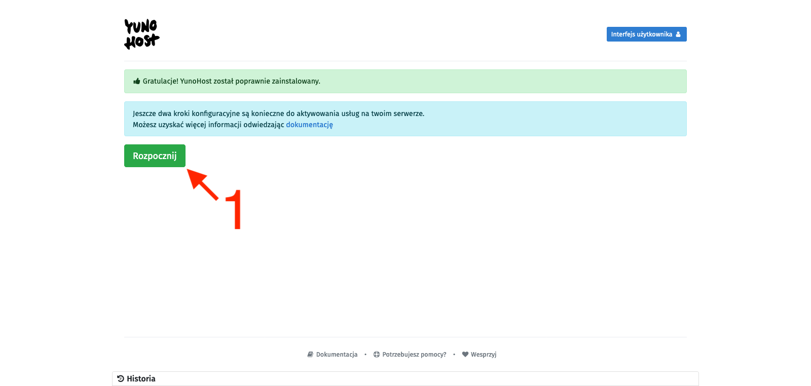
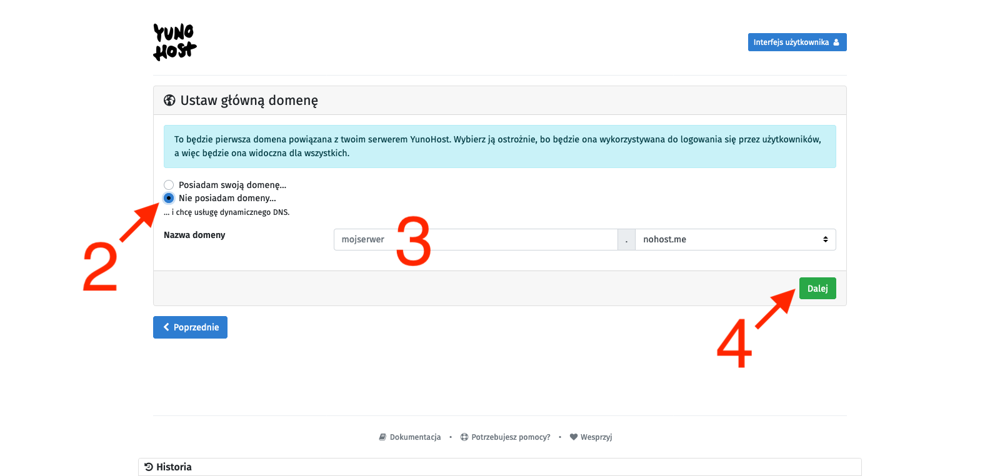
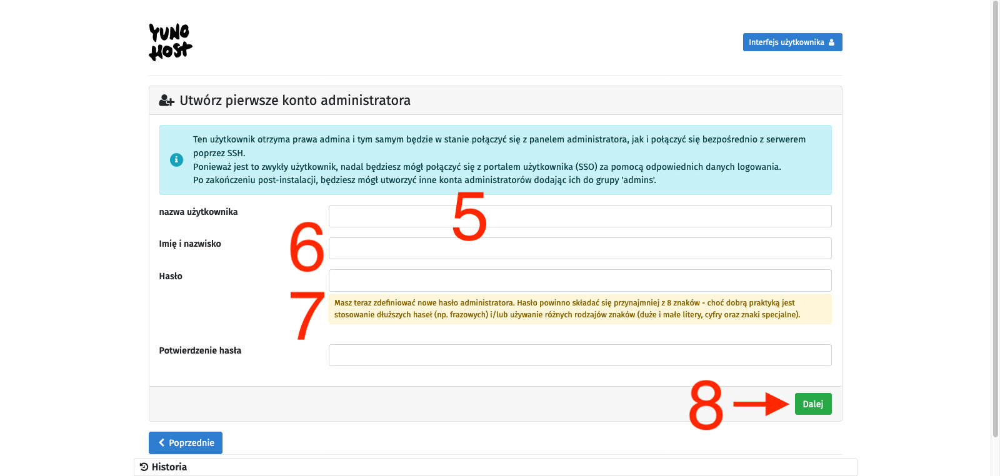
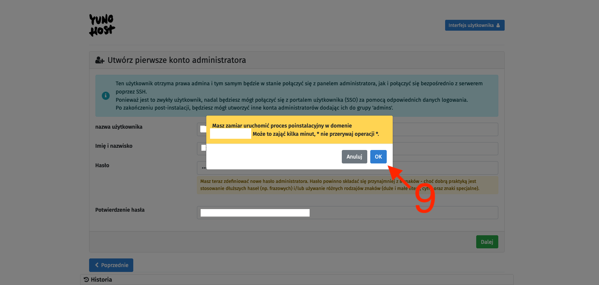
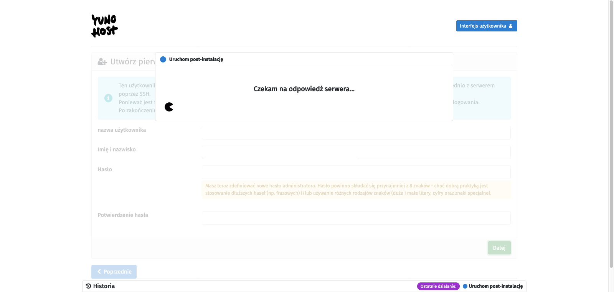
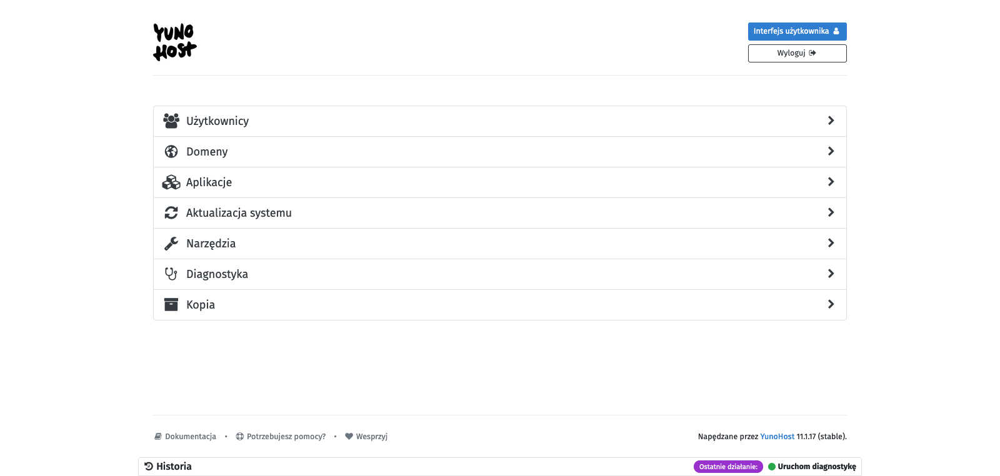

Spis treści:
* TOC
{:toc}

W [poprzednim wpisie](https://blog.tomaszdunia.pl/oracle-free-tier/) opisałem jak uzyskać darmowy dostęp do całkiem niezłego _VPSa_ - _Oracle Cloud Free Tier_. Dzisiaj przedstawię jedną z moich propozycji co można z nim dalej zrobić, a konkretnie pokażę jak, w prosty sposób, **zmienić taki serwer w centrum do uruchamiania rozwiązań _self-hosted_**. Zainstalujemy na nim narzędzie, czy może raczej system, [_YunoHost_](https://yunohost.org/#/), które służy do uruchamiania usług, a wyróżnia się tym, że posiada bardzo przyjazny interfejs graficzny, który **pozwala na zanurkowanie w świecie _self-hosting'u_ nawet osobom niezbyt technicznym**. _YunoHost_ jest oprogramowaniem _open-source_, które pod przejrzystą oprawą wizualną posiada bardzo dobrze napisany kod, który sam **zadba o prawidłowe skonfigurowanie od strony technicznej i bezpieczeństwo usług**, które będą na nim uruchomione.

_**EDIT**_: Jeden z Czytelników słusznie zauważył, że nie wszyscy chcą instalować _YunoHost_ w chmurze _Oracle_, a są tutaj, żeby dowiedzieć się jak to zrobić np. na maszynie, która już posiada zainstalowany system operacyjny _Debian_. Tym osobom polecam przeskoczyć od razu do rozdziału _[Instalacja YunoHost](#installyh)_.

## Przygotowanie

Tak jak wspomniałem we wstępie, w dalszej części tego wpisu będziemy potrzebować serwera w _Oracle Cloud_, o który pisałem we wpisie [Darmowy VPS z 4 OCPU, 24GB RAMu i dyskiem 200GB](https://blog.tomaszdunia.pl/oracle-free-tier/). Pisząc ten poradnik zakładam, że masz już, drogi Czytelniku, założone konto na _Oracle Cloud_, uruchomiłeś na nim _instancję_ tak jak to opisałem, otworzyłeś jej porty _80_ i _443_, włączyłeś obsługę IPv6 oraz umiesz się połączyć poprzez _SSH_. Jak zawsze polecam do tego celu skorzystać z wygodnego i darmowego (w zakresie tego co jest nam potrzebne) narzędzia _[Termius](https://www.google.com/url?sa=t&rct=j&q=&esrc=s&source=web&cd=&cad=rja&uact=8&ved=2ahUKEwieuJm0hZr-AhWPiYsKHdKLADsQFnoECBYQAQ&url=https%3A%2F%2Ftermius.com%2F&usg=AOvVaw0GQItTs65kIr1PbJt-j5bc)_.

**Spełniając powyższe warunki** możemy przystąpić do działania!

## Instalacja Debiana na instancji Oracle

Jeżeli stworzona przez Ciebie _instancja_ jest w 100% tak jak to opisałem to znaczy, że masz na niej zainstalowany system _Ubuntu_. **_YunoHost_ działa jedynie na _Debian'ie_**, którego nie ma na liście dostępnych systemów od _Oracle_. Nie jest to wielki problem, a jedynie dodatkowy krok do wykonania, w którym przekonwertujemy nasze _Ubuntu_ właśnie w _Debian’a_. Wykorzystamy do tego gotowy skrypt dostępny na [GitHub pod tym linkiem](https://github.com/bohanyang/debi).

_AKTUALIZACJA 2023-11-05: Uznałem, że istotne jest dodać w tym miejscu, że powyższy skrypt nie zadziała na każdym VPSie! Na Oracle działa jak należy, ale zdarzył mi się już przypadek całkowitego zabicia serwera zdalnego _(nie na Oracle)_ przy użyciu tego skryptu (serwer nie wrócił do sprawności po restarcie i wymagane było postawienie go od nowa). Miejcie to proszę na uwadzę._

Połączmy się z naszym _VPS_ poprzez _SSH_. Następnie pobierzmy w/w skrypt:

```bash
curl -fLO https://raw.githubusercontent.com/bohanyang/debi/master/debi.sh
```

Nadajmy mu uprawnienia do uruchamiania się:

```bash
chmod a+rx debi.sh
```

Teraz musimy wykonać istotny krok, który jest niezbędny do prawidłowego wykonania późniejszych działań. Chodzi o udostępnienie swojego publicznego klucza _SSH_, którego używamy do logowania na tym serwerze, a który będzie mógł być pobrany i wykorzystany przez _instalator_. Chodzi o to, że musimy dostarczyć _instalatorowi_ klucz, który wrzucony zostanie na nowo zainstalowany system _Debian_. Bez tego po zakończeniu instalacji i konwersji _Ubuntu_ w _Debiana_ **utracilibyśmy dostęp do naszego serwera**! Jest wiele sposobów aby to zrobić, ja jednak przedstawi taki, do którego będziemy potrzebowali jedynie konta na _GitHub_.

Instrukcja jak dodać na _GitHub_ publiczny klucz _SSH_ do swojego serwera:

- Jeżeli jeszcze nie masz konta na _GitHub_ to należy [je założyć](https://github.com/signup).

- Następnie po zalogowaniu klikamy na nasz awatar w prawym górnym rogu i z rozwiniętej listy wybieramy _Settings_.

- Po lewej w sekcji _Access_ wybieramy _SSH and GPG keys_ po czym po prawej stronie znajdujemy zielony przycisk _New SSH key_ i naciskamy go.

- W oknie, które wyskoczy w polu _Title_ wpisujemy dowolną nazwę jaką ten klucz będzie się identyfikował, jako _Key type_ zostawiamy _Authentication Key_, a w pole tekstowe _Key_ wpisujemy nasz publiczny klucz _SSH_.

- **Ważne**: Upewnij się, że wrzucasz swój **publiczny, a NIE prywatny**, klucz! Klucz publiczny może być jawny i udostępniony dla wszystkich w Internecie i nie jest to żadne zagrożenie bezpieczeństwa dla Twojego serwera. Natomiast klucza prywatnego należy strzec jak oka w głowie i nie udostępniać go nigdzie, gdyż to właśnie on jest niezbędny do uzyskania dostępu do Twojego serwera.

- Potwierdzamy zielonym przyciskiem _Add SSH key_.

Dla pewności przedstawiam poniżej wygląd **przykładowego** klucza publicznego:

```bash
ssh-rsa AAAAB3NzaC1yc2EAAAADAQABAAAAgQCvYkO7T45XKg95Jhj69xvzO+E74hdzO+KTeNLOsA2RwzAEeKkZCLGT1l3tWNZ57BuK0Umt5qbHOye/gTOAsY+kekIsyN27bzTlKx4O7GfmYIYNsByX0nj76JBCfcxazUwLCxIu6TC8Q+/1KGpwqfBV8rwLD0MEbFVm5ruSaEFDWw== blogtomaszdunia
```

Tak udostępniony klucz _SSH_ będzie dostępny pod adresem:

> https://github.com/<Twój\_login\_na\_GitHub>.keys

Teraz gdy już udostępniliśmy nasz publiczny klucz _SSH_ możemy kontynuować instalację _Debian'a_ na naszym serwerze. Uruchamiamy skrypt:

```bash
sudo ./debi.sh --version 11 --authorized-keys-url https://github.com/<Twój_login_na_GitHub>.keys
```

Zwróć uwagę, że **musisz zmodyfikować treść tego polecenia** zmieniając frazę _<Twój\_login\_na\_GitHub>_ na odpowiednią wartość odpowiadającą nazwie Twojego konta na _GitHub_.

Wszystko gotowe możemy rozpocząć instalację, a realizuje się to poprzez ponowne uruchomienie maszyny poleceniem:

```bash
sudo shutdown -r now
```

Zostaniemy oczywiście rozłączeni z serwerem. Proces może potrwać nawet kilka minut, więc zachowaj spokój, jeżeli nie od razu będzie można się do niego podłączyć. W międzyczasie będziemy musieli także zmienić jeszcze dane do logowania przez _SSH_, gdyż teraz będziemy logowali się do zupełnie innego systemu. Zmianie ulegnie nazwa użytkownika, na którego będziemy się logować. Stary użytkownik nazywał się _ubuntu_, a nowy to _debian_.

PS: Jeżeli czujesz wewnętrzną potrzebę to po zakończeniu instalacji możesz już usunąć swój publiczny klucz _SSH_ z _GitHuba_.

## Instalacja YunoHost

Gdy konfiguracja _Debian'a_ zostanie już zakończona to będziemy mogli połączyć się z serwerem. Od tego momentu instrukcja jest uniwersalna dla dowolnego urządzenia z zainstalowanym _Debian'em_. W pierwszej kolejności oczywiście aktualizacja systemu i jego pakietów:

```bash
sudo apt update
sudo apt upgrade -y
```

Następnie instalujemy niezbędne składniki:

```bash
sudo apt install htop curl unzip tmux -y
```

Dalej skorzystamy z narzędzia _tmux_ (_Terminal Multiplexer_), które w skrócie pozwala na tworzenie i zarządzanie wieloma wirtualnymi terminalami. Uruchamiamy sesję _tmux_:

```bash
tmux new -s yuno
```

Przechodzimy na konto _root_:

```bash
sudo -i
```

Pobieramy skrypt instalacyjny _YunoHost_ i rozpoczynamy instalację:

```bash
curl https://install.yunohost.org | bash
```

Proces instalacji jest banalny i praktycznie nic nie trzeba robić w jego trakcie, więc nie będę opisywał go szczegółowo. Po zakończeniu otrzymamy informację, że dalsza konfiguracja będzie przebiegała już z poziomu przeglądarki po wejściu na adres:

> https://<ip\_serwera>/

Tak też robimy, czyli otwieramy przeglądarkę, wpisujemy stosowny adres i potwierdzamy. Naszym oczom powinno pojawić się ostrzeżenie o tym, że połączenie może nie być bezpieczne. Jest to nam dobrze znane zachowanie przeglądarki, które podyktowane jest tym, że nie mamy zainstalowanego _certyfikatu SSL_ dla tej domeny. Na tym etapie nie jest to istotne. Przeklikujemy się przez to ostrzeżenie szukając przycisku _Akceptuję ryzyko i mimo to chcę kontynuować_ lub coś w tym stylu, dokładna treść zależy od tego jakiej przeglądarki używasz.


    

    

    

    

    

    

Naszym oczom ukaże się ekran powitalny _YunoHost_, który gratuluje nam pomyślnej instalacji i zachęca do dalszej konfiguracji. Naciskamy zatem przycisk _Rozpocznij_ \[1\]. W ustawieniach domeny głównej definiujemy pod jakim adresem dostępny będzie ten panel administracyjny (oraz panel użytkownika), czyli ustawiamy _alias_, który sprawi, że nie będziemy musieli używać adresu _IP_ serwera jako odnośnika do naszego _YunoHost_. Opcje są dwie: można podpiąć tutaj swoją domenę (lub subdomenę) zewnętrzną lub skorzystać z subdomen udostępnionych przez _YunoHost_. Mogą się one kończyć na:

- _nohost.me_

- _noho.st_

- _ynh.fr_

Żeby zbytnio nie komplikować sprawy skorzystamy właśnie z tego drugiego rozwiązania, a więc wybieramy opcję _Nie posiadam domeny..._ \[2\], w pole tekstowe _Nazwa domeny_ \[3\] wpisujemy wybrany przez nas ciąg znaków i potwierdzamy przyciskiem _Dalej_ \[4\]. Na następnej stronie tworzymy konto administratora. Wypełniamy pola: _nazwa użytkownika_ \[5\], _Imię i nazwisko_ \[6\] i dwa razy podajemy hasło \[7\]. Zatwierdzamy przyciskiem _Dalej_ \[8\]. Chyba nie muszę tutaj nikogo pouczać, że **hasło powinno być odpowiednio mocne**, bo jest ono jedynym zabezpieczeniem naszego panelu administracyjnego przed nieuprawnionym dostępem, a cała ta infrastruktura jest dostępna w otwartym Internecie. Na koniec zostaniemy jeszcze poproszeni o finalne potwierdzenie przyciskiem _OK_ \[9\]. Po tym wszystkim pozostaje nam już tylko czekać na zakończenie procesu, po czym zostaniemy przeniesieni do głównego panelu sterowania.

**Istotne jest to, że od teraz do serwera należy łączyć się wykorzystując poświadczenia podane podczas tworzenia konta administratora**. A więc nie logujemy się na użytkownika _debian_ tylko nowoutworzonego i wykorzystujemy nowe hasło, a nie klucz _SSH_. Po pierwszym logowaniu dobrze jest z powrotem wrócić do logowania się przy użyciu kluczy _SSH_. Jak to zrobić opisałem [tutaj](https://blog.tomaszdunia.pl/serwer-domowy-podstawowa-konfiguracja/#kluczessh). Istotne jest też, aby wyłączenie możliwości uwierzytelnienia hasłem wykonać z poziomu interfejsu webowego _YunoHost_ poprzez wejście w _(Główny panel sterowania)_ -> _Narzędzia_ -> _Ustawienia YunoHost_ -> sekcja _SSH_ -> _Password authentication_ -> zmienić na _Nie_, a **nie** poprzez edycję pliku _sshd\_config_ tak jak to opisałem w [tym wpisie](https://blog.tomaszdunia.pl/serwer-domowy-podstawowa-konfiguracja/). Oczywiście obie formy zadziałają tak samo, z tym że edytując plik z poziomu terminala sprawimy, że _YunoHost_ będzie nam później zgłaszał jako błąd, iż wykrył jego modyfikację, co może powodować konflikt w konfiguracji.

## Podstawowa konfiguracja - przygotowanie do pracy

Po wejściu do głównego panelu sterowania _YunoHost_ polecam w pierwszej kolejności wejść do _Aktualizacja systemu_. System zostanie od razu przeskanowany w poszukiwaniu pakietów, które można zaktualizować. Po zakończeniu skanowania potwierdzamy na dole zielonym przyciskiem _Aktualizuj wszystkie pakiety_. Po uruchomieniu pierwszych usług to właśnie z poziomu tego menu będzie można je również zaktualizować. Po zobaczeniu dwóch komunikatów - _Wszystkie pakiety systemowe są aktualne!_ i _Wszystkie programy są aktualne!_ - wracamy do panelu głównego.

Następnie miejsce, w które powinniśmy zajrzeć to _Diagnostyka_. Jest to sprytne narzędzie _YunoHost_, którego zadaniem jest przeskanowanie naszej konfiguracji i sprawdzenie czy wszystko jest ustawione prawidłowo. Po zakończeniu skanowania zobaczymy cztery rodzaje markerów:

- **_niebieskie_** - informacyjne, przedstawiające pewne istotne informacje, ale nie wymagające działania,

- **_zielone_** - potwierdzające, że dany parametr jest ustawiony prawidłowo,

- **_żółte_** - wskazujące, że coś nie jest ustawione prawidłowo, ale nie jest to kluczowa funkcja,

- **_czerwone_** - krytyczne, które określają, że coś istotnego jest ustawione nieprawidłowo i tym samym coś przez to może działać nieprawidłowo.

Rozsądnym będzie zająć się w pierwszej kolejności problemami zaznaczonymi na czerwono. W moim przypadku narzędzie diagnostyczne zgłosiło problem z tym, że prawidłowo otwarte mam porty _22_, _80_ i _443_, jednak **do poprawnego działania potrzebne jest jeszcze otwarcie portów _25_, _587_, _993_, _5222_ i _5269_**. Pozostałe czerwone markery widniały w sekcji _Email_, ale nie będziemy się nimi teraz przejmować, bo są one spowodowane tym, że port _25_ jest na ten moment zamknięty.

Wskazano nam palcem, które porty należy otworzyć, więc zróbmy to. To jak to zrobić w _Oracle Cloud_ opisałem dość szczegółowo [tutaj](https://blog.tomaszdunia.pl/oracle-free-tier/#porty) (na przykładzie portów _80_ i _443_). Jedyna różnica jest taka, że zmiany musimy wprowadzić jedynie od strony interfejsu _Oracle_ (dodać odpowiednie _Ingress Rules_), bo od strony serwera wszystko załatwi za nas _YunoHost_. Pamiętaj, aby otworzyć również porty w zakresie adresacji IPv6. Po wprowadzeniu zmian zapuszczamy proces diagnostyki jeszcze raz.

W moim przypadku zostały jeszcze dwa czerwone markery związane z obsługą poczty. Oba wskazują na problem z wysyłaniem, bo pomimo otwarcia port _25_ wydaje się zamknięty, a także jest problem z _reverse DNS_. Jest to prawdopodobnie spowodowane tym, że **część dostawców usług chmurowych blokuje możliwość wysyłania poczty** z oferowanych przez siebie serwerów i wygląda na to, że _Oracle_ należy do tego grona. Da się to obejść poprzez skorzystanie z odpowiedniego przekaźnika (po ang. relay), ale nie będziemy dzisiaj się tym zajmować.

Skoro największe problemy mamy w miarę ogarnięte to zejdźmy poziom niżej i zwróćmy uwagę na żółte markery. W moim przypadku pierwszym problemem zgłaszanym na żółto był temat **dopuszczenia repozytoriów _backports_** (z ang. wsteczne porty) w menedżerze pakietów. Repozytoria _backports_ to specjalne repozytoria, które zawierają nowsze wersje oprogramowania, które zostały pierwotnie opracowane dla nowszych wersji dystrybucji _Linux'a_. Są używane, aby zapewnić użytkownikom starszych wersji dystrybucji _Linux'a_ dostęp do nowszego oprogramowania bez konieczności aktualizacji całego systemu operacyjnego do nowszej wersji. Zainstalowanie oprogramowania z **repozytorium _backports_ może prowadzić do niestabilności lub konfliktów**, dlatego _YunoHost_ podpowiada nam, aby ich nie stosować, a my posłuchamy tej rady i **wyłączymy je z listy menedżera pakietów**.

W pierwszej kolejności ustalmy, o które repozytoria chodzi:

```bash
sudo grep -nr backport /etc/apt/sources.list* 
```

Ja w odpowiedzi na to polecenie otrzymałem następujący wynik:

```bash
/etc/apt/sources.list:10:# see https://www.debian.org/doc/manuals/debian-reference/ch02.en.html#_updates_and_backports
/etc/apt/sources.list:14:# bullseye-backports, previously on backports.debian.org
/etc/apt/sources.list:15:deb http://deb.debian.org/debian bullseye-backports main
/etc/apt/sources.list:16:deb-src http://deb.debian.org/debian bullseye-backports main
```

Jak widać słowo kluczowe _backport_, którego szukamy występuje czterokrotnie w pliku _/etc/apt/sources.list_ w liniach 10, 14, 15 i 16, z czego pierwsze dwie są liniami zakomentowanymi, czyli niejako wyłączonymi, ale bez usuwania ich z listy. Pozostaje nam zrobić to samo z liniami 15 i 16 tego pliku. Wejdźmy zatem do pliku z listą repozytoriów menedżera pakietów i dodajmy znak _#_ gdzie trzeba:

```bash
sudo nano /etc/apt/sources.list
```

Plik zapisujemy i wychodzimy z niego.

Dla pewności przeskanujmy system jeszcze raz przy użyciu narzędzia do diagnostyki. W moim przypadku wygląda na to, że nie znaleziono więcej problemów, więc system wydaje się gotowy do dalszych działań.

## Bazowa kopia zapasowa

Podstawowa konfiguracja zakończona. Na tym etapie dobrą praktyką będzie zrobienie sobie **_kopii zapasowej_ czystego systemu**, którą w razie czego będzie można w łatwy sposób przywrócić. Ja zawsze robię taką kopię plus poza cyklicznymi _backup'ami_ wykonuję jeszcze dodatkowe kopie przed uruchomieniem każdej nowej usługi (aplikacji).

Kopie zapasowe wykonuje się w _(Główny panel sterowania)_ -> _Kopia_ -> _Lokalne archiwa (local)_ -> zielony przycisk po prawej _+Nowa kopia_. Tak utworzoną kopię można pobrać z poziomu graficznego interfejsu webowego lub z poziomu terminala np. poprzez jakąś automatyzację. Kopie znajdują się na serwerze pod ścieżką - _/home/yunohost.backup/archives/<data\_wykonania\_kopii>.tar_.

## Co dalej?

O tym co dalej można zrobić korzystając z _YunoHost_ opowiem przy innej okazji. Celem tego wpisu było jedynie pokazanie jak zainstalować _YunoHost_ i jest to, wydaje mi się, dobra baza do kolejnych wpisów, w których już bardziej szczegółowo opiszę jak uruchamiać różne usługi na tak skonfigurowanym środowisku. Katalog aplikacji (usług) jakie można uruchomić przy użyciu _YunoHost_ jest dostępny [tutaj](https://yunohost.org/en/apps) i trzeba przyznać, że jest obszerny. Z ciekawszych pozycji wskazałbym:

- **_code-server_** - edytor kodu Virtual Studio Code w wersji self-hosted,

- **_Discourse_** - forum dyskusyjne,

- **_Domoticz_** - system do smarthome,

- **_FreshRSS_** - agregator RSS,

- **_Gitea_** - zarządzanie kodem źródłowym,

- **_Grafana_** - narzędzie analityczne,

- **_Home Assistant_** - system do smarthome,

- **_n8n_** - narzędzie do automatyzacji,

- **_Mastodon_** - sieć społecznościowa,

- **_Nextcloud_** - chmura na pliki,

- **_Nitter_** - alternatywny front-end dla Twittera,

- **_PeerTube_** - Youtube tylko self-hosted,

- **_phpMyAdmin_** - zarządzanie bazami MySQL,

- **_Pi-hole_** - serwer DNS,

- **_Pixelfed_** - Instagram tylko self-hosted,

- **_Roundcube_** - klient poczty e-mail,

- **_Transmission_** - klient torrent (P2P),

- **_Vaultwarden_** - menedżer haseł Bitwarden w wersji self-hosted,

- **_Wallabag_** - agregator trześci do przeczytanie później (po ang. _read it later_),

- **_WireGuard_** - serwer VPN,

- **_Wordpress_** - platforma do blogowania,

- **_WriteFreely_** - platforma do blogowania jak Wordpress ale w Fediverse.

I to są tylko wybrane wyrywkowo na szybko, bo jest tego dużo dużo więcej i pewnie pominąłem kilka naprawdę interesujących i/lub nieznanych mi usług. Jest też sporo ciekawych pozycji w _waitlist'cie_ (z ang. liście oczekujących) do implementacji.
