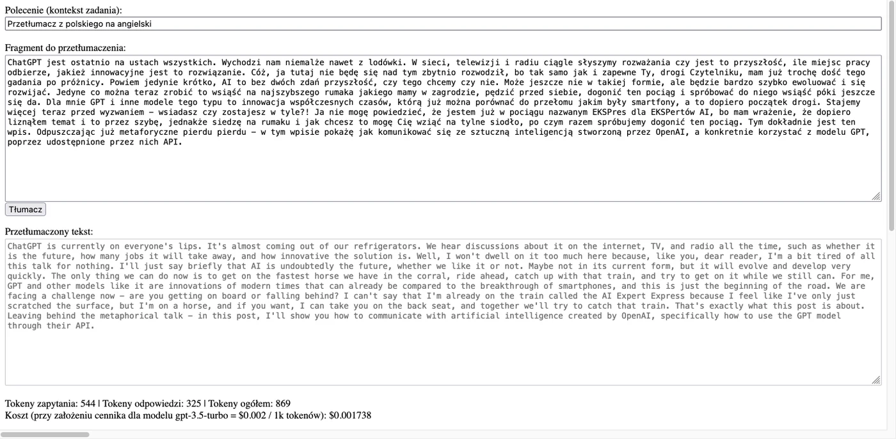

Spis treści:
* TOC
{:toc}

_ChatGPT_ jest ostatnio na ustach wszystkich. Wychodzi nam niemalże nawet z lodówki. W sieci, telewizji i radiu ciągle słyszymy rozważania _czy jest to przyszłość_, _ile miejsc pracy odbierze_, _jakież innowacyjne jest to rozwiązanie_. Cóż, ja tutaj nie będę się nad tym zbytnio rozwodził, a jedynie skupię się na aspektach praktycznych, bo tak samo jak i zapewne Ty, drogi Czytelniku, **mam już trochę dość tego gadania po próżnicy**. Powiem jedynie krótko, **AI to bez dwóch zdań przyszłość**, czy tego chcemy czy nie. Może jeszcze nie w takiej formie, ale **będzie bardzo szybko ewoluować i się rozwijać**. Jedyne co można zrobić aby brać czynny udział w tej przyszłości to wsiąść na najszybszego rumaka jakiego mamy w zagrodzie, pędzić przed siebie, dogonić ten pociąg i spróbować do niego **wsiąść póki jeszcze się da**. Dla mnie _GPT_ i inne modele tego typu to innowacja współczesnych czasów, którą **już można porównać do przełomu jakim były smartfony**, a to dopiero początek drogi. Stajemy więcej teraz przed wyzwaniem - **wsiadasz czy zostajesz w tyle?!** Ja nie mogę powiedzieć, że jestem już w pociągu nazwanym _EKSPres dla EKSPertów AI_, bo mam wrażenie, że dopiero liznąłem temat i to przez szybę, jednakże siedzę na rumaku i **jak chcesz to mogę Cię wziąć na tylne siodło, po czym razem spróbujemy dogonić ten pociąg**. Tym dokładnie jest ten wpis. Odpuszczając już metaforyczne pierdu pierdu - **w tym wpisie pokażę jak komunikować się ze sztuczną inteligencją stworzoną przez _OpenAI_**, a konkretnie korzystać z modelu _GPT_, poprzez udostępnione przez nich _API_.

_OpenAI_ oraz ich produkt mają wielu przeciwników, którzy wygłaszają (według mnie) słuszne wątpliwości (pozdrawiam MiKlo oraz Ryśka i polecam zajrzeć do komentarzy pod [moim tootem](https://mastodon.tomaszdunia.pl/@to3k/110187175119834883) będącym zapowiedzią tego wpisu). Polecam takim osobom potraktować ten wpis jako zbiór informacji, które pozwolą poznać swojego przeciwnika, to zawsze ułatwia walkę 😉

## ChatGPT

Słysząc _OpenAI_, _GPT_ czy _sztuczna inteligencja_ uderzająca większość odbiorców pomyśli _ChatGPT_. Faktycznie jest to coś co przyczyniło się w znacznym stopniu do popularyzacji i dyskusji o _AI_, bo tak naprawdę pozwoliło zademonstrować potęgę tego rozwiązania. _ChatGPT_ jest zupełnie darmowym narzędziem (oczywiście jest plan płatny, ale my tutaj nie o tym), pozwalającym prowadzić konwersację ze _sztuczną inteligencją_, a raczej z modelem językowym (_LLM_, skrót od _Large Language Model_, z ang. _wielki model językowy_), tak jakby to było rozmawianie z kolegą na _Signalu_. Jednak wszyscy musimy zrozumieć, że **_ChatGPT_ to nie koniec historii i nie jest to jedyna forma dostępu do modeli uczenia maszynowego**, z których jednym jest _GPT_, tak samo _GPT_, co jest skrótem od _Generative Pre-trained Transformer_ (z ang. _Generatywny Wstępnie Szkolony Przekształtnik_ - moje autorskie tłumaczenie 😎). Chodzi tu o zaawansowany model uczenia maszynowego, który został wytrenowany na dużych zbiorach danych tekstowych w celu generowania spójnych i logicznych sekwencji tekstu w języku naturalnym. Dlaczego przetłumaczyłem to jako _przekształtnik_? Bo najprościej można to wszystko wytłumaczyć tak, że **_GPT_ przekształca komunikaty zrozumiałe dla maszyny na komunikaty zrozumiałe dla człowiek i odwrotnie**. Tak, więc _ChatGPT_ można traktować jak jedynie jedną z usług bazujących na _GPT_. Na bazie _GPT_ już powstało wiele innych projektów, a codziennie powstają kolejne, co udowadnia strona _[Futurepedia.io](https://www.futurepedia.io/)_. **Integracja modelu _GPT_ do swojego projektu jest możliwa poprzez _API_** udostępnione przez _OpenAI_ i jak się okazuje nie jest to wcale trudne, co udowodnię w tym wpisie.

## Jak uzyskać dostęp do API

Oczywiście jak w przypadku większości _API_, aby uzyskać do niego dostęp potrzebujemy posiadać klucz. Takowy można otrzymać **rejestrując się na stronie**: [https://auth0.openai.com/u/signup/identifier](https://auth0.openai.com/u/signup/identifier). Rejestracja jest darmowa, a po niej dostajemy na start $5 do wykorzystania na naukę/zabawę. Z pozoru te $5 wydaje się śmieszną ilością, ale jak zaraz zobaczysz ile kosztuje wykonanie naprawdę skomplikowanych zadań to zrozumiesz, że **za te pięć dolków można naprawdę przenieść niejedną górę**!

Po założeniu konta wchodzimy do panelu zarządzania naszym kontem i dalej do zakładki _API Keys_ lub po prostu możesz pójść na skróty i skorzystać z tego linku - [https://platform.openai.com/account/api-keys](https://platform.openai.com/account/api-keys). W tym miejscu wystarczy nacisnąć przycisk _+Create new secret key_ i skopiować wartość klucza, który zostanie wyświetlony w oknie, które wyskoczy.

## Zbudujmy tłumacza PL-ENG wykorzystującego model GPT

Pewnie wiele razy tłumaczyłeś coś przy użyciu _Tłumacza Google_ czy chociażby _DeepL_, o którym pisałem w [tym wpisie](https://blog.tomaszdunia.pl/deepl-api/). Jednak **to jak z tłumaczeniem radzi sobie model _GPT_ nie sposób porównać do żadnego z wcześniej wspomnianych narzędzi**. W momencie pisania tego wpisu biorę się na poważnie za tłumaczenie większości wpisów tego bloga przy wsparciu właśnie rozwiązania od _OpenAI_. W momencie kiedy będzie on opublikowany pewnie już wszystkie z nich będą przetłumaczone, choć to trochę zależy od finalnej daty publikacji jaką ustalę dla tego wpisu oraz ilości czasu jaki będę miał na sprawdzenie wygenerowanych tłumaczeń, bo nie ma co ukrywać, że jednak trzeba je przynajmniej przejrzeć przed publikacją.

Wróćmy jednak do tematu. Poniżej przedstawiam kod skryptu, który przy użyciu, znanego nam z poprzednich wpisów ([tego](https://blog.tomaszdunia.pl/mews/) i [tego](https://blog.tomaszdunia.pl/deepl-api/)), _cURL_ skomunikuje się z _API_ _OpenAI_ i wyśle podany przez użytkownika fragment tekstu do tłumaczenia. Podstawowy opis poszczególnych kroków skryptu znajduje się standardowo w treści kodu w postaci komentarzy.

```php
<?php
    // OPENAI API TOKEN
    $token = '[TU_WKLEJ_TOKEN]';
    
    // Sprawdza czy wysłano polecenie i fragment do tłumaczenia
    if(!empty($_POST['polecenie']) AND !empty($_POST['fragment']))
    {
        // Jeżeli tak to pobiera zmienną POST, w której jest przechowywany
        $polecenie = $_POST['polecenie'];
        $fragment = $_POST['fragment'];
        
        // Określa jaki maksymalny limit tokenów możemy zadeklarować
        // Określa ilość znaków fragmentu (długość)
        $prompt_size = strlen($polecenie) + strlen($fragment);
        // Dla modelu gpt-3.5-turbo limit tokenów to 4096, więc odejmujemy wyżej wyliczoną długość od tego limitu
        $max_tokens = 4096-$prompt_size;

        // Tablica z informacjami wysyłanymi w zapytaniu cURL
        $postfields = array(
            "model" => "gpt-3.5-turbo", // Określenie jaki model ma zostać użyty
            "messages" => [
                array(
                    "role" => "system", // Określenie roli wiadomości jako ta od systemu (nadająca kontekst)
                    "content" => $polecenie // Kontekst (w naszym przypadku polecenie, co ma być zrobione)
                ), 
                array(
                    "role" => "user", // Określenie roli wiadomości jako ta od użytkownika
                    "content" => $fragment // Fragment do tłumaczenia
                )
            ],
            "temperature" => 0.5, // Parametr, który określa jak kreatywna (losowa) ma być odpowiedź
            "max_tokens" => $max_tokens // Określenie jak długa może być odpowiedź
        );
        // Konwertuje powyższą tablicę w obiekt JSON, bo w takiej formie należy go wysłać
        $postfields = json_encode($postfields);

        // Nagłówki zapytania
        $headers = array(
            "Content-Type: application/json", // Określenie typu wysyłanej treści - JSON
            "Authorization: Bearer ".$token // Token do uwierzytelnienia przy komunikacji z API
        );
        
        // Inicjalizuje zapytanie cURL
        $curl = curl_init();
        // Określa URL do którego ma zostać skierowane zapytanie
        curl_setopt($curl, CURLOPT_URL, "https://api.openai.com/v1/chat/completions");
        // Nakazuje cURL zwrócić wynik zapytania
        curl_setopt($curl, CURLOPT_RETURNTRANSFER, true);
        // Deklaruje, że ma to być zapytanie typu POST
        curl_setopt($curl, CURLOPT_POST, 1);
        // Definiuje dane do przekazania
        curl_setopt($curl, CURLOPT_POSTFIELDS, $postfields);
        // Ustawia nagłówki
        curl_setopt($curl, CURLOPT_HTTPHEADER, $headers);
        // Wysyła zapytanie i zapisuje zdekodowany wynik do zmiennej
        $result = json_decode(curl_exec($curl), true);
        // Zamyka połączenie
        curl_close ($curl);
        // Wyciąga z wyniku przetłumaczoną treść
        $translated = $result['choices']['0']['message']['content'];
        // Wyciąga z wyniku długość zapytania (tokeny)
        $prompt_tokens = $result['usage']['prompt_tokens'];
        // Wyciąga z wyniku długość odpowiedzi (tokeny)
        $completion_tokens = $result['usage']['completion_tokens'];
        // Wyciąga z wyniku całkowitą ilość użytych tokenów
        $total_tokens = $result['usage']['total_tokens'];
    }
    else
    {
        $polecenie = "Przetłumacz z polskiego na angielski";
    }
?>

<!-- Formularz HTML -->
<form action="" method="POST" name="form">
    Polecenie (kontekst zadania):<br>
    <input name="polecenie" style="width: 100%;" value="<?php echo $polecenie; ?>"><br><br>
    <!-- Pole tekstowe do wpisania fragmentu do przetłumaczenia -->
    Fragment do przetłumaczenia:<br>
    <textarea name="fragment" style="width: 100%; height: 35%;"><?php echo $fragment; ?></textarea>
    <br>
    <button type="submit">Tłumacz</button>
</form>

<?php
    // Jeżeli istnieje tłumaczenie
    if(!empty($translated))
    {
?>

        <!-- Wyświetla przetłumaczony fragment w polu tekstowym z wyłączoną moliwością edycji -->
        Przetłumaczony tekst:
        <textarea style="width: 100%; height: 35%;" disabled><?php echo $translated; ?></textarea>
        <br><br>

<?php
        // Oblicza koszt wykonania zadania
        $cost = 0.002 * $total_tokens / 1000;
        // Wyświetla ilość użytych tokenów
        echo "Tokeny zapytania: ".$prompt_tokens." | Tokeny odpowiedzi: ".$completion_tokens." | Tokeny ogółem: ".$total_tokens."<br>";
        // Wyświetla koszt wykonania zadania
        echo "Koszt (przy założeniu cennika dla modelu gpt-3.5-turbo = $0.002 / 1k tokenów): $".$cost;
        echo "<br><br><hr>";
        // Wyświetla odpowiedź od serwera API przekonwertowaną na tablicę
        echo "Odpowiedź serwera API:";
        echo "<pre>";
        print_r($result);
        echo "</pre>";
    }
?>
```

W całym tym kodzie najważniejsze są trzy parametry zapytania _cURL_:

- _**CURLOPT\_URL**_ - adres na jaki kierowane jest zapytanie do _API_,

- **CURLOPT\_HTTPHEADER** - znane nam nagłówki, w których zawarty jest _token_ używany do uwierzytelnienia się i uzyskania dostępu do _API_,

- **CURLOPT\_POSTFIELDS** - samo mięsko, esencja, najważniejsza część, czyli informacje jakie wysyłamy do _API_.

Chciałbym pochylić się jedynie nad tym ostatnim parametrem. Przesyłany jest on w postaci obiektu _JSON_, o restrykcyjnie określonej strukturze. Użyłem słowa restrykcyjnie, bo wystarczy pomylić jeden znak i całe zapytanie się wysypie. W skrypcie obrałem taką taktykę, że najpierw tworzę tablicę, wypełniam ją danymi i dopiero na koniec konwertuję na obiekt _JSON_. W każdym razie, w tej części zapytania _cURL_ można określić takie rzeczy jak:

- _**model**_ - jaki model językowy ma zostać użyty (lista wszystkich aktualnie dostępnych modeli znajduje się [tutaj](https://platform.openai.com/docs/models/overview)), w momencie pisania tego wpisu najnowszym modelem dostępnym bez subskrypcji jest _gpt-3.5-turbo_, natomiast przy jej wykupieniu (za $20 miesięcznie) otrzymujemy dostęp do modelu _gpt-4_,

- **_message_** - podzielone na:
    - **_role_** - mamy tutaj dostępne następujące role:
        - _system_ - wiadomości podpisane taką rolą to bardzo istotne narzędzie dla użytkownika, które jest dostępne jedynie z poziomu API (używając ChatGPT nie ma możliwości skorzystania z takiej funkcji), służy do określenia kontekstu, czyli np. możemy tutaj napisać do _AI_ w jakiej roli ma wystąpić - "jesteś poetą i masz odpisywać wierszem trzynastozgłoskowym", lub też po prostu tak jak ja w powyższym kodzie wykorzystać tę funkcję do określenia konkretnego zadania, które ma zostać wykonane przez _AI_ - "Przetłumacz z języka polskiego na angielski",
        
        - _user_ - rola, która określa, że dana wiadomość pochodzi od użytkownika (od nas),
        
        - _assistant_ - tak oznaczane są wiadomości napisane przez _AI_,
    
    - **_content_** - treść wiadomości,

- **_temperature_** - temperaturą określa się parametr, który definiuje jakiego poziomu kreatywności, a może raczej w tym przypadku losowości, bo ciężko powiedzieć, że model językowy może być kreatywny, oczekujemy od _AI_ w odpowiedzi na zapytanie, im wartość bliższa 0 tym odpowiedź będzie rzeczowa (dobre, gdy oczekujemy realnej odpowiedzi np. na jakieś pytanie lub zadajemy mu po prostu konkretne zadanie do wykonania), natomiast im bliżej 1 tym model zacznie po prostu bardziej zmyślać (dobre, gdy zadanie ma charakter kreatywny, czyli model ma np. wymyślić slogan reklamowy),

- **_max\_tokens_** - maksymalna długość odpowiedzi liczona w tokenach, które niestety są ciężko przeliczalne na słowa czy chociażby litery, w praktyce im mniejszy parametr _max\_tokens_ tym bardziej zwięzła będzie odpowiedź.

Jak widać używając tej metody, czyli komunikacji poprzez _API_, co prawda płacimy, ale mamy możliwość skonfigurowania znaczniej większej liczby parametrów niż przy zwykłej rozmowie z _ChatGPT_. Te parametry pozwalają nam w znacznym stopniu określić swoje potrzeby i zoptymalizować proces, który tworzymy w oparciu o wykorzystanie _GPT_. Według mnie szczególnie istotne jest pobawienie się parametrem _temperature_, który powinien być dostosowany odpowiednio do danego zastosowania. Niemniej istotne jest określenie odpowiedniego kontekstu poprzez wysłanie wiadomości z rolą system, która nakreśli _GPT_ jak ma podejść do danego zadania. Sformułowanie odpowiedniej wiadomości to według mnie dopiero trzeci ważny aspekt całego procesu. Ludzie śmieszkują, że teraz powstaną nowe stanowiska pracy nazywające się _Prompt Engineer/Specialist_. Zastanów się jednak, czy po przeczytaniu wszystkiego co napisałem powyżej, też uważasz, że taka specjalizacja nie miałaby sensu? Jeżeli tak to proponuję spróbować własnych sił z wyciśnięciem z _GPT_, w sposób optymalny, dokładnie takiej odpowiedzi jakiej oczekujesz, powodzenia! 😉

## Sprawdźmy działanie skryptu

Wynik działania powyższego skryptu, po wrzuceniu do niego treści wstępu tego wpisu, prezentuje się następująco:



Jak widać jakość tłumaczenia jest na całkiem niezłym poziomie. Oczywiście potrzebna jest pewna korekta, ale też trzeba przyznać, że mój styl wyrażania swoich myśli nie jest do końca łatwy w analizie, a w szczególności jeżeli trzeba go przełożyć na inny język. Przy wykonaniu tego zadania użyliśmy w sumie 869 _tokenów_, co przekłada się na koszt w wysokości ułamków jednego centa (niecałe 0.2 centa, czyli w praktyce za 1 centa można wykonać aż pięć podobnych zadań, a za jednego dolara można ich zrobić 500). Teraz rozumiesz ile można zrobić za 5 dolarów, o których mówiłem wcześniej?

## Odpowiedź od serwera API

Na koniec zwróćmy jeszcze uwagę jak wygląda odpowiedź od serwera API:

```markup
Array
(
    [id] => chatcmpl-74ECqgzzmsDLEH62Te6QXFxO72nqY
    [object] => chat.completion
    [created] => 1681242276
    [model] => gpt-3.5-turbo-0301
    [usage] => Array
        (
            [prompt_tokens] => 544
            [completion_tokens] => 325
            [total_tokens] => 869
        )

    [choices] => Array
        (
            [0] => Array
                (
                    [message] => Array
                        (
                            [role] => assistant
                            [content] => ChatGPT is currently on everyone's lips. It's almost coming out of our refrigerators. We hear discussions about it on the internet, TV, and radio all the time, such as whether it is the future, how many jobs it will take away, and how innovative the solution is. Well, I won't dwell on it too much here because, like you, dear reader, I'm a bit tired of all this talk for nothing. I'll just say briefly that AI is undoubtedly the future, whether we like it or not. Maybe not in its current form, but it will evolve and develop very quickly. The only thing we can do now is to get on the fastest horse we have in the corral, ride ahead, catch up with that train, and try to get on it while we still can. For me, GPT and other models like it are innovations of modern times that can already be compared to the breakthrough of smartphones, and this is just the beginning of the road. We are facing a challenge now - are you getting on board or falling behind? I can't say that I'm already on the train called the AI Expert Express because I feel like I've only just scratched the surface, but I'm on a horse, and if you want, I can take you on the back seat, and together we'll try to catch that train. That's exactly what this post is about. Leaving behind the metaphorical talk - in this post, I'll show you how to communicate with artificial intelligence created by OpenAI, specifically how to use the GPT model through their API.
                        )

                    [finish_reason] => stop
                    [index] => 0
                )

        )

)
```

Jak widać w odpowiedzi zawarte są m.in. informacje:

- jakie jest ID danej konwersacji, ciekawe czy na podstawie tego ID można później do niej jakoś nawiązać... tego jeszcze nie testowałem,

- jaki model został użyty,

- ile tokenów zostało użytych, z podziałem na prompt, odpowiedź i sumę,

- odpowiedź docelową,

- z jakim statusem zostało zakończone generowanie odpowiedzi, gdzie _stop_ oznacza, że model zakończył zadanie prawidłowo i sam się zatrzymał, a np. _length_ oznacza, że ustawiono zbyt małą wartość w parametrze _max\_tokens_ i modelowi po prostu nie wystarczyło znaków, aby prawidłowo zakończyć odpowiedź (przeważnie jest wtedy po prostu urwana w miejscu, w którym wyczerpały się dostępne tokeny).
