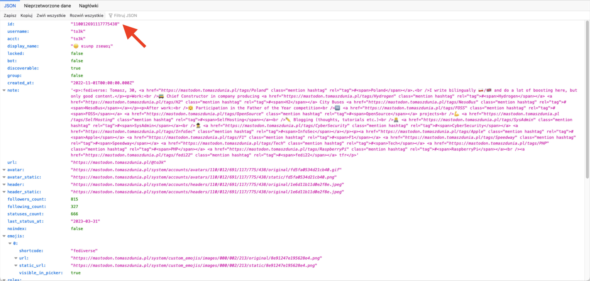
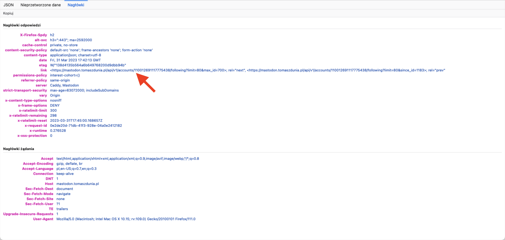
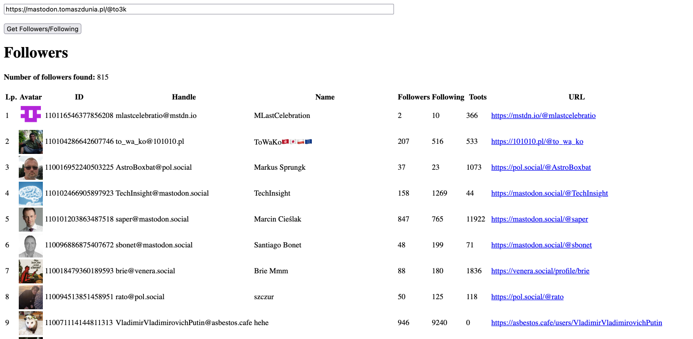

[🇬🇧 Go to english version of this post / Przejdź do angielskiej wersji tego wpisu](https://blog.tomaszdunia.pl/mastodon-api-followers-following-eng/)

Spis treści:
* TOC
{:toc}

W tym wpisie będzie nieco bardziej technicznie. Uzyskanie listy obserwowanych i/lub obserwujących dla danego konta na _Mastodonie_ nie jest takie oczywiste. Można to zrobić używając oficjalnego _API_ i właśnie to jak to zrobić pokażę w tym wpisie. Co ciekawe poniżej opisane zagadnienie może być użyte jako narzędzie [OSINT'owe](https://pl.wikipedia.org/wiki/Bia%C5%82y_wywiad). Podkreślamy to, gdyż za sprawą ‪[@avolha@infosec.exchange‬](https://infosec.exchange/@avolha) link do [mojego wpisu o Dockerze](https://blog.tomaszdunia.pl/docker/) trafił do zestawienia [Weekendowa Lektura: odcinek 512 \[2023-03-25\]](https://zaufanatrzeciastrona.pl/post/weekendowa-lektura-odcinek-512-2023-03-25-bierzcie-i-czytajcie/), które jest kierowane głównie do bezpieczników (specjalistów zajmujących się cyberbezpieczeństwem), a temat związany z OSINT'em powinien pasować do profilu zainteresowań osób pracujących w tej dziedzinie.

## Zajrzyjmy do dokumentacji

Jak każdy szanujący się _geekonerd_ wejdziemy najpierw do dokumentacji dotyczące _API_ _Mastodona_ i zobaczymy co ciekawego można tam wyczytać na temat, który aktualnie nas interesuje. Rozdział o pobieraniu listy obserwujących znajduje się pod [tym linkiem](https://docs.joinmastodon.org/methods/accounts/#followers). Natomiast ten o obserwowanych znajduje się [tuż pod nim](https://docs.joinmastodon.org/methods/accounts/#following). Z ciekawych informacji jakie wyczytałem to:

- od wersji _4.0.0_ przy zapytaniach o obserwowanych/obserwujacych _API_ nie wymaga uwierzytelnienia się tokenem _API_, to super, bo wystarczy zwykłe zapytanie _HTTP_ i krok tworzenia aplikacji możemy całkowicie pominąć,

- do zapytania potrzebujemy _ID_ konta, o którego dane pytamy, a więc musimy wykonać dodatkowy krok i na podstawie adresu profilu lub handle użytkownika musimy ustalić w/w _ID_ (wykonamy to przy pomocy innej funkcji _API_),

- domyślna liczba rezultatów jakie możemy uzyskać to _40_, jednak można ją zwiększyć do _80_ poprzez ustawienie parametru _limit=80_, niestety taki limit to spora niedogodność, bo jeżeli konto posiada więcej niż _80_ obserwujących/obserwowanych to, aby uzyskać pełną listę będziemy musieli wykonać więcej niż jedno zapytanie do _API_ i w dodatku przeprowadzić odpowiednią _paginację_ zapytań (coś jak podział na strony),

- do skorzystania z _paginacji_ wykorzystuje się parametry _max\_id_, _since\_id_ i _min\_id_, co istotne fraza _id_ zawarta w nazwach tych parametrów wcale nie odnosi się do _ID_ konta, o którym wcześniej mówiłem, a do wartości znanej jedynie dla _backendu_ i _bazy danych_ _Mastodona_, więc korzystanie z nich jest niejako brodzeniem po omacku, jednakże jest pewien sposób na uproszczenie tego procesu, o którym napiszę za chwilę,

- jako odpowiedź od serwera otrzymamy listę kont obserwowanych/obserwujących, które dodatkowo będzie zawierała dość obszerne informacje na temat tych kont, pełna ich lista znajduje się pod [tym linkiem](https://docs.joinmastodon.org/entities/Account/), jednak z najciekawszych są to:
    - ID konta (np. _110012691117775438_)
    
    - acct (np. _to3k@tomaszdunia.pl_)
    
    - display\_name (np. _🙃 ɐıunp zsɐɯoʇ)_
    
    - note (bio profilu)
    
    - url (np. _https://mastodon.tomaszdunia.pl/@to3k_)
    
    - avatar (link do awatara a.k.a. profilówki)
    
    - followers\_count (liczba obserwujących to konto)
    
    - following\_count (liczba obserwowanych przez to konto)
    
    - statuses\_count (liczba tootów a.k.a. postów)

## Podstawowe zapytanie

Weźmy mój profil jako przykład roboczy. Link do niego to - [_https://mastodon.tomaszdunia.pl/@to3k_](https://mastodon.tomaszdunia.pl/@to3k). Zapytanie do API, którego rezultatem będzie uzyskanie listy obserwujących, ma wyglądać następująco:

> https://\[adres\_instancji\]/api/v1/accounts/\[id\_użytkownika\]/followers

_Adres instancji_ to w moim przypadku będzie _mastodon.tomaszdunia.pl_. Natomiast skąd mam znać swój _ID użytkownika_? Użyjemy do tego innej funkcji API, która pozwala wyszukiwać użytkowników (i co najważniejsze podstawowe ich dane, w tym _ID_) po _nazwie_:

> https://\[adres\_instancji\]/api/v1/accounts/lookup?acct=\[nazwa\_użytkownika\]

Skonstruujmy zatem stosowny URL - [https://mastodon.tomaszdunia.pl/api/v1/accounts/lookup?acct=to3k](https://mastodon.tomaszdunia.pl/api/v1/accounts/lookup?acct=to3k). Po uruchomieniu go w przeglądarce otrzymamy od serwera odpowiedź w postaci obiektu _JSON_ (wspominałem o tym formacie w [tym wpisie](https://blog.tomaszdunia.pl/deepl-api/)). W przeglądarce Firefox, która jest moim podstawowym narzędziem deweloperskim, wygląda to tak:



Szukane ID wskazałem czerwoną strzałką na powyższym zrzucie ekranu. Bierzemy to _ID_ i tworzymy link będący zapytaniem o listę obserwowanych - [https://mastodon.tomaszdunia.pl/api/v1/accounts/110012691117775438/followers](https://mastodon.tomaszdunia.pl/api/v1/accounts/110012691117775438/followers). W ten sposób otrzymaliśmy obiekt _JSON_ będący tablicą z informacjami o 40 kontach, które obserwują mnie na _Mastodonie_. Zmodyfikujmy ten link dodając do niego na końcu parametr _limit_, aby otrzymać dwa razy więcej wyników (wartość maksymalna jaką możemy uzyskać to 80) - [https://mastodon.tomaszdunia.pl/api/v1/accounts/110012691117775438/followers?limit=80](https://mastodon.tomaszdunia.pl/api/v1/accounts/110012691117775438/followers?limit=80). Co w przypadku, gdy ktoś ma więcej niż 80 obserwujących i chce uzyskać całą listę? Do tego potrzebujemy wykorzystać _paginację_, ale o niej w dalszej części wpisu.

Aha, jeszcze lista obserwowanych. Sprawa wygląda bardzo analogicznie z tym, że w linku frazę _followers_ należy zamienić na _following_ - [https://mastodon.tomaszdunia.pl/api/v1/accounts/110012691117775438/following?limit=80](https://mastodon.tomaszdunia.pl/api/v1/accounts/110012691117775438/following?limit=80).

## O co chodzi z paginacją?

Pisząc to zastanawiam się czy takie słowo w ogóle istnieje w języku polskim... Może powinienem to przetłumaczyć jak stronicowanie? W każdym razie to sformułowanie pochodzi od angielskiego _pagination_ i w tym kontekście dotyczy tego, że posiadając limit rezultatów (_80_), jakie otrzymamy jednosrazowo od serwera, musimy wiedzieć jak sformułować następne zapytanie do API, aby otrzymać inny (niezdublowany) wynik i tym samym rozszerzyć naszą listę aż do momenty, gdy pobierzemy wszystkie jej elementy (kompletna lista obserwujących/obserwowanych). To tak jakby przeglądać tabelę podzieloną na strony składające się z 80 elementów i przełączać się pomiędzy nimi. Jak już wspomniałem wcześniej do ogarnięcia tematu _paginacji_ służą nam parametry _max\_id_, _since\_id_ i _min\_id_. Z pozoru parametry te odnoszą się do _ID_ użytkowników, jednak w rzeczywistości tak nie jest. To konkretne _ID_ to odniesienie do wewnętrznej bazy danych serwera, której zawartość jest znana jedynie dla _backend'_u. A zatem w jaki sposób mamy korzystać z tych parametrów? Zacznijmy od początku.

Załóżmy, że mam 800 obserwujących. Korzystając z linka - [https://mastodon.tomaszdunia.pl/api/v1/accounts/110012691117775438/followers?limit=80](https://mastodon.tomaszdunia.pl/api/v1/accounts/110012691117775438/followers?limit=80), który skonstruowaliśmy wcześniej, otrzymujemy w odpowiedzi od serwera listę 80 kont, które obserwują mnie na _Mastodonie_. Są to konta posortowane czasowo, zaczynając od najświeższego obserwatora (osoby, która zaczęła mnie obserwować jako ostatnia). Tak, więc 1/10 listy moich obserwowanych już mamy. Jak w takim razie przejść do następnej strony i poznać obserwatorów od 81 do 160? Musimy ustalić jaki będzie URL następnej strony, a informację o tym dostajemy w nagłówku (_header_) odpowiedzi od API. Jest to konkretnie zawarte w parametrze nazywającym się _link_. W Firefox wystarczy zmienić zakładkę z _JSON_ na _Nagłówki_ i otrzymamy coś podobnego do tego:



Pozyskajmy wartość tego parametru nagłówkowego:

> `<https://mastodon.tomaszdunia.pl/api/v1/accounts/110012691117775438/following?limit=80&max_id=700>; rel="next", <https://mastodon.tomaszdunia.pl/api/v1/accounts/110012691117775438/following?limit=80&since_id=1183>; rel="prev"`

URL znajdujący się przed _rel="next"_ zaznaczony na zielono to link do następnej strony z obserwującymi, którego szukaliśmy. Po skorzystaniu z niego otrzymujemy kolejną partię 80 kont, które są moimi obserwującymi.

W ten sposób powtarzamy proces jeszcze 8 razy, aby uzyskać informacje o wszystkich 800 obserwujących. Cała misterna _paginacja_ właśnie stała się oczywista, prawda? 😎

## Skrypt PHP

Ręcznie można zrobić to raz, aby zrozumieć cały mechanizm. Dalej potrzebujemy skryptu, który będzie to automatyzował, bo nie jesteśmy, do cholery, dzikusami 😂 Poniżej kod skryptu PHP, którego kolejne linijki wyjaśniam (jak zawsze) poprzez komentarze zawarte w treści.

```php
<?php
    // Pobiera zmienną GET
    $url = trim(addslashes(strip_tags($_GET['url'])));
?>

<!-- Formularz służący do pobrania od użytkownika adresu profilu użytkownika -->
<form action="" method="GET" name="form">
    <input type="text" name="url" placeholder="Profile URL..." value="<?php echo $url; ?>" size="100"><br><br>
    <button type="submit">Get Followers/Following</button>
</form>

<?php
    if(empty($url))
    {
        // Jeżeli nie podano adresu to zakańcza działanie skryptu
        exit;
    }
    else
    {
        // Jeżeli zmienna z adresem nie jest pusta to...
        // Rozbija adres na domenę (instancji) i nazwę użytkownika
        $explode_url = explode("@", $url);
        $mastodon_domain = $explode_url[0];
        $mastodon_username = $explode_url[1];
        // Wzór regexp do walidacji formatu nazwy użytkownika
        $check = '/^[a-zA-Z0-9_]+/';

        if(filter_var($mastodon_domain, FILTER_VALIDATE_URL) AND preg_match($check, $mastodon_username))
        {
            // Jeżeli domena i nazwa użytkownika zostały zwalidowane jako prawidłowe
            $profile_url = $url;
        }
        else
        {
            // Jeżeli domena lub nazwa użytkownika nie przeszły walidacji to wyświetla błąd i zakańcza działanie skryptu
            echo "Forbidden value of GET variable";
            exit;
        }
    }

    // USTALA ID UŻYTKOWNIKA
    // Konstruuje adres do komunikacji z API
    $api_url = $mastodon_domain."/api/v1/accounts/lookup?acct=".$mastodon_username;
    // Konstruuje zapytanie cURL
    $curl = curl_init($api_url);
    curl_setopt($curl, CURLOPT_URL, $api_url);
    curl_setopt($curl, CURLOPT_RETURNTRANSFER, 1);
    curl_setopt($curl, CURLOPT_USERAGENT, 'Mozilla/5.0 (Windows NT 10.0; Win64; x64) AppleWebKit/537.36 (KHTML, like Gecko) Chrome/88.0.4324.182 Safari/537.36');
    curl_setopt($curl, CURLOPT_TIMEOUT, 30);
    curl_setopt($curl, CURLOPT_HEADER, 0);
    // Wysyła zapytanie cURL i zapisuje wynik do zmiennej
    $json = curl_exec($curl);
    // Konwertuje wynik z formatu JSON na zwykłą tablicę
    $api_result = json_decode($json, true);
    // Wyciąga z wyniku ID użytkownika i zapisuje do zmiennej
    $mastodon_id = $api_result['id'];

    if(empty($mastodon_id))
    {
        // Jeżeli zmienna z ID użytkownika jest pusta to wyświetla błąd i zakańcza działanie skryptu
        echo "Error while getting account ID, failed to connect to API";
        exit;
    }

    // FUNKCJA DO WYCIĄGNIĘCIA INFORMACJI Z NAGŁÓWKA ODPOWIEDZI SERWERA API
    function HeaderLink($curl, $header_line) {
        if(str_contains($header_line, "link:"))
        {
            $GLOBALS['link'] = $header_line;
        }
        return strlen($header_line);
    }

    // POBIERA LISTĘ OBSERWUJĄCYCH
    // Licznik znalezionych obserwujących
    $followers_counter = 0;
    // Tablica do przechowywania danych znalezionych obserwujących
    $followers = array();
    // Tablica do przechowywania jedynie ID znalezionych obserwujących (potrzebne do uniknięcia duplikatów)
    $followers_ids = array();
    
    // Konstruuje adres do komunikacji z API
    $api_url = $mastodon_domain."/api/v1/accounts/".$mastodon_id."/followers?limit=80";
    // Konstruuje zapytanie cURL
    $curl = curl_init($api_url);
    curl_setopt($curl, CURLOPT_URL, $api_url);
    curl_setopt($curl, CURLOPT_RETURNTRANSFER, 1);
    curl_setopt($curl, CURLOPT_USERAGENT, 'Mozilla/5.0 (Windows NT 10.0; Win64; x64) AppleWebKit/537.36 (KHTML, like Gecko) Chrome/88.0.4324.182 Safari/537.36');
    curl_setopt($curl, CURLOPT_TIMEOUT, 30);
    curl_setopt($curl, CURLOPT_HEADER, 0);
    // Odwołuje się do funkcji wyciągającej informację z nagłówka odpowiedzi serwera API
    curl_setopt($curl, CURLOPT_HEADERFUNCTION, "HeaderLink");
    // Wysyła zapytanie cURL i zapisuje wynik do zmiennej
    $json = curl_exec($curl);
    // Konwertuje wynik z formatu JSON na zwykłą tablicę
    $api_result = json_decode($json, true);
    
    // Przechodzi przez wszystkie elementy tablicy i wykonuje dla każdego następujące czynności...
    foreach($api_result as $follow)
    {
        // Sprawdza czy taki element nie był już przetwarzany (przeciwdziałanie duplikacji)
        if(!in_array($follow['id'], $followers_ids))
        {
            // Dodaje ID elementu do tablicy z ID
            $followers_ids[] = $follow['id'];
            // Dodaje nowy element do tablicy ze znalezionymi obserwującymi
            $followers[] = array(
                "id" => $follow['id'], 
                "acct" => $follow['acct'],  
                "display_name" => $follow['display_name'],  
                "url" => $follow['url'],  
                "avatar" => $follow['avatar'],  
                "followers_count" => $follow['followers_count'],  
                "following_count" => $follow['following_count'],  
                "statuses_count" => $follow['statuses_count']
            );
            // Inkrementuje licznik znalezionych obserwujących
            $followers_counter++;
        }
    }
    // Ustala adres następnej strony z obserwującymi
    preg_match("(link: <(.+?)>; rel=\"next\", <.+?>; rel=\"prev\")is", $GLOBALS['link'], $temp);
    $api_url = $temp[1];

    // Pętla, która wykonuje to samo co powyżej, dopóki jest w stanie ustalić adres następnej strony z obserwującymi
    while(!empty($api_url))
    {
        $curl = curl_init($api_url);
        curl_setopt($curl, CURLOPT_URL, $api_url);
        curl_setopt($curl, CURLOPT_RETURNTRANSFER, 1);
        curl_setopt($curl, CURLOPT_USERAGENT, 'Mozilla/5.0 (Windows NT 10.0; Win64; x64) AppleWebKit/537.36 (KHTML, like Gecko) Chrome/88.0.4324.182 Safari/537.36');
        curl_setopt($curl, CURLOPT_TIMEOUT, 30);
        curl_setopt($curl, CURLOPT_HEADER, 0);
        curl_setopt($curl, CURLOPT_HEADERFUNCTION, "HeaderLink");
        $json = curl_exec($curl);
        $api_result = json_decode($json, true);

        foreach($api_result as $follow)
        {
            if(!in_array($follower['id'], $followers_ids))
            {
                $followers_ids[] = $follow['id'];
                $followers[] = array(
                    "id" => $follow['id'], 
                    "acct" => $follow['acct'],  
                    "display_name" => $follow['display_name'],  
                    "url" => $follow['url'],  
                    "avatar" => $follow['avatar'],  
                    "followers_count" => $follow['followers_count'],  
                    "following_count" => $follow['following_count'],  
                    "statuses_count" => $follow['statuses_count']
                );
                $followers_counter++;
            }
        }
        preg_match("(link: <(.+?)>; rel=\"next\", <.+?>; rel=\"prev\")is", $GLOBALS['link'], $temp);
        $api_url = $temp[1];
    }

    // POBIERA LISTĘ OBSERWOWANYCH
    // Licznik znalezionych obserwowanych
    $following_counter = 0;
    // Tablica do przechowywania danych znalezionych obserwowanych
    $following = array();
    // Tablica do przechowywania jedynie ID znalezionych obserwowanych (potrzebne do uniknięcia duplikatów)
    $following_ids = array();
    
    // Konstruuje adres do komunikacji z API
    $api_url = $mastodon_domain."/api/v1/accounts/".$mastodon_id."/following?limit=80";
    // Konstruuje zapytanie cURL
    $curl = curl_init($api_url);
    curl_setopt($curl, CURLOPT_URL, $api_url);
    curl_setopt($curl, CURLOPT_RETURNTRANSFER, 1);
    curl_setopt($curl, CURLOPT_USERAGENT, 'Mozilla/5.0 (Windows NT 10.0; Win64; x64) AppleWebKit/537.36 (KHTML, like Gecko) Chrome/88.0.4324.182 Safari/537.36');
    curl_setopt($curl, CURLOPT_TIMEOUT, 30);
    curl_setopt($curl, CURLOPT_HEADER, 0);
    // Odwołuje się do funkcji wyciągającej informację z nagłówka odpowiedzi serwera API
    curl_setopt($curl, CURLOPT_HEADERFUNCTION, "HeaderLink");
    // Wysyła zapytanie cURL i zapisuje wynik do zmiennej
    $json = curl_exec($curl);
    // Konwertuje wynik z formatu JSON na zwykłą tablicę
    $api_result = json_decode($json, true);
    
    // Przechodzi przez wszystkie elementy tablicy i wykonuje dla każdego następujące czynności...
    foreach($api_result as $follow)
    {
        // Sprawdza czy taki element nie był już przetwarzany (przeciwdziałanie duplikacji)
        if(!in_array($follow['id'], $following_ids))
        {
            // Dodaje ID elementu do tablicy z ID
            $following_ids[] = $follow['id'];
            // Dodaje nowy element do tablicy ze znalezionymi obserwowanymi
            $following[] = array(
                "id" => $follow['id'], 
                "acct" => $follow['acct'],  
                "display_name" => $follow['display_name'],  
                "url" => $follow['url'],  
                "avatar" => $follow['avatar'],  
                "followers_count" => $follow['followers_count'],  
                "following_count" => $follow['following_count'],  
                "statuses_count" => $follow['statuses_count']
            );
            // Inkrementuje licznik znalezionych obserwowanych
            $following_counter++;
        }
    }
    // Ustala adres następnej strony z obserwowanymi
    preg_match("(link: <(.+?)>; rel=\"next\", <.+?>; rel=\"prev\")is", $GLOBALS['link'], $temp);
    $api_url = $temp[1];

    // Pętla, która wykonuje to samo co powyżej, dopóki jest w stanie ustalić adres następnej strony z obserwowanymi
    while(!empty($api_url))
    {
        $curl = curl_init($api_url);
        curl_setopt($curl, CURLOPT_URL, $api_url);
        curl_setopt($curl, CURLOPT_RETURNTRANSFER, 1);
        curl_setopt($curl, CURLOPT_USERAGENT, 'Mozilla/5.0 (Windows NT 10.0; Win64; x64) AppleWebKit/537.36 (KHTML, like Gecko) Chrome/88.0.4324.182 Safari/537.36');
        curl_setopt($curl, CURLOPT_TIMEOUT, 30);
        curl_setopt($curl, CURLOPT_HEADER, 0);
        curl_setopt($curl, CURLOPT_HEADERFUNCTION, "HeaderLink");
        $json = curl_exec($curl);
        $api_result = json_decode($json, true);

        foreach($api_result as $follow)
        {
            if(!in_array($follow['id'], $following_ids))
            {
                $following_ids[] = $follow['id'];
                $following[] = array(
                    "id" => $follow['id'], 
                    "acct" => $follow['acct'],  
                    "display_name" => $follow['display_name'],  
                    "url" => $follow['url'],  
                    "avatar" => $follow['avatar'],  
                    "followers_count" => $follow['followers_count'],  
                    "following_count" => $follow['following_count'],  
                    "statuses_count" => $follow['statuses_count']
                );
                $following_counter++;
            }
        }
        preg_match("(link: <(.+?)>; rel=\"next\", <.+?>; rel=\"prev\")is", $GLOBALS['link'], $temp);
        $api_url = $temp[1];
    }
?>
<!-- WYŚWIETLENIE WYNIKÓW -->
<h1>Followers</h1>
<b>Number of followers found:</b> <?php echo $followers_counter; ?><br><br>
<table>
    <tr>
        <th>Lp.</th>
        <th>Avatar</th>
        <th>ID</th>
        <th>Handle</th>
        <th>Name</th>
        <th>Followers</th>
        <th>Following</th>
        <th>Toots</th>
        <th>URL</th>
    </tr>
<?php
    $i = 1;
    foreach($followers as $follow)
    {
        echo "<tr>";
        echo "<td>".$i."</td>";
        echo "<td></td>";
        echo "<td>".$follow['id']."</td>";
        echo "<td>".$follow['acct']."</td>";
        echo "<td>".$follow['display_name']."</td>";
        echo "<td>".$follow['followers_count']."</td>";
        echo "<td>".$follow['following_count']."</td>";
        echo "<td>".$follow['statuses_count']."</td>";
        echo "<td><a href=\"".$follow['url']."\">".$follow['url']."</a></td>";
        echo "</tr>";

        $i++;
    }
?>
</table>

<h1>Following</h1>
<b>Number of following found:</b> <?php echo $following_counter; ?><br><br>
<table>
    <tr>
        <th>Lp.</th>
        <th>Avatar</th>
        <th>ID</th>
        <th>Handle</th>
        <th>Name</th>
        <th>Followers</th>
        <th>Following</th>
        <th>Toots</th>
        <th>URL</th>
    </tr>
<?php
    $i = 1;
    foreach($following as $follow)
    {
        echo "<tr>";
        echo "<td>".$i."</td>";
        echo "<td></td>";
        echo "<td>".$follow['id']."</td>";
        echo "<td>".$follow['acct']."</td>";
        echo "<td>".$follow['display_name']."</td>";
        echo "<td>".$follow['followers_count']."</td>";
        echo "<td>".$follow['following_count']."</td>";
        echo "<td>".$follow['statuses_count']."</td>";
        echo "<td><a href=\"".$follow['url']."\">".$follow['url']."</a></td>";
        echo "</tr>";

        $i++;
    }
?>
</table>
```

Wynik działania skryptu:



Skrypt jest również dostępny na [moim GitHub'ie](https://github.com/to3k/mastodon-api/blob/main/masto-get-followers-following.php).
