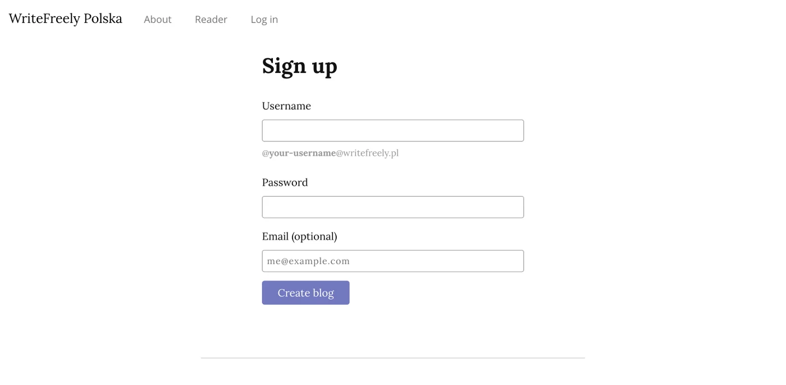
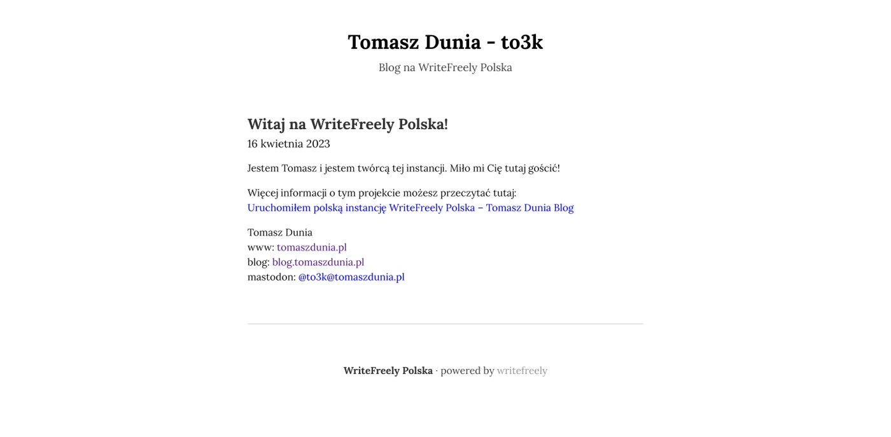
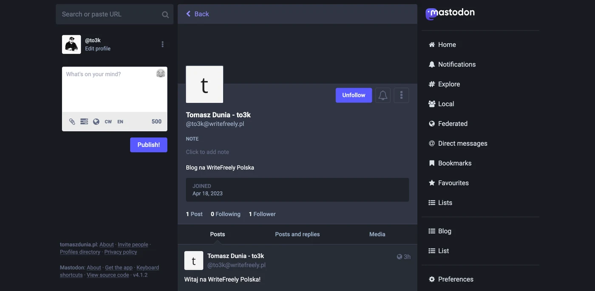

Spis treści:
* TOC
{:toc}

Wszystko zaczęło się od tego, że udało mi się pozyskać domenę [_writefreely.pl_](https://writefreely.pl). Mając taką domenę grzechem byłoby z niej nie skorzystać! Zatem uruchomiłem darmowy serwer w chmurze _Oracle Free Tier_ (tak jak to opisałem w [tym wpisie](https://blog.tomaszdunia.pl/oracle-free-tier/)), zainstalowałem na nim system _YunoHost_ (tak jak to opisałem w [tym wpisie](https://blog.tomaszdunia.pl/yunohost-oracle/)) i uruchomiłem instancję _[WriteFreely](https://writefreely.org/)_, czyli uproszczonej do minimum platformy do blogowania opartej o protokół _ActivityPub_ dający możliwość federowania się z całym zdecentralizowanym _Fediverse_.

Ten wpis jest po pierwsze **zaproszeniem do założenia darmowego konta na _WriteFreely Polska_** oraz miejscem, w którym pokrótce **opowiem o tym projekcie**. Po drugie jest to wstęp, a może raczej zapowiedź wpisu, w którym opiszę jak na _YunoHost_ uruchomić swoją instancję _WriteFreely_.

## Jak uzyskać dostęp?

Już na wstępie chciałbym podkreślić, że ta **instancja jest darmowa i dostępna dla każdego**. Jako jej twórca nie czerpię żadnych korzyści finansowych wynikających z jej działania. Natomiast wszystkie koszty wiążące się z prowadzeniem tej instancji biorę na siebie. Na szczęście na ten moment jest to jedynie koszt domeny, bo przynajmniej na razie za serwer nie płacę nic, a reszta to jedynie ewentualny koszt poświęconego przeze mnie wolnego czasu. Oczywiście istnieje możliwość wsparcia mnie finansowo, ale [o tym później](#wsparcie).

Z obawy przed spamem i złośliwymi aktorami zrezygnowałem z całkowicie otwartego systemu rejestracji. _WriteFreely_ nie jest w żaden sposób zabezpieczone przed botami, a wymaganie jedynie loginu i hasła podczas rejestracji (bez żadnej dodatkowej weryfikacji) sprzyja atakom z ich strony. Zamiast tego, aby mieć możliwość rejestracji konta konieczne jest skorzystanie ze specjalnego zaproszenia, do którego prowadzi poniższy przycisk:

[**https://writefreely.pl/invite/45BrVb**](https://writefreely.pl/invite/45BrVb)

Przy użyciu tego zaproszenia każdy użytkownik może również zaprosić swoich znajomych. To zaproszenie nie ma ograniczeń ilościowych, ani też nie jest ograniczone czasowo. Po wejściu w link nastąpi przekierowanie do strony, na której można założyć swoje konto. Jedyne co jest potrzebne to login i hasło. Jest możliwość podania także adresu e-mail, ale nie jest to w żaden sposób wymagane. Istotnym jest, aby podkreślić, że przy takim podejściu w przypadku zgubienia/zapomnienia hasła traci się dostęp do swojego konta bez możliwości zresetowania hasła lub odzyskania go w żadnej inny sposób. To polityka twórców platformy _WriteFreely_, a nie moja, choć w pełni rozumiem takie podejście, bo jednym z głównych założeń tej platformy jest prostota i dbanie o prywatność użytkowników, a co za tym idzie wymaganie od nich podawania jedynie informacji niezbędnych do działania bloga.

## Jak to wygląda?

Jak już wcześniej wspomniałem _WriteFreely_ charakteryzuje się prostotą zarówno w obsłudze jak i wyglądzie całej platformy. Twórcy ewidentnie postawili tutaj na minimalizm i jest to niewątpliwy plus zarówno dla osób piszących jak i czytelników. To wszystkie jest jednocześnie połączone z pełną integracją z protokołem _ActivityPub_, a więc całym _Fediverse_.

Blogi utworzone na _instancji_ _WriteFreely Polska_ są dostępne pod adresami:

> https://writefreely.pl/<nazwa\_użytkownika>

W moim przypadku jest to: [https://writefreely.pl/to3k](https://writefreely.pl/to3k). A pierwszy, testowy post jaki napisałem można przeczytać tutaj: [https://writefreely.pl/to3k/witaj-na-writefreely-polska](https://writefreely.pl/to3k/witaj-na-writefreely-polska). Zachęcam do wejścia i zobaczenia jak to wygląda w praktyce.

Po założeniu konta dla naszego bloga otrzymujemy również coś w rodzaju profilu w instancji, do którego dostęp może uzyskać każdy z poziomu wszystkich usług federujących się w zakresie _Fediverse_. Aby odszukać ten profil należy np. z poziomu swojego konta na _Mastodon_ wpisać w wyszukiwarkę odpowiedni _handle_ (z ang. _uchwyt_):

> @<nazwa\_użytkownika>@writefreely.pl

W przypadku mojego bloga będzie to _@to3k@writefreely.pl_. Spróbuj wpisać to w wyszukiwarce na swoim koncie na _Mastodonie_, a otrzymasz rezultat podobny do tego poniżej.

## Chcesz wesprzeć tą inicjatywę?

Możesz wesprzeć _WriteFreely Polska_, a tym samym mnie, poprzez:

- [Patreon](https://www.patreon.com/bePatron?u=67755731)

- [Patronite](https://patronite.pl/patronuj/to3k-za-5pln/128901)

- [LiberaPay](https://liberapay.com/to3k/donate)

- [BuyCoffee.to](http://buycoffee.to/to3k)

- [Ko-Fi](https://ko-fi.com/tomaszdunia)
