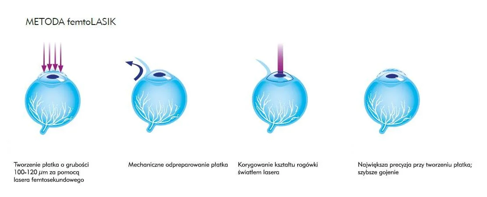

Spis treści:
* TOC
{:toc}

Od 7. do prawie 31. roku życia wyglądałem tak 🤓. Od 17 marca 2023 już tak nie wyglądam, bo postanowiłem poddać się **operacji laserowej korekcji mojej krótkowzroczności**. Dla jasności, bo wiem, że niektórym się to myli, krótkowzroczność to słabe widzenie z daleka i to naciągając to słowo, bo przy mojej wadzie, czyli ok. -4 na obu oczach (mówię sumarycznie, bo miałem też astygmatyzm i to różnie się rozkładało), nie widziałem ostro już z odległości pół metra, czyli nawet o używaniu komputera bez okularów nie mogło być mowy. Przez tyle lat przywykłem już do okularów, na tyle, że raczej nie były one dla mnie nadmiernie uciążliwe. Okulary stały się częścią mnie do tego stopnia, że myślę iż większość znajomych nigdy mnie bez nich nie widziało. Jednakże, posiadanie okularów na nosie to w niektórych przypadkach spora niedogodność, dlatego postanowiłem poddać się operacji. Wybrałem metodę _**FemtoLASIK**_, a w tym wpisie **opiszę jak ten cały proces wyglądał z mojej perspektywy**. Mam nadzieję, że tego typu historia przyda się komuś kto rozważa poddanie się laserowej korekcji wady wzroku.

## Kwalifikacja

Po wstępnym badaniu rynku wybrałem jedną z lubelskich klinik okulistycznych. Nie będę tutaj podawał jej nazwy, bo nie chcę robić żadnej reklamy. Jeżeli jednak ktoś jest zainteresowany pozyskaniem ode mnie takiej informacji to zapraszam do kontaktu mailowego lub każdego innego dostępnego.

Proces rozpoczyna się od umówienia się na **bezpłatne badanie przesiewowe**. Polega ono na naprawdę wstępnej ocenie naszego wzroku. Jeżeli wszystko jest dobrze i nie ma żadnych podstawowych przeciwwskazań do wykonania operacji to można umówić się na **docelową kwalifikację**, której celem będzie już bardziej szczegółowe wykluczenie wystąpienia jakichkolwiek przeciwwskazań oraz określenie metody jaka będzie odpowiednia w naszym konkretnym przypadku. Taka kwalifikacja kosztowała mnie **300 zł** i trwała ok. **5 godzin** (w moim przypadku było to między 9:00 a 14:00). Dobrze jest wziąć przynajmniej dwa dni urlopu, tj. na dzień w którym wykonywana jest kwalifikacja i na kolejny, gdyż podczas jej trwania zapuszczane są krople z, w mojej ocenie, dużym stężeniem atropiny, które rozszerzyły mi źrenice na aż ok. 30 godzin. W tym czasie występował u mnie światłowstręt i słabe widzenie z bliska zarówno w okularach jak i bez nich, dlatego polecam jednak ten urlop. Mi się udało umówić na czwartek i biorąc wolny piątek miałem jeszcze do tego weekend na powrót wzroku do normalności. Przebieg kwalifikacji jest o tyle ciekawy, że nigdy nie przetestowano mnie tyloma różnymi maszynami. Nawet nie wiedziałem, że tyle maszyn do sprawdzania wzroku istnieje. Jedne badały dno oka, inne sprawdzały grubość rogówki, a jeszcze inne sprawdzały jak źrenice reagują na zmianę oświetlenia.

Po wszystkich badaniach następuje rozmowa z lekarzem, który ocenia stan naszego wzroku, określa czy kwalifikujemy się na operację oraz definiuje, które metody są dla nas odpowiednie, a także opowiada w skrócie na czym polegają, tak aby uzyskać komplet informacji potrzebnych do podjęcia decyzji czy poddać się operacji, a także jaką technikę wybrać.

Mi zostały przedstawione dwie metody, z których wybrałem _FemtoLASIK_. Umówiłem się na termin operacji, wpłaciłem **2000 zł zaliczki** i pozostało mi poczekać na ten dzień.

## Przygotowania

Po zdecydowaniu się na poddanie się operacji otrzymuje się komplet broszur informujących o tym jak się do niej przygotować, jak będzie wyglądał jej przebieg oraz jak wygląda umowa, którą będzie trzeba podpisać.

Na operację musiałem wziąć ze sobą:

- dres,

- klapki,

- okulary z polaryzacją (filtr UV), mi np. dali i mogłem je zostawić sobie po operacji, ale nie były dopasowane, więc zawsze lepiej mieć swoje, a takie dobrej jakości to koszt ok. 300-350 zł,

- dowód osobisty,

- pieniądze na pokrycie pozostałego kosztu operacji.

W moim przypadku operacja **kosztowała 9200 zł**, z czego koszt 2300 zł poniosłem już wcześniej płacąc za kwalifikację (300) i wpłacając zaliczkę (2000).

Dodatkowo z ciekawostek:

- 2h przed operacją nie można zupełnie nic pic,

- 24h przed operacją nie zaleca się używać perfum, antyperspirantu i/lub dezodorantu,

- 48h przed operacją nie zaleca się picia alkoholu, kawy i energetyków, żeby nie zwiększać ciśnienia w oku.

## Przebieg

Zostało mi przykazane stawić się na 8:45 w klinice. Po uregulowaniu płatności i krótkim oczekiwaniu w poczekalni zostałem zaproszony do przebieralni, gdzie ubrałem się w dres, klapki i szpitalny czepek oraz ochraniacze na buty, które otrzymałem. W pierwszej kolejności sprawdzenie tętna i ciśnienia. Wydawało mi się, że nie jestem zbytnio zdenerwowany, jednak ciśnienie wyszło nieco podwyższone. Dostałem tabletkę na obniżenie i zainstalowano mi wenflon, który okazał się jedynie zabezpieczeniem w razie czego, bo finalnie nie był użyty, ale rozumiem to, bo jakby coś się działo to łatwiej jest wpiąć strzykawkę w wenflon niż na wariata szukać żyły u pacjenta, z którym jest coś nie tak. Następnie rozpoczęto zapuszczanie **kropli znieczulających**. Myślałem, że robi się to tylko raz, a okazało się, że w przeciągu kilkudziesięciu minut miałem zapuszczone z 7-8 razy po 5-10 kropli. Luźna obserwacją, że zarówno na sali operacyjnej jak i na salach przedoperacyjnych panowała temperatura ok. 19 stopni. Zauważyłem to na termostacie ściennym. To dość zimno, więc ciekawe czy to celowe działanie czy też obsługa po prostu tak woli. Możliwe, że lasery muszą pracować w takich warunkach, bo zdaje mi się, że kiedyś coś takiego na ten temat przeczytałem.

Po wejściu na salę operacyjną. Zaczynamy od lasera, którego zadaniem jest zrobienie **nacięcia wierzchniej warstwy rogówki i stworzenia takiej jakby klapki**, której odchylenie spowoduje odsłonięcie wewnętrznej części rogówki. Powieki blokowane są przy pomocy specjalnych kleszczy, natomiast laser wyposażony jest w coś w rodzaju przyssawki, która przyczepiwszy się do oka zapobiega jego ruchowi. Sam proces trwa chwilę i wykonuje się go najpierw na jednym, a potem od razu na drugim oku.

Po zakończeniu pracy pierwszego lasera przejeżdża się na stole pod drugi. Tutaj robi się nieco mniej fajnie, bo na tym etapie następuje **chirurgiczne odsłonięcie wcześniej wyciętej klapki**. Wydaje mi się, że klapka składa się z więcej niż jednej warstwy, a cały proces z mojej perspektywy wyglądał tak jakby chirurg otwierał mi oko jak książkę, strona po stronie. Po otwarciu oka **laser wykonuje swoją pracę, po czym oko jest ponownie zamykane**. Sposób zamykania przypominało mi ściąganie wody z szyby przy pomocy specjalnej gumowej szpatułki. Chirurg używał bardzo dużo płynu i jeździł tą szpatułką po oku, aż wyrównał powierzchnie oka. Było to **zupełnie bezbolesne, jednak niezbyt przyjemne doznanie**. Cały proces jest powtarzany na drugim oku.

To wszystko. **Całość trwała może 20 minut**. Wstajesz ze stołu operacyjnego i w eskorcie pielęgniarki wracasz z powrotem po pokoju, w którym oczekiwało się na operację. Już w tym momencie widziałem dużo lepiej niż bez okularów, mimo tego, że widziałem jak przez bardzo gęstą mgłę. Efekt podobny do tego jaki ma się po pływaniu bez okularów w basenie z duża ilością chloru. Oczy są mocno podrażnione, ale znieczulenie jeszcze chwilę działa, więc jest znośnie.

## Po operacji

Po około 30 minutach oczekiwania przychodzi lekarz i wykonuje badanie, sprawdzając czy wszystko jest w porządku. W tym czasie dostaje się od pielęgniarki okulary przeciwsłoneczne z filtrem (polaryzacją), komplet dokumentów z zaleceniami, krople z antybiotykiem, krople będące sztucznymi łzami i leki przeciwbólowe. Po wszystkim można opuścić klinikę, ale **pod nadzorem osoby dorosłej**. **Cały proces od wejścia do wyjścia z kliniki trwał w moim przypadku ok. 3 godzin**.

Pierwsze 4-6 godzin po powrocie do domu to była dla mnie tragedia. Oczy piekły i łzawiły na potęgę. Przy zamkniętych była masakra, a i otworzyć na dłużej niż sekunda nie mogłem. W końcu zaczęły działać leki przeciwbólowe i udało mi się usnąć. Już wieczorem tego samego dnia było znośnie, aczkolwiek widoczność z bliska była bardzo słaba. Ogniskowanie wzroku na czymkolwiek w obrębie pomieszczenia było wręcz bolesnym doznaniem. Problem ustał tak naprawdę dopiero po 7 dniach od zabiegu. Po tych siedmiu dniach jedyne minusy jakie dostrzegałem to chwilowe trudności ze skupieniem wzroku na niewielkich odległościach, szybkie męczenie się i wysychanie oka oraz lekki światłowstręt. Po dwóch tygodniach było już całkiem super. Jedyne skutki uboczne jakie dalej odczuwałem to wysychanie oczu, szczególnie uciążliwe po przebudzeniu rano, oraz łatwe męczenie się oczu, które wpływało na dość słabe widzenie wieczorem.

Kuracja po operacji polega na zakraplaniu kropki _Tobradex_, co godzinę dobę po zabiegu, a później 4 krople dziennie w 1. tygodniu, w następnym 3 i tak aż do odstawienia po 4 tygodniach. Te krople to chyba steryd o działaniu przeciwzapalnym. Do tego dochodzą drugie krople _Artelac_ do stosowania przez 6 miesięcy po zabiegu w przypadku wystąpienia suchości w oczach.

Oczywiście na tym przygoda się nie kończy, bo jeszcze zostają wizyty kontrolne. Pierwszą odbyłem 3 dni po operacji. Z badania wyszło, że prawym okiem czytam 120% normy, natomiast lewym trochę gorzej, bo 90%, jednak to z lewym okiem miałem zdecydowanie większe problemy, bo to ono mnie bolało bardziej, więc zakładam, że proces gojenia przebiegał w tym przypadku nieco gorzej. Następną wizytę mam zaplanowaną na trzy tygodnie po operacji i w momencie pisania tego wpisu jeszcze się nie odbyła. Te dwie wizyty są darmowe (wchodzące w skład kosztu operacji), natomiast następne już prawdopodobnie będą normalnie płatne, z tym że jeszcze nie wiem ile.

## Podsumowanie i finalne wrażenia

Podczas operacji miałem taki moment, w którym pomyślałem _Co ja zrobiłem_. Tak samo pierwsze godziny po były dla mnie dość trudne i budziły lekkie wątpliwości, co do słuszności mojej decyzji. Jednak już teraz patrząc z perspektywy czasu jestem bardzo zadowolony z efektu i na pewno zdecydowałbym się na to wszystko jeszcze raz. Wzrost komfortu życia jest nie do opisania i mówię to w momencie, gdy jeszcze nie ustąpiły wszystkie efekty uboczne. Tak, więc formalnością będzie stwierdzenie, że z czystym sumieniem mogę polecić wykonanie sobie takiej korekcji każdemu kto nosi okulary. Jeżeli ktoś ma jakiekolwiek pytania z tym związane to zachęcam do napisania komentarza lub kontaktu bezpośredniego.
