Spis treści:
* TOC
{:toc}

W [poprzednim wpisie](https://blog.tomaszdunia.pl/ubuntu-touch/) opisałem jak wgrać system _Ubuntu Touch_ na smartfon _Google Pixel 3a XL_ i tym samym zastąpić fabrycznego _Androida_. Już na podstawie pierwszych wrażeń można było dojść do wniosku, że ten system (jeszcze) nie nadaje się jako coś więcej niż tylko ciekawostka. Działa i wygląda w porządku, ale brakuje w nim oprogramowania. Do tego nie jest tak otwarty jak mogłoby się wydawać, bo pomimo, że jest to Linux to jest dość ograniczony jako środowisko, tj. niewiele da się w nim zdziałać nawet z poziomu terminala. Rozpocząłem zatem dalsze poszukiwania idealnego systemu dla mojego _Pixela_, który zastąpi _Androida_, a jednocześnie będzie otwarty i darmowy. Dość szybko trafiłem na [projekt _Droidian_](https://droidian.org/), który bazuje na _Mobianie_, czyli **porcie _Debian_ na urządzenia mobilne**. Okazało się, że jest to **pełnoprawna dystrybucja _Linuxa_**, która ma możliwości niemalże takie jak ta dla _desktopów_, ale można ją **uruchomić na 6-calowym urządzeniu**! Może **nie jest tak dopracowany wizualnie** jak _Ubuntu Touch_ (jest spory problem ze skalowaniem aplikacji, bo to są aplikacje dla _desktopów_) i **podstawowe funkcje telefonu nie działają tak pewnie, a nawet część z nich nie działa** (np. automatyczne obracanie do pionu/poziomu, automatyczna jasność ekranu czy chociażby czytnik linii papilarnych), jednakże zdecydowanie rozwiązuje moje kluczowe problemy z _Ubuntu Touch_, tj. **repozytorium z oprogramowaniem jest znacznie bardziej obszerne**, a nawet jeżeli czegoś w nim nie ma to istnieje duża szansa na **zainstalowanie tego z poziomu terminala** (np. jako _root_), oczywiście o ile dane oprogramowanie działa na standardowym _Debianie_. Ze względu na powyższe, **ten wpis będzie poradnikiem jak wgrać system operacyjny _Droidian_** na smartfona _Google Pixel 3a XL_.

## Przygotowanie do flashowania Droidiana

Aż 95% czynności koniecznych do wgrania _Droidiana_ na _Pixela 3a XL_ jest tożsamych z tym co robiliśmy przy okazji [wpisu traktującego o _Ubuntu Touch_](https://blog.tomaszdunia.pl/ubuntu-touch/). Dlatego w tym wpisie jedynie je wypunktuję w kolejności wykonywania, odeślę do nich i przejdę do części, która różni się dla tych dwóch systemów.

Czynności do wykonania przed flashowaniem _Droidiana_:

1. [zakup odpowiedniego smartfona](https://blog.tomaszdunia.pl/ubuntu-touch/#pixel),

3. [przygotowanie komputera](https://blog.tomaszdunia.pl/ubuntu-touch/#pc),

5. [odblokowanie bootloadera](https://blog.tomaszdunia.pl/ubuntu-touch/#bootloader),

7. [przywrócenie wymaganej wersji systemu _Android_](https://blog.tomaszdunia.pl/ubuntu-touch/#android9).

## Flashowanie Droidiana

Co ciekawe, _Droidiana_ można wgrać dokładnie tym samym programem co _Ubuntu Touch_ - _UBports Installer_. Tak jak w przypadku _Ubuntu Touch_ przebieg procesu pokażę na zrzutach ekranu poniżej.

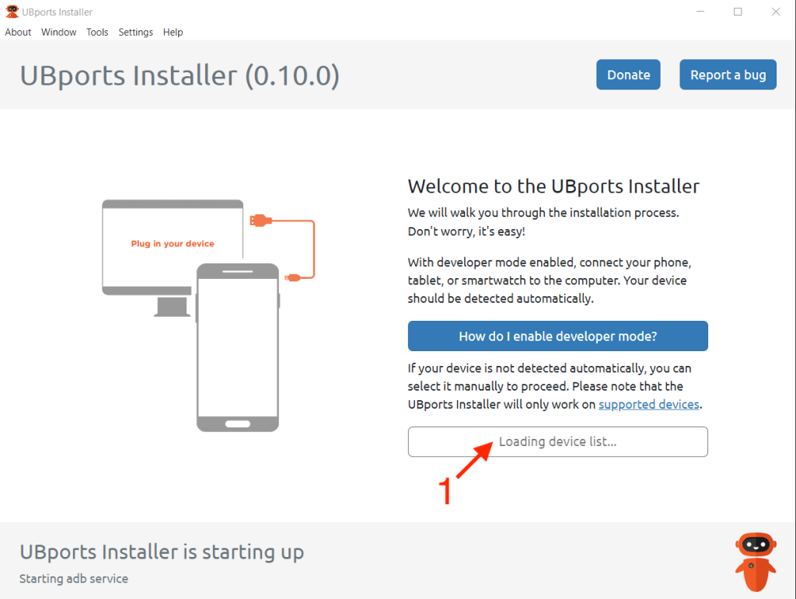
    
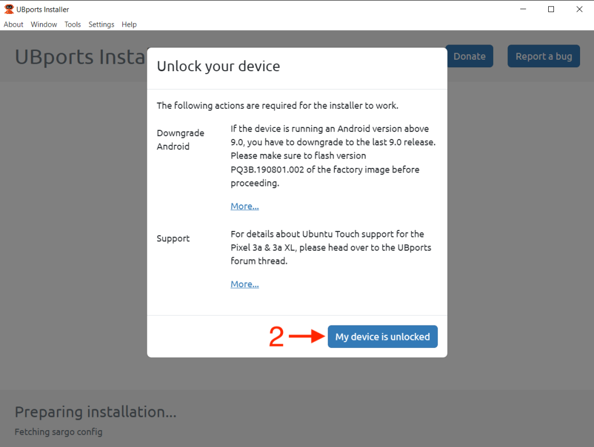
    
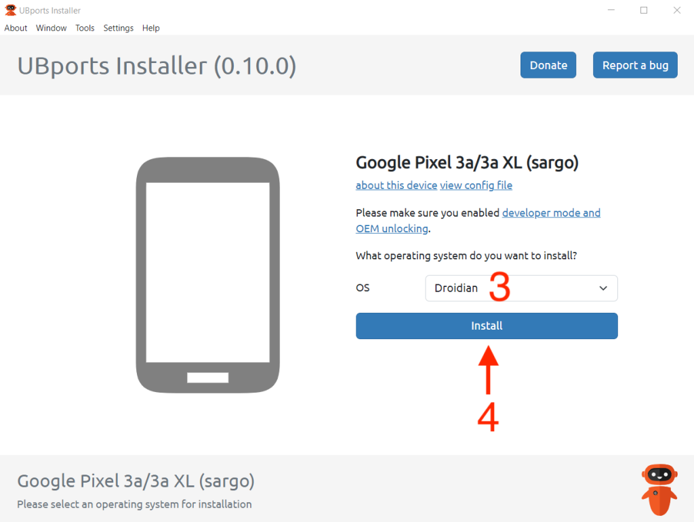
    
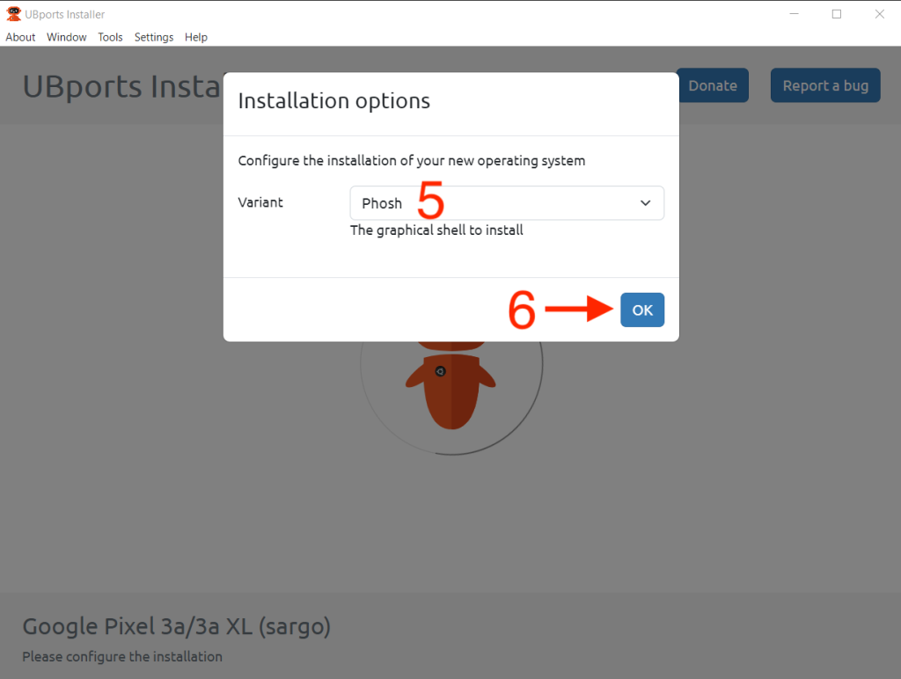
    

    
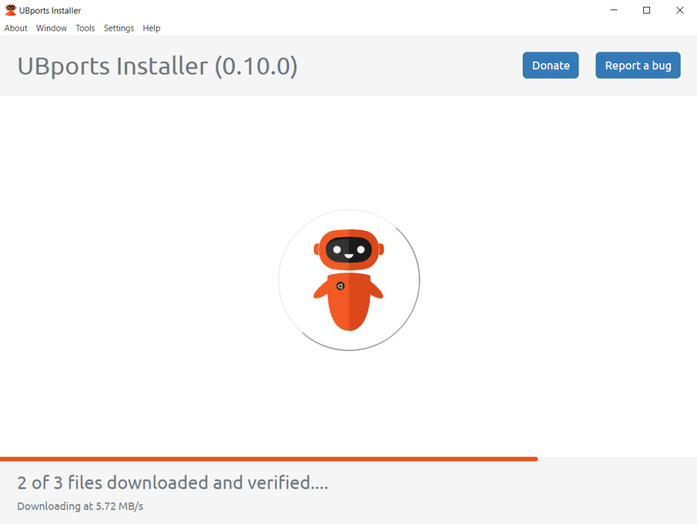
    
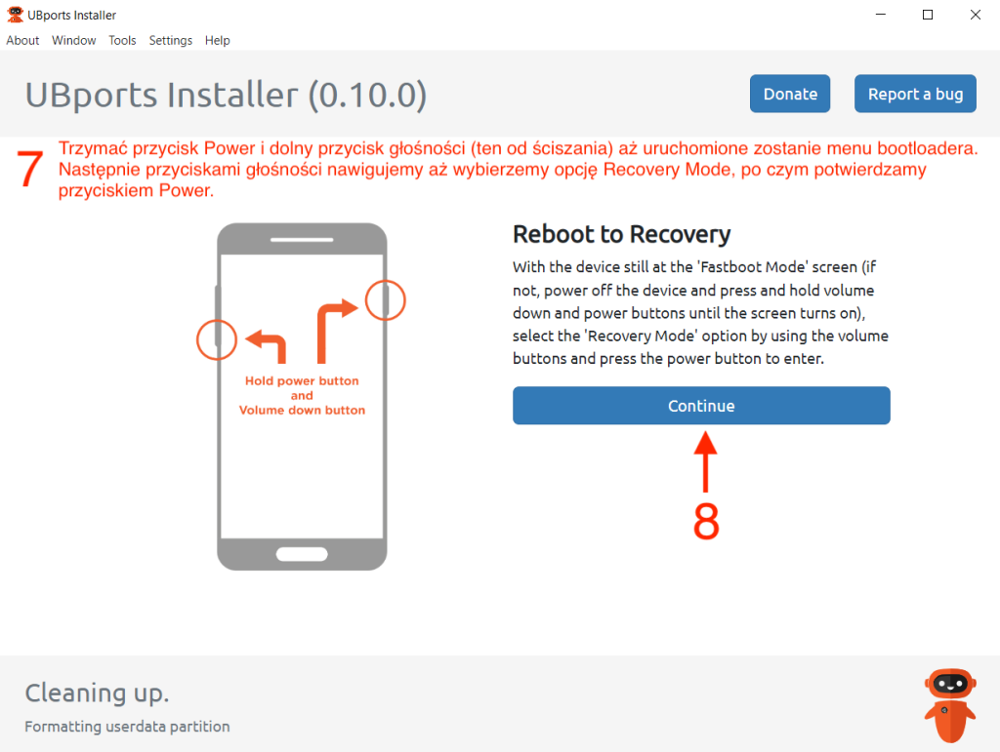
    
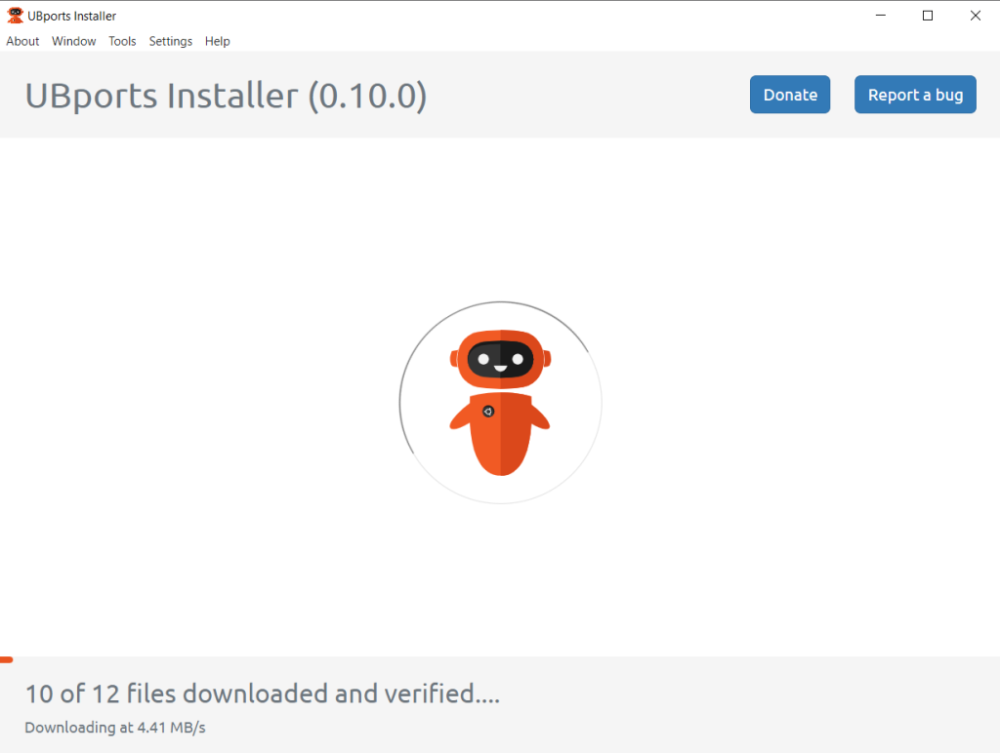
    
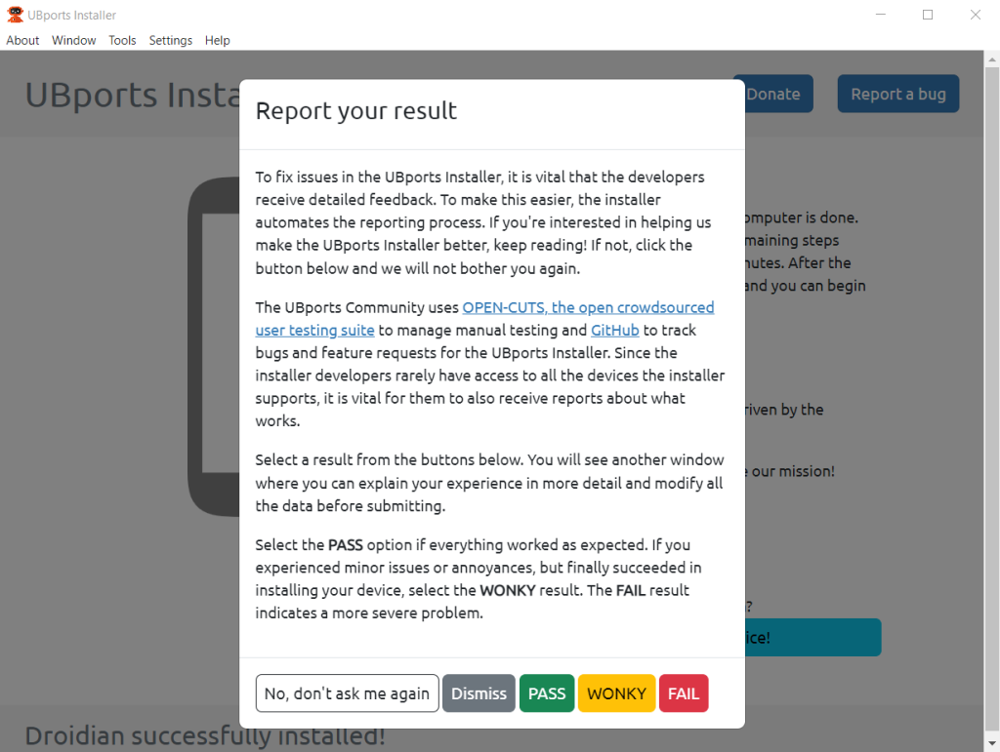
    
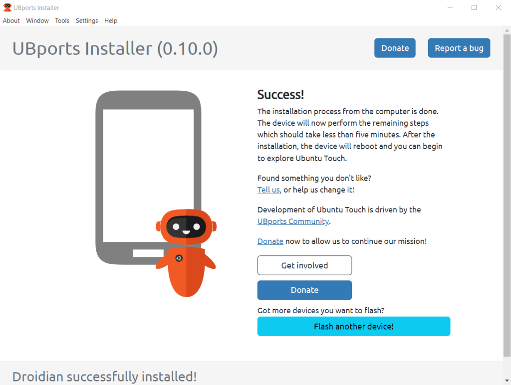
    

## Droidian - pierwsze wrażenia

Muszę przyznać, że pisząc pierwsze wrażenia dotyczące _Ubuntu Touch_, które zawarłem w [poprzednim wpisie](https://blog.tomaszdunia.pl/ubuntu-touch/), byłem lekko zniesmaczony tym jaki okazał się ten system. W przypadku _Droidian_ już od samego początku miałem zupełnie odwrotnie. Może i nie jest on idealny i ma wiele problemów, ale daje mi to czego szukałem, czyli sprawił, że smartfon, którego mogę włożyć do kieszeni, stał się tak naprawdę pełnoprawnym komputerem, na którym uruchomione jest _desktopowa_ dystrybucja _Linuxa_ (_Debian_). Przy okazji poprzedniego wpisu ludzie pytali się, dlaczego tak nieprzychylnie wypowiedziałem się na temat _Ubuntu Touch_. Sęk w tym, że ja nie szukałem trochę bardziej egzotycznego systemu, który umożliwi korzystanie z mojego _Pixela_ jak z podstawowego telefonu, tj. dzwonienie, SMSy, trochę surfowania w przeglądarce i ewentualnie mapy czy odtwarzać audio. Tak jak napisałem wcześniej, ja szukałem czegoś co z telefonu zrobi bardzo przenośny komputer i _Droidian_ jest właśnie takim rozwiązaniem.

Zacznijmy od podstaw. _Droidian_ już na start ma zainstalowanych kilka podstawowych aplikacji. Ja w pierwszej kolejności pozbyłem się większości z nich, bo przewidziałem dla tego urządzenia zupełnie inne zastosowanie. Dla przykładu usunąłem aplikacje do dzwonienia i wysyłania wiadomości _SMS_, bo w _Pixela_ mam wsadzoną kartę _SIM_, która ma możliwość korzystania jedynie z usługi transmisji danych _GSM_, więc posiadanie tych aplikacji było w moim przypadku bez sensu. Niemniej jednak jeżeli ktoś zamierza używać _Droidiana_ jako swojego codziennego rozwiązania to warto podkreślić, że jest taka możliwość. Poza tym tak samo jak w przypadku _Ubuntu_ działają takie funkcje jak _Wi-Fi_, transmisja danych, _Bluetooth_, _GPS_ czy chociażby latarka. Wydaje mi się, że dosłownie parę dni temu wyszły jakieś łatki, którymi ogarnięto funkcję automatycznej jasności ekranu oraz automatycznej zmiany orientacji ekranu (obrót pionowo i poziomo), które wcześniej były niedostępne. Jest też kilka rzeczy, które działały na _Ubuntu Touch_, a nie działają na _Droidianie_. Jest to np. czytnik linii papilarnych i aparat. Przyznam, że czytnik mógłby mi się przydać, ale to też nie jest tak, że nie ma perspektyw na dodanie tej funkcji, bo wydaje mi się, że czytnik fizycznie może normalnie działać, ale nie ma po prostu programowej obsługi dla tej funkcji, a to może się pojawić w każdej chwili, bo widać, że _Droidian_ (a może raczej _Mobian_, którego _forkiem_ jest _Droidian_) jest cały czas aktywnie rozwijany.

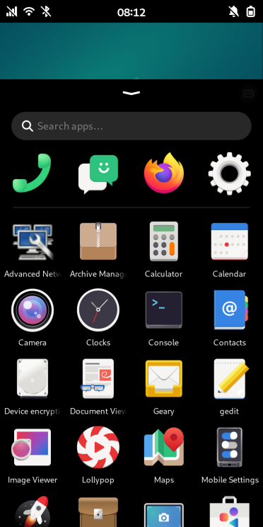

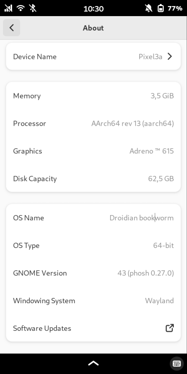

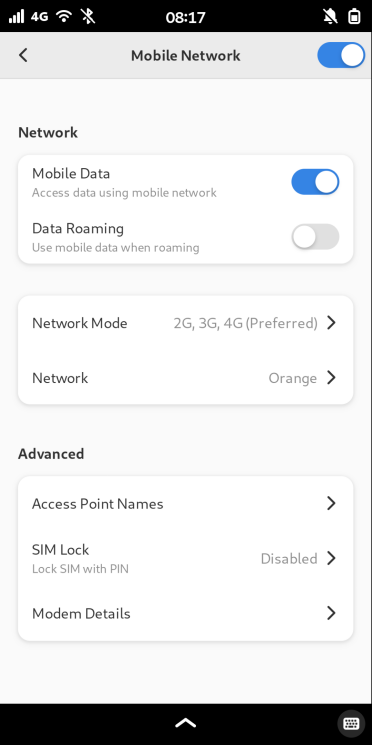

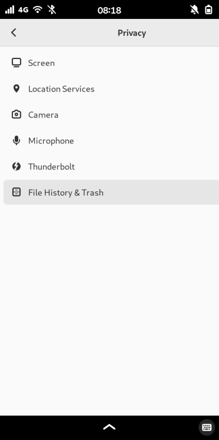

W mojej ocenie podstawowe zalety _Droidiana_ to _desktopowy_ _Firefox_ i niczym nie zablokowany _linuxowy Terminal_. Większość pewnie zastanawia się jak można używać przeglądarki projektowanej na zupełnie inny rozmiar ekranu. Jest to momentami faktycznie lekko karkołomne, bo niejednokrotnie jest znaczny problem ze skalowaniem. Jednakże da się to częściowo obejść zmieniając _Zoom_ interfejsu na 50%. Natomiast jeżeli chodzi o _Terminal_ to tutaj doznania są jak na świeżo zainstalowanym _Debianie_ w wersji _minimal_. Trzeba wykonać podstawowe czynności jak zmiana hasła (bo domyślne to _1234_), pierwsza aktualizacja, konfiguracja repozytoriów APT, instalacja _Flatpaka_ i _Snapa_, ale później już system stoi przed nami otworem.

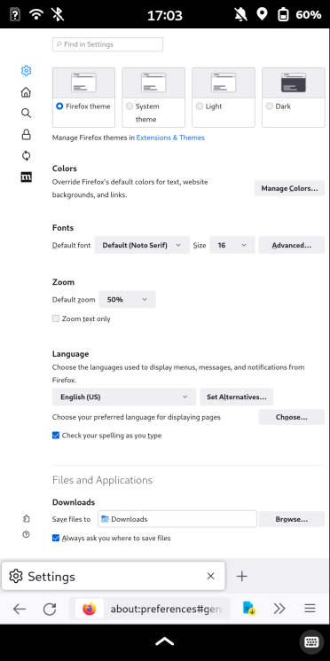

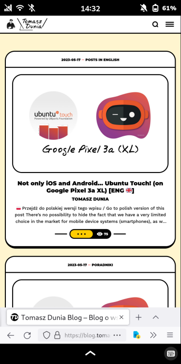

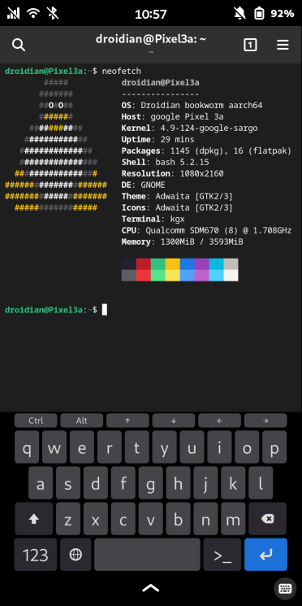

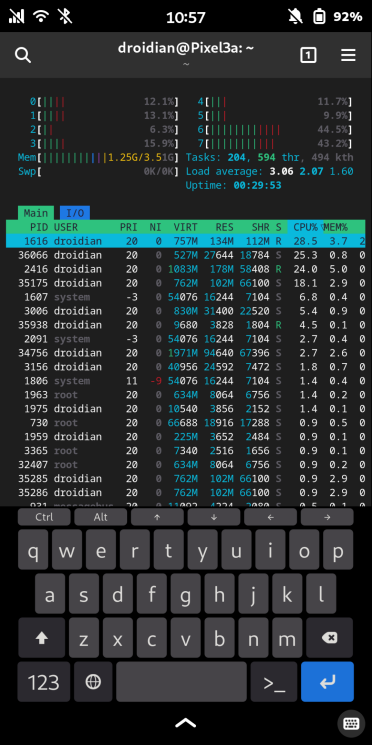

Bez problemu udało mi się także zainstalować takie aplikacje jak _Bitwarden_ (menedżer haseł), _Thunderbird_ (klient poczty e-mail), _Fractal_ (klient _Matrixa_), _Pure Maps_ (mapy), _Nextcloud_ (dysk sieciowy), _gEdit_ (edytor tekstowy) czy nawet _Spot_ (klient _Spotify_). Wszystkie wymienione aplikacje działając wyjątkowo dobrze.

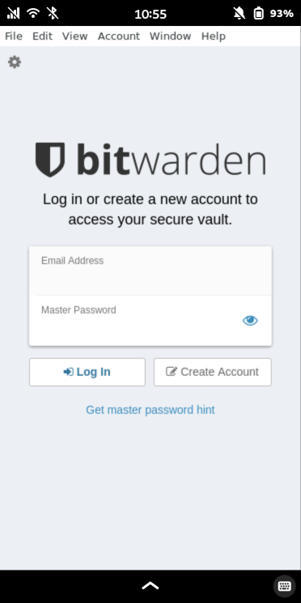

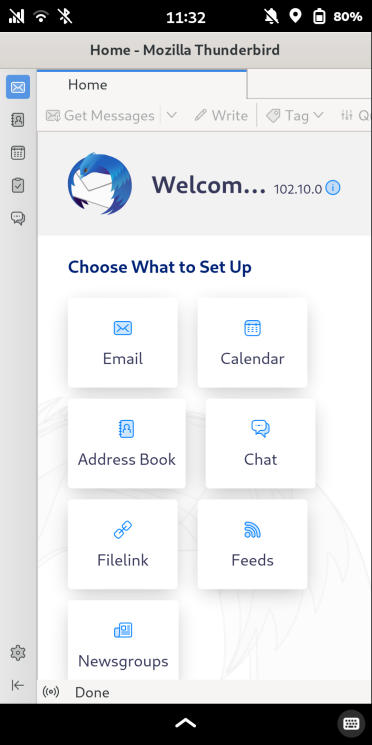

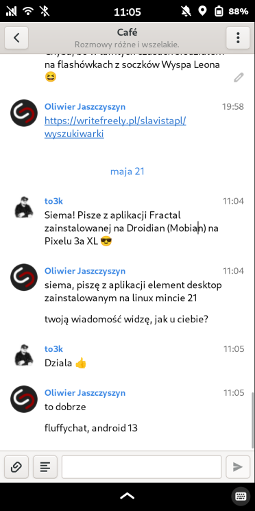

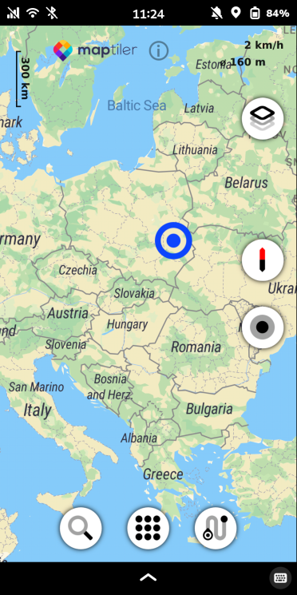

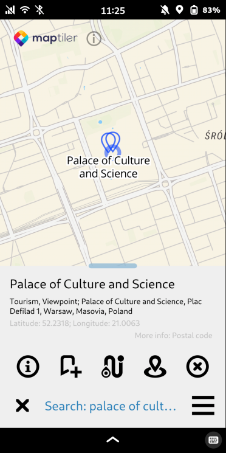

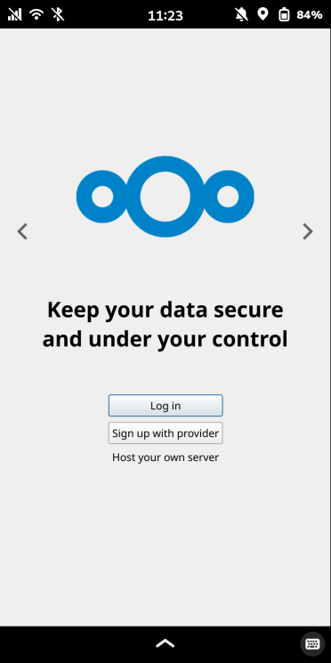

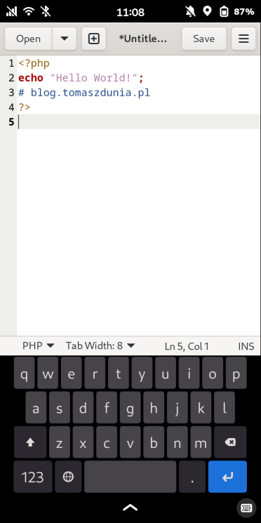

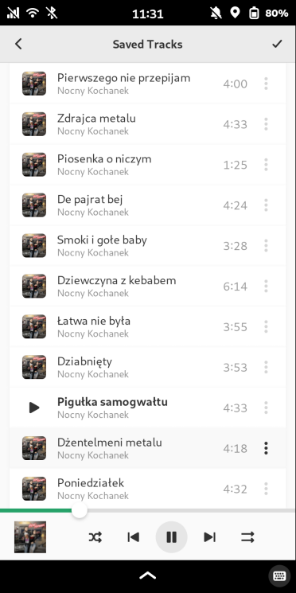

Istnieją też takie aplikacje, które mnie trochę pokonały. Najbardziej boli mnie to, że nie udało mi się z powodzeniem zainstalować żadnego klienta _Signala_ (komunikator). Jest niby coś co się nazywa _Axolotl_ i nawet w pewnym momencie udało mi się go uruchomić, ale potem poszła jakaś aktualizacja, po której już się nie uruchamia. Jako drugi przykład przytoczę _KeePassXC_ (menedżer haseł), choć tutaj sytuacja jest o tyle inna, że nie ma problemu ani z instalacją ani z uruchomieniem, a jedynie z tym, że aplikacja nie skaluje się w żaden sposób, a więc używanie jej ani w pionie, ani w poziomie jest raczej nie możliwe. Na koniec _Filezilla_ (klient _FTP_), z którą po pierwszym uruchomieniu ma ten sam problem co _KeePassXC_, jednakże w tym przypadku możemy temu zaradzić poprzez odpowiednie ustawienia w zakładce View, gdzie należy wyłączyć wszystkie niepotrzebne elementy interfejsu, po czym korzystanie w orientacji poziomej jest możliwe.

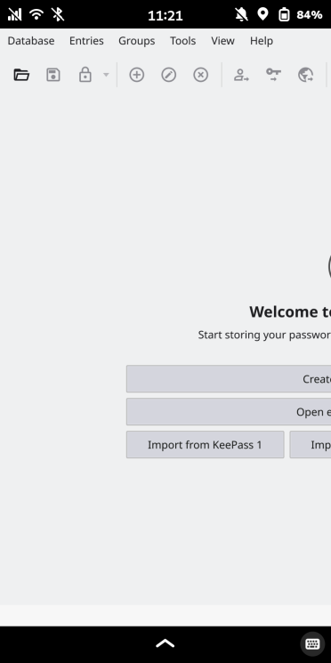

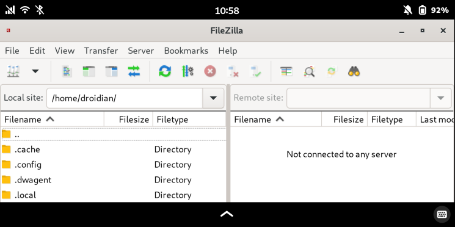

To nie jest też tak, że wszystkie niepowodzenia przyjmuję negatywnie. Wręcz przeciwnie, jest to świetna zabawa! W sieci można znaleźć ogromną ilość _forków_ i _portów_ różnych aplikacji, które deweloperzy próbują dostosować dla _Mobiana_. Każdy kto lubi pogrzebać trochę w systemie _Linux_ na pewno znakomicie się w tym odnajdzie. Oficjalna lista aplikacji (lepiej lub gorzej dostosowanych) znajduje się [tutaj](https://wiki.mobian.org/doku.php?id=apps).

## Do codziennego użytku?

Ciężko orzec tak lub nie, bo wszystko zależy od zastosowania i przede wszystkim wymagań tego konkretnego użytkownika. Dla mnie jest to rozwiązanie idealne, bo tak jak mówiłem mam komputer z pełnoprawnym _Linuxem_ w kieszeni. Na tym można wykorzystać nawet _Dockera_! No, ale ja używam tego telefonu jako zupełnie dodatkową zabawkę. Patrząc bardziej przyziemnie, można dzwonić i _SMSować_, jest _Spotify_, są jakieś mapy. Czego więcej chcieć od telefonu? Ano przydałby się aparat, którego tutaj, można powiedzieć, nie ma wcale, ale nawet jak będzie to jakość będzie porównywalna do tej z _Ubuntu Touch_, czyli tragiczna. Drugi temat to płacenie telefonem, które według mnie jest jedną z kluczowych funkcji. Nie wyobrażam sobie sytuacji, w której możliwe byłoby płacenie _Pixelem_ z zainstalowanym _Droidianem_. Żaden bank na to nie pozwoli, aczkolwiek może jest jakieś obejście, o którym nie wiem. Poza tym nie mam pomysłu czego nie można by było zrobić na takiej konfiguracji, bo niemalże wszystko można zrobić chociażby w oparciu o rozwiązania _self-hosted_, które będą uruchomione bezpośrednio na tym urządzeniu.
