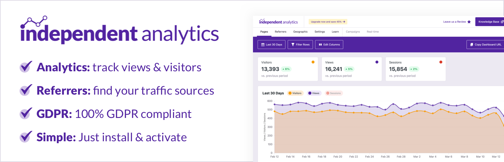
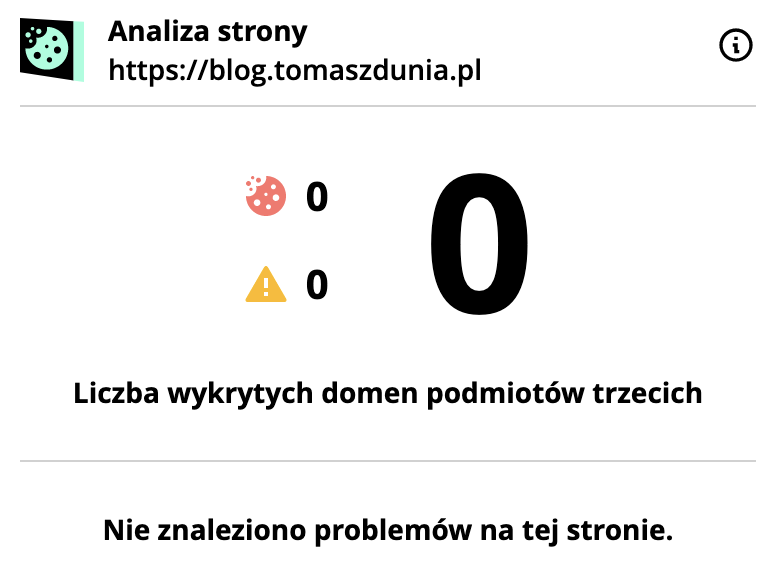

[🇬🇧 Go to english version of this post / Przejdź do angielskiej wersji tego wpisu](https://blog.tomaszdunia.pl/rodo-gdpr-eng/)

Spis treści:
* TOC
{:toc}

Muszę przyznać, że popularność tego bloga przerosła moje najśmielsze wyobrażenia. Na początku myślałem, że nie zyskam wielu Czytelników i będę pisał raczej do szafy. Przez to nigdy **nie myślałem nawet o czymś takim jak napisanie polityki prywatności**. Jednak przy takich wzrostach **to wstyd, że jeszcze nie mam takiego dokumentu**, więc postanowiłem siąść, coś z tym zrobić i przy okazji upiec dwie pieczenie na jednym ogniu, bo w tym wpisie opiszę cały proces pisania przeze mnie polityki prywatności dla tego bloga.

Od razu na wstępie chcę zaznaczyć, że **nie jestem ekspertem w tej dziedzinie, a przepisy _[RODO/GDPR](https://pl.wikipedia.org/wiki/Ogólne_rozporządzenie_o_ochronie_danych)_ to dla mnie czarna magia**. Będę po prostu pisał to na tyle na ile udało mi się zebrać informacji w Internecie oraz skorzystał z legendarnego _na chłopski rozum_. Mam nadzieję, że żaden prawnik nie ukrzyżuje mnie za to co napiszę poniżej. Jestem jednak bardziej niż otwarty na konstruktywną krytykę!

_AKTUALIZACJA 11.06.2023:_ Moim wpisem zainteresowała się [Pani Mecenas Agnieszka Rapcewicz](https://mastodon.internet-czas-dzialac.pl/@agnieszka), która jest specjalistką właśnie w dziedzinie _RODO_, a także widać, że jak niewielu prawników ma pojęcie o nieco bardziej technicznych aspektach dotyczących prywatności. To bardzo przydane połączenie i jestem zachwycony faktem, że miałem możliwość zasięgnąć opinii od takiej osoby! Na podstawie tego zmodyfikowałem niektóre fragmenty poniżej, oznaczając je przy tym słowem _Aktualizacja_ i datą.

_AKTUALIZACJA 18.07.2023:_ Jeden z Czytelników [w komentarzu](https://blog.tomaszdunia.pl/rodo-gdpr/#comment-409) słusznie zauważył (dziękuję za to!), że _dostawca hostingu jest procesorem a nie administratorem danych. Dane są mu powierzane, a nie udostępniane – nie może on z nimi zrobić co chce, a jedynie przetwarza je ze względu na administrowanie serwerem. Gdyby były udostępnione (a to wierzę, że nie ma miejsca) to byłby administratorem, a więc mógłby z nimi „robić co chce”._ To słuszna uwaga, więc sprostowałem ten wpis i politykę prywatności tego bloga.

## Założenia początkowe

Na własnym przykładzie widzę **niechęć do wszelkiego rodzaju tematów związanych z _RODO/GDPR_**. Wydaje mi się, że to **przez formę** jaka jest używana do tworzenia zapisów polityk prywatności, warunków korzystania z usług i wszelkich innych regulaminów. W większości przypadków są to po prostu ogromne bloki tekstu podzielone na paragrafy, które w takiej formie **mają wyglądać** na turbo-profesjonalne. Wydaje mi się, że moje nastawienie nie jest czymś wyjątkowym i więcej osób (o ile nie większość) ma te same przemyślenia. Czytanie czegokolwiek w tej formie może sprawiać dziką przyjemność jedynie prawnikom i totalnym zapaleńcom. Ale czy tak naprawdę o to w tym wszystkim chodzi? Żeby napisać coś w sposób jak najbardziej zawiły i niezrozumiały dla drugiej strony jak to tylko możliwe? Może **ma to sens dla kogoś kto chce coś ukryć**, tudzież przeszmuglować w potoku mądrze i groźnie brzmiących słów. W praktyce **_RODO/GDPR_ to świetna sprawa**, której podstawowym założeniem powinno być dbanie o prywatność i zarazem bezpieczeństwo zwykłych ludzi, obywateli, użytkowników usługi. **Każdy powinien mieć prawo dbania o bezpieczeństwo swoich danych i posiadać narzędzia do egzekwowania tego prawa**.

Czy w takim razie można stworzyć politykę prywatności, która bez zbędnego pier... będzie spełniała swoją rolę? W mojej ocenie tak! **Wystarczy zastanowić się jaki jest cel pisania takiego dokumentu, zadać odpowiednie pytania i sumiennie na nie odpowiedzieć** zachowując przy tym spójną formę, czyli skupić się jedynie na meritum.

## Jakie to pytania?

Wbrew pozorom **zadanie polityki prywatności jest bardzo proste**. Jako właściciel (administrator) strony/usługi/aplikacji **mamy dostarczyć użytkownikowi wszystkie informacje dotyczące jego danych**. Podzieliłem to na 6 pytań, które należy sobie zadać:

1. **Kto** jest administratorem (osobą odpowiedzialną) danych zbieranych na tym blogu?

3. **Co**, tj. jakie dane są zbierane?

5. **Dlaczego** te dane są zbierane?

7. **Gdzie** przechowywane są te dane?

9. **Komu** poza administratorem udostępniane powierzane są te dane?

11. **Jaką** kontrolę nad swoimi danymi ma użytkownik?

Piszemy!

## 1\. Kto

**Administratorem danych zbieranych na moim blogu jestem ja sa**m. Jako, że jestem osobą fizyczną, a nie firmą, i nie mam zarejestrowanej działalności gospodarczej związanej z tym blogiem to ilość danych, które muszę podać jest ograniczona jedynie do imienia, nazwiska, adresu korespondencyjnego i adresu e-mail, które spełniają **ustawowy wymóg udostępnienia użytkownikowi kanału do komunikacji ze mną**. W tym przypadku daję możliwość kontaktu poprzez standardową korespondencję listową lub elektronicznie poprzez e-mail.

## 2\. Co

W tym miejscu musimy **wypisać rodzaje zbieranych (i przetwarzanych) danych**. Muszę przyznać, że sam miałem duży problem, bo _Wordpress_ nie jest dla mnie jak otwarta księga, którą w pełni rozumiem i wiem gdzie w niej szukać konkretnych rzeczy. W przypadku innych skryptów, które napisałem od początku do końca sam, nie mam najmniejszego problemu. Wtedy bez cienia wątpliwości mogę napisać, że moje narzędzia nie używają cookies i nie zbierają absolutnie żadnych danych osób ich używających, co przeważnie potwierdzam poprzez udostępnienie ich jako open-source. Jednak w przypadku bloga mamy aktorów zewnętrznych w postaci chociażby wtyczek czy nawet motywów, których sam nie napisałem, i to już trudniej utrzymać pod 100% kontrolą.

Bardzo dużą pomocą w ogarnięciu tej sprawy okazało się dla mnie rozszerzenie do przeglądarki _Firefox_ o nazwie [_Rentgen_](https://addons.mozilla.org/pl/firefox/addon/rentgen/), stworzone przez ekipę _[Internet. Czas działać!](https://www.internet-czas-dzialac.pl)_. Pozwala ono na przeskanowanie swojej (lub czyjejś) strony i wygenerowanie raportu skupionego na tym czy dana strona spełnia wszystkie ustawowe wymagania _RODO/GDPR_, a także jak ogólnie dba (lub nie) o prywatność swoich użytkowników. Na tej podstawie zdefiniowałem co powinienem poprawić na mojej stronie.

W pierwszej kolejności wziąłem się za _Google Fonts_, czyli czcionki zewnętrzne pobierane z serwerów _Google_. To bardzo ciekawa taktyka ze strony molocha, która bazuje na hostowaniu na swoich serwerach czcionek używanych przez wiele stron. Przeważnie pośredniczy temu domena _gstatic.com_. Ale co w tym sprytnego? Otóż każda osoba, która odwiedza stronę używającą _Google Fonts_, podczas wczytywania tejże strony łączy się z serwerami _Google'a_ i pobiera te czcionki jako zasób zewnętrzny. **W ten sposób _Google_ może bardzo skutecznie monitorować ruch w sieci, profilować ludzi i analizować ich poczynania w sieci**. Wszystko po to, aby wiedzieć o Tobie jak najwięcej i na tej podstawie serwować Ci treści (przeważnie reklamy), które będą najmocniej na Ciebie oddziaływały. To jednak jedynie czubek góry lodowej, bo takie praktyki niosą za sobą jeszcze wiele innych zagrożeń dla prywatności użytkowników. No dobrze, ale jak uchroniłem przed tym swoich Czytelników? W bardzo prosty sposób. **Wszystkie czcionki, które są używane na tym blogu, zostały przeze mnie pobrane i umieszczone na serwerze, na którym hostowany jest ten blog**. To oznacza, że użytkownik wchodząc tutaj po raz pierwszy musi tak samo pobrać czcionki, ale nie robi tego poprzez kontakt z serwerami _Google_. Można to zrealizować na wiele różnych sposobów, ale według mnie najprostszym z nich jest zastosowanie wtyczki do tego dedykowanej o niezbyt poważnej nazwie [_OMGF | GDPR/DSGVO Compliant, Faster Google Fonts. Easy_](https://pl.wordpress.org/plugins/host-webfonts-local/). Prostota działa tej wtyczki sprawia, że Jjest to rozwiązanie, z którym poradzi sobie absolutnie każdy.

Kolejnym tematem jaki był problematyczny na moim blogu to wtyczka _Jetpack_, a konkretnie jej moduł _Stats_ służący do zbierania statystyk odwiedzin bloga. _Jetpack_ jest wtyczką od _Automattic_, czyli twórców samego _Wordpress_. To daje pewien spokój w zakresie przetwarzania danych użytkowników, bo jest to **firma dość zaufana i dbająca o prywatność swoich użytkowników**, patrząc po dokumentacji jaką dostarcza. **Jednakże nie podobało mi się to, że dane moich Czytelników mogą być wysyłane gdzieś poza serwer**, na którym uruchomiony jest blog, więc postanowiłem znaleźć alternatywę. Po krótkim badaniu rynku zapadła decyzja o skorzystaniu z wtyczki _[Independent Analytics](https://pl.wordpress.org/plugins/independent-analytics/)_, która przekonała mnie tym, że **nie używa _ciasteczek_ (_cookies_), nie przechowuje żadnych danych pozwalających na identyfikacje konkretnej osoby oraz wszystkie statystyki przechowuje na serwerze właściciela bloga**, na którym jest zainstalowana.

_Jetpack_ po odpowiednim _wykastrowaniu_ (usunięciu niepotrzebnych funkcji) dalej pozostanie na moim blogu jako wtyczka, bo oferuje kilka naprawdę przydatnych narzędzi jak ładny i wygodny blok galerii w postaci karuzeli (_slideshow_), którego często używam, moduł _Firewall_ zabezpieczający bloga, czy też moduł _Akismet_, który pomaga mi walczyć z falami spamu, które już miały okazję zaatakować mojego bloga. **Są to narzędzia, które nie zbierają żadnych danych moich Czytelników**, co potwierdza dokumentacja dostarczona przez twórców _Jetpack_, którym trzeba przyznać, że stawiają dość duży nacisk na transparentność w zakresie prywatności, a każdy moduł będący częścią ich wtyczki ma wypisane czy zbiera, i jeżeli tak to jakie, dane. Wszystkie te informacje dostępne są [tutaj](https://jetpack.com/support/privacy/#data-usage).

Czy w takim razie jako administrator tego bloga nie zbieram i nie przetwarzam żadnych danych moich Czytelników? Robię to, chociażby poprzez system komentarzy i formularz kontaktowy.

Zacznijmy od prostszego czyli formularza kontaktowego. Użytkownik korzystając z niego są zobligowani do wypełnienia dwóch pól (adres e-mail i treść wiadomości), a pozostałe dwa (imię i tytuł wiadomości) nie są obowiązkowe. Wszystkie te pola są agregowane w bazie, a więc **stanowią dane, które zbieram**. Jednakże trzeba przyznać, że żadna z tych informacji **nie może być raczej uważana za krytyczne dane osobowe**. Może jedynie adres e-mail i/lub jeżeli ktoś poda swoje pełne imię i nazwisko, ale chciałbym zauważyć, że te pola mogą być wypełnione czymkolwiek, a e-mail i tak zostanie do mnie dostarczony, co najwyżej nie będę miał możliwości odpisania na niego, gdy podany adres będzie wymyślony. Niemniej jednak **informację o tym, że te dane są zbierane należy zawrzeć w swojej polityce prywatności**.

W przypadku systemu komentarzy sytuacja wygląda podobnie, a pozornie wygląda na nawet łatwiejszą, bo użytkownik podczas dodawania komentarza podaje mniej danych - treść komentarza, imię i adres e-mail. Celowo użyłem słowa _pozornie_, bo w praktyce jest to znacznie bardziej skomplikowane. Wszystko za sprawą tego, że **domyślnie po podaniu adresu e-mail przez użytkownika jest on wysyłany do serwera _Wordpressa_, który dalej podaje ten adres do _Gravatar_**, czyli kolejnego narzędzia od _Automattic_ (twórców _Wordpress_). Podany przez użytkownika adres e-mail jest przekazywany **w celu pobrania zdjęcia profilowego danego użytkownika**, które zostanie wyświetlone po dodaniu komentarza. Oczywiście o ile dany adres powiązany jest z jakimś kontem _Gravatar_. Tak więc mamy dwie opcje. Pierwsza z nich to napisać w swojej polityce prywatności, że obiektem przetwarzania jest adres e-mail, który przekazywany jest do podmiotów trzecich i wskazać jakie to konkretnie podmioty - _Automattic_, a konkretnie _Wordpress_ i _Gravatar_. Ja jednak wybrałem opcję drugą, która może nieco odbiera uroku, ale **jest na pewno lepsza dla prywatności osób komentujących mojego bloga**, czyli **wyłączyłem całkowicie obsługę _Gravatar_** i w takim wypadku nie przekazuję nigdzie dalej tego adresu, więc nie muszę pisać, że komukolwiek wysyłam adres, a jedynie, że przechowuję go w mojej bazie danych jako nieodłączną część komentarza. **_Wordpress_ z automatu zachowuje też adres _IP_ osoby dodającej komentarz**, więc o tym również trzeba napisać.

Po przeprowadzeniu powyższych działań ponownie skorzystałem z wtyczki _Rentgen_ i tym razem osiągnąłem stan idealny, który chciałbym widzieć na wszystkich stronach w Internecie, a nie tylko na swojej.

Teraz z czystym sumieniem mogę napisać, iż **moja strona nie używa ciasteczek (_cookies_) i nie przesyła żadnych danych do domen podmiotów trzecich**. Jednak to nie kończy tematu, bo w dalszym ciągu na moim serwerze przechowywane i przetwarzane są dane. Podsumujmy zatem ten rozdział. Mój blog zbiera następujące dane Czytelników:

- adres e-mail (podczas korzystania z formularza kontaktowego lub komentowania),

- imię (podczas korzystania z formularza kontaktowego lub komentowania),

- adres IP (podczas komentowania),

- treść komentarza,

- tytuł wiadomości formularza kontaktowego,

- treść wiadomości formularza kontaktowego,

- w pełni zanonimizowane informacje statystyczne (liczba odsłon z podziałem na podstrony, medium odsyłające, czas spędzony na stronie).

Nie jestem pewien czy istnieje konieczność pisania o tym ostatnim (zanonimizowane informacje statystyczne), jednak na pewno nie zaszkodzi o tym wspomnieć na rzecz pełnej transparentności.

_AKTUALIZACJA 11.06.2023:_ Mec. Rapcewicz potwierdziła moje przypuszczenia, w sprawie tego, czy istnieje konieczność podawania danych statystycznych jako dane osobowe, które są zbierane. Zacytuję - _Dane anonimowe, czyli takie, których nie da się przypisać do osoby fizycznej, to nie są dane osobowe. Nie musiałbyś więc o nich pisać, ale zgadzam się, że warto wspomnieć o tym dla transparentności._

## 3\. Dlaczego

W poprzednim rozdziale wskazaliśmy jakie dane są zbierane, a **teraz trzeba to uzasadnić**. Istotne jest to, żeby wykazać, tutaj zacytuję ustawę, _prawnie uzasadniony interes administratora_. W przypadku mojego bloga sprawa jest dość prosta i to dlaczego zbieram dane wykazałem już w poprzednim rozdziale. Zbieram dane na użytek:

- formularza kontaktowego - umożliwiając w ten sposób Czytelnikom możliwość podjęcia kontaktu bezpośredniego ze mną,

- systemu komentarzy - umożliwiając w ten sposób Czytelnikom możliwość wyrażenia publicznie swojej opinii na temat tworzonych przeze mnie treści,

- statystyki - umożliwiając sobie możliwość analizy popularności wpisów, aby prawidłowo dobierać tematykę w przyszłości.

Na koniec trzeba dorzucić jeszcze krótki zapis, który prawie w całości wziąłem z Internetu, a mówi on o tym, że **dane przetwarzane są do momentu cofnięcia zgody przez użytkownika oraz są przetwarzane zgodnie z prawem, do wskazanych celów, które są w pełni uzasadnione, i nie dłużej niż jest to konieczne**.

_AKTUALIZACJA 11.06.2023:_ Tutaj lekkie sprostowanie na podstawie tego co dowiedziałem się od mec. Rapcewicz. Napisałem, że dane przetwarzane są do momentu cofnięcia zgody, ale żeby cofnięcie zgody było możliwe musi być najpierw taka zgoda zbierana. W moim przypadku takie coś nie ma zupełnie miejsca, bo wszystkie przetwarzane przeze mnie dane są przetwarzane w celu realizacji prawnie uzasadnionego interesu, do czego nie potrzebuję zgody, a więc nie ma co cofać. W takim przypadku powinienem tu napisać, że **dane przetwarzane są do momentu skutecznego wniesienia sprzeciwu** (lub do czasu realizacji tego interesu, ale nie wiem co mogłoby w tym przypadku być tą datą graniczną, dlatego pozostanę przy samym sprzeciwie) **oraz są przetwarzane zgodnie z prawem, do wskazanych celów, które są w pełni uzasadnione, i nie dłużej niż jest to konieczne**. Tak więc cofnięcie zgody zamieniłem na wniesienie sprzeciwu. Gdyby nie zwrócenie uwagi przez mec. Rapcewicz to jako zjadacz czerstwego chleba w życiu nie wpadłbym na to, że jest to tak istotna różnica. W skrócie, to jak zbieram i przetwarzam dane jest uzasadnione i nie wymaga zgody od użytkownika. Nie ma zgody, więc nie ma czego cofać, natomiast użytkownik może wnieść sprzeciw. Efekt jest praktycznie ten sam, ale jednak różnica jest i nie można powiedzieć, że nie ma to sensu.

## 4\. Gdzie

W tym rozdziale istotne jest wskazanie **konkretnego miejsca, w którym przechowywane (i przetwarzane) są wcześniej wskazane dane**. Dodatkowo jeżeli istnieją ich dowolne kopie (np. _backupy_) to dobrą praktyką jest wskazanie również ich miejsca przechowywania. Warto zwrócić uwagę, że często bywa tak, iż siedziba firmy (lub adres pod jakim została zgłoszona) jest w innym miejscu niż serwerownia obsługująca jej infrastrukturę. Tak właśnie jest w moim przypadku.

Dostawcą hostingu, na którym uruchomiony jest ten blog, jest **_ABC Hosting Ltd._** (znany bardziej pod nazwą domeny [CBA.pl](https://cba.pl)), ale cała infrastruktura uruchomiona jest w serwerowni firmy **_LeaseWeb Netherlands B.V._** zlokalizowanej pod adresem _Hessenbergweg 95 1101 CX, Amsterdam, Holandia_, a więc **na terenie Unii Europejskiej**. Jest to **bardzo istotne, aby wszelkie dane były przechowywane i przetwarzane w obrębie UE**, gdyż wtedy obowiązują europejskie przepisy _GDPR_. Wiadomo, że optymalnie dla polskiej strony byłoby mieć wszystko zlokalizowane w Polsce, jednak zamknięcie się w UE też jest w porządku, bo przepisy są tożsame.

_AKTUALIZACJA 11.06.2023:_ Tutaj lekkie sprostowanie ze strony mec. Rapcewicz - _Przepisy RODO obowiązują też do przechowywania danych poza UE (szerzej: EOG), tylko wówczas mamy dodatkowe wymagania prawne, które trzeba spełnić, aby przechowywanie danych poza EOG było zgodne z prawem (ogólnie mówiąc, muszą zostać zagwarantowane odpowiednie zabezpieczenia dla tych danych)._

## 5\. Komu

Ciężko o prostszą sytuację niż w moim przypadku, gdyż dane przetwarzane na tym blogu nie są udostępniane (lub powierzane) osobom trzecim i nie opuszczają serwera, na którym są przechowywane. Jednakże **jeżeli w przypadku Twojej strony dane te są jednak udostępniane (lub powierzane) osobom trzecim to należy to tutaj wskazać**. Dla przykładu, gdybym nie zrezygnował z używania _Gravatara_ to musiałbym w tym rozdziale napisać, że dane takie jak adres e-mail są przekazywane do _Automattic_ za pośrednictwem domeny _wp.com_ i wszystkich jej subdomen, co oznacza przetwarzanie ich nie tylko poza serwerem zarządzanym przez administratora, ale także poza infrastrukturą dostawcy hostingu, na której ten blog jest uruchomiony.

_AKTUALIZACJA 11.06.2023:_ Mec. Rapcewicz słusznie zauważyła, że powinienem w tym miejscu jako podmiot, któremu udostępniane powierzane są dane, wskazać dostawcę hostingu. Jest to logiczne skoro jest on właścicielem infrastruktury, w której obrębie uruchomiony jest ten blog i przechowywane są dane zebrane za jego sprawą.

## 6\. Jaką (kontrolę ma użytkownik)

Ostatni rozdział, w którym **należy zawrzeć w zasadzie gotową formułkę informującą jakie roszczenia może mieć użytkownik**. Chodzi o to, że _RODO_/_GDPR_ ustawowo nakłada na każdego administratora **pięć podstawowych obowiązków**:

1. dać każdemu użytkownikowi, który wystąpi o to, możliwość wglądu w treść **dostępu do treści** zebranych danych osobowych na jego temat,

3. dać możliwość ich **sprostowania**,

5. dać możliwość **ograniczenia** przetwarzania,

7. dać możliwość wniesienia **sprzeciwu**,

9. dać możliwość **usunięcia** i co za tym idzie **zaprzestania dalszego przetwarzania** danych osobowych użytkownika, który tego zażąda.

Powyższe żądania muszą być zgłaszane poprzez którąś z drug kontaktu z administratorem wskazanych w rozdziale pierwszym.

_AKTUALIZACJA 11.06.2023:_ Mec. Rapcewicz pouczyła mnie przy tym punkcie, że zamiast sformułowania _wgląd w treść zebranych danych_ powinienem użyć _dostęp do treści zebranych danych_. Dodatkowo, poza możliwością dostępu, sprostowania i usunięcia, użytkownik powinien mieć też prawo ograniczenia przetwarzania (rozumiem, że chodzi tutaj o przetwarzanie pewnych danych, a innych nie) oraz prawo do wniesienia sprzeciwu, co łączy się z tym, co dopowiedziałem w rozdziale _3\. Dlaczego_. Z uwagi na powyższe zmodyfikowałem powyższą listę obowiązków administratora. Dodatkowo mec. Rapcewicz wskazała jeszcze powinność wspomnienia o tym, że użytkownik, w przypadku gdy widzi do tego podstawy, może wnieść skargę do PUODO (Prezesa Urzędu Ochrony Danych Osobowych).

## To wszystko!

Teraz proponuję zajrzeć do treści polityki prywatności jaką napisałem dla tego bloga. **Jest ona dostępna [tutaj](https://blog.tomaszdunia.pl/rodo/)**. Czy było to trudne? Nie wydaje mi się. Czy taka forma jest bardziej przyjazna niż większość polityk prywatności, które widziałem? Zdecydowanie. Czy polityka prywatności w takiej formie jest mniej wartościowa? Nie wydaje mi się, gdyż zawarte w niej zostały wszystkie kluczowe informacje.

Uznaję to za sukces. Cieszę się, że w końcu napisałem politykę prywatności dla mojego bloga. Sprawiła mi radość również możliwość podzielenia się przebiegiem tego całego procesu. Mam także nadzieję, że treści tego typu kogoś zainteresują, pomogą i pokażą, że **_RODO/GDPR_ to wcale nie jest zła rzecz**. Gdy przepisy _RODO/GDPR_ wchodziły w życie to każdy przewracał oczami i mówił, że _to tylko kolejne martwe przepisy, które będą na pewno służyć korporacjom_. Okazuje się jednak, że jest zupełnie odwrotnie, **co doskonale pokazują kary nałożone na podmioty, które nie szanują (z niedbalstwa lub celowo) prywatności swoich użytkowników**. Te przepisy, a także cały system z tym związany, to **oręż do walki o swoje prawo do prywatności**. W mojej ocenie **warto je znać, wiedzieć jak z nich korzystać i nie bać się tego robić**.
