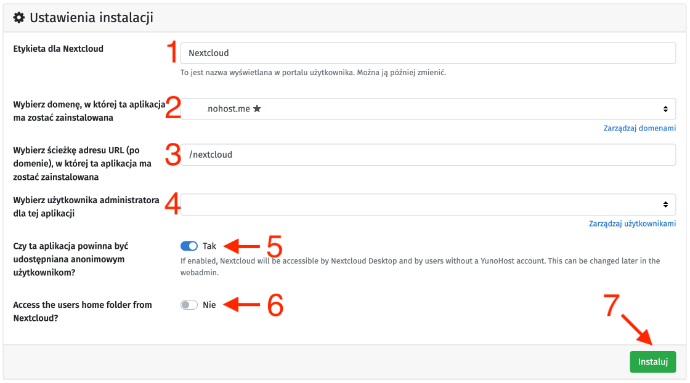
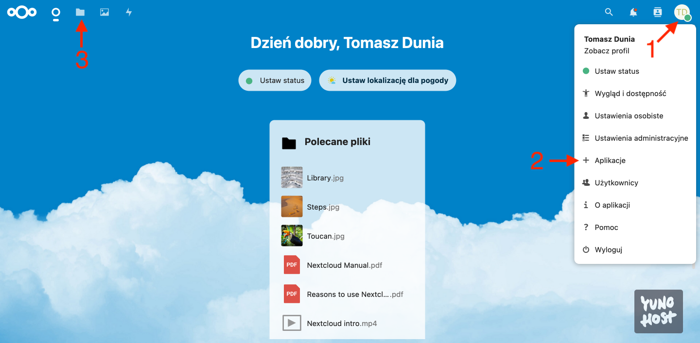
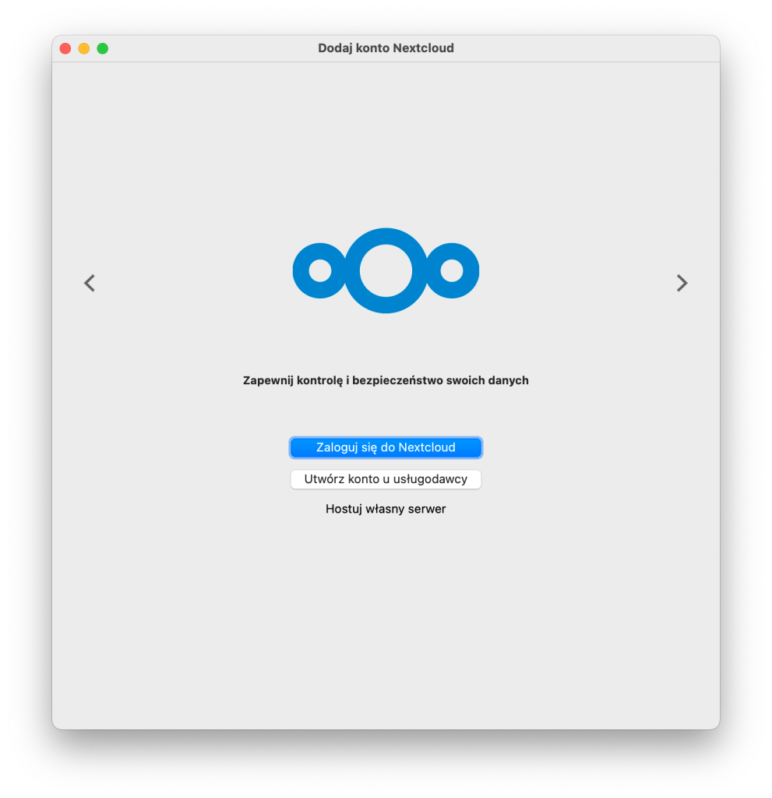
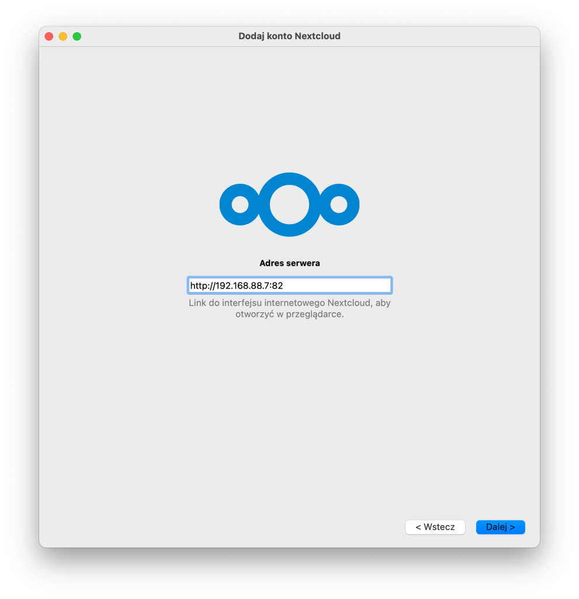
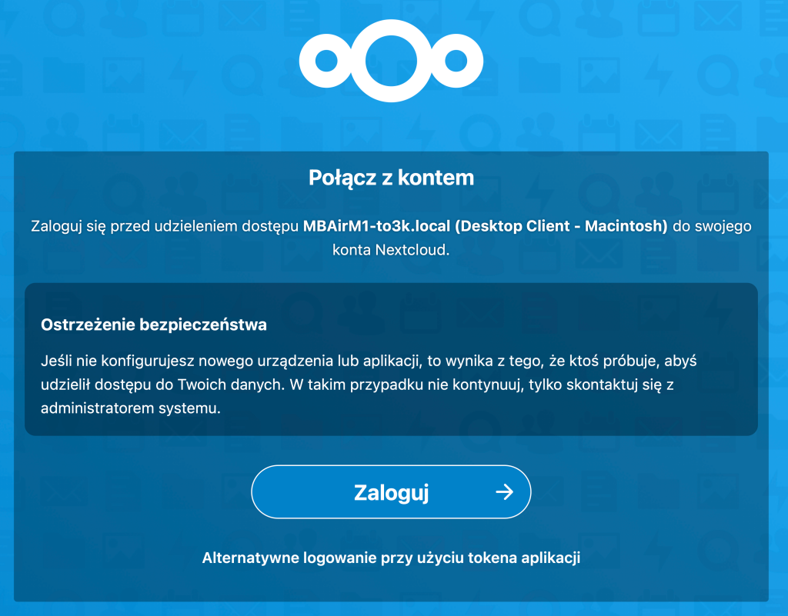
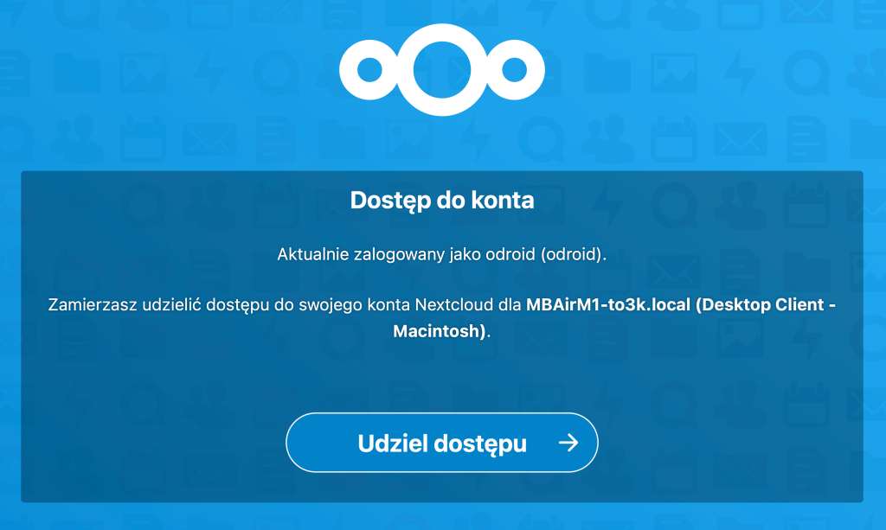
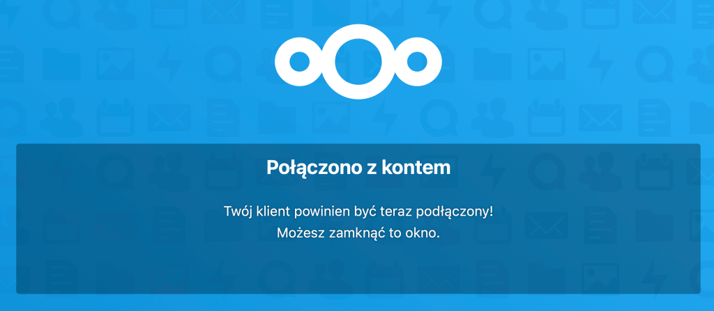
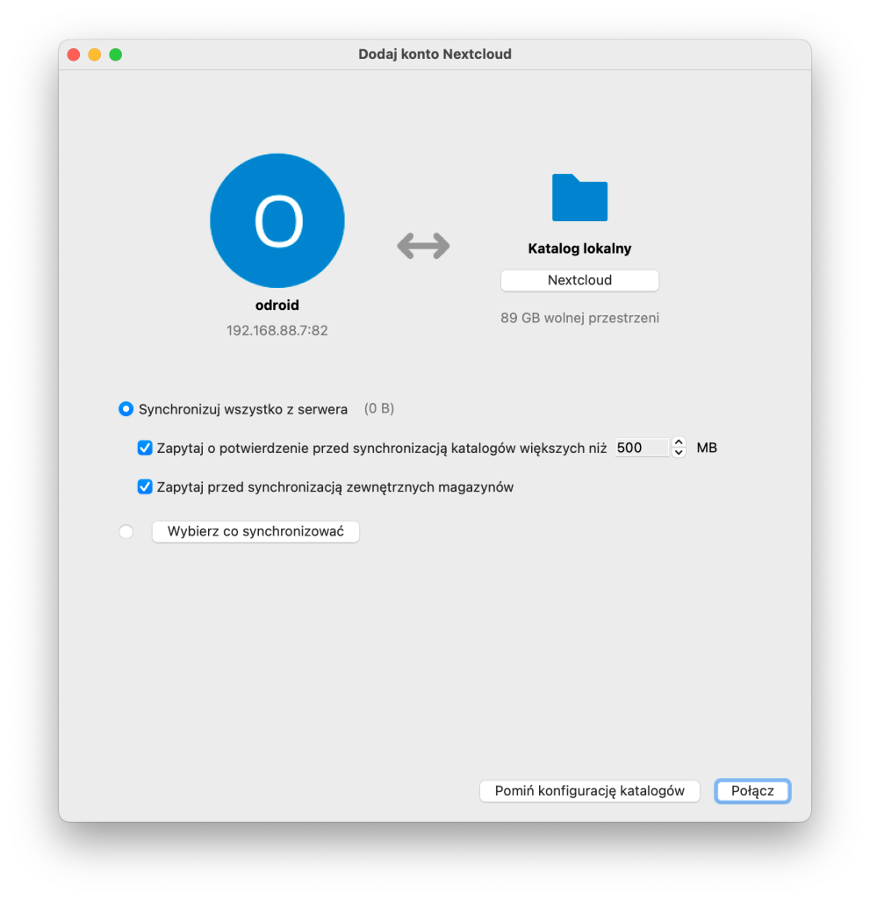

[🇬🇧 Go to english version of this post / Przejdź do angielskiej wersji tego wpisu](https://blog.tomaszdunia.pl/nextcloud-eng/)

Spis treści:
* TOC
{:toc}

[Dropbox](https://www.dropbox.com/plans), [OneDrive](https://www.microsoft.com/pl-pl/microsoft-365/onedrive/compare-onedrive-plans?activetab=tab%3aprimaryr1), [Google Drive](https://one.google.com/about/plans?hl=pl), [iCloud](https://support.apple.com/pl-pl/HT201238), [MEGA](https://mega.io/pl/pricing), [Backblaze](https://www.backblaze.com/b2/cloud-storage-pricing.html) to chyba wszystkie najpopularniejsze rozwiązania do przechowywania plików w, [potocznie nazywanej](/images/nocloudbutsomeonescomputer.jpg), chmurze. Trzeba przyznać, że taka forma agregacji i dostępu do swoich danych jest **bardzo wygodna** i dodatkowo jest pewnego rodzaju kopią zapasową. Wszystkie z wymienionych usług oferują większą lub mniejszą przestrzeń dyskową w pakietach darmowych, natomiast do przechowywania większej ilości danych musimy już rozważyć wykupienie któregoś z płatnych planów, a to przy np. dużej ilości zdjęć **nie wychodzi już tak przyjaźnie cenowo**. Dodatkowym, dla mnie kluczowym, **minusem takiego rozwiązania jest konieczność powierzenia swoich danych osobom trzecim**, a co gorsza korporacjom. W takim razie co zrobić, jak żyć? **Uruchomić swoją własną "chmurę" na dane**, a najlepszym do tego rozwiązaniem jest _**[Nextcloud](https://nextcloud.com/)**_! Jest to narzędzie, które teraz opisywane jest jako platforma do współpracy (po ang. _Collaboration platform_), bo składa się z nie jednej, a wielu narzędzi. Jako kilka przykładowych można wymienić:

- **_Files_** - dysk sieciowy,

- **_Photos_** - galeria zdjęć,

- **_Talk_** - rozmowy wideo/audio,

- **_Groupware_** - organizacja kalendarza, kontaktów i poczty,

- **_Office_** - pakiet biurowy.

Jednak to wszystko zaczęło się od tego, że _Nextcloud_ był po prostu **otwarto-źródłowym** (_open-source_) oprogramowaniem stworzonym do uruchamiania na swoim serwerze dysku sieciowego.

W tym wpisie pokażę jak uruchomić taką platformę dla siebie. Dam do wyboru dwie opcje:

1. [uruchomienie na serwerze z _YunoHost_](#yunohost),

3. [uruchomienie w oparciu o _Dockera_ na dowolnym innym serwerze](#docker).

## Uruchomienie w YunoHost

Instalacja będzie przebiegać podobnie do tej opisanej we [wpisie o _WriteFreely_](https://blog.tomaszdunia.pl/yunohost-writefreely/), jednakże w przypadku uruchamiania _NC_ nie potrzebujemy oddzielnej domeny. Powiem więcej, w przypadku uruchamiania jedynie dla siebie nawet nie zalecane jest tworzenie specjalnej domeny, bo po pierwsze to tylko dodatkowy koszt, a po drugie lepiej nie odkrywać wszystkich swoich kart, a tym samym narażać swoich danych, poprzez korzystanie z subdomeny np. _nextcloud.tomaszdunia.pl_, co jednoznacznie oznaczałoby, że pod tym adresem znajdują się wszystkie nasze dane. Ja ogólnie jestem zwolennikiem trzymania tego typu usług w sieci lokalnej, do której dostęp ma się jedynie przez _VPN_ np. _WireGuard_, ale o tym kiedy indziej w zupełnie innym wpisie.

Zaczynamy od zalogowania się do naszego panelu administratora _YunoHost_ i od razu przechodzimy do _Aplikacje_. Następnie w prawym górnym rogu zielony przycisk _\+ Instaluj_, wyszukujemy aplikację _Nextcloud_ i wybieramy ją z listy. Zjeżdżamy niżej do sekcji _Ustawienia instalacji_ i rozpoczynamy konfigurację:



1. W pole tekstowe _Etykieta dla Nextcloud_ \[1\] wpisujemy to pod jaką nazwą chcemy widzieć tą aplikację na liście aplikacji w naszym _YunoHost_.

3. Z rozwijanej listy poniżej \[2\] wybieramy na jakiej domenie ma zostać zainstalowany _NC_. Jak widać ja wybrałem domenę główną, na której uruchomiony jest mój _YunoHost_. Możesz zrobić tak samo lub wybrać inną domenę z listy.

5. W następnym polu tekstowym \[3\] definiujemy dokładną ścieżkę pod jaką ma zostać zainstalowany _NC_. Podając tutaj wartość (jak domyślnie) _/nextcloud_ _NC_ zostanie zainstalowany na _przykładowa.domena.pl/nextcloud_, gdzie oczywiście _przykładowa.domena.pl_ to wybrana przez Ciebie wyżej domena. Jeżeli zdecydowałeś/aś się na podpięcie domeny dedykowanej tylko do _NC_ to w tym miejscu można podać jedynie _/_ co będzie oznaczało instalację _NC_ w katalogu nadrzędnym domeny.

7. Kolejna lista rozwijana \[4\] służy do wskazania, który z użytkowników _YunoHost_ ma być administratorem dla tej aplikacji, a tym samym pierwszym jej użytkownikiem.

9. Dalej mamy dwa pola decyzji, z których pierwsze \[5\] to pytanie _Czy ta aplikacja powinna być udostępniana anonimowym użytkownikom?_. Tutaj proponuję wybrać _Tak_, gdyż w przeciwnym wypadku klienty _Nextcloud_ (mowa tutaj o _Nextcloud Desktop_, który służy do korzystania z _NC_ na urządzeniach końcowych) nie będą działały, bo pojawi się dodatkowy krok uwierzytelnienia, konieczność zalogowania do _YunoHost_, którego nie przewiduje.

11. Drugie pole wyboru \[6\] to pytanie czy chcemy nadać _Nextcloud_ możliwość dostępu do folderu _/home_ na naszym serwerze. Osobiście nie widzę takiej potrzeby, a jest to na pewno ryzykowana sprawa, bo w przypadku zaznaczenia _Tak_, _NC_ uzyska dostęp np. do pozostałych aplikacji działających na _YunoHost_. Każdy zdecyduje za siebie, bo wszystko zależy konkretnego zastosowania. Ja jednak pozostawiam wybraną opcję _Nie_.

13. Powyższe ustawienia zatwierdzamy przyciskiem _Instaluj_ \[7\] i tym samym rozpoczynamy proces instalacji, który niestety do najkrótszych nie należy, więc trzeba się uzbroić w cierpliwość.

Po zakończonej instalacji zostaniemy przeniesieni do listy z aplikacjami _YunoHost_, gdzie _Nextcloud_ pojawił się jako nowa pozycja. Aby przejść do _NC_ możemy wybrać ją z listy i skorzystać z przycisku _Otwórz tę aplikację_ lub po prostu w pasek adresu przeglądarki wpisać ścieżkę jaka została zdefiniowana podczas powyższej konfiguracji.

## Uruchomienie jako kontener Dockera

Nie masz serwera z _YunoHost_? Nic nie szkodzi! To samo da się zrobić przy użyciu _Dockera_! Polecam najpierw zapoznać się z moim wpisem [_Docker – jeden serwer wiele usług_](https://blog.tomaszdunia.pl/docker/).

Rozpoczynamy od stworzenia folderu dla tego kontenera:

```bash
mkdir -p /home/$USER/docker/nextcloud
```

Następnie tworzymy plik konfiguracyjny dla tego kontenera:

```bash
nano /home/$USER/docker/nextcloud/docker-compose.yml
```

_Nextcloud_ jako kontener _Dockera_ może być skonfigurowany na wiele różnych sposobów, a mowa tu w szczególności o tym jaką bazę danych dla niego wybierzemy. Można tutaj wybrać np. MySQL/MariaDB czy PostgreSQL. Jednakże domyślnym rozwiązaniem jest skorzystanie z SQLite, z którego właśnie skorzystamy w tym wpisie, co w znacznym stopniu uprości nam proces konfiguracji i nadaje się idealnie do tego poradnika, którego rolą jest pokazać _Nextcloud_ jedynie w zakresie podstawowej konfiguracji, bez wchodzenia w szczegóły. W takim przypadku stworzony przez nas plik konfiguracyjny _docker\_compose.yml_ należy wypełnić następującą treścią:

```yaml
version: "3"

services:
  nextcloud:
    container_name: nextcloud
    image: nextcloud:latest
    ports:
      - "80:80"
      - "443:443"
    environment:
      PUID: '1000'
      PGID: '1000'
      TZ: 'Europe/Warsaw'
    volumes:
      - '/home/$USER/docker/nextcloud/volumes/var/www/html:/var/www/html'
    restart: unless-stopped
```

W powyższej treści jedyną nowością mogą być _zmienne środowiskowego_ _PUID_ i _PGID_. Są to zmienne, które informują kontener jak ma zapisywać swoje dane, a konkretnie kogo ma ustawiać jako właściciela tych plików. _PUID_ odpowiada identyfikatorowi użytkownika, a _PGID_ odpowiada identyfikatorowi grupy, do której ten użytkownik należy, a także do której mogą należeć inni użytkownicy, którzy mają mieć dostęp do tych plików. Te identyfikatory dla swojego użytkownika można ustalić korzystając z polecenia:

```bash
id $USER
```

W odpowiedzi uzyskamy coś podobnego do:

```bash
uid=1000(dockeruser) gid=1000(dockergroup) groups=1000(dockergroup)
```

Wartość podana jako _uid_ oraz _gid_ to właśnie to co należy wpisać w pliku konfiguracyjnym _docker\_compose.yml_ jako odpowiednio _PUID_ i _PGID_. Tak skonstruowany plik konfiguracyjny możemy już zapisać i z niego wyjść.

Na tym etapie pozostaje nam jeszcze utworzyć odpowiedni _wolumen_, który zadeklarowaliśmy jako miejsce do przechowywania danych kontenera:

```bash
mkdir -p /home/$USER/docker/nextcloud/volumes/var/www/html
```

Sprawdźmy jeszcze czy porty do obsługi tego kontenera zostały otwarte w naszym _firewall'u_:

```bash
sudo ufw allow 80
sudo ufw allow 443
```

Na koniec pozostaje nam już tylko kompilacja i uruchomienie kontenera _Nextcloud_:

```bash
docker-compose -f /home/$USER/docker/nextcloud/docker-compose.yml up -d
```

Poprawne uruchomienie kontenera można dodatkowo skontrolować korzystając z polecenia:

```bash
docker ps
```

Jeżeli wszystko jest w porządku to możemy teraz przejść do przeglądarki i wpisać adres _IP_ naszego serwera, pod którym powinien działać świeżo uruchomiony _Nextcloud_. Na stronie powitalnej musimy jeszcze dokończyć konfigurację poprzez utworzenie konta administratora oraz wybrania typu bazy danych jako _SQLite_. To wszystko potwierdzamy przyciskiem _Instaluj_ i gotowe.

## Efekt prac

Po przejściu przez dowolną z powyższych instrukcji uzyskanym efektem będzie taki (lub podobny) ekran powitalny:



Jak widać już na pierwszy rzut oka, _Nextcloud_ jest bardzo przyjaznym, schludnym i intuicyjnym interfejsem dla użytkownika. Nie będę się tutaj rozpisywał na temat możliwości tego środowiska, a jedynie polecę wejść w narzędzie do instalacji i zarządzania aplikacjami (ikona użytkownika w prawym górnym rogu \[1\] i z listy wybrać _Aplikacje_ \[2\]). Proszę zwrócić uwagę ile możliwości jest teraz w bibliotece _Nextcloud_!

To co zawsze robię po pierwszym uruchomieniu _Nextcloud_ to wejście do narzędzia _Files_ \[3\] i wyczyszczenie wszystkiego co jest w środku. Jednakże są to materiały demonstracyjny pokazujące podstawowe funkcjonalności, które nowym użytkownikom mogą być przydatne, więc polecam do nich zajrzeć. Następnie oczywiście można je usunąć i rozplanować przestrzeń dyskową po swojemu.

Nie można zapomnieć także o włączeniu funkcji dwuskładnikowego uwierzytelniania podczas logowania. Przejrzysta instrukcja jak to zrobić znajduje się w [dokumentacji _Nextcloud_](https://docs.nextcloud.com/server/latest/user_manual/pl/user_2fa.html), więc nie będę powielał tych informacji tutaj.

## Aplikacje Nextcloud - podpięcie urządzeń

Aplikacje dedykowane _Nextcloud_ są dostępne dla _Windowsa_, _Linuxa_, _macOS_, _Androida_ i _iOS_. Wszystkie są dostępne po [tym linkiem](https://nextcloud.com/install/). Instalacja na każdym z systemów jest bliźniacza, więc pokażę cały proces na systemie _macOS_. Po zainstalowaniu adekwatnej aplikacji odpalamy ją i na start otrzymujemy okno, w którym wybieramy przycisk _Zaloguj się do Nextcloud_. W następnym oknie jesteśmy proszeni o wpisanie adresu serwera, więc podajemy go i potwierdzamy przyciskiem _Dalej >_.


    

    

Zostaniemy przeniesieni do przeglądarki, gdzie musimy uwierzytelnić nowego klienta.


    

    

    

Na koniec wracamy do świeżo zainstalowanej aplikacji _Nextcloud_, gdzie pozostaje nam jeszcze podstawowa konfiguracja klienta. Podajemy folder w pamięci lokalnej komputera, do którego ma zostać podpięty _Nextcloud_. Reszta do zmiany według uznania. Na koniec potwierdzamy przyciskiem _Połącz_ i gotowe. Tak skonfigurowany klient będzie nam w czasie rzeczywistym aktualizował pliki, co oznacza, że gdy zmodyfikujemy, dodamy lub usuniemy plik na dowolnym urządzeniu to za moment te zmiany będą miały odzwierciedlenie na serwerze, a następnie na innych podpiętych urządzeniach.


