Spis treści:
* TOC
{:toc}

[W poprzednim wpisie pisałem o _Nextcloud_](https://blog.tomaszdunia.pl/nextcloud/), czyli jak uruchomić swój własny dysk sieciowy, który niektórzy potocznie nazywają chmurą na pliki. Zastanówmy się jednak co w przypadku, gdy uruchamiamy taką usługę na serwerze, który nie stoi w naszym domu, tj. **nie mamy pełnej kontroli nad tym kto może mieć do niego dostęp**? Lub też w przypadku, kiedy chcemy jednak **powierzyć swoje dane** takim usługom jak _Dropbox_? Czy można w takiej sytuacji zabezpieczyć swoje dane? **Oczywiście, że tak** i jednym z najciekawszych sposobów jest darmowe narzędzie nazywające się _[Cryptomator](https://cryptomator.org/)_.

Zasadę działania tego narzędzia jest **bajecznie prosta, a przy tym genialna**. Typowy przypadek sytuacji, gdzie piękno tkwi w prostocie. _Cryptomator_ pozwala na stworzenie pewnego rodzaju **zaszyfrowanego kontenera** (skarbca czy też sejfu), którego zawartość jest dostępna dopiero po podaniu hasła. Taki kontener wrzucamy na dysk sieciowy, który synchronizowany jest pomiędzy wszystkimi podpiętymi urządzeniami. Natomiast na urządzeniach końcowych dany kontener zostaje odszyfrowany poprzez aplikację _Cryptomator_ i udostępniony jako dodatkowy dysk sieciowy. W praktyce po prawidłowym pierwszym skonfigurowaniu **poziom bezpieczeństwa zostaje drastycznie zwiększony**, a **wygoda użytkowania nie zostaje zaburzona** w żaden sposób.

## Instalacja i konfiguracja

Zacznijmy od [pobrania aplikacji](https://cryptomator.org/downloads/) odpowiedniej dla naszego systemu. Wierzę, że każdy poradzi sobie z jej instalacją. Po uruchomieniu _Cryptomatora_ od razu przechodzimy do działania i rozpoczynamy proces dodawania kontenera poprzez skorzystanie z przycisku _\+ Add Vault_.

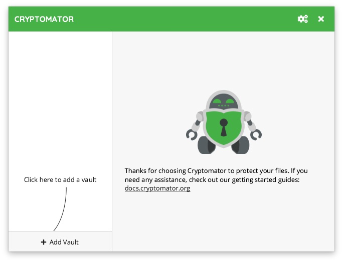

W oknie, które wyskoczy, mamy dwie opcje do wyboru:

- _**Create New Vault**_ - tworzenie nowego kontenera i to właśnie z tej opcji skorzystamy,

- **_Open Existing Vault_** - otwarcie (dodanie do tego urządzenia, np. po przeinstalowaniu aplikacji) już wcześniej utworzonego kontenera.

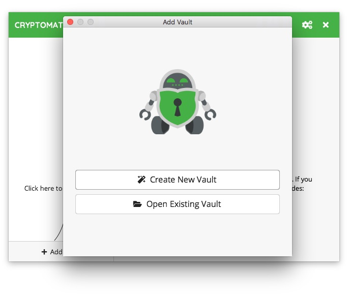

W następnym oknie **podajemy nazwę roboczą** dla tworzonego kontenera i przechodzimy dalej naciskając przycisk _Next_.

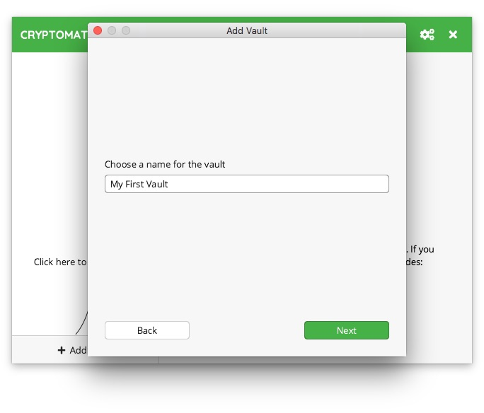

Przyszedł czas na **wskazanie miejsca, w którym ten kontener ma zostać ulokowany**. Jak widać na poniższym zrzucie ekranu mamy od razu do wyboru takie opcje jak _iCloud_, _Dropbox_, _Google Drive_ czy _OneDrive_. Na końcu znajduje się też opcja ręcznego wskazania miejsca na dysku lokalnym, który może być jednocześnie folderem współdzielonym z dowolną inną usługą chmurową (np. naszym dyskiem sieciowym _Nextcloud_). Po prawidłowym wskazaniu lokalizacji naciskamy przycisk _Next_.

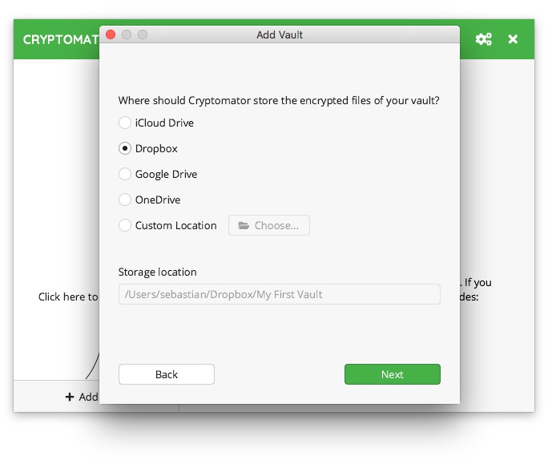

W tym kroku ustawiamy najważniejsze, czyli **hasło**. Myślę, że nie muszę tłumaczyć dlaczego powinno ono być mocne, tj. składające się z jak największej ilości znaków (najlepiej małe i duże litery, cyfry oraz znaki specjalne). Po dwukrotnym wpisaniu wybranego ciągu znaków musimy jeszcze zdecydować czy życzymy sobie, aby został wygenerowany specjalny kod odzyskiwania, który będzie można użyć w przypadku zapomnienia hasła. Polecam wygenerować taki kod i trzymać go w bezpiecznym miejscu.

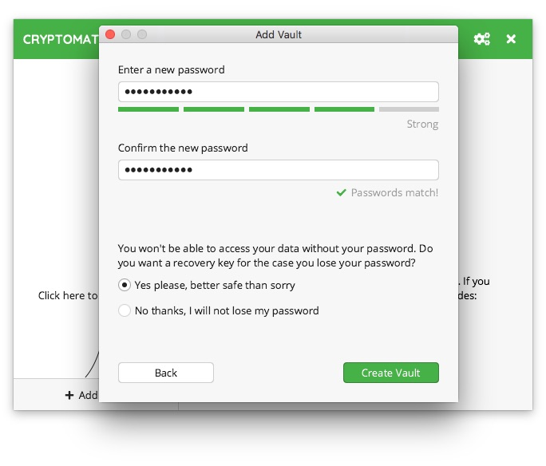

Przycisk _Create Vault_ kończy proces tworzenia kontenera jednak na koniec dostaniemy jeszcze okno z wygenerowanym kodem odzyskiwania, który należy zachować.

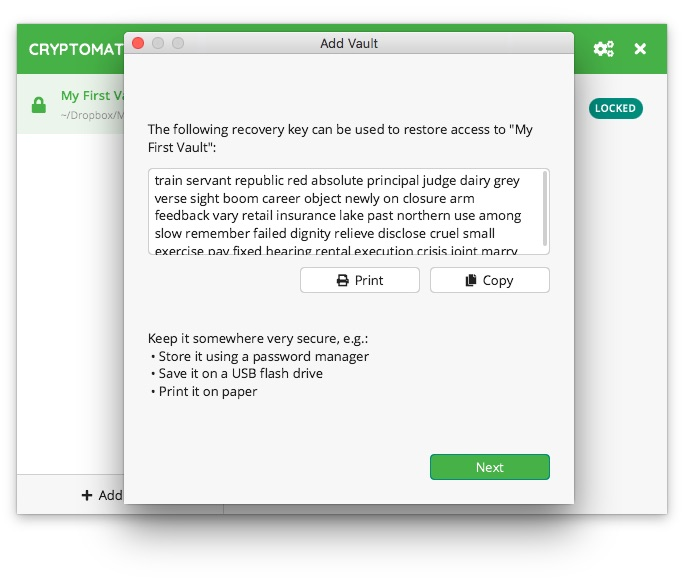

Gotowe, kontener został utworzony. Dostajemy okno informujące o tym oraz wybór czy chcemy go od razu odblokować (przycisk _Unlock Now_) lub po prostu przejść dalej (przycisk _Done_). Na ten moment proponuję skorzystać z tego drugiego.

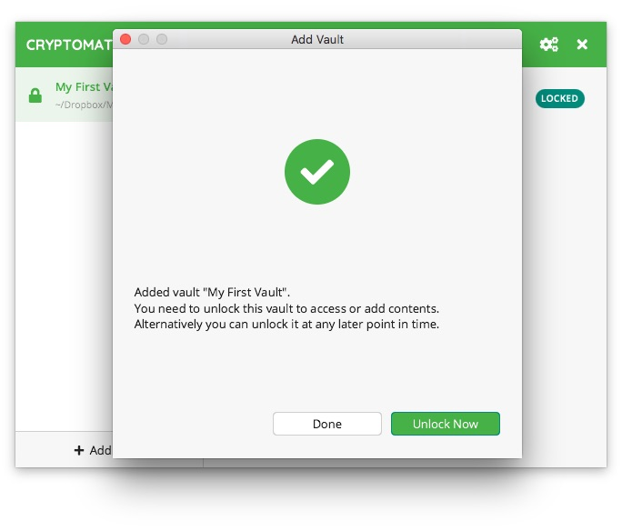

Wracamy do głównego okna _Cryptomatora_, gdzie na liście widnieje już nowy kontener. Wybierzmy go i wejdźmy do jego ustawień (_Vault Options_).

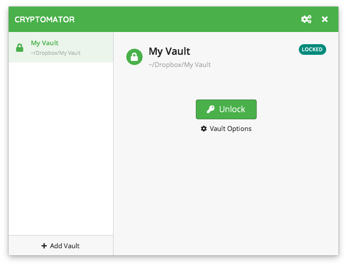

W pierwszej zakładce _General_ możemy włączyć opcję, aby skarbiec był odblokowany już przy uruchomieniu aplikacji _Cryptomator_, co dla wygody polecam zrobić. Następnie mamy wybór co w takim przypadku ma się stać, tj. czy ma on zostać pokazany jako nowe okno menedżera plików, pytać się każdorazowo co ma zrobić, czy też ma po prostu zostać otwarty w tle i nie robić nic więcej. Ja zawsze używam tej ostatniej opcji. W następnej zakładce _Mounting_ jak sama nazwa wskazuje mamy ustawienia dotyczące montowania kontenera, tj. możliwość zmiany nazwy pod jaką ma widnieć w naszym drzewie dysków, czy ma być tylko do odczytu (czasem jest to przydatna funkcja), flagami się nie zajmujemy, bo to już bardziej zaawansowane działanie, i na koniec mamy możliwość edycji miejsca, w którym ma być montowany. Ostatnia zakładka to _Password_, gdzie możemy zmienić hasło i podejrzeć obecny lub wygenerować nowy kod odzyskiwania.

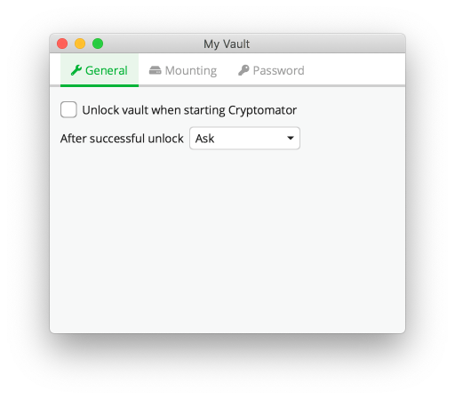
    
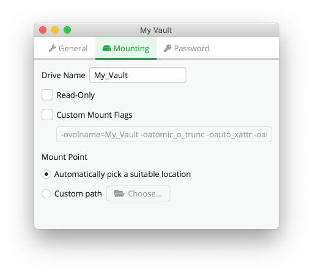
    
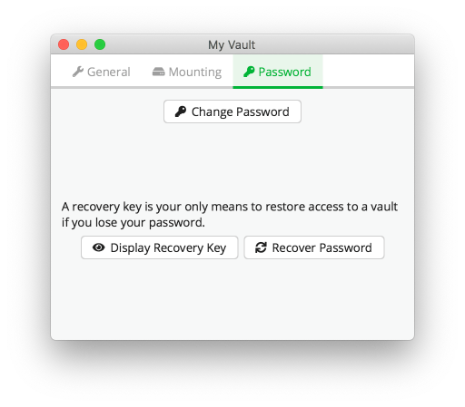
    

Wracamy do głównego okna i tym razem naciskamy przycisk _Unlock_. Przy pierwszym otwarciu zostaniemy poproszeni o podanie hasła, które możemy zachować w pamięci aplikacji zaznaczając poniżej _Save Password_. Wszystko tutaj zależy od zastosowania, jednak jeżeli chcemy mieć zabezpieczenie jedynie na zewnątrz, a z poziomu swojego komputera postawić na wygodę to zaznaczenie tej opcji jest uzasadnione. Przy takiej konfiguracji można ustawić, aby _Cryptomator_ był uruchamiany razem z systemem operacyjnym, a wraz z nim odblokowany zostanie skarbiec i od razu podpięty jako dysk sieciowy, bez udziału użytkownika, gotowy aby z niego korzystać.

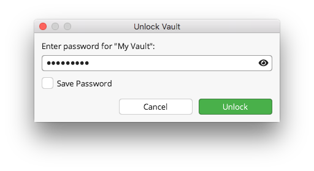
    
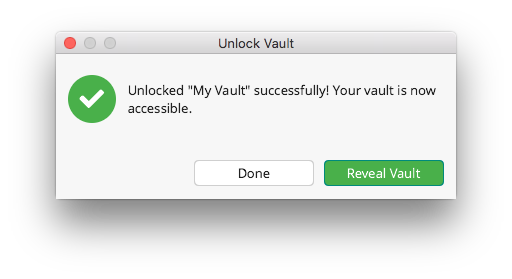
    

## Urządzenia mobilne

_Cryptomator_ jest dostępny jako aplikacja również na urządzenia mobilne. Analogiczne do powyższej instrukcje instalacji i konfiguracji są dostępne dla _[Androida](https://docs.cryptomator.org/en/latest/android/setup/)_ i _[iOS](https://docs.cryptomator.org/en/latest/ios/setup/)_.

## Jak to wygląda z poziomu chmury

Pisałem już, że z poziomu naszego urządzenia skarbiec będzie wyglądał jak zwykły dysk sieciowy czy nawet jak zwykły folder na naszym dysku lokalnym, który synchronizuje się ze standardowym rozwiązaniem chmurowym. Jednak uważam, że warto także pokazać jak pliki kontenera wyglądają z poziomu tejże chmury. Dla przykładu zrobiłem zrzut ekranu z Dropboxa.

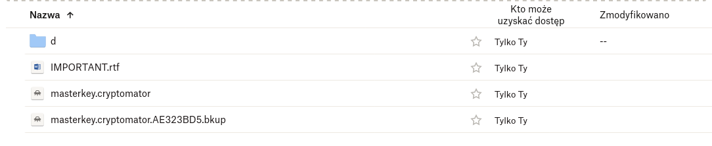

Jak widać ta zaszyfrowana zawartość jaka jest umieszczana na dysku zewnętrznym to tak naprawdę folder z dużą ilością dziwnie nazwanych podfolderów (nie do odczytania), w którym znajdują się wszystkie pliki zapisane wewnątrz skarbca, dokument informacyjny w formacie RTF (skrót od Rich Text File, jest to coś pokroju pliku DOCX), klucz _masterkey.cryptomator_ w postaci zaszyfrowanej oraz jego kopia zapasowa. To tyle. Dla kogoś, kto nie ma _Cryptomatora_ i hasła do odszyfrowania, te pliki wydają się kompletnym bełkotem i o to w tym wszystkim chodzi.
