Spis treści:
* TOC
{:toc}

Silne hasła to niesamowicie **istotna sprawa**! Jest to jeden z fundamentów bezpieczeństwa w Internecie. Najlepszym rozwiązaniem jest posiadanie haseł składających się z **przynajmniej** 16 znaków, małych i dużych liter, a także cyfr i znaków specjalnych. Do tego dość kluczowe jest, aby **nie posiadać jednakowego hasła do każdego z serwisów**, bo jak wycieknie on z jednego z nich to sprawdzenie w innych popularnych portalach to pierwsze działanie jakie wykonują oszuści/złodzieje/włamywacze. Patrząc na to wszystko nasuwa się pytanie – _Jak spamiętać w głowie wszystkie te skomplikowane ciągi znaków?!_ Zapisanie ich w notatniku na komputerze nie jest zbyt bezpiecznym rozwiązaniem, a przepisywanie z fizycznego notesu chowanego w sejfie to droga przez mękę. W takiej sytuacji na białym rumaku wjeżdża menedżer haseł i to nie byle jaki, bo konkretnie _**Bitwarden**_, którego można **hostować na własnym serwerze**, co też uczynimy, bo przecież nie lubimy przekazywać swoich danych w posiadanie osobom trzecim, a w szczególności jeżeli chodzi tutaj o nasze hasła.

W tym wpisie podejdę do sprawy podobnie jak przy [wpisie o _Nextcloud_](https://blog.tomaszdunia.pl/nextcloud/), czyli pokażę dwa sposoby na uruchomienie swojej instancji _Bitwardena_ (a konkretnie implementacji _Vaultwarden_):

1. [na serwerze z YunoHost](#yunohost),

3. [w oparciu o Dockera na dowolnym innym serwerze](#docker).

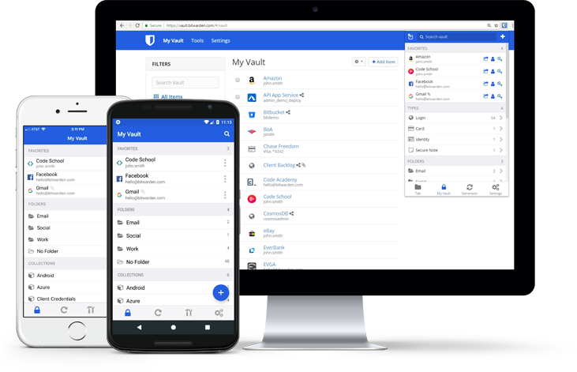

## Uruchomienie w YunoHost

Instalacja będzie przebiegać podobnie do tej opisanej we [wpisie o _WriteFreely_](https://blog.tomaszdunia.pl/yunohost-writefreely/), jednakże w przypadku uruchamiania _Vaultwardena_ nie potrzebujemy oddzielnej domeny (tak samo jak we [wpisie o _Nextcloud_](https://blog.tomaszdunia.pl/nextcloud/)). Powiem więcej, w przypadku uruchamiania jedynie dla siebie nawet nie zalecane jest tworzenie specjalnej domeny, bo po pierwsze to tylko dodatkowy koszt, a po drugie lepiej nie odkrywać wszystkich swoich kart, a tym samym narażać swoich danych, poprzez korzystanie z subdomeny np. _bitwarden.tomaszdunia.pl_, co jednoznacznie oznaczałoby, że pod tym adresem znajdują się wszystkie nasze hasła. Ja ogólnie jestem zwolennikiem **trzymania tego typu usług w sieci lokalnej, do której dostęp ma się jedynie przez _VPN_** np. _WireGuard_, ale o tym kiedy indziej w zupełnie innym wpisie.

Zaczynamy od zalogowania się do naszego panelu administratora _YunoHost_ i od razu przechodzimy do _Aplikacje_. Następnie w prawym górnym rogu zielony przycisk _\+ Instaluj_, wyszukujemy aplikację _Vaultwarden_ i wybieramy ją z listy. Zjeżdżamy niżej do sekcji _Ustawienia instalacji_ i rozpoczynamy konfigurację:

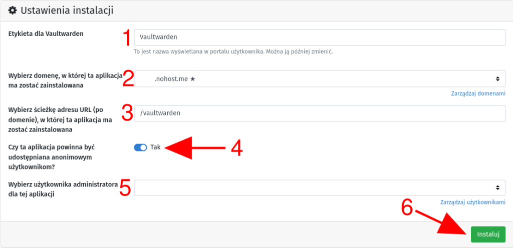

1. W pole tekstowe _Etykieta dla Vaultwarden_ \[1\] wpisujemy to pod jaką nazwą chcemy widzieć tą aplikację na liście aplikacji w naszym _YunoHost_.

3. Z rozwijanej listy poniżej \[2\] wybieramy na jakiej domenie ma zostać zainstalowany _Vaultwarden_. Jak widać ja wybrałem domenę główną, na której uruchomiony jest mój _YunoHost_. Możesz zrobić tak samo lub wybrać inną domenę z listy.

5. W następnym polu tekstowym \[3\] definiujemy dokładną ścieżkę pod jaką ma zostać zainstalowany _Vaultwarden_. Podając tutaj wartość (jak domyślnie) _/vaultwarden_ zostanie zainstalowany na _przykładowa.domena.pl/vaultwarden_, gdzie oczywiście _przykładowa.domena.pl_ to wybrana przez Ciebie wyżej domena. Jeżeli zdecydowałeś/aś się na podpięcie domeny dedykowanej tylko do _Vaultwardena_ to w tym miejscu można podać jedynie _/_ co będzie oznaczało instalację w katalogu nadrzędnym domeny.

7. Dalej mamy pole decyzji \[4\] _Czy ta aplikacja powinna być udostępniana anonimowym użytkownikom?_. Tutaj proponuję wybrać _Tak_, gdyż w przeciwnym wypadku klienty _Vaultwarden_ (mowa tutaj o oficjalnej aplikacji _Bitwardena_) nie będą działały, bo pojawi się dodatkowy krok uwierzytelnienia, konieczność zalogowania do _YunoHost_, którego nie przewiduje.

9. Kolejna lista rozwijana \[5\] służy do wskazania, który z użytkowników _YunoHost_ ma być administratorem dla tej aplikacji.

11. Powyższe ustawienia zatwierdzamy przyciskiem _Instaluj_ \[6\] i tym samym rozpoczynamy proces instalacji, który niestety do najkrótszych nie należy, więc trzeba się uzbroić w cierpliwość.

Po zakończeniu procesu instalacji łączymy się przez _SSH_ do serwera, na którym uruchomiony jest _YunoHost_. Następnie przelogowujemy się na użytkownika _root_:

```bash
sudo su
```

Otwieramy plik z ustawieniami aplikacji _Vaultwarden_:

```bash
nano /etc/yunohost/apps/vaultwarden/settings.yml
```

W tym pliku musimy odszukać następującą linijkę:

```yaml
admin_token: [token]
```

Kopiujemy wartość _\[token\]_, która będzie nam potrzebna do zalogowania się do panelu administratora _Vaultwarden_. Na tym etapie połączenie _SSH_ z serwerem nie będzie już nam potrzebne. Panel administratora dostępny jest pod adresem, którego początek to adres, który podczas instalacji wybraliśmy dla aplikacji _Vaultwarden_, a koniec to dopisek _/admin_. Podajemy tam skopiowany _token_ i co pozwoli wejść do panelu admina, w którym od razu przechodzimy do zakładki _Users_ \[1\].

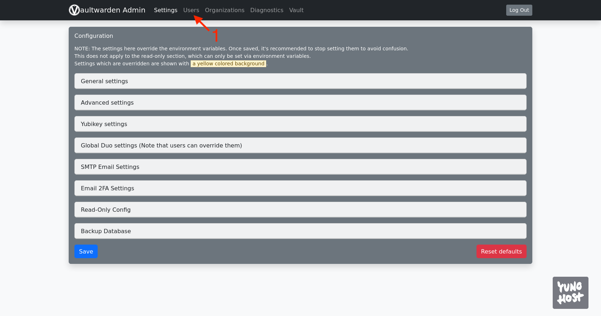

Na dole znajduje się sekcja _Invite User_. W polu tekstowym \[2\] podajemy swój adres e-mail i potwierdzamy przyciskiem _Invite_ \[3\].

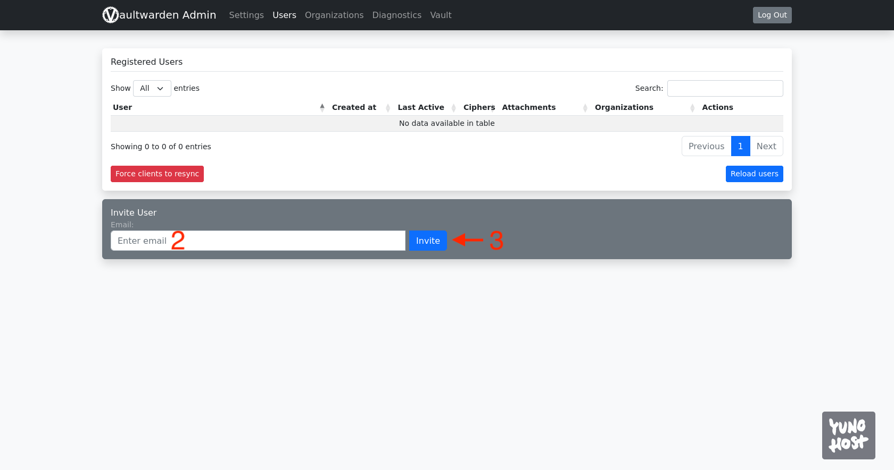

Powyższe działanie poskutkuje tym, że na liście pojawi się nowy użytkownik \[4\]

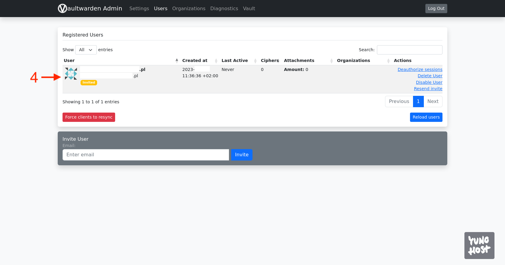

W międzyczasie na podany adres e-mail zostanie wysłane zaproszenie z linkiem aktywacyjnym. Naciskamy przycisk _Join Organization Now_ \[5\].

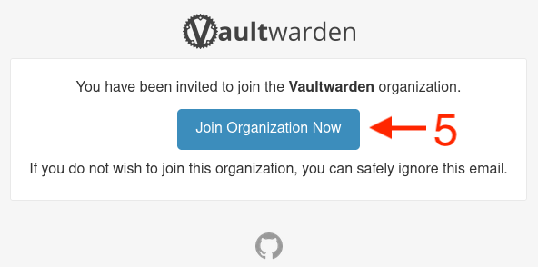

Zostaniemy przeniesieni z powrotem do przeglądarki, gdzie zobaczymy komunikat mówiący o tym, że zostaliśmy zaproszeni do organizacji i możemy z niego teraz skorzystać. Naciskamy przycisk _Utwórz konto_ \[6\].

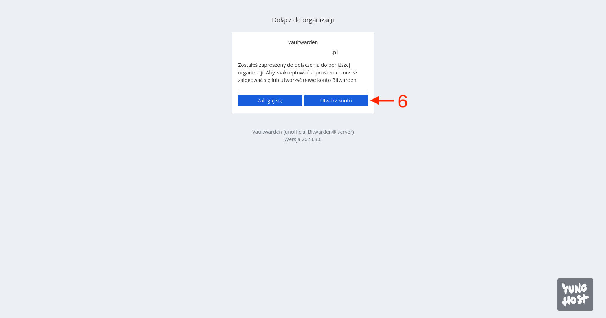

Zostaniemy przeniesieni do standardowego formularza rejestracji, w którym podajemy adres e-mail \[7\], nazwę użytkownika \[8\], hasło (dwa razy) \[9\] i opcjonalnie podpowiedź do hasła \[10\]. Na koniec możemy jeszcze zdecydować \[11\] czy chcemy, aby nasze hasło było wyszukane w znanych zbiorach haseł, które wyciekły. Ja jednak tego celu używam strony [HaveIBeenPwned.com](https://haveibeenpwned.com/), więc zawsze odznaczam to pole. Wypełniony formularz potwierdzamy przyciskiem _Utwórz konto_ \[12\].

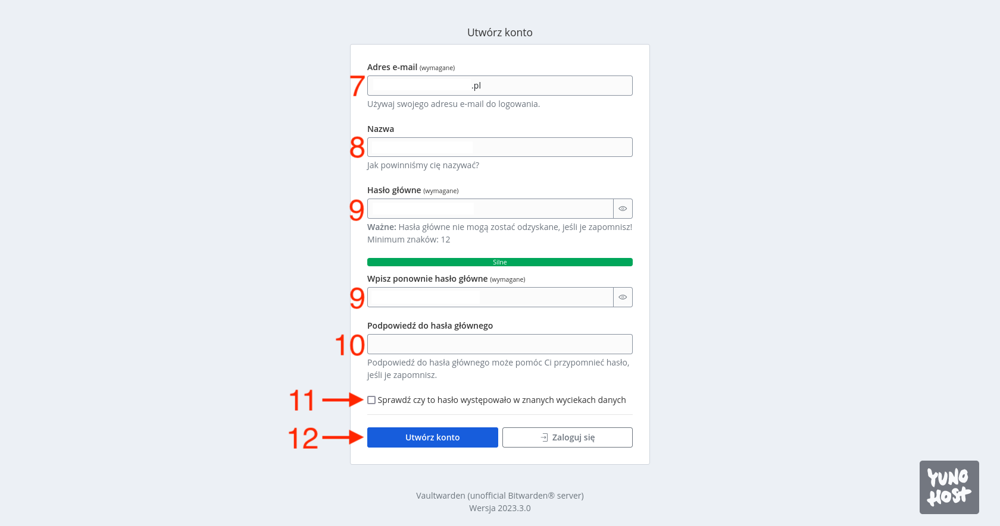

## Uruchomienie jako kontener Dockera

Nie masz serwera z _YunoHost_? Nic nie szkodzi! To samo da się zrobić przy użyciu _Dockera_! Polecam najpierw zapoznać się z moim wpisem [_Docker – jeden serwer wiele usług_](https://blog.tomaszdunia.pl/docker/). Jako obraz wykorzystamy fork o nazwie [_Vaultwarden_ dostępny na _Docker Hub_](https://hub.docker.com/r/vaultwarden/server).

Rozpoczynamy od stworzenia folderu dla tego kontenera:

```bash
mkdir -p /home/$USER/docker/vaultwarden
```

Następnie tworzymy plik konfiguracyjny dla tego kontenera:

```bash
nano /home/$USER/docker/vaultwarden/docker-compose.yml
```

Proces konfiguracji _Vaultwardena_ jako kontener jest stosunkowo prosty:

```yaml
version: "3"

services:
  vaultwarden:
    container_name: vaultwarden
    image: vaultwarden/server:latest
    ports:
      - "80:80"
    environment:
      PUID: '1000'
      PGID: '1000'
      TZ: 'Europe/Warsaw'
    volumes:
      - '/home/$USER/docker/vaultwarden/volumes/data:/data'
    restart: unless-stopped
```

W powyższej konfiguracji należy skontrolować i ewentualnie dostosować do swojego zastosowania:

- port na jakim ma być uruchomiony ten kontener, ja dla przykładu wpisałem port _80_,

- _PUID_ i _PGID_, tak jak to było opisane we [wpisie o kontenerze _Nextcloud_](https://blog.tomaszdunia.pl/nextcloud/).

Na tym etapie pozostaje nam jeszcze utworzyć odpowiedni _wolumen_, który zadeklarowaliśmy jako miejsce do przechowywania danych kontenera:

```bash
mkdir -p /home/$USER/docker/vaultwarden/volumes/data
```

Sprawdźmy jeszcze czy port do obsługi tego kontenera został otwarty w naszym _firewall’u_:

```bash
sudo ufw allow 80
```

Na koniec pozostaje nam już tylko kompilacja i uruchomienie kontenera _Vaultwarden_:

```bash
docker-compose -f /home/$USER/docker/vaultwarden/docker-compose.yml up -d
```

Wchodzimy w przeglądarce na adres składający się z _IP_ serwera oraz portu, na których uruchomiony został kontener (jeżeli jest to port _80_ to nie ma potrzeby podawania go, bo jest to port domyślny) i sprawdzamy czy zostanie poprawnie załadowana strona Vaultwarden. Niestety w takiej formie będzie się wyświetlać, ale **nie będzie prawidłowo działać**, co można zaobserwować próbując utworzyć nowe konto użytkownika. Otrzymamy wtedy komunikat, że jest potrzebny certyfikat _HTTPS_, bez którego nie możemy korzystać z naszego _skarbca_ (po ang. _vault_). Więc na ten moment zatrzymajmy kontener:

```bash
docker stop vaultwarden
```

A następnie usuńmy go:

```bash
docker rm vaultwarden
```

Musimy utworzyć tak zwany _self signed certificate_, co można przetłumaczyć jako _certyfikat z własnym podpisem_. To wystarczy w przypadku, kiedy mówimy o _Vaultwardenie_ działającym w sieci lokalnej. W przypadku, gdy chcesz udostępniać go osobom trzecim (poza sieć lokalną) to możesz skorzystać z [Let’s Encrypt](https://letsencrypt.org) jednocześnie podpinając pod to domenę. Ja, na potrzeby tego wpisu, wybrałem znacznie bezpieczniejsze rozwiązanie i stawiam _skarbiec_ w sieci lokalnej, do której mam dostęp przez _VPN_ - _[Wireguard](https://www.wireguard.com/)_, więc zewnętrzny certyfikat nie jest mi potrzebny.

Najpierw musimy stworzyć _Root Certificate Authority_, zwany w skrócie _CA_, czyli nasz prywatny _urząd certyfikacyjny_, który będzie podpisywał certyfikaty dla konkretnych domen.  
Zaczynamy od utworzenia klucz _CA_:

```bash
openssl genpkey -algorithm RSA -aes128 -out private-ca.key -outform PEM -pkeyopt rsa_keygen_bits:2048
```

Trzeba podać _passphrase_, który ma od 4 do 1024 znaków. Zapamiętaj go! W tym przypadku zagrożenie jest znikome, więc proponuję zastosować regułę _KISS_ – z ang. _Keep It Simple Stupid_, co można przełożyć na _Zrób to prosto idioto_. Dążę do tego, że _passphrase_ nie musi być skomplikowane, bo jak ktoś dostanie dostęp do naszej sieci lokalnej i tym samym do menedżera haseł to możliwość poznania przez niego _passphrase_ będzie naszym najmniejszym zmartwieniem. Efektem działania powyższego polecenia będzie utworzenie pliku _private-ca.key_.

Na podstawie utworzonego klucza generujemy certyfikat _CA_:

```bash
openssl req -x509 -new -nodes -sha256 -days 3650 -key private-ca.key -out self-signed-ca-cert.crt
```

Po wywołaniu tego procesu musimy wpisać wcześniej podane _passphrase_ i wypełnić krótką ankietę, w której w każdym polu można podać po prostu kropkę („.”) i zatwierdzić _ENTERem_. Jedyne co warto wypełnić to pole _Common name_, w którym należy podać nazwę naszego certyfikatu, ja podałem _vaultwarden_. Jak widać w poleceniu podaliśmy _\-days 3650_ to oznacza, że nasze _CA_ będzie miało 10-letnią datę ważności.

```bash
Enter pass phrase for private-ca.key: [podaj passphrase]
You are about to be asked to enter information that will be incorporated
into your certificate request.
What you are about to enter is what is called a Distinguished Name or a DN.
There are quite a few fields but you can leave some blank
For some fields there will be a default value,
If you enter '.', the field will be left blank.
Country Name (2 letter code) [AU]:.
State or Province Name (full name) [Some-State]:.
Locality Name (eg, city) []:.
Organization Name (eg, company) [Internet Widgits Pty Ltd]:.
Organizational Unit Name (eg, section) []:.
Common Name (e.g. server FQDN or YOUR name) []:vaultwarden
Email Address []:.
```

Rezultatem tego polecenia będzie utworzenie pliku _self-signed-ca-cert.crt_.

Teraz musimy utworzyć klucz dla certyfikatu _Vaultwarden_:

```bash
openssl genpkey -algorithm RSA -out vaultwarden.key -outform PEM -pkeyopt rsa_keygen_bits:2048
```

Zostanie utworzony plik _vaultwarden.key_. Następnie musimy stworzyć _certificate request file_:

```bash
openssl req -new -key vaultwarden.key -out vaultwarden.csr
```

Tutaj znowu krótka ankieta, w której wszędzie wstawiamy kropki, poza polem _Common name_, w którym musimy podać adres naszego serwera, który może być adresem w sieci lokalnej (adresem _IP_ serwera).

```bash
You are about to be asked to enter information that will be incorporated
into your certificate request.
What you are about to enter is what is called a Distinguished Name or a DN.
There are quite a few fields but you can leave some blank
For some fields there will be a default value,
If you enter '.', the field will be left blank.
Country Name (2 letter code) [AU]:.
State or Province Name (full name) [Some-State]:.
Locality Name (eg, city) []:.
Organization Name (eg, company) [Internet Widgits Pty Ltd]:.
Organizational Unit Name (eg, section) []:.
Common Name (e.g. server FQDN or YOUR name) []:[adres ip serwera]
Email Address []:.

Please enter the following 'extra' attributes
to be sent with your certificate request
A challenge password []:.
An optional company name []:.
```

Zostanie utworzony plik vaultwarden.csr. Ostatnim plikiem jaki musimy utworzyć jest:

```bash
nano vaultwarden.ext
```

Do którego wklejamy:

```bash
authorityKeyIdentifier=keyid,issuer
basicConstraints=CA:FALSE
keyUsage = digitalSignature, nonRepudiation, keyEncipherment, dataEncipherment
extendedKeyUsage = serverAuth
subjectAltName = @alt_names

[alt_names]
IP.1 = [adres ip serwera]
```

Jako parametr _IP.1_ podajemy ten sam adres co wcześniej, czyli adres _IP_ serwera. Plik w takiej formie zapisujemy i wychodzimy z edytora.

Tak utworzony certyfikat musimy teraz podpisać przez wcześniej utworzone _CA_:

```bash
openssl x509 -req -in vaultwarden.csr -CA self-signed-ca-cert.crt -CAkey private-ca.key -CAcreateserial -out vaultwarden.crt -days 365 -sha256 -extfile vaultwarden.ext
```

Efektem końcowym będzie utworzenie pliku _vaultwarden.crt_. Warto zauważyć, że ustawiliśmy ważność certyfikatu na 365 dni. Dlaczego nie podpisaliśmy go od razu na 10 lat tak jak to zrobiliśmy dla _CA_? Niestety niektóre podmioty uznają za prawidłowe jedynie certyfikaty, które są ważne do maksymalnie roku (plus/minus parę dni). W przypadku _Apple_ jest to na przykład 398 dni. Z uwagi na to, co rok będziemy musieli wykonywać ten ostatni krok i przedłużać certyfikat _Vaultwardena_ na kolejny okres.

Dalej przenieśmy utworzony i podpisany certyfikat _Vaultwardena_ wraz z jego kluczem do folderu dla certyfikatów na naszym serwerze:

```bash
sudo mv vaultwarden.crt vaultwarden.key /etc/ssl/certs
```

Pozostałe pliki proponuję zachować w folderze _/etc/ssl_ na przyszłość:

```bash
sudo mkdir /etc/ssl/CA
sudo mv vaultwarden.csr vaultwarden.ext private-ca.key self-signed-ca-cert.crt self-signed-ca-cert.srl /etc/ssl/CA
```

Gdy już rozwiązaliśmy problem z certyfikatami, wchodzimy do pliku konfiguracyjnego kontenera _Vaultwarden_:

```bash
nano /home/$USER/docker/vaultwarden/docker-compose.yml
```

i zmieniamy jego zawartość analogicznie do poniższego przykładu:

```yaml
version: "3"

services:
  vaultwarden:
    container_name: vaultwarden
    image: vaultwarden/server:latest
    ports:
      - "80:80"
    environment:
      PUID: '1000'
      PGID: '1000'
      TZ: 'Europe/Warsaw'
      ROCKET_TLS: '{certs="/ssl/vaultwarden.crt",key="/ssl/vaultwarden.key"}'
    volumes:
      - '/home/$USER/docker/vaultwarden/volumes/data:/data'
      - '/etc/ssl/certs:/ssl'
    restart: unless-stopped
```

Jak widać dodana została jedna zmienna środowiskowa (_environment_) i _wolumen_, w którym zapisaliśmy wygenerowany certyfikat.

To niestety jeszcze nie koniec, bo tworzenie własnego certyfikatu wiąże się z tym, że **konieczne będzie przerzucenie go na wszystkie urządzenia**, które będą korzystać z menedżera haseł. Bez tego nie zostaną one prawidłowo uwierzytelnione. W tym celu potrzebujemy wyciągnąć z serwera plik _self-signed-ca-cert.crt_ i wrzucić go do pamięci wszystkich urządzeń, na których zamierzamy korzystać z _Vaultwardena_.

Omówmy sobie jak go zaaplikować do najpopularniejszych przeglądarek i urządzeń:

- **_Firefox_** – _Ustawienia_ -> _Prywatność i bezpieczeństwo_ -> _Certyfikaty_ -> _Wyświetl certyfikaty…_ -> zakładka _Organy certyfikacji_ -> _Importuj…_ wybieramy z dysku certyfikat, w okienku zaznaczamy _Zaufaj temu CA przy identyfikacji witryn internetowych._, na koniec potwierdzamy przyciskiem _OK_. Dobrze jest zrestartować przeglądarkę.

- **_Chrome_** – _Ustawienia_ -> _Prywatność i bezpieczeństwo_ -> _Bezpieczeństwo_ -> _Zarządzaj certyfikatami_ -> odpali się okno _Certyfikaty_ -> zakładka _Zaufane główne urzędy certyfikacji_ -> _Importuj…_ -> _Dalej_ -> _Przeglądaj…_ -> wybieramy z dysku certyfikat -> _Dalej_ -> _Zakończ_, na koniec wyskoczy pewnie jeszcze _Security Warning_, na którym potwierdzamy _Tak_. Dobrze jest zrestartować przeglądarkę.

- _**iOS**_ / _**iPadOS**_ – tutaj wystarczy w dowolny sposób przerzucić certyfikat na urządzenie i uruchomić go. Wyskoczy okienko _Wybierz urządzenie, na którym chcesz zainstalować ten profil_, w którym wybieramy _iPhone_, po czym certyfikat powinien pojawić się w _Ustawieniach_ i wystarczy go tylko włączyć w _Ustawienia_ -> _Ogólne_ -> _VPN i urządzenia zarządzane_ -> sekcja _Profil konfiguracji_ -> tu powinien już być do wybrania nasz certyfikat pod nazwą, którą mu nadaliśmy -> _Zainstaluj_ -> podajemy kod do odblokowania urządzenia -> _Instaluj_ -> wychodzimy _OK_. Konieczne jest jeszcze dodanie certyfikatu do zaufanych w _Ustawienia_ -> _Ogólne_ -> _To urządzenie…_ -> na samym dole _Ustawienia zaufanych certyfikatów_ -> sekcja _Włącz pełne zaufanie do certyfikatów głównych_ -> aktywujemy nasz certyfikat, tak aby przełącznik znajdujący się przy nim był na zielono -> w okienku, które wyskoczy wciskamy _Dalej_ i gotowe.

- **_Android_** – tak samo jak na _iOS_ wystarczy w dowolny sposób pobrać certyfikat na telefon i otworzyć go, zostaniemy zapytani czy otworzyć _Instalator certyfikatów_, oczywiście potwierdzamy i zostaniemy przeniesieni do okienka, w którym podajemy nazwę certyfikatu oraz z listy rozwijanej wybieramy, że ma zostać użyty dla _VPN i aplikacji_.

Teraz, gdy już dla wszystkich urządzeń mamy zainstalowane certyfikaty, możemy przejść pod adres, pod którym uruchomiony jest _Vaultwarden_ i zalogować się do _skarbca_.

## Aplikacje i rozszerzenia do przeglądarek

Przydatną rzeczą w kontekście menedżera haseł jest **posiadanie aplikacji mobilnych i/lub rozszerzeń do przeglądarek**, które same będą nam przeszukiwać bazę haseł i wypełniać odpowiednie z nich na odpowiednich stronach. [_Bitwarden_ udostępnia aplikacje](https://bitwarden.com/download/) na każdy popularny system operacyjny i rozszerzenia do wszystkich przeglądarek. **Działają one z _Vaultwardenem_**. Jednak w naszym przypadku, aby korzystać z tych aplikacji/rozszerzeń **musimy wskazać nasz serwer niestandardowy**, czyli po instalacji na ekranie logowania wejść do ustawień (nacisnąć ikonę koła zębatego) i wpisać jako _Adres URL serwera_ adres (poprzedzony _https://_), pod którym działa _Vaultwarden_.

## Kopia zapasowa

Robienie kopii zapasowych to zawsze **bardzo ważna sprawa**. Jednakże posiadanie _backupu_ skarbca menedżera haseł to **sprawa życia lub śmierci**. Nie ma tutaj znaczenia, czy uruchamiamy _Vaultwardena_ w chmurze czy też na serwerze domowy, na nowym czy na starym sprzęcie. Zawsze należy zak**ładać, że coś może pójść nie tak i trzeba być na to przygotowanym**. Ja osobiście nie wyobrażam sobie stracić dostępu do mojej bazy haseł, bo zabiłoby to moje cyfrowe życie. Z uwagi na to mam dużo kopii zapasowych rozlokowanych w wielu miejscach, na wielu rodzajach nośników i każdemu polecam taką praktykę.

## Bitwarden - podstawowa konfiguracja

W moim przypadku, poza ogarnięciem sprawy kopii zapasowych, konfiguracja zaraz po uruchomieniu własnego _skarbca_ składa się jeszcze z jedynie dwóch kroków.

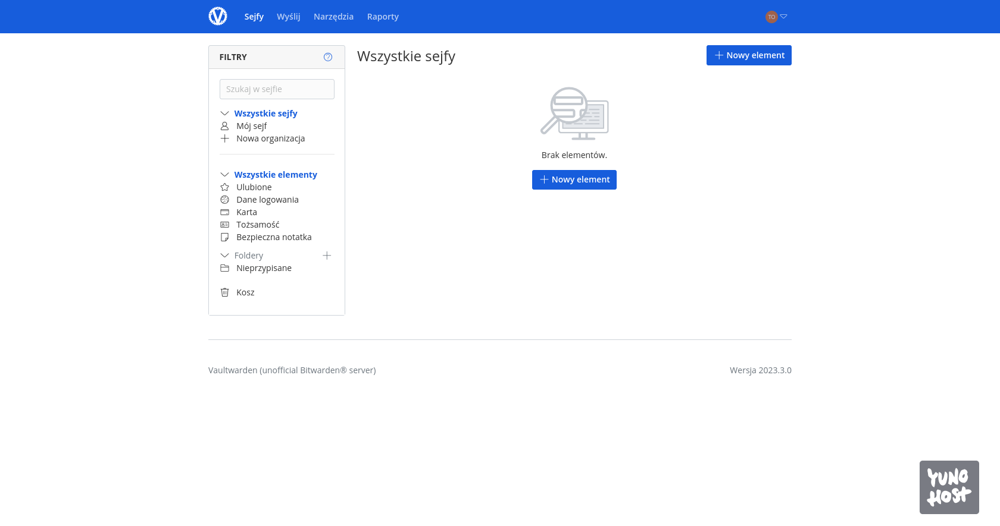

Pierwszym z nich jest **włączenie dwuskładnikowego uwierzytelnienia podczas logowania**, bo zabezpieczenie swoich haseł to podstawa. Realizuje się to poprzez rozwinięcie menu użytkownika znajdującego się w prawym górnym rogu \[1\], wejście w _Ustawienia konta_ \[2\], następnie po lewej zakładka _Zabezpieczenia_ \[3\] i _Logowanie dwustopniowe_ \[4\]. W tym miejscu można skonfigurować takie zabezpieczenia jak _TOTP_ (aplikacje z kodami czasowymi), klucze sprzętowe _Yubico_ (_YubiKey_) czy w ostateczności (bo jest to najgorsza forma) kody przesyłane na skrzynkę mailową.

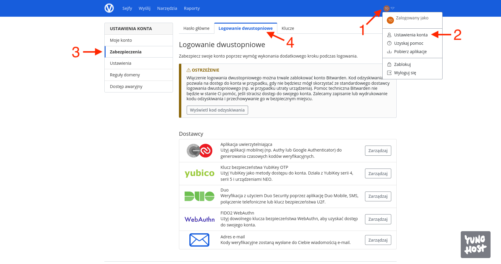

Drugą czynnością jest **migracja mojej bazy haseł**. Narzędzie do importu znajduje się w zakładce _Narzędzia_ \[5\] w zakładce _Importuj dane_ \[6\].

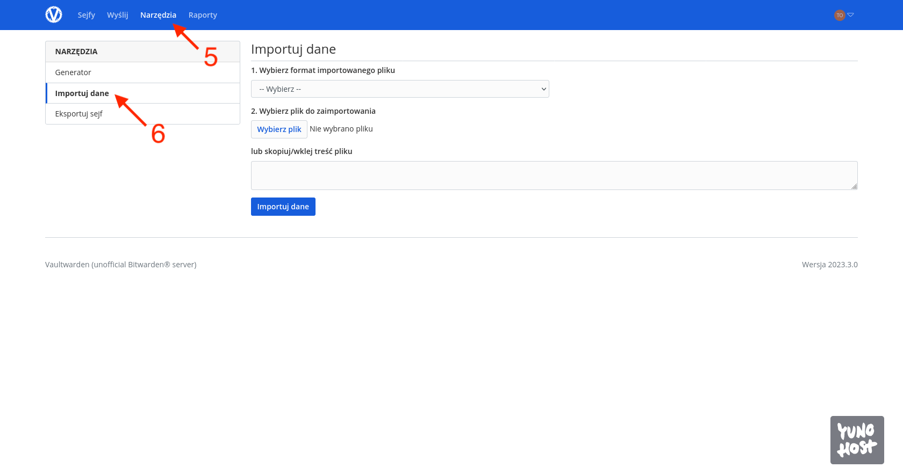
