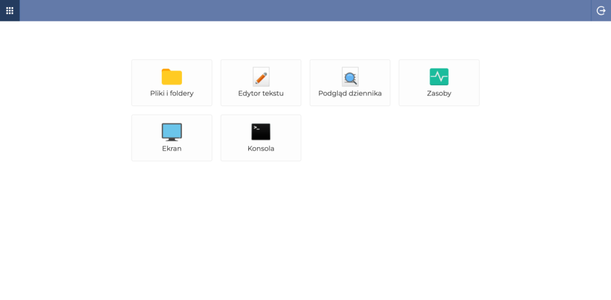
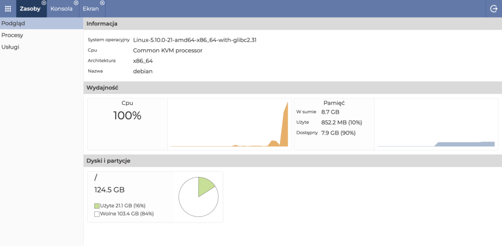
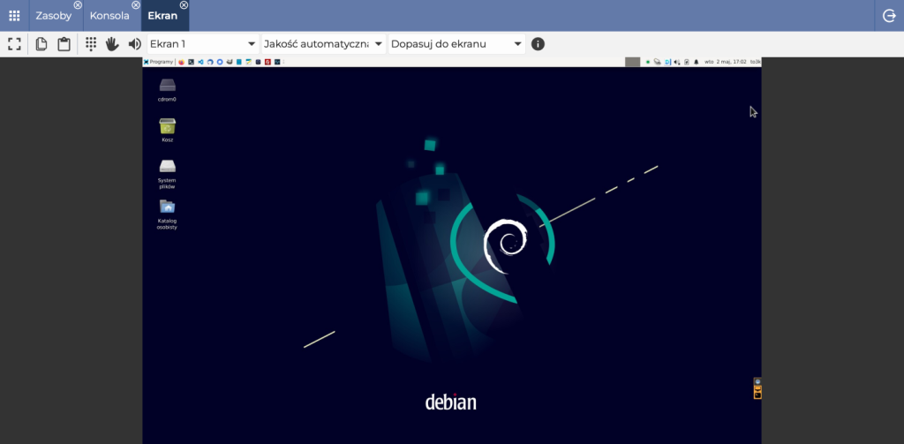
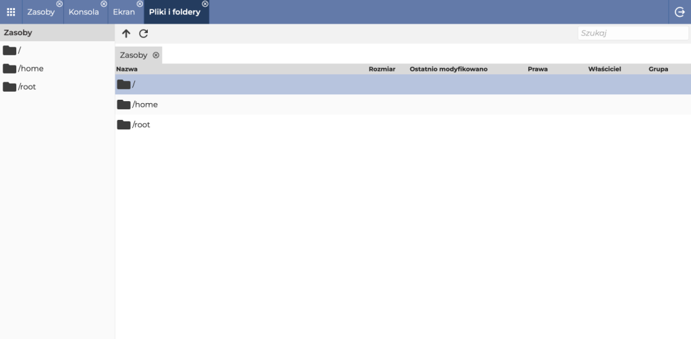

Spis treści:
* TOC
{:toc}

Zakładam, że fraza _**zdalny pulpit**_ nie jest nikomu obca. Jest to bardzo wygodny sposób na dostęp (sterowanie) do komputera działającego w innym miejscu świata lub po prostu będącego serwerem działającym bez podpiętych peryferiów. Na hasło _zdalny pulpit_ wiele, nawet nietechnicznych osób, pomyśli na pewno _Team Viewer_ albo _AnyDesk_, jednak królem w tym obszarze jest protokół _[VNC](https://en.wikipedia.org/wiki/Virtual_Network_Computing)_ (skrót od _Virtual Network Computing_, z ang. _Wirtualna Sieciowa Komunikacja_). Jest mnóstwo programów działających w oparciu właśnie o _VNC_ (_RealVNC_, _TightVNC_, _UltraVNC_, _TigerVNC_, _Vinagre_, ... i wiele wiele innych), a zdecydowana większość z nich opiera się na konieczności zainstalowania dwóch aplikacji - jednej na serwerze (komputerze, którym będziemy sterować) i drugiej na kliencie (komputerze, z którego będziemy sterować). Tego typu narzędzia to podstawowe narzędzie pracy każdego administratora sieci składającej się z więcej niż jednego komputera, więc każdemu zaczynającemu przygodę jako Sysadmin (administrator systemów) powinien przynajmniej wiedzieć z czym to się je.

W tym wpisie chciałbym wskazać jedną usługę, która według mnie niejako wyróżnia się z tłumu tym, że po pierwsze działa przez przeglądarkę, po drugie jest darmowa w podstawowym zakresie (a i płatne plany są atrakcyjne cenowo) i po trzecie kod źródłowy klienta jest udostępniony jako otwarte oprogramowanie (_open-source_). Tym narzędziem jest [_DWService.net_](https://www.dwservice.net/)!

## Ale jak przez przeglądarkę?

Tak jak napisałem wcześniej to co wyróżnia _DWService_ względem konkurencji to interfejs działający przez każdą, zwykłą przeglądarkę. Oczywiście istnieje konieczność zainstalowania specjalnego _agenta_ (_klienta_) na komputerze/serwerze, którym będziemy sterować, ale samo sterowanie z drugiego urządzenia odbywa się już w całości przy użyciu interfejsu webowego, bez konieczności instalowania jakiegokolwiek dodatkowe oprogramowania.

Poniżej kilka zrzutów ekranu pokazujących jak to wygląda dla jednego z moich serwerów:


    

    

    

    

    

## Rejestracja konta i utworzenie agenta

Zacznijmy od [założenia konta na _DWService_](https://www.dwservice.net/pl/loginsignup.html). Po jego utworzeniu i zalogowaniu się wybieramy z menu przycisk _Grupy_ i na górnym pasku odnajdujemy przycisk _+_ podpisany _Now_a. Wyskoczy skromny kreator, w którym wystarczy w polu _Nazwa_ podać dowolną nazwę dla naszej pierwszej grupy (może to być np. _Serwery_). Wracamy do menu głównego i tym razem wybieramy przycisk _Agenci_, gdzie tak samo odnajdujemy przycisk _+_ podpisany _Nowy_. W tym równie skromnym kreatorze wybieramy wcześniej utworzoną grupę i w polu poniżej podajemy nazwę dla _agenta_, które za chwilę zainstalujemy. Po utworzeniu nowego _agenta_ pojawi nam się on na liście wraz z 9-cyfrowym ciągiem na żółtym tle. Ten ciąg to tzw. _Installation Code_ i będzie nam on potrzebny podczas instalacji, więc polecam gdzieś go zapisać.

## Rozważ włączenie 2FA

Rekomenduję uszczelnić swoje konto przy pomocy _TOTP_ (_Time-based One-Time Password algorithm_, z ang. _algorytm jednorazowych haseł opartych na czasie_), czyli jednej z form _uwierzytelnienia dwuskładnikowego_. Jest to zabezpieczenie, które przy logowaniu wymaga, oprócz loginu i hasła, podania dodatkowego jednorazowego kodu. Używam tego rozwiązania wszędzie gdzie mam taką możliwość, a realizuję to poprzez aplikację [_Authy_](https://authy.com/), dostępną zarówno na Androidzie jak i iOS. _TOTP_ włącza się w zakładce _Moje konto_.

## Instalacja agenta

Instalację można wykonać zarówno przy użyciu interfejsu graficznego jak i z poziomu terminala. Zacznijmy od pobrania skryptu instalacyjnego _agenta_. W przypadku instalacji przy pomocy interfejsu graficznego wystarczy wejść na stronę [https://www.dwservice.net/pl/download.html](https://www.dwservice.net/pl/download.html) i pobrać instalator dla odpowiedniego dla siebie systemu. Dla instalacji w _CLI_ najpierw wejdźmy do odpowiedniego folderu:

```bash
cd /usr/src
```

A następnie pobierzmy skrypt instalacyjny przy użyciu _wget_:

```
wget https://www.dwservice.net/download/dwagent.sh
```

Musimy jeszcze nadać pobranemu skryptowi uprawienia do uruchamiania się:

```bash
chmod +x dwagent.sh
```

Przyszedł czas na uruchomienie skryptu. Od tego momentu wszystkie czynności będą praktycznie identyczne dla wariantu instalacji graficznej i _CLI_.

```bash
./dwagent.sh
```

W pierwszej kolejności zostaniemy zapytani jakie działanie chcemy wykonać. Mamy do wyboru:

- **_Install_** - standardowa instalacja,

- **_Run_** - uruchomienie jednorazowe,

- **_I do not accep_t** - to opcja dla tych, którzy przeczytali licencję, regulamin użytkowania i politykę prywatności, nie zgadzają się z nimi i chcą zrezygnować.

My wybieramy oczywiście _Install_, czyli wpisujemy z klawiatury _1_ i kontynuujemy _ENTERem_.

```bash
1. Install
2. Run
3. I do not accept
Option (3): 1
```

Następnie zostaniemy poproszeni o wskazanie ścieżki, gdzie ma zostać zainstalowany _agent_. Domyślnie podpowiadana ścieżka to _/usr/share/dwagent_, co nam odpowiada, więc nie zmieniamy nic i potwierdzamy _ENTERem_. Następnie zostaniemy poproszeni o potwierdzenie tego wyboru, więc wpisujemy z klawiatury _1_ i kontynuujemy _ENTERem_.

```bash
Select the installation path:
Path (/usr/share/dwagent): [ENTER]
Waiting…
Would you want install DWAgent to '/usr/share/dwagent'?
1. Yes
2. No
Option (2): 1
```

Ostatnim krokiem jest wskazanie jak chcemy skonfigurować _agenta_, wybieramy opcję _1_, co oznacza, że chcemy użyć wcześniej wygenerowanego kodu (_Installation Code_, o którym mowa była w poprzednim rozdziale), co potwierdzamy _ENTERem_. Następnie zostaniemy poproszeni o podanie tego kodu, wiec oczywiście wpisujemy go (łącznie z myślnikami w odpowiednich miejscach), co również na końcu potwierdzamy _ENTERem_.

```bash
How would you like to configure the agent?
1. Enter the installation code
2. Creating a new agent
Option (1): 1
Waiting…
Enter the installation code
Code: [wpisz kod ze strony]
```

Gotowe. _Agent_ powinien zostać prawidłowo zainstalowany, a z poziomu interfejsu webowego po odświeżeniu powinniśmy zamiast żółtego tła widzieć zielone. Po kliknięciu w tego _agenta_ zostaniemy przeniesieni do panelu zarządzania, z którego rzuty ekranu pokazałem powyżej w tym wpisie.

Na koniec polecam także posprzątać po instalacji, a więc usunąć pobrany skrypt instalacyjny, który już na tym etapie nie będzie nam potrzebny:

```bash
rm /usr/src/dwagent.sh
```

## Znany problem z XWaylands

U niektórych użytkowników próba uzyskania dostępu do ekranu komputera zdalnego może zakończyć się wyświetlenie błędu:

> Error: XWayland is not supported.

To znany problem, wynikający z tego, że tak jak głosi komunikat - _DWService_ nie radzi sobie z _XWayland_. Można go bardzo prosto rozwiązać poprzez wyłączenie _XWayland_ na serwerze, a co ciekawe można to zrobić z poziomu samego _DWService_.

Wracamy do głównego menu zarządzania _agentem_ i naciskamy przycisk _Pliki i foldery_. To nic innego jak menedżer plików, w którym przechodzimy do folderu _/etc/gdm3/_. W tym folderze musimy znaleźć plik o nazwie _custom.conf_ lub _daemon.conf_. Otwieramy go w edytorze tekstu. Teraz musimy znaleźć linijkę o następującej treści:

> #WaylandEnable=false

i usunąć znak _#_ z jej początku (odkomentować to polecenie). Po wszystkim plik należy zapisać i można go zamknąć. W ten sposób wyłączyliśmy _XWayland_.

Szybki restart maszyny, który można wykonać z poziomu konsoli poleceniem _reboot_ lub z poziomu listy _agentów_ _DWService_ poprzez naciśnięcie trzech pionowych kropek i wybranie opcji _Uruchom system ponownie_.

## Rozważ wsparcie projektu

_DWService_ to naprawdę przydatne narzędzie i w dodatku oferuje dostęp do darmowego planu, który podstawowemu użytkownikowi zdecydowanie wystarczy, gdyż plany różnią się w zasadzie tylko maksymalną przepustowością połączenia. Darmowy plan oferuje 6 Mbps, co do streamingu obrazu z komputera wystarcza. Istnieją jednak płatne plany, których wykupienie jest uzasadnione choćby ze względu na chęć wsparcia projektu. Ja tak zrobiłem i żeby nie być gołosłownym jestem w stanie to udowodnić poprzez obecność na liście subskrybentów dostępnej [tutaj](https://www.dwservice.net/pl/contribute-subscriptions.html) (jeżeli chcesz mnie sprawdzić to wyszukaj _tomaszdunia.pl_ 😉).
