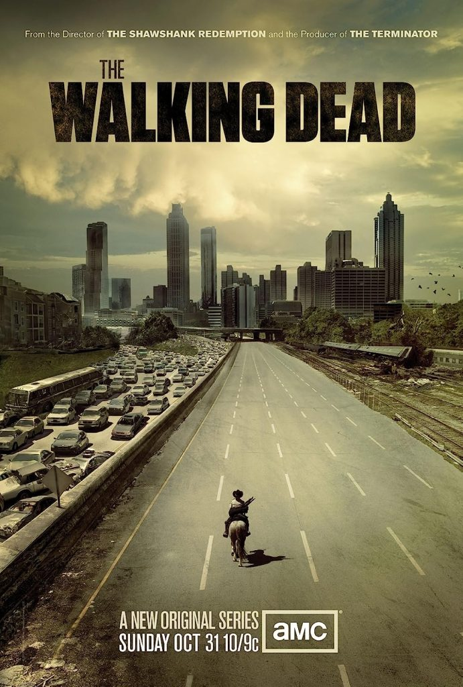
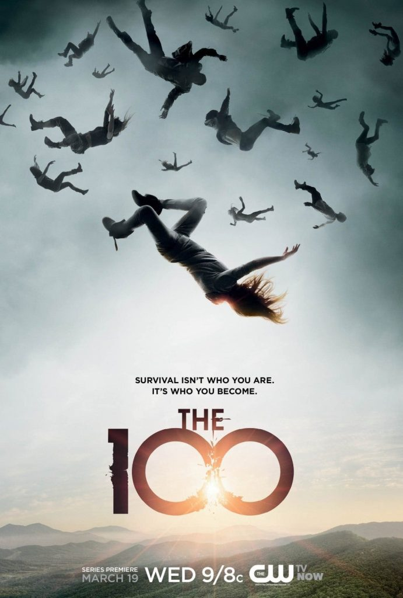
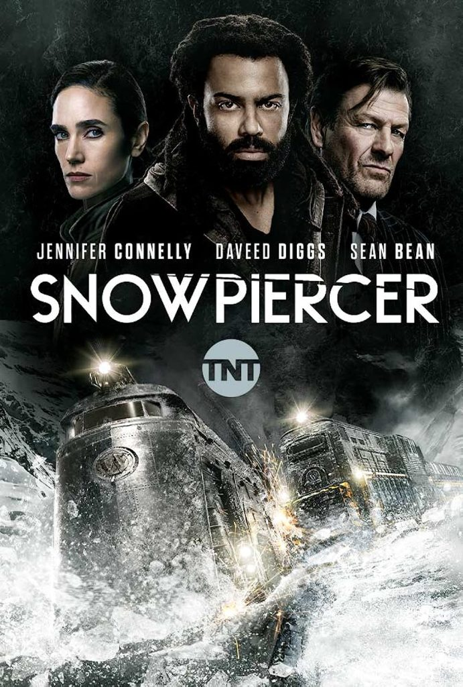
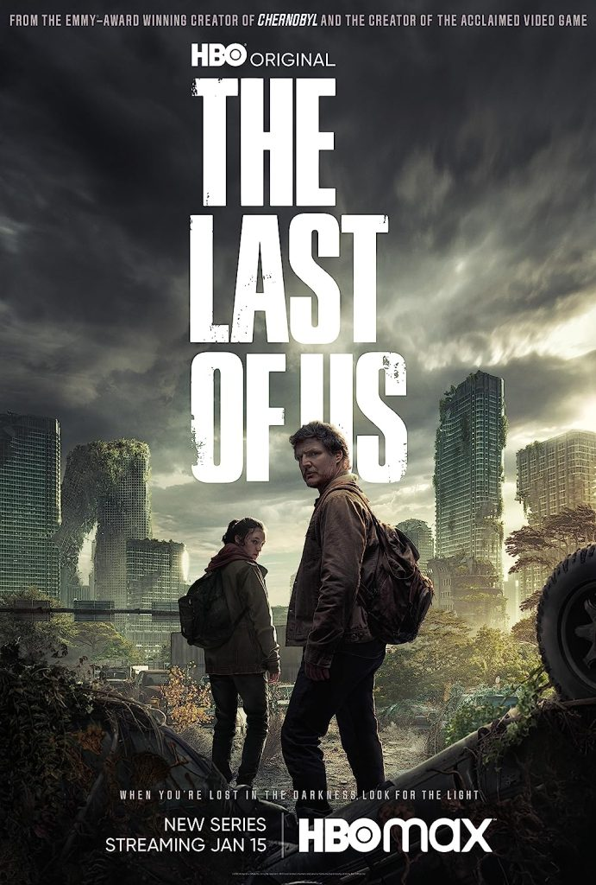
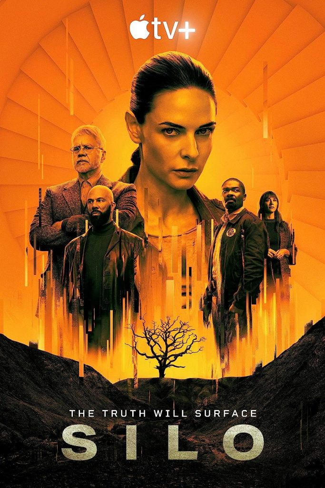

Spis treści:
* TOC
{:toc}

Data wypuszczenia wpisu o tej konkretnej tematyce nie jest przypadkowa. Skłoniło mnie do tego zakończenie pierwszego sezonu serialu _Silo_ (polski tytuł to _Silos_) dostępnego na _Apple TV+_. Już jakiś czas nie natrafiłem na konkretny tytuł w tematyce post-apo, a _Silo_ jest godny polecenia! Tak więc, ten wpis będzie poświęcony właśnie serialom, których wątkiem wiodącym jest apokalipsa.

## The Walking Dead

Zacznijmy od klasyki, czyli serialu TWD, o którym można śmiało powiedzieć, że rozkręcił _hype_ na tą tematykę w serialach. Polski tytuł to _Żywe trupy_, ale nie warto zawracać sobie nim głowy, bo nawet w Polsce nikt nie posługuje się tą nazwą. Popularność całej serii sięgnęła niebotycznego poziomu, dosłownie każdy wie czym jest The Walking Dead. Jednakże jest to serial z typu tych, które poprzez sztuczne i niepotrzebne przedłużanie stały się tasiemcami, które zaskarbiły sobie sporą rzeszę fanów dzięki fenomenalnemu początkowi, przez kilka dobrych późniejszych sezonów, aż po utratę szacunku w pewnym momencie, w którym już nawet główny bohater nie chciał grać w kolejnych sezonach... Tak na dobrą sprawę to nawet nie wiem czy ten serial już się skończył i ile ma sezonów/odcinków. Widziałem jednak, że powstał (i to chyba nie jeden) spin-off serii. Dla mnie praktycznie skończyło się na pokonaniu Negana, czyli powiedzmy po 8 sezonie, po czym obejrzałem może jeszcze kilka odcinków i dałem sobie spokój. To niestety problem wielu seriali, że po każdym wielkim przeciwniku zawsze na siłę można wymyślić jeszcze większego i tak przeciągać i przeciągać, aż w końcu widz powie sobie _Dość tego, nie mam ochoty tracić na to już więcej czasu_. Historia The Walking Dead skończyła się dla mnie tak jak się skończyła, jednakże nie można zaprzeczyć, że TWD to całkiem spory kawał dobrego kina.

## The 100

Wojna nuklearna niszczy Ziemię przez co życie na niej jest niemożliwe. Grupa ocalałych na statkach, które zdążyły odlecieć na orbitę Ziemi zbiera się do kupy tworząc jedną dużą stację o nazwie _Arka_ i tak trwają prawie 100 lat wyczekując momentu, w którym możliwe będzie przetrwanie na planecie. Zasady na _Arce_ są proste - za każde przestępstwo dorośli (powyżej 18. roku życia) skazywani są na śmierć poprzez wydalenie z kolonii, a nieletni zamykani są w czymś w rodzaju więzienia. Po niespełna 100 latach takiego życia _Arka_ zaczyna się rozpadać, a przede wszystkim systemy podtrzymania życia zaczynają szwankować. Ocalali podejmują decyzję o wysłaniu setki nieletnich więźniów na powierzchnię w celu zdefiniowania czy dalej występuje tam skażenie. Po wylądowaniu okazuje się, że nie dość, że Ziemia jest gotowa do ponownego zaludnienia to jeszcze jest to dopiero początek problemów. Trzeba przyznać, że są to solidne podwaliny do stworzenia ciekawej historii i taki właśnie jest ten serial. Fakt, że jest on dość długi i czasem ma momenty, które sprawiają, że się dłuży, a także takie odjechane na tyle, że przekracza kolejne granice absurdu, niemniej jednak mimo tego dobrze mi się go oglądało.

## Snowpiercer

Kolejny serial bazujący na bardzo ciekawym pomyśle. Fabularną apokalipsą tym razem jest zlodowacenie Ziemi i to takie do naprawdę niskich temperatur, oczywiście uniemożliwiające życie na powierzchni, a nawet pod nią. Natomiast tytułowy _Snowpiercer_ to pociąg bardzo bogatego biznesmena, który został stworzony właśnie na potrzeby tego, aby garstka osób mogła przetrwać krążąc w nim wokół Ziemi kolejne razy. Jasna sprawa, że bilety na ten pociąg mogli kupić jedynie zamożni i/lub osoby posiadające konkretny wachlarz umiejętności, którzy będą potrzebni do przetrwania gatunku ludzkiego. Rzeczywistość okazała się jednak zupełnie inna, bo na statek dostała się spora grupa zwykłych ludzi, którzy wdarli się do niego siłą. Po wyruszeniu pociągu zostali oni ściśnięci w ostatnich wagonach i odizolowani od reszty. Te wagony zostały nazwane _Ogon_ (po ang. _Tail_). Ciężko powiedzieć cokolwiek więcej bez spoilerów, a tego nie chciałbym robić nikomu kto nie miał okazji jeszcze zapoznać się z tym tytułem. Mogę natomiast powiedzieć, że jest to serial trzymający w napięciu i sprawiający, że widz czuje zarówno silną sympatię do pozytywnych bohaterów jak i równie mocną antypatię do czarnych charakterów, którzy dodatkowo są wykreowani bardzo dobrze i mają też swoje motywy, co niejednokrotnie powoduje rozdarcie uczuć u oglądającego.

## The Last of Us

Pisząc o tematyce post-apo w serialach nie sposób byłoby przejść obok tegorocznego hitu - _The Last of Us_. Tytuł znany z jeszcze bardziej popularnej serii gier wywodzącej się z rynku konsolowego, a konkretnie _Sony Playstation_. Gdy usłyszano pierwsze pogłoski o rozpoczęciu kręcenia tego serialu, wielu graczy, fanów serii, rozpoczęło swój lament, że będzie to kolejna gra, której honor zostanie zbrukany poprzez marną ekranizację. Nie sposób im się dziwić, bo dobre ekranizacje gier można policzyć dosłownie na palcach jednej ręki. Jednakże już po premierze okazało się, że _HBO_ kolejny raz stanęło na wysokości zadania i wypuściło serial naprawdę godny uwagi. Na razie mamy za sobą jedynie pierwszy sezon, po którym widać, że był kręcony przy zastosowaniu ograniczonego budżetu, tak jakby twórcy obawiali się nieco negatywnego odbioru i nie chcieli wyrzucać dużych pieniędzy w błoto, w przypadku gdyby się nie udało. Jednak mimo to ten tytuł zaskarbił sobie sporą rzeszę fanów i to zarówno osób, które grały w grę jak i tych, które nie miały z nią absolutnie żadnej styczności. Ja zaliczam się do tej drugiej grupy, bo nigdy nie byłem graczem konsolowym. Wiecie... jak jeszcze miałem czas i chęci grać (teraz wolę po prostu spożytkować swój czas na coś innego) to byłem _#PCMasterRace_ 😎 Po tym przydługim wstępie słów kilka o fabule. Już pierwsze minuty serialu wprowadzają nas w historię nadając jej kontekst. Temperatura na Ziemi sukcesywnie rośnie, co sprzyja rozwojowi grzyba, który jest bardzo agresywny, w odpowiednich warunkach intensywnie się rozprzestrzenia i atakuje ludzki układ nerwowy zmieniając ludzi w... tak wiem, że większość fanów (szczególnie gier) splunęłoby na mnie, gdybym po prostu napisał _zombie_, gdyż według nich _to nie są zombie, to są klikacze!_ Głównych bohaterów jest dwójka i są to Joel, który w dniu rozpoczęcia epidemii w sposób tragiczny traci córkę, oraz nastolatka Ellie. Tutaj robię pauzę, bo zastanawiałem się czy to co chciałem o niej napisać nie jest spoilerem, ale doszedłem do wniosku, że po pierwsze gra ma już blisko 10 lat, a po drugie serial zyskał taki rozgłos, że jeżeli ktoś uzna to za spoiler to musi żyć pod kamieniem jeżeli już wcześniej na niego nie natrafił. Chodzi o to, że Ellie jest odporna na oddziaływanie grzyba, który zdziesiątkował ludzkość. Reszty już musicie dowiedzieć się z samego serialu lub z gry.

## Silo

Na koniec wisienka na torcie, czyli serial przez, który powstał ten wpis. Wszystko powyżej wraz z tym i następnym zdaniem napisałem jeszcze przed finałowym odcinkiem, który zostanie wyemitowany z mojej perspektywy w następny piątek, natomiast w momencie publikacji tego wpisu będzie to zeszły piątek. Jak dotąd jestem oczarowany światem wykreowanym przez twórców tego tytułu, a co dalej to już napiszę po obejrzeniu finałowego odcinka… No i jestem po obejrzeniu ostatniego odcinka sezonu pierwszego. Na szczęście twórcy nie zawiedli, więc z czystym sumieniem mogę napisać parę słów więcej na temat tego serialu, bo naprawdę warto. Obiecuję brak spoilerów! Zacznijmy od tego, że tytułowy Silos to podziemny bunkier składający się z 144 poziomów, pomiędzy którymi można się poruszać jedynie poprzez spiralne schody umieszczone w samym środku. W silosie żyje około 10 tysięcy osób, które są już którymś z kolei pokoleniem żyjącym w zamknięciu, a ich wiedza o przeszłości urywa się mniej więcej 140 lat wcześniej w miejscu w historii nazywanym rebelią. Nie wiadomo czym była rebelia, kto brał w niej udział, ani nawet co było jej przyczyną. Jedyne co wiadomo to to, że skutkiem rebelii było powstanie _Paktu_, czyli niejako prawa, które obecnie rządzi całym silosem. Jednym z tych praw, przysługujących każdemu mieszkańcowi, jest możliwość opuszczenia silosu, ale drugim warunkiem jest brak możliwości powrotu. Ten proces nazywa się _czyszczeniem_, co można rozumieć na różne sposoby, ale ogólnie wzięło się to od tego, że człowiek wychodzi w specjalnym skafandrze, do którego dostaje specjalną ścierkę służącą do przetarcia obiektywu kamery, która jest jedynym narzędziem pokazującym co jest na zewnątrz. Do tego wszystkie przedmioty, które mają związek z czasami przed rebelią nazywane są reliktami i są zakazane. Znaczna ich część została zniszczona zaraz po rebelii i w kilku kolejnych latach, a nieliczne, które się zachowały można kupić na czarnym rynku lub znaleźć w schowkach mieszkańców, w których są przekazywane z pokolenia na pokolenie. Te relikty mogą być właśnie kluczem do poznania odpowiedzi na pytania występujące podczas ceremonii czyszczenia - _Nie wiemy dlaczego tu jesteśmy. Nie wiemy kto zbudował Silos. Nie wiemy dlaczego wszystko na zewnątrz Silosu jest takie jakie jest. Nie wiemy kiedy będzie bezpiecznie by wyjść na zewnątrz. Wiemy jedynie, że ten dzień nie jest dzisiaj._  
Czy aby napewno? Z tym pytaniem juz Was pozostawię 😏
