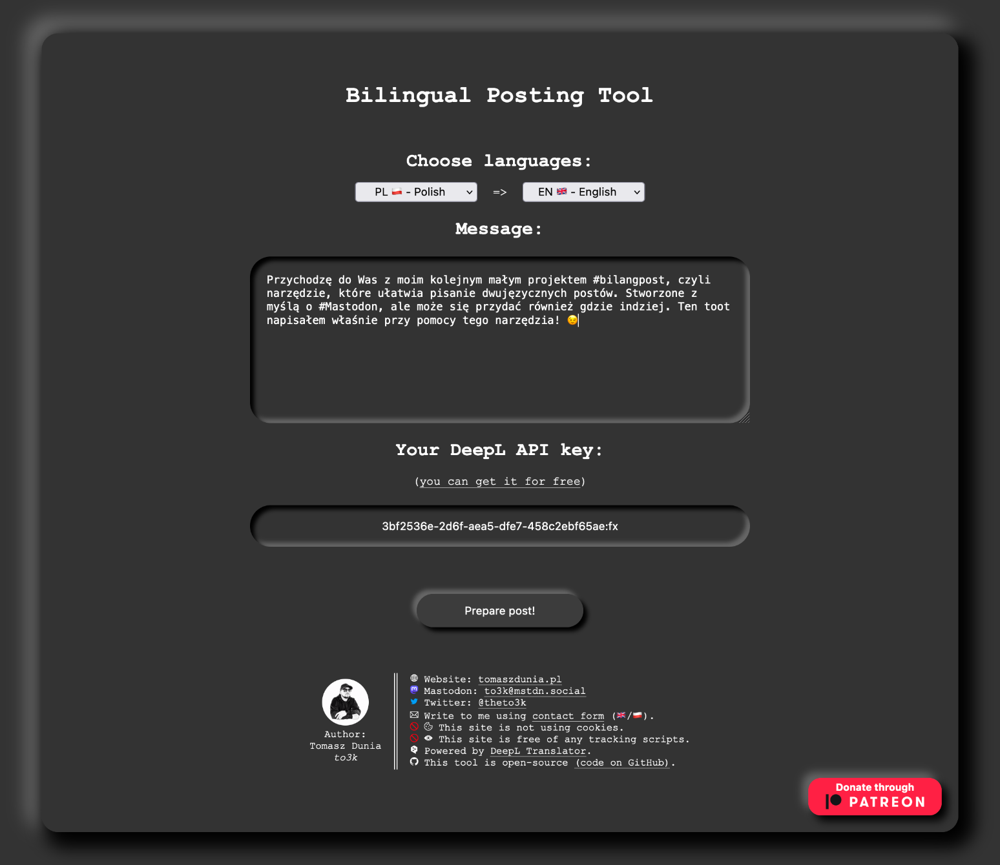
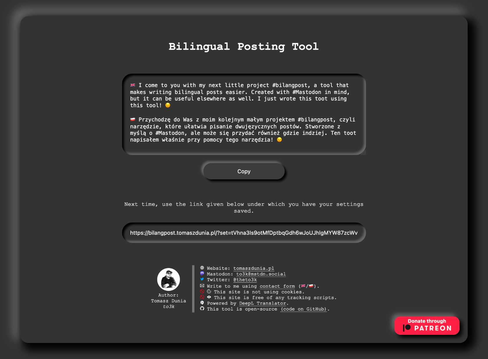

Spis treści:
* TOC
{:toc}

[_BiLangPost_](https://bilangpost.tomaszdunia.pl/) to mój kolejny, mały i niezbyt skomplikowany projekcik (wiecie jak bardzo takie lubię 😉). Jest to narzędzie, które ułatwia pisanie dwujęzycznych postów. A przyczyną powstania jest to, że w momencie dołączenia do _[Mastodona](https://mastodon.tomaszdunia.pl/@to3k)_ postanowiłem, że będę tam pisał zarówno po polsku jak i po angielsku. Językiem angielskim posługuję się dość biegle w mowie i piśmie, ale jestem również fanem automatyzacji wszystkiego tego co może zostać zautomatyzowane, a z tłumaczeniami jest tak, że zawsze lepiej jest poprawić nieidealne tłumaczenie niż napisać coś dwa razy (najpierw w jednym języku, a później w drugim). Z uwagi na powyższe przemyślałem sprawę, siadłem do edytora kodu i stworzyłem przy użyciu języka _PHP_ tytułowe narzędzie.

[](/images/bc7ca2566e0eac59.png)

[](/images/0b6c4ec5e220b563.png)

Zasada działania polega na tym, że wpisujemy wiadomość w języku źródłowym i wskazujemy język docelowy, a BiLangPost tłumaczy nam treść wiadomości źródłowej na docelową i następnie skleja jedną z drugą, dodatkowo to formatując, tak aby powstał z tego gotowy post (albo _toot_) do publikacji np. w mediach społecznościowych. Cały mechanizm tłumaczący działający pod spodem to _[DeepL](https://www.deepl.com/translator)_, z którym [komunikuję się poprzez _API_, tak jak to opisałem w tym wpisie](https://blog.tomaszdunia.pl/deepl-api/). Skoro już jesteśmy przy temacie _API DeepL'a_ to, jak pewnie wiecie z podlinkowanego wpisu, jest ono darmowe do pewnego limitu, po którego przekroczeniu wchodzi już płatny plan, który niestety do najtańszych nie należy. Z uwagi na to, nie byłem w stanie udostępnić swojego prywatnego _tokenu_ _API_ do użytku przez to darmowe narzędzie, bo po prostu mój limit zostałby bardzo szybko wykorzystany, a dla mnie samego wystarcza mi w zupełności ten darmowy pakiet. Stąd każdy kto chce skorzystać z _BiLangPost_ musi używać swojego własnego klucza. Oczywiście podany przez użytkownika klucz nie jest przeze mnie nigdzie zapisywany, czy też wykorzystywany w jakikolwiek inny sposób niż do wykonania pracy _BiLangPost_, która została mu zlecona w danej sesji.

## Jak zawsze zajrzyjmy do kodu

Cały kod jest oczywiście otwarty i [dostępny do wglądu na GitHub](https://github.com/to3k/bilangpost). Merytoryczną część dotyczącą tłumaczenia, tj. jak prawidłowo komunikować się z _API DeepL'a_ [opisałem już na blogu](https://blog.tomaszdunia.pl/deepl-api/), więc nie będę tego powtarzał. Jednakże jest w kodzie _BiLangPost_ jedna rzecz, którą chciałbym omowić. Jest to mechanizm, który stworzyłem, aby bez użycia ciasteczek i/lub sesji użytkownik nie musiał za każdym razem podawać ręcznie swojego _tokenu API_ i wybierać języków do tłumaczenia. Wymyśliłem to tak, że biorę zmienną przechowującą podany przez użytkownika _token API_ oraz zmienne określające wybrane języki (źródłowy i docelowy) i zapisuje to wszystko do jednej zmiennej rozdzielając średnikami. Następnie wartość tej zmiennej szyfruję przy użyciu funkcji _openssl\_encrypt()_ i zapisuję jako globalną zmienną typu _$\_GET_ (to ta, która jest przechowywana w adresie _URL_). W ten sposób użytkownik może użyć przy następnej wizycie tego specjalnego adresu URL, w którym zagnieżdżona jest zmienna z potrzebnymi informacjami, i nie musieć konfigurować wszystkiego od nowa. Jest to rozwiązanie jednocześnie wygodne jak i względnie bezpieczne, bo _token API_ użytkownika nie lata jako adres _URL_ w formacie _plaintext_ (z ang. _jawnego tekstu_).

Wspomniana wcześniej funkcja _openssl\_encrypt()_ przyjmuje 3 główne parametry:

1. _$data_ - dane, które mają zostać zaszyfrowane,

3. _$cipher\_algo_ - deklaracja algorytmu szyfrującego jaki ma zostać użyty (ja wybrałem _AES-128-CTR_),

5. _$passphrase_ - klucz szyfrujący, bez którego odszyfrowanie nie jest możliwe.

Zaszyfrowaną wartość można oczywiście odszyfrować używając lustrzanej funkcji _openssl\_decrypt()_, która przyjmuje analogiczne parametry.

```php
<?php
    // Zmienne niezbędne do procesu szyfrowania
    $passphrase = "[klucz do zaszyfrowania zmiennej GET z ustawieniami]";
    $cipher_algo = "AES-128-CTR";
    // Deklaracja zmiennej do przechowywania ustawień
    $settings = "";
    [...]
?>

<!-- Formularz HTML -->
<form action="/?set=<?php echo $set; ?>" method="post">
    [...]
    <button type="submit" name="PreparePost" value="PreparePost">Prepare post!</button>
</form>

<?php
    [...]
    // Jeżeli formularz HTML został wysłany
    if(isset($_POST['PreparePost']))
    {
        // Proces szyfrowania
        $settings = $token.";".$lang1.";".$lang2;
        $set = openssl_encrypt($settings, $cipher_algo, $passphrase);
    }
    [...]
    // Jeżeli zmienna globalna (GET) set nie jest pusta
    if(!empty($_GET['set']))
    {
        // Proces odszyfrowania
        $set = addslashes(strip_tags($_GET['set']));
        $decrypted_set = openssl_decrypt($set, $cipher_algo, $passphrase);
        $explode = explode(";", $decrypted_set);
        $token = $explode[0];
        $lang1 = $explode[1];
        $lang2 = $explode[2];
    }
    [...]
?>
```

## Obsługa obszarów tekstowych

Front-end nigdy nie był moją mocną stroną i trochę wstyd się przyznać, ale jestem kompletnie niezaznajomiony z językiem _Javascript_. W obszarze _HTML_, _PHP_ czy nawet _MySQL_ poruszam się bez większych oporów, ale _JS_ był dla mnie od zawsze jednym wielkim znakiem zapytania. Jakoś nigdy nie miałem czasu, aby przysiąść i się z nim zapoznać. Niejednokrotnie jest to dla mnie sporym problemem, bo trzeba przyznać, że o _Javascript_ oparte jest 99% Internetu. Za każdym razem, gdy na którejś ze swoich strony muszę zrobić coś napisanego w _JS_ to szukam po prostu podobnych, gotowych rozwiązań, które modyfikuję i uzyskuję to czego potrzebuję. Podobnie było w przypadku _BiLangPost_, gdzie potrzebowałem nauczyć się obsługi obszarów tekstowych (po ang. _Text Area_), a konkretnie chciałem zrobić trzy rzeczy:

1. powiększać dynamicznie obszar tekstowy, w przypadku gdy wprowadzony tekst przestanie się w nim mieścić,

3. zliczać ilość znaków wprowadzonych w obszar tekstowy tak, aby użytkownik na bieżąco widział czy mieści się w limicie znaków, który sobie założył,

5. dodać przycisk umożliwiający skopiowanie jednym kliknięciem zawartości całego obszaru tekstowego.

Bazowy kod HTML do modyfikacji:

```markup
<textarea
    id="textarea"
    name="message"
    placeholder="Write here in your native language..."
>[Zawartość]</textarea>

<button type="button" name="CopyButton">Copy</button>
```

Załatwienie tematu samo skalującego się obszaru (powiększanie po przekroczeniu domyślnego rozmiaru) załatwia się dość prosto, bo poprzez dodanie parametru w elemencie _<textarea>_.

```markup
<textarea [...] oninput='this.style.height = "";this.style.height = this.scrollHeight + "px"'></textarea>
```

Jeżeli dobrze rozumiem zapis to chodzi po prostu o to, że parametr wysokości obszaru tekstowego jest na bieżąco, przy wprowadzaniu kolejnych znaków do obszaru, nadpisywany wartością równą wysokości paska przewijania (po ang. _scrollbar_).

W przypadku liczenia ilości znaków wewnątrz obszaru stworzyłem funkcję, która inicjuje zmienną _counter_ (z ang. _licznik_), w której zapisuje aktualną długość ciągu wprowadzonego wewnątrz wskazanego obszaru tekstowego. Wywołanie tej funkcji następuje poprzez wydarzenie (po ang. _event_) o nazwie _onKeyUp_, który w prostych słowach oznacza _gdy przycisk klawiatury zostanie zwolniony_, czyli wydarzenie tego typu występuje, gdy naciśniemy na klawiaturze przycisk i go puścimy (dokładnie w momencie puszczenia). Na koniec musimy jeszcze wyświetlić obliczoną wartość pod obszarem tekstowym.

```markup
<textarea onKeyUp="count_it()" [...]></textarea>

<div>Characters: <span id="counter"></span></div>

<script>
    function count_it()
    {
        document.getElementById('counter').innerHTML = document.getElementById('textarea').value.length;
    }
    count_it();
</script>
```

Na koniec pozostaje nam jeszcze przycisk do kopiowania zawartości obszaru tekstowego jednym kliknięciem. Skrypt obsługujący tą funkcjonalność składa się z funkcji, w której w pierwszej kolejności definiujemy, o który obszar tekstowy chodzi, wskazując go po jego identyfikatorze (_Id_). Następnie zawartość obszaru zostaje zaznaczona i następnym poleceniem ta zaznaczona zawartość zostaje skopiowana do schowka użytkownika. Na końcu funkcji znajduje się jeszcze bonus w postaci zmiany tekstu wewnątrz przycisku (etykieta) po jego naciśnięciu. Tekst _Copy_ (z ang. _Kopiuj_) zmienia się na _Copied!_ (z ang. _Skopiowano!_). Po zakończeniu pisania skryptu należy jeszcze pamiętać, aby do przycisku dodać parametr _id_ oraz _onclick_. Ten drugi informuje interpreter o tym co ma się zdarzyć po naciśnięciu przycisku, tj. w tym konkretnym przypadku ma zostać wywołana funkcja _copy()_, wcześniej przez nas napisana.

```markup
<button [...] id="CopyButton" onclick="copy()">Copy</button>

<script>
    function copy()
    {
        let textarea = document.getElementById("textarea");
        textarea.select();
        document.execCommand("copy");
        var btn = document.getElementById("CopyButton");
        btn.innerHTML = "Copied!";
    }
</script>
```

## BiLangPost czeka aby służyć

Na koniec tego wpisu chciałem tylko jeszcze po raz ostatni zaprosić na stronę dedykowaną narzędziowi _BiPangPost_!  
\> [https://bilangpost.tomaszdunia.pl](https://bilangpost.tomaszdunia.pl) <  
Przykładowy toot napisany przy użyciu _BiLangPost_ wygląda tak:

<iframe src="https://mstdn.social/@to3k/109930509908621693/embed" width="100%" height="300px" allowfullscreen="allowfullscreen" sandbox="allow-scripts allow-same-origin allow-popups allow-popups-to-escape-sandbox allow-forms"></iframe>
