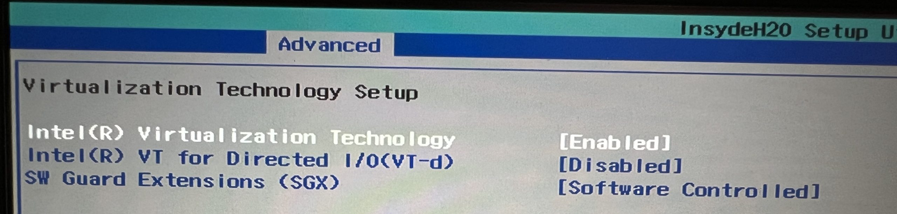
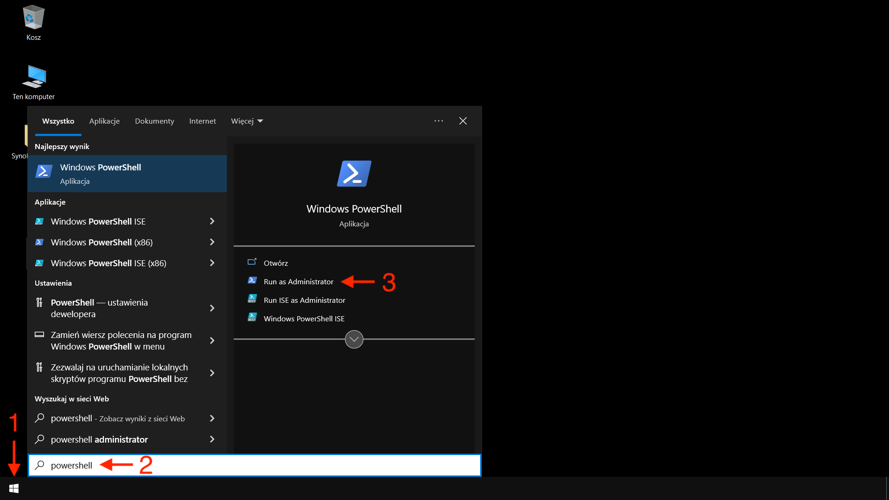
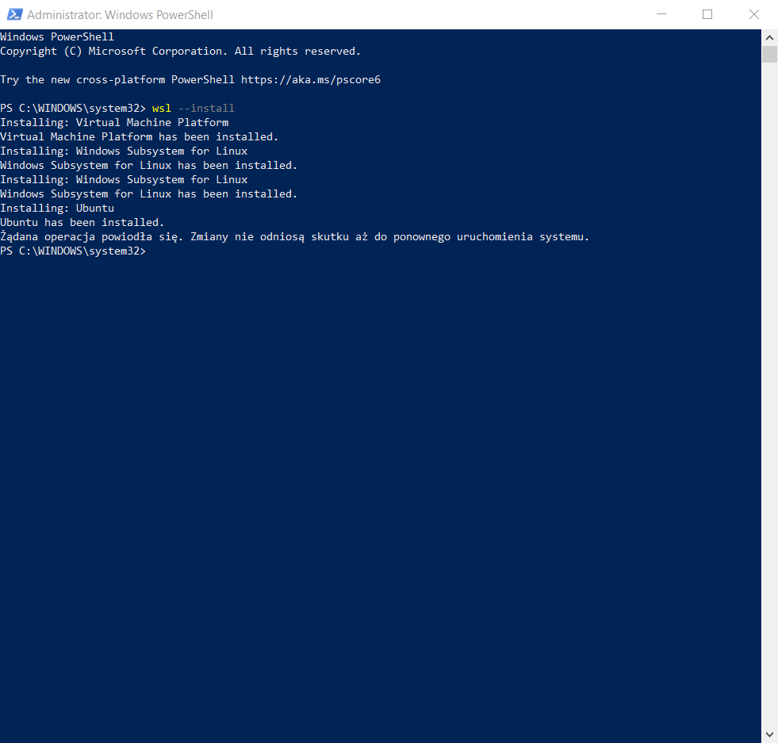
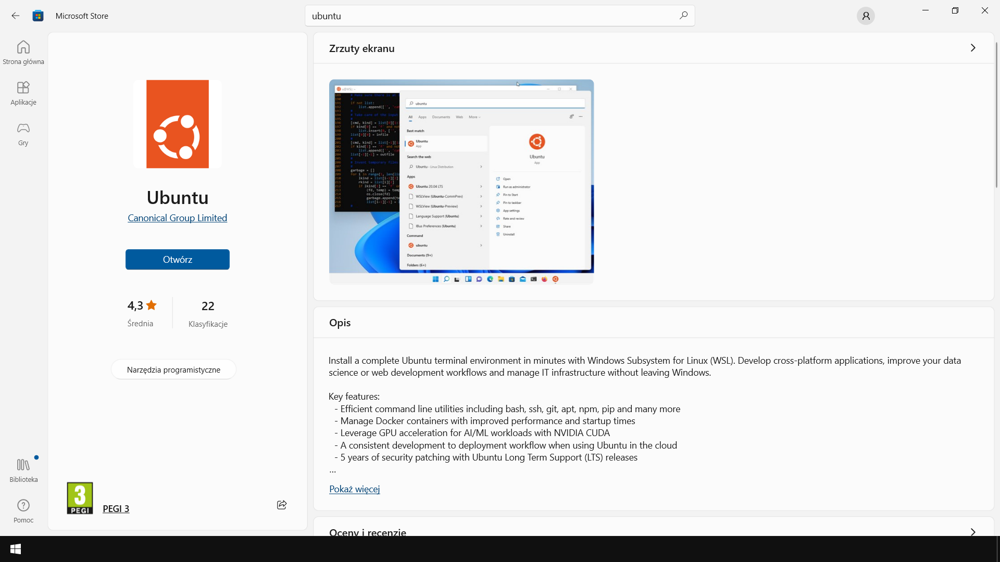
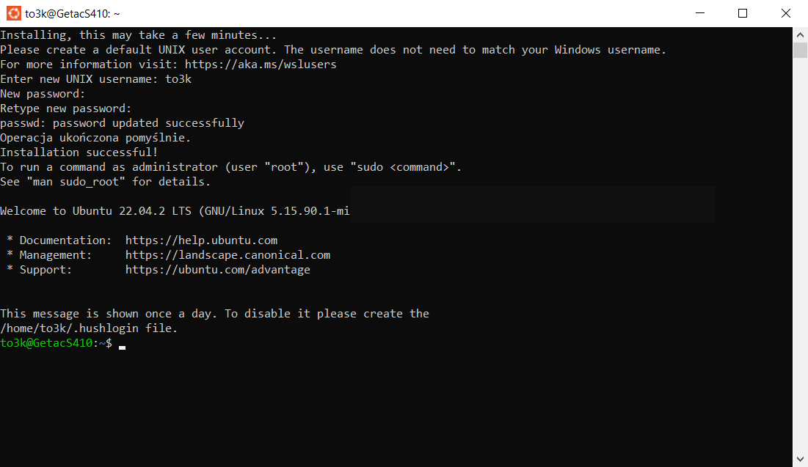

Spis treści:
* TOC
{:toc}

Sporo już pisałem o stawianiu różnego rodzaju serwerów domowych. Była mowa o _Raspberry Pi_ jak i nieco potężniejszych _terminalach_. Ale czy każdy potrzebuje serwera w postaci oddzielnej maszyny? Co jeżeli ktoś chce dopiero rozpocząć naukę i/lub w ogóle sprawdzić czy to w ogóle dla niego/niej, a przy tym do maksimum redukować koszty? Okazuje się, że **wystarczy mieć dowolnego laptopa z _Windowsem_** _10_ (lub _11_), na którym w **bardzo prosty sposób można zainstalować wirtualne środowisko Linux**, a konkretnie Ubuntu, i mieć ekwiwalent serwera, ale uruchomiony na swoim komputerze. Nie mówimy tutaj instalowaniu drugiego systemu, czy też zastępowaniu Windowsa Linuxem. W tym wpisie mowa będzie o tym jak wewnątrz Windowsa uruchomić Linuxa jako podsystem. Oczywiście nie jest to rozwiązanie, które stworzy nam serwer działający 24/7 (no chyba, że Wasz komputer jest cały czas włączony), a jedynie raczej namiastkę serwera, która będzie działać tylko wtedy, gdy tego potrzebujemy.

## Przygotowanie komputera

Aby móc zainstalować _Ubuntu_ wewnątrz systemu operacyjnego Windows musimy w pierwszej kolejności włączyć wirtualizację w _BIOSie_. Wejście do _BIOS_/_UEFI_ realizuje się poprzez: _menu Start_ -> _Zmień zaawansowane ustawienia uruchamiania_ -> zakładka _Odzyskiwanie_ -> sekcja _Uruchamianie zaawansowane_ -> przycisk _Uruchom ponownie teraz_ -> _Rozwiąż problemy_ -> _Opcje zaawansowane_ -> _Ustawienia oprogramowania układowego UEFI_ -> przycisk _Uruchom ponownie_.

Dalej już niestety jest mi nieco trudniej wskazać prawidłową drogę, gdyż tyle ile komputerów tyle różnych ułożeń ustawień w _BIOS_/_UEFI_. Tak samo mogę powiedzieć, że dla komputerów z procesorem _Intel_ szukamy opcji nazywającej się _Inter(R) Virtualization Technology_, którą należy włączyć (ustawić na _Enabled_), jednakże nie wiem jak będzie nazywać się odpowiednik tego dla urządzeń z procesorami AMD. Wychodzi na to, że każdy będzie musiał wygooglować to we własnym zakresie.



Poza włączeniem wirtualizacji musimy jeszcze zainstalować [Microsoft Visual C++](https://en.wikipedia.org/wiki/Microsoft_Visual_C%2B%2B), które jest niezbędnym składnikiem. Wystarczy pobrać plik instalacyjny z [tej strony](https://learn.microsoft.com/pl-pl/cpp/windows/latest-supported-vc-redist?view=msvc-170) i zainstalować.

## Instalacja środowiska Ubuntu

Wchodzimy do _PowerShell'a_, czyli windowsowego terminala. Istotne jest, aby uruchomić go jako administrator.



Instalujemy _WSL_ (skrót od _Windows Subsystem for Linux_, z ang. _Podsystem systemu Windows dla systemu Linux_), korzystając z polecenia:

```powershell
wsl --install
```



Po poprawnym zakończeniu instalacji konieczne jest ponowne uruchomienie komputera. Po wznowieniu pracy systemu wchodzimy do _Microsoft Store_, w pole tekstowe wyszukiwarki wpisujemy _Ubuntu_ i przechodzimy do strony aplikacji, z której poziomu możemy zainstalować i uruchomić środowisko _Ubuntu_. Po zainstalowaniu jest ono także dostępne normalnie z poziomu _menu Start_ lub jeżeli utworzyliśmy odpowiednią ikonę na pulpicie. W _Microsoft Store_ mamy także możliwość zainstalowania konkretnej wersji _Ubuntu_ np. 22.04 LTS lub 20.04 LTS, daje to wybór, w przypadku kiedy chcemy taką konkretną wersję, a nie inną.



Po skorzystaniu z przycisku _Otwórz_, uruchomione zostanie okno terminala, w którym rozpocznie się docelowa instalacja. W jej trakcie musimy paodać nazwę użytkownika oraz dwukrotnie hasło. Po poprawnym zakończeniu całego procesu uzyskamy dostęp do powłoki, która niczym nie różni się od systemu _Ubuntu_ postawionego np. na _Raspberry Pi_.



## Podsumowanie

Myślę, że nie znajdzie się osoba, która powie, że nie było to proste. _WSL_ jest bardzo ciekawym tworem, który otworzył środowisko potocznie zwanych okienek (od ang. _windows_, tj. _okna_) na dystrybucję spod znaku pingwina. _WSL_ ma jednak również wady i raczej jest rozwiązaniem do użytku z doskoku lub do stosowania jako środowisko testowe. Jeżeli myślisz na poważnie o _self-hostingu_ to dalej najlepszym rozwiązaniem jest przeznaczenie do tego osobnej maszyny.
