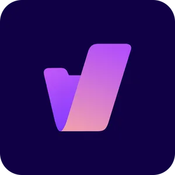

Spis treści:
* TOC
{:toc}

Czy zastanawiałeś/aś się kiedyś jak można przetłumaczyć słowo _Internet_? Wydaje mi się, że nie ma tutaj jednoznacznej i jedynej słusznej genezy tej nazwy. Według mnie nie ma znaczenia z jakich słów jest to zlepek. Dla mnie Internet to po prostu sieć połączonych komputerów. Ta definicja była dużo łatwiejsza do wybronienia w czasach, gdy dopiero powstała sieć _WWW_. Wtedy było to faktycznie kilka komputerów połączonych ze sobą. Teraz jest to niemożliwa do policzenia ilość wszelkiego rodzaju urządzeń i nie można się tutaj ograniczyć jedynie do komputerów, bo obecnie dostęp do Internetu mają nawet lodówki czy pralki, bo o telefonach, telewizorach i konsolach już nie wspomnę. Jednakże najgorsze z tego wszystkie jest to, że duża część Internetu jest w obecnych czasach skupiona na serwerach i tym samym kontrolowana przez ogromne firmy żerujące na prywatności swoich użytkowników.

Idea Internetu była naprawdę górnolotna przez co niestety dość szybko okazała się utopijna. Efekty tego widzimy dzisiaj. Internet stał się bronią obosieczną. Z jednej strony jest nieskończonym źródłem wiedzy czy chociażby umożliwia natychmiastowy kontakt bez względu na położenie geograficzne. Nie można odmówić tego, że Internet można śmiało porównywać do takich sukcesów ludzkości jak opanowanie ognia czy wynalezienie koła. Przesadziłem? Może i tak, ale spróbuj w dzisiejszych czasach zrobić cokolwiek bez dostępu do Internetu. Wszystkie podstawowe aspekty życia zależne są właśnie od tego. Z drugiej strony został po mistrzowsku i jednocześnie bezwzględnie opanowany przez wielkie korporacje, które zrobiły z niego nieskończenie wielki rynek, na którym można sprzedać wszystko, na gigantyczną skalę, śledzić, analizować i profilować ludzi, po czym wpływać na nich w tak wyrachowany sposób, że nawet nie są świadomi tego, że są w jakikolwiek sposób manipulowani.

Czy w dzisiejszych czasach można jeszcze mówić o jakiejkolwiek prywatności? W mojej ocenie to obecnie iluzja. Prywatność stała się walutą, którą płacimy za dostęp do Internetu, a konkretnie do treści i narzędzi znajdujących się w nim. Trzeba być świadomym tego, że żadna firma nastawiona na zyski nie udostępnia niczego za darmo. Zawsze jest jakiś haczyk i przeważnie jest to rezygnacja ze swojej prywatności i poufności swoich danych. To wszystko zapisane jest pięknymi i zarazem możliwie najbardziej skomplikowanymi słowami w regulaminach i politykach prywatności, których nikt nie czyta. Czy da się z tym walczyć? Owszem! Niekiedy trzeba pójść na pewne kompromisy i zrezygnować z wygody lub w ogóle z dostępu do pewnych usług, ale w mojej ocenie jest to gra warta świeczki.

Tym wpisem otwieram nowy cykl pod nazwą _Outernet_. Nazwa ta powstała w mojej głowie, gdy tak jak w pierwszym akapicie tego wpisu, analizowałem skąd wzięła się nazwa _Internet_. Tym razem jednak poszedłem nieco na bakier względem tego co napisałem wyżej i rozwinąłem nazwę _Internet_ jako sieć wewnętrzną, którą zawładnęły korporacje, a _Outernet_ to takie rubierze, obszar na obrzeżach tejże sieci wewnętrznej, ziemia niczyja. _Outernet_ to miejsce, gdzie nie śledzą nas żadne algorytmy, w którym możemy stworzyć swoją własną przestrzeń i łączyć się z osobami, które tak samo jak my dbają o swoją prywatność. Zaczniemy od mediów społecznościowych. Poniżej postaram się wskazać i omówić kilka ciekawych miejsc, które warto odwiedzić, ocenić i rozważyć porzucenie na ich rzeczy mainstreamowych social mediów.

## Mastodon jako alternatywa dla Twittera (X'a?)

O _[Mastodonie](https://joinmastodon.org/)_ wspominałem już wiele razy na tym blogu. Jest to aktualnie moje ulubione miejsce w sieci i zdecydowanie pasuje do ideologii _Outernet_. Dla tych, którzy jeszcze nie mieli okazji przeczytać polecam mój [wpis, w którym opowiadam czym jest _Mastodon_ i cały _Fediverse_](https://blog.tomaszdunia.pl/mastodon/). W skrócie, _Mastodon_ swoją formą przypomina _Twittera_, ale jest wolny od wszelkiego rodzaju algorytmów, które jedne treści polecają i bombardują nas nimi, a inne, nierzadko bardziej wartościowe, skrzętnie ukrywają, także by możliwie jak najtrudniej byłoby je znaleźć. Nie uświadczysz tam również natarczywych reklam, a nieodpowiednie treści można tam w prosty sposób odfiltrować poprzez wyciszenie lub całkowite zbanowanie i to nie tylko na poziomie jednego konta, ale również w zakresie całych instancji, które w naszej ocenie są dla nas nieodpowiednie. Polecam rozpocząć swoją przygodę w tym świecie od rejestracji na jednej z poniższych instancji, które polecam:

- 🇵🇱 [101010.pl](https://101010.pl)

- 🇵🇱 [pol.social](https://pol.social)

- 🇵🇱 [wspanialy.eu](https://wspanialy.eu)

- 🇬🇧 [mstdn.social](https://mstdn.social)

- 🇬🇧 [infosec.exchange](https://infosec.exchange)

- 🇬🇧 [fosstodon.or](https://fosstodon.org)

Gdy już uznasz, że _Mastodon_ to miejsce dla Ciebie to zawsze możesz się uniezależnić i uruchomić swoją własną instancję. Pisałem o tym trochę [tutaj](https://blog.tomaszdunia.pl/wlasna-instancja-mastodona/).

Z kronikarskiego obowiązku muszę też wspomnieć o tym, że w _Fediverse_ istnieją też inne projekty podobne do _Mastodona_ - _[Misskey](https://misskey-hub.net)_, _[Pleroma](https://pleroma.social/)_, _[Calckey](https://i.calckey.cloud/)_.

## Pixelfed jako alternatywa dla Instagrama

_Instagram_ jest obecnie chyba najbardziej rozpoznawalna sieć społecznościowa na świecie. Znajduje się niestety w rękach korporacji _Meta_ (czy jak kto woli _Facebook_, bo np. do mnie ten rebranding jeszcze nie dociera). Czy nie jesteś już zmęczony/a ciągłym przewijaniem osi czasu i oglądaniem influencerów wciskających Ci kolejne produkty, których nie potrzebujesz, bycia bombardowanym/ą reklamami, które podprogowo wpływają na Twoje decyzje zakupowe, czy oglądaniem materiałów pokazujących jak idealne życie prowadzą celebryci, a które w rzeczywistości są tylko maskami i nie mają nic wspólnego z tym jak jest naprawdę? Jeżeli jesteś po prostu normalnym człowiekiem, który od czasu do czasu zrobi jakieś fajne zdjęcie czy grafikę i chce się nimi podzielić, a także oglądać twórczość podobnych osób to polecam sprawdzić _[Pixelfed](https://pixelfed.org/)_.

Polecane przeze mnie instancje:

- 🇬🇧 [pixelfed.social](https://pixelfed.social)

- 🇬🇧 [metapixl.com](https://metapixl.com)

## Lemmy jako alternatywa dla Reddita

O _Reddit_ jest ostatnio bardzo głośno i to w negatywny sposób. Wszystko za sprawą podjęcia dziwnej polityki jego właściciela, który zaczął postępować podobnie do tego co _Elon Musk_ zrobił z _Twitterem_. Podniesienie ceny za używanie _API_, a raczej sprawienie, że jest ono przez to nieużywalne, doprowadziło do upadku bardzo lubianej aplikacji dla systemu _iOS_ o nazwie _[Apollo](https://apolloapp.io/)_. To jednak nie koniec historii, bo dzięki temu, że przez wiele lat istnienia _Reddita_ jego _API_ było powszechnie dostępne, powstało wiele innych, przydatnych narzędzi, które po zmianach również niemalże przestały istnieć. Do tego już od jakiegoś czasu _Reddit_ coraz bardziej stawał się maszynką do zarabiania pieniędzy. Wprowadzono plan Premium, monetki i inne duperele pokroju skórek na bronie w _CS:GO_. Tak w ogóle to _Reddit_ przygotowuje się do zostania spółką giełdową, a to nigdy nie sprzyja podejmowaniu dobrych decyzji dla użytkowników tylko dbaniu o zadowolenie udziałowców.

Na ratunek przychodzi kolejna usługa działająca w obrębie _Fediverse_ - _[Lemmy](https://join-lemmy.org/)_. Trudno o wierniejszą kopię _Reddita_, która jednocześnie nie ma wszystkich jego wad. Problemem może być jedynie to, że nie jest jeszcze tak popularna. Nie sposób też wspomnieć o tym jak pokaźną bazą wiedzy stał się przez te wszystkie lata _Reddit_ i jednak trochę szkoda to porzucać. _Reddit_ to ostatnie miejsce w Internecie, które trudno mi tak łatwo porzucić na rzecz rozwiązań z _Outernetu_. Jednakże nie można mnie też nazwać _power-user'em_, bo korzystam z _Reddita_ tylko po to, żeby wejść od czasu do czasu i sprawdzić co tam się dzieje na świecie. Ograniczam się raczej do przejrzenia zakładki _Popularne_ i sprawdzenia kilku wyselekcjonowanych _subreddit'ów_ korespondujących z moimi zainteresowaniami.

Polecane przeze mnie instancje _Lemmy_:

- 🇵🇱 [szmer.info](https://szmer.info)

- 🇬🇧 [lemmy.world](https://lemmy.world)

Poruszając temat alternatywy dla _Reddita_ nie sposób też nie wspomnieć o projekcie _[kbin](https://kbin.pub)_, który jest jak _Lemmy_, ale ma nieco inną specyfikę. Polecam zajrzeć również na te instancje _kbin_:

- 🇵🇱 [karab.in](https://karab.in)

- 🇬🇧 [kbin.social](https://kbin.social)

## Friendica jako alternatywa dla Facebooka

Na temat _[Friendica](https://friendi.ca/)_ nie mogę powiedzieć za dużo, bo po prostu z niej nie korzystam. Jest to _fediversowy_ odpowiednik _Facebooka_, dla którego ja nie widzę zastosowania, tj. jest mi kompletnie zbędny, toteż z niego nie korzystam i nie planuję także korzystać z jego odpowiednika.

Niemniej jednak to tylko moje zdanie, więc polecam każdemu sprawdzić na własnej skórze, a polecić mogę następujące instancje:

- 🇵🇱 [soc.citizen4.eu](https://soc.citizen4.eu)

- 🇬🇧/🇩🇪 [libranet.de](https://libranet.de)

## PeerTube jako alternatywa dla YouTube'a

Jesteś twórcą internetowym? Tworzysz treści wideo? Masz dosyć YouTube'a i szukasz alternatywy, która pozwoli Ci odzyskać kontrolę? _[PeerTube](https://joinpeertube.org)_ to rozwiązanie dla Ciebie! W tym przypadku ciężko jest mi wskazać jakąś konkretną instancję, od której warto zacząć, bo istotne jest jaka tematyka Cię interesuje. [Tutaj jest lista](https://joinpeertube.org/instances) polecanych instancji posegregowanych tematycznie. Jeżeli traktujesz swoją twórczość na poważnie to zdecydowanie polecam utworzyć własną instancję do hostowania swoich treści.

## Blogowanie w Outernet

Lubisz pisać? Istnieją rozwiązania, które pozwolą Twojej twórczości na łatwą interakcję (federację) z rozwiązaniami w _Fediverse_. Pierwszym z nich jest specjalnie przygotowana do tego platforma _[WriteFreely](https://writefreely.org/)_, o której pisałem w [jednym z poprzednich wpisów](https://blog.tomaszdunia.pl/writefreely-polska/). W skrócie pozwala na pisanie bloga w bardzo prostej formie, a mówi się, że piękno tkwi w prostocie. Polecam następujące instancje:

- 🇵🇱 [writefreely.pl](https://writefreely.pl)

- 🇬🇧 [write.as](https://write.as)

Alternatywnym rozwiązaniem jest uruchomienie zwykłego bloga w oparciu o _[Wordpress](https://wordpress.org/)_ i instalacja [wtyczki _ActivityPub_](https://wordpress.org/plugins/activitypub/), która pozwala na połączenie treści publikowanych na _WP_ z _Fediverse_.

## Podsumowanie

Jak widzisz poza powszechnie znanymi portalami społecznościowymi istnieje jeszcze całkowicie oddzielny świat - _Outernet_, w którym możesz łączyć się z ludźmi i jednocześnie nie rezygnować ze swojej prywatności w sieci poprzez oddawanie jej w ręce wielkich korporacji. Wszystko czego potrzebujesz to w zasadzie _Fediverse_ wraz ze wszystkimi platformami wchodzącymi w jego skład. Już teraz w _Fediverse_ jest wiele wartościowych osób godnych obserwowania, z którymi warto wejść w interakcję, a to dopiero początek, bo rozwiązania takie jak _Mastodon_, pomimo tego, że istnieją już od jakiegoś czasu to, dopiero teraz zaczynają zyskiwać popularność.
