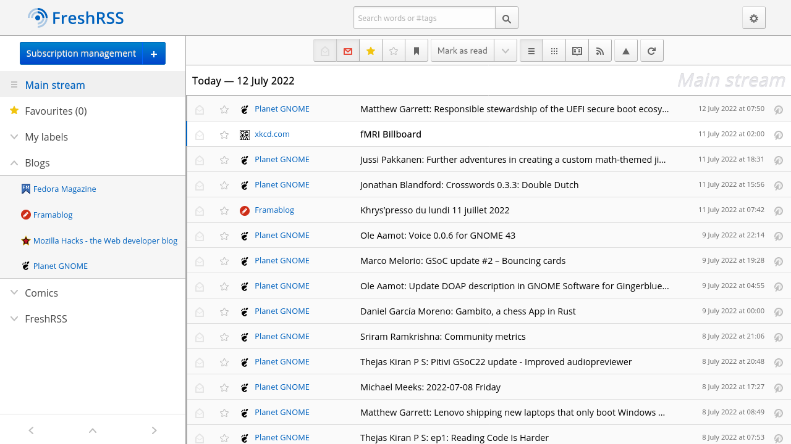

[🇬🇧 Go to english version of this post / Przejdź do angielskiej wersji tego wpisu](https://blog.tomaszdunia.pl/outernet-rss-eng/)

Spis treści:
* TOC
{:toc}

[W poprzednim wpisie](https://blog.tomaszdunia.pl/outernet-social-media/) przedstawiłem alternatywy dla _mainstreamowych mediów społecznościowych_, które pozwalają wyskoczyć z bańki, którą krótko scharakteryzować można jako uzależniającą, gwałcącą prywatność swoich użytkowników czy też wywołującą całą gamę niepotrzebnych emocji służących jedynie temu, aby firmy, które za tym stoją bogaciły się w nieskończoność.

W tym wpisie postanowiłem poruszyć kolejny temat jakim jest pozyskiwanie informacji ze świata. Ostatnimi czasy zauważyłem trend odcinania się od czytania aktualności przez coraz większą liczbę osób. Nie mogę powiedzieć, że nie jest to zdrowe i niezrozumiałe dla mnie podejście. To co obecnie jest nam serwowane przez portale informacyjne głównego nurtu oddziałuje na nas negatywnie w podobny sposób co media społecznościowe. Mi jednak życie pod przysłowiowym kamieniem nie odpowiada i lubię wiedzieć co się dzieje na świecie. Nie mówię tutaj oczywiście o polityce, bo ten temat działa na mnie jak płachta na byka i zdecydowanie nie wpływa pozytywnie na moje samopoczucie. Chodzi mi bardziej o nowinki technologiczne i naukowe, aktualności związane z moją pracą (autobusy, wodór, elektromobilność) czy też informacje sportowe (żużel, F1). Czy jestem w stanie poczytać na spokojnie o tym wszystkich korzystając z _Google News_, który serwuje treści zgodnie ze swoim algorytmem, który zawsze "wie lepiej" co powinienem czytać, a czego nie? A może powinienem ograniczyć się jedynie do _Onetu_ i/lub innych portali tego typu, na których 90% artykułów to _clickbaity_, czyli takie, których tytuły są napisane w taki sposób, aby za wszelką cenę zachęcić czytelnika do otworzenia ich treści, a które w tym samym czasie, delikatnie mówiąc, nie reprezentują swoją zawartością wysokiego poziomu dziennikarskiego? Na oba te pytania odpowiem stanowczo - NIE.

Ja jestem świadomym użytkownikiem Internetu i wiem, że na jego rubieżach znajduje się _Outernet_, czyli miejsce, w którym sam mogę decydować co mnie interesuje i czytać o tym na moich własnych warunkach. Orężem, z którego korzystam są kanały oraz czytnik _RSS_.

## Czym jest RSS?

Nie sądzę, aby znalazł się tutaj ktoś kto nigdy nie miał styczności z _RSS_ i zupełnie nie wie co to jest, jednakże z kronikarskiego obowiązku czuję się zobligowany w skrócie o tym wspomnieć.

_RSS_, czyli _Really Simple Syndication_ (z ang. przetłumaczyłbym to jako _naprawdę prostą sygnalizację_), to technologia umożliwiająca łatwe i automatyczne śledzenie nowych treści publikowanych na wybranych stronach internetowych. Dzięki _RSS_ użytkownicy mogą subskrybować ulubione blogi, strony informacyjne czy chociażby podcasty i otrzymywać aktualizacje bez konieczności odwiedzania każdej z tych witryn osobno. To nie tylko oszczędza czas, ale także pomaga w utrzymaniu porządku w oceanie informacji dostępnych w sieci, a w głównej mierze ogranicza ekspozycję na zbędne bodźce, którymi jesteśmy bombardowani poprzez standardowe odwiedzanie portali informacyjnych głównego nurtu.

Idea _RSS_ jest bardzo prosta. Źródło, z którego będziemy czerpać informacje, posiada kanał _RSS_ (zwany również z angielskiego _feed'em_), który jest tak na prawdę swego rodzaju plikiem tekstowym (przeważnie w formacie _XML_), który poprzez określoną składnię listuje w sposób chronologiczny publikowane treści. Można to porównać do spisu treści, który zawiera podstawowe informacje o artykułach (tytuł, odnośnik, data publikacji, informacje o autorze, skrócona treść). Plik ten znajdować może się pod różnymi adresami i nie ma jednej słusznej metody. Najprostszą metodą na znalezienie kanału _RSS_ danej strony jest wrzucenie jej nazwy w wyszukiwarkę i dopisanie do zapytania frazy _RSS_. Innym sposobem jest poleganie na czytnikach _RSS_, z których większość poradzi sobie ze znalezieniem odpowiedniego kanału po podaniu zaledwie adresu strony głównej danego źródła.

Dla przykładu adres kanału _RSS_ mojego bloga (tego, który właśnie czytasz) to:

> https://blog.tomaszdunia.pl/rss

Blog działa w oparciu o _Wordpress'a_, więc zamiast _rss_ można też na końcu użyć frazy _feed_ i efekt będzie ten sam.

Co więcej, nie ma konieczności subskrybowania mojego bloga jako całości. Można śledzić jedynie te tematy, które są dla Ciebie interesujące. W ten sposób można np. ograniczyć się jedynie do treści, które piszę po polsku - korzystając z tego adresu `https://blog.tomaszdunia.pl/category/pl/rss`, lub jedynie do tych po angielsku - analogiczny link `https://blog.tomaszdunia.pl/category/eng/rss`. A może interesują Cię jedynie wpisy, które oznaczyłem konkretnym tagiem? Weźmy dla przykładu tag _selfhosted_. Kanał _RSS_ z wpisami otagowanymi w ten sposób można znaleźć pod adresem `https://blog.tomaszdunia.pl/tag/selfhosted/rss`.

Dobrym przykładem opisującym działanie _RSS_ jest napisany przeze mnie jakiś czas temu wpis [MEWS Bot = Mastodon nEWS](https://blog.tomaszdunia.pl/mews/), w którym w formie poradnika opisałem jak stworzyć bota zasysającego informacje z kanału _RSS_ i publikującego je na _Mastodonie_. Skoro już jesteśmy przy temacie _Mastodona_ to warto przypomnieć, że każdy profil użytkownika, czy też hashtag, posiada swój indywidualny kanał _RSS_, który można subskrybować przez dowolny czytnik _RSS_. Ten mechanizm wykorzystuję na przykład w moim narzędziu _[Twittodon](https://blog.tomaszdunia.pl/twittodon/)_ i przy tworzeniu cotygodniowego zestawienia newsów [_TDBNews_](https://blog.tomaszdunia.pl/automatyzacja-tdbnews/).

## Czytnik RSS

Już kilkukrotnie wspomniałem powyżej o czymś co nazywam czytnikiem _RSS_, więc wypadałoby w końcu wskazać palcem jakiejś rozwiązanie, które polecam. Wybór w tym zakresie jest naprawdę ogromny.

Można pójść na łatwiznę i po prostu wejść na swoim smartfonie czy tablecie do sklepu z aplikacjami i pobrać konkretną aplikację. Dla Androida polecam czytnik _Feeder_, który jest dostępny zarówno w [_Google Play_](https://play.google.com/store/apps/details?id=com.nononsenseapps.feeder.play) (👎) jak i w [_F-Droid_](https://f-droid.org/en/packages/com.nononsenseapps.feeder/) (💪). Dlaczego akurat ten skoro wybór jest tak obszerny? _Feeder_ jest darmowy, otwarto-źródłowy, często aktualizowany, nie zbiera żadnych informacji o swoich użytkownikach i działa jak należy, wyglądając przy tym nie najgorzej. Czy potrzeba czegoś więcej? Dla _iOS_ polecam płatny [_Reeder 5_](https://apps.apple.com/pl/app/reeder-5/id1529445840), który jest jednocześnie tą aplikacją, której używam. Z darmowych alternatyw polecaną appką jest [_NetNewsWire_](https://apps.apple.com/us/app/netnewswire-rss-reader/id1480640210). Dla obu systemów istnieje jeszcze aplikacja [_Feedly_](https://feedly.com), która posiada płatne plany, ale jej darmowa wersja starcza do podstawowych zastosowań. Ostateczny wybór pozostawiam wedle uznania.

Dla bardziej ambitnych i nakierowanych na rozwiązania self-hosted istnieje fajna opcja w postaci narzędzia _[FreshRSS](https://freshrss.org/index.html)_. Jest to oprogramowanie, które można uruchomić na swoim serwerze np. poprzez _[Yunohost](https://yunohost.org/en/app_freshrss)_ czy _[Docker](https://hub.docker.com/r/freshrss/freshrss)_. Polecam zapoznanie się z moimi poprzednimi wpisami, w których zawarłem wszystkie niezbędne informacje potrzebne do uruchomienia swojej własnej instancji _FreshRSS_:

- [czym jest _Yunohost_ i jak uruchomić go na swoim serwerze](https://blog.tomaszdunia.pl/yunohost-oracle/),

- [czym jest _Docker_ i jak wygląda jego podstawowa obsługa](https://blog.tomaszdunia.pl/docker/),

- [jak uruchomić _Vaultwarden_ w oparciu o _Yunohost_ lub _Docker_](https://blog.tomaszdunia.pl/vaultwarden/),

- [jak uruchomić _Nextcloud_ w oparciu o _Yunohost_ lub _Docker_](https://blog.tomaszdunia.pl/nextcloud/).

_FreshRSS_ jest nie tylko czytnikiem _RSS_, ale także agregator, którego można używać do skanowania kanałów źródeł i agregowania znalezionych treści, które później można czytać na zewnętrznym czytniku po jego podpięciu. Tak jak pisałem wcześniej, jest to rozwiązanie nastawione na autonomię i samowystarczalność, czyli idealnie pasujące do ideologii _Outernet_.

## Moje RRSy

Uznałem, że na koniec tego wpisu podzielę się kilkoma źródłami, które uważam za moje okno na świat, tj. te z których czerpię informacje o aktualnościach dotyczących interesujących mnie tematów. Tak więc otwieram mój czytnik i poniżej przedstawiam zebrane przeze mnie kanały _RSS_.

Tematyka ogólnopojętego cyberbezpieczeństwa - czytam hobbistycznie:

1. [Zaufana Trzecia Strona](https://zaufanatrzeciastrona.pl) - https://zaufanatrzeciastrona.pl/feed

3. [Niebezpiecznik](https://niebezpiecznik.pl) - http://feeds.feedburner.com/niebezpiecznik

5. [Sekurak](https://sekurak.pl) - https://sekurak.pl/feed

7. [Informatyk Zakładowy](https://informatykzakladowy.pl) - https://informatykzakladowy.pl/feed

9. [Kapitan Hack](https://kapitanhack.pl) - https://kapitanhack.pl/feed

11. [PAYLOAD](https://payload.pl/) - https://payload.pl/feed

_Rzeczpospolita_ - jedyny portal informacyjny, który czytam i płacę za dostęp za paywall, jednakże nie czytam wszystkiego, a jedynie treści z konkretnych kategorii:

1. [Logistyka](https://logistyka.rp.pl/) - https://rp.pl/rss/4741-logistyka

3. [Klimat](https://klimat.rp.pl/) - https://rp.pl/rss/5161-klimat

5. [Motoryzacja](https://moto.rp.pl/) - https://rp.pl/rss/2651-motoryzacja

7. [Energetyka](https://energia.rp.pl/) - https://rp.pl/rss/4351-energetyka

9. [Cyfrowa](https://cyfrowa.rp.pl/) - https://rp.pl/rss/2991-cyfrowa

_Reddit_ - każdy _sub-reddit_ ma swój kanał _RSS_, a korzystanie w ten sposób jest bardzo wygodne, bo nie ma konieczności odwiedzania strony głównej wypchanej reklamami i treściami niskiej jakości, których zadaniem jest jedynie przykuwać uwagę. Powoli wygaszam moją aktywność na _Reddicie_, dlatego mam tutaj już tylko jeden kanał, którego ciężko mi się pozbyć, bo pojawia się na nim sporo interesujących treści:

1. [r/TechNews](https://www.reddit.com/r/technews/) - https://reddit.com/r/technews/new

Sport - interesują mnie sport motorowe, a konkretnie dwa - formuła 1 i żużel:

1. [Cyrk F1](https://www.cyrkf1.pl/) - https://cyrkf1.pl/feed

3. [MotorSport.com Formuła 1](https://pl.motorsport.com/f1/) - https://pl.motorsport.com/rss/f1/news

5. [SportoweFakty WP Żużel](https://sportowefakty.wp.pl/zuzel/) - https://sportowefakty.wp.pl/zuzel/rss.xml

7. [speedwaynews.pl](https://speedwaynews.pl) - https://speedwaynews.pl/feed

Elektromobilność i OZE - częściowo hobbistycznie, częściowo branżowo:

1. [Elektrowóz](https://elektrowoz.pl) - https://elektrowoz.pl/feed

3. [WysokieNapięcie](https://wysokienapiecie.pl) - https://wysokienapiecie.pl/rss

Branżowe (związane z moją pracą, czyli autobusami):

1. [Transinfo (Infobus)](https://transinfo.pl/infobus/) - https://transinfo.pl/infobus/rss

3. [Transport Publiczny](https://www.transport-publiczny.pl/) - https://www.transport-publiczny.pl/rss/rss.xml

5. [Sustainable Bus](https://www.sustainable-bus.com/) - https://www.sustainable-bus.com/feed

Kiedyś miałem znacznie więcej anglojęzycznych źródeł, jednakże od tamtego czasu powstało wiele rodzimych portali, które nie odstają poziomem i warto je śledzić.
