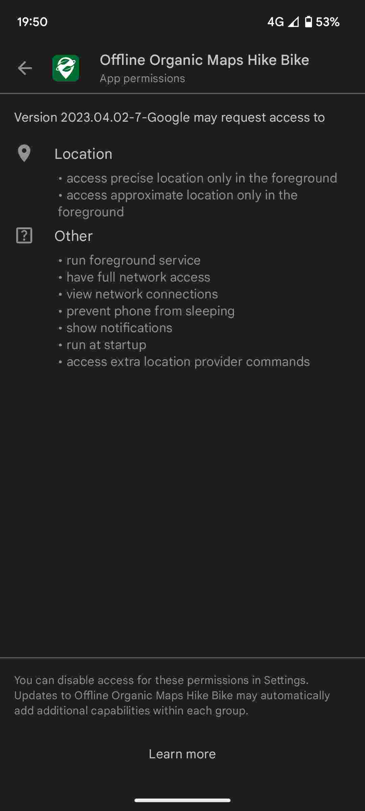
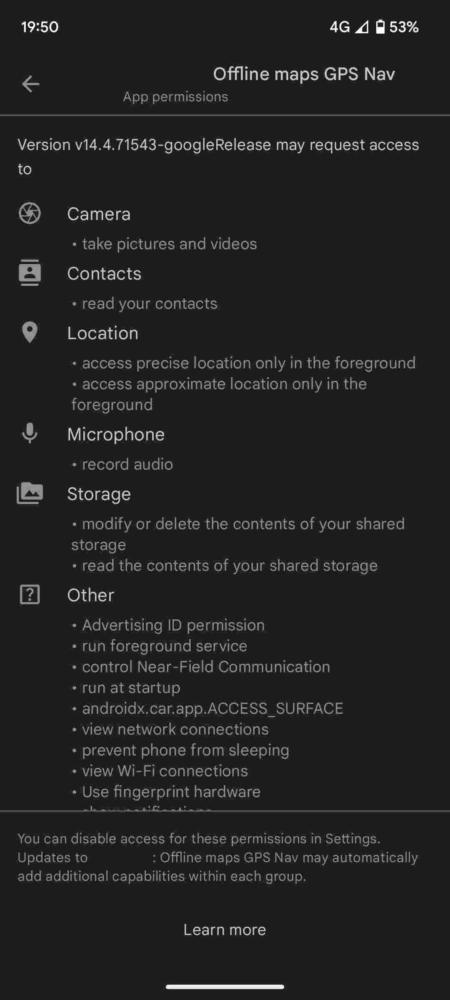
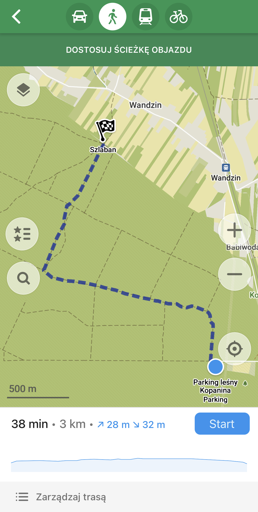
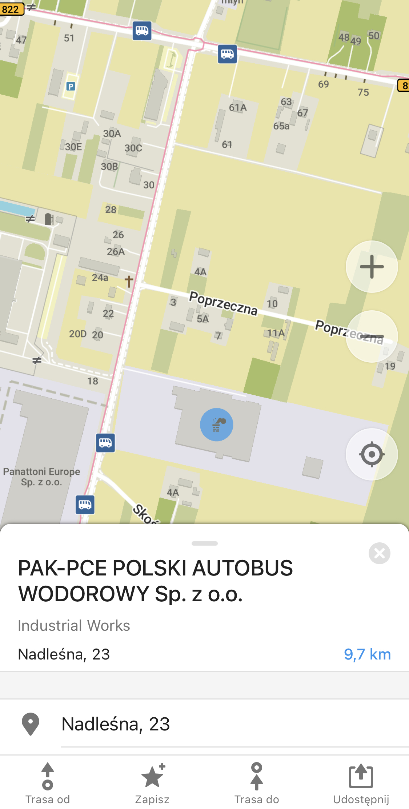
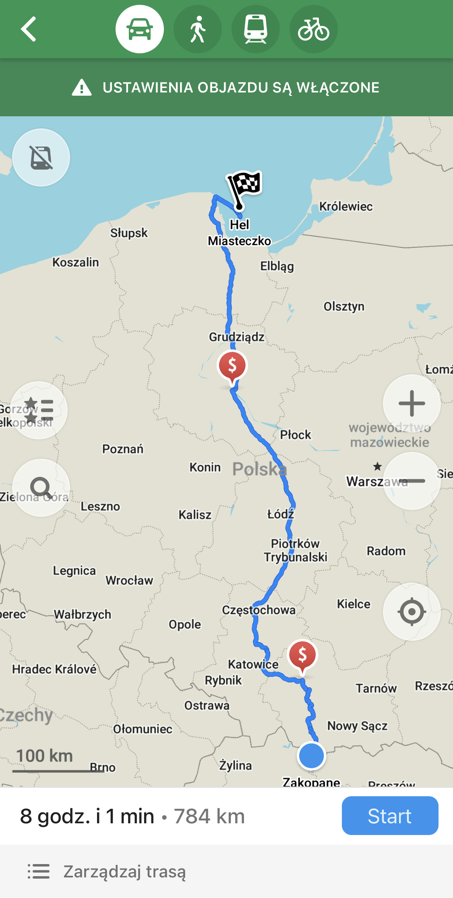
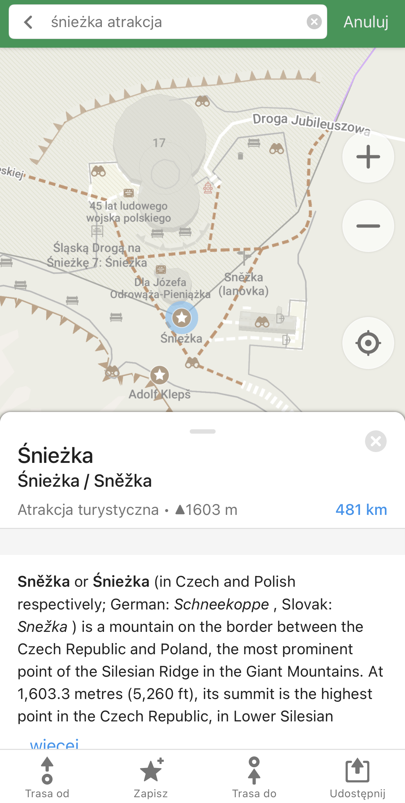
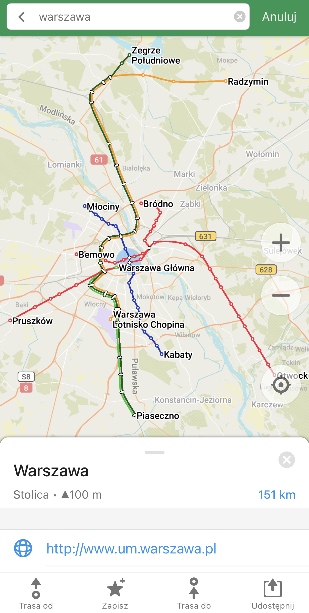
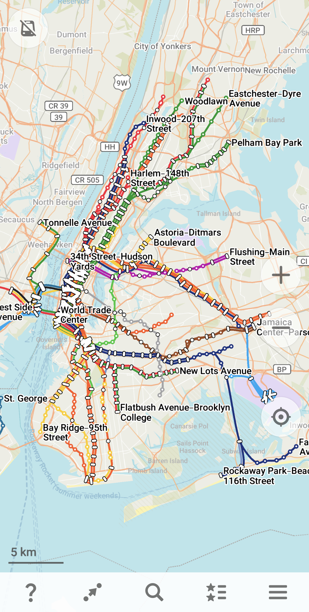
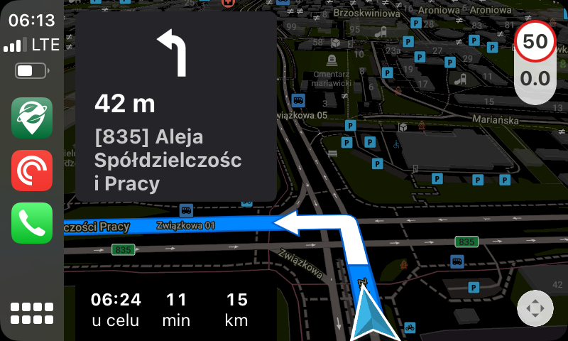

[🇬🇧 Go to english version of this post / Przejdź do angielskiej wersji tego wpisu](https://blog.tomaszdunia.pl/outernet-maps-eng/)

Spis treści:
* TOC
{:toc}

Nie tak dawno w moim cotygodniowym zestawieniu _TDBNews_ pisałem o tym, że [_Meta_ (_Facebook_), _Microsoft_ i _Amazon_ planują wypuszczenie aplikacji konkurencyjnej dla _Google Maps_ i _Apple Maps_](https://techcrunch.com/2023/07/26/meta-microsoft-and-amazon-release-open-map-dataset-to-rival-google-maps-apple-maps/). Według przechwałek tych trzech firm ma ona być najlepszą mapą i nawigacją na urządzenia mobilne, ale niewiele ludzi patrzy na to w ten sposób, że rozwiązania tego pokroju to tak naprawdę idealny sposób na śledzenie swoich użytkowników przez takie molochy jak właśnie _Meta_, _Microsoft_, _Amazon_, _Google_ czy nawet _Apple_, które z tych wszystkich wymienionych chyba najbardziej dba o prywatność swoich użytkowników, a przynajmniej najbardziej zwraca na to uwagę... Ja osobiście ufam _Apple_, ale wiem, że są osoby, które mają zupełnie odmienne zdanie i rozumiem to. Lecz to nie o tym chciałem tutaj rozmawiać! W tym kolejnym wpisie z cyklu _Outernet_ poruszę temat jakich rozwiązań w zakresie map i nawigacji używać, aby podróżować wygodnie i jednocześnie dbać o swoją prywatność.

## OpenStreetMap

_[OpenStreetMap](https://www.openstreetmap.org)_ to projekt społeczny, który powstał 9 sierpnia 2004 r. Jego celem jest stworzenie, a może raczej ciągłe tworzenie i udoskonalanie, **darmowej mapy** całego naszego globu. Siłą tej inicjatywy jest to, że powstała i jest cały czas rozwijana dzięki pracy użytkowników, wolontariuszy, czy może raczej **pasjonatów**, którymi mogę być ja czy możesz być Ty. Dzięki temu _OSM_ jest oferowane na podstawie całkowicie **otwartej licencji**, to znaczy _bierz i zrób z tym co uważasz_. Zaletami _OSM_ są nie tylko szczegółowe mapy z naniesioną siatką dróg, czy też ukształtowaniem terenu, ale przede wszystkim niebotyczna ilość POI (_Points Of Interest_ - z ang. można to przetłumaczyć jako _punkty szczególn_e), które są określane i aktualizowane niezwykle skrupulatnie, jak przystało na pasjonatów, a których próżno w takiej ilości i precyzji szukać na innych mapach. Takie projekty to istne złoto i wierzę, że właśnie dla podobnych idei powstał Internet, który niedługo po rozpowszechnieniu został skomercjalizowany do granic możliwości, a projekty takie jak _OSM_ stały się jedynie drobnymi punkcikami rozświetlającymi tą marketingową otchłań.

## Organic Maps

[_Organic Maps_](https://organicmaps.app/) to aplikacja dostępna zarówno w sklepach [_App Store_](https://apps.apple.com/app/organic-maps/id1567437057), [_Google Play_](https://play.google.com/store/apps/details?id=app.organicmaps), [_App Gallery_](https://appgallery.huawei.com/#/app/C104325611) (_Huawei_) jak i w katalogu [_F-Droid_](https://f-droid.org/pl/packages/app.organicmaps/). Jest to _fork_ (co można wytłumaczyć jako oprogramowanie, które powstało na bazie jakiegoś kodu źródłowego, przeważnie otwartego, i jest teraz modyfikowane i aktualizowane przez nowego dewelopera jako odłam od pierwotnego rozwiązania) aplikacji Maps.me, którą lubiłem i używałem dość długo nie wiedząc o tym, że jest to oprogramowanie wykupione przez jedną z największych rosyjskich korporacji (ha tfu). Moja przygoda z Maps.me zakończyła się, gdy pewnego dnia przez zupełny przypadek napisałem o niej na _[Mastodonie](https://mastodon.tomaszdunia.pl/@to3k)_ i jeden z obserwujących ([pozdrawiam Vitali!](https://mastodon.social/@vb)) zwrócił mi uwagę na konotacje tej aplikacji z Mail.ru Group i polecił od razu właśnie _Organic Maps_. Jako, że jest to _fork_ to przejście z używania jednej aplikacji na używanie drugiej można porównać do przesiadki z zielonego Fiata Seicento do czerwonego Fiata Seicento z przyciemnianymi szybami, bo aplikacja _Organic Maps_ jest nakierowane właśnie na zachowanie maksymalnej prywatności swoich użytkowników. Obrazuje to idealnie porównanie jakich uprawnień wymaga _Organic Maps_ (pierwszy zrzut ekranu) w odniesieniu do _Maps.me_ (drugi zrzut ekranu).

Polecam zwrócić uwagę i zastanowić się po co aplikacji z mapami dostęp do takich rzeczy jak: aparat, mikrofon, kontakty, pamięć całego urządzenia, NFC, historia połączeń WiFi, Advertising ID (taki identyfikator jak dla bydła, ale służący do personalizacji reklam) czy hardware odpowiedzialny za biometrię... Takie uprawnienia wymaga _Maps.me_, gdy aplikacja wyglądająca tak samo i wykonująca tę samą pracę potrzebuje tylko podstawowe uprawnienia wynikające z tego do czego jest używana (lokalizacja, praca w tle, blokowanie telefonu przed wygaszeniem ekranu, pokazywanie powiadomień czy uruchomienie po włączeniu telefonu).

Dobra, myślę, że leżące _Maps.me_ skopałem już wystarczająco mocno, więc przejdźmy teraz do części, w której będę argumentował dlaczego _Organic Maps_ to najlepsza aplikacja do map i nawigacji jaką znam. Jak pewnie się domyślasz korzysta z wcześniej wspomnianego _OpenStreetMap_, czyli potężnej bazy z mapami całego świata. Do tego wygodny i intuicyjny interfejs oraz możliwość pobierania map offline, tak aby można było z nich korzystać bez dostępu do Internetu, np. w totalnej głuszy. Czego można chcieć więcej?! Ja mam w głowie jedną taką rzecz - funkcja społecznościowego informowania o zdarzeniach na drogach, czy chociażby o patrolu kontrolującym prędkość, tak jak to ma miejsce w popularnym, ze względu właśnie na tę funkcję, _[Yanosiku](https://yanosik.pl)_.

Mi _Organic Maps_ imponuje głównie przy dwóch czynnościach. Pierwsza z nich to, gdy muszę znaleźć konkretny blok na bardzo zatłoczonym osiedlu. Oznaczenia bloków są bardzo jasne i precyzyjne. Drugi temat to naprawdę solidne oznaczenie szlaków w górach oraz, co dla mnie ważniejsze, ścieżek w lesie, które nigdy mnie nie zawiodło, a są dostępne nawet dla naprawdę mało popularnych terenów. Co ciekawe na tych ścieżkach można ustawić normalną trasę z punktu A do B (z ewentualnymi przystankami) i odpalić nawigację po niej.

Przez ostatnie kilka dni testowałem _Organic Maps_ jako główną mapę w _CarPlay_ i mam następujące spostrzeżenia.

### Zalety

- Działa :)

- Dostępne tryby jasny i ciemny (można ustawić automatyczne przełączanie)

- Działa wyszukiwanie lokalizacji (klawiatura) nawet podczas jazdy (np. dla _Google Maps_ jest komunikat, żeby nie korzystać z wyświetlacza podczas jazdy, ale co w przypadku, gdy adres wpisuje pasażer?)

- Pełna funkcjonalność nawigacji wraz z komunikatami głosowymi w różnych językach

- Wyświetlanie ograniczenia prędkości obowiązującego na drodze, po której się poruszamy (dane są naprawdę precyzyjne i szybko aktualizowane, czego nie można na przykład powiedzieć o _Apple Maps_)

### Wady

- Można używać tylko w trybie pełnoekranowym (nie ma możliwości wyświetlenia mapy tylko na połowie ekranu tak jak to jest w przypadku innych nawigacji jak _Apple Maps_, _Google Maps_ czy _Waze_)

- Czasem bez potrzeby włącza się w dzień tryb ciemny

- Aplikacja nie pojawia się na pasku ostatnio używanych po lewej (częściowo jest to połączone z tym, że działa tylko w trybie pełnoekranowym

