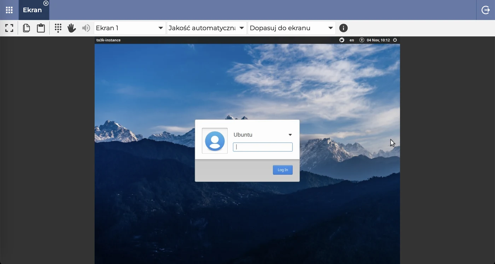
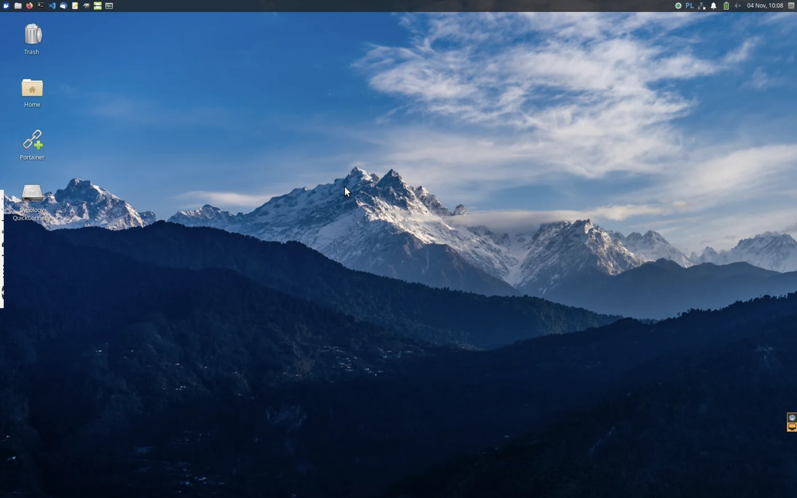
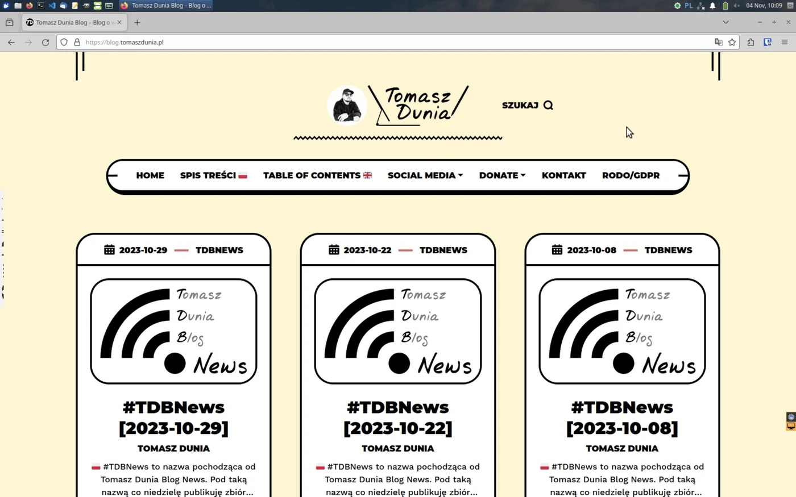
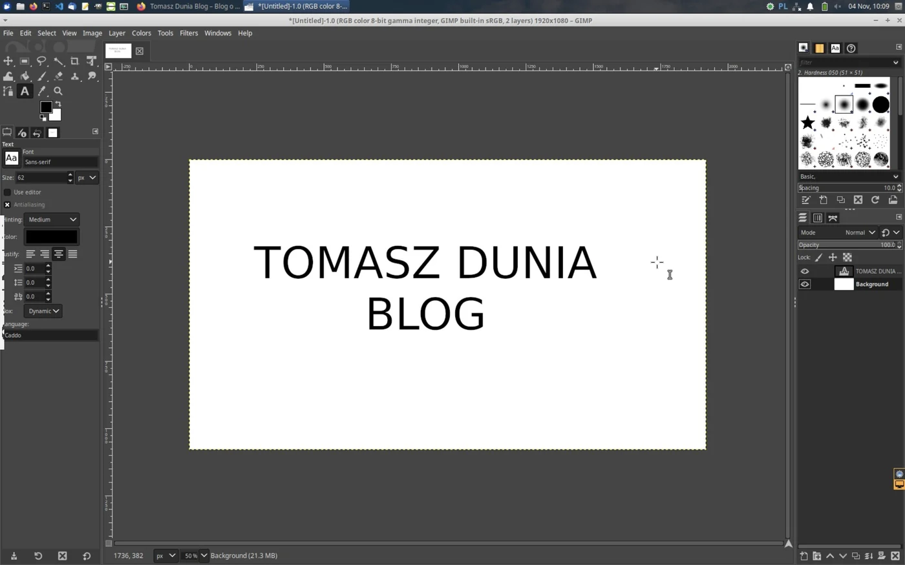
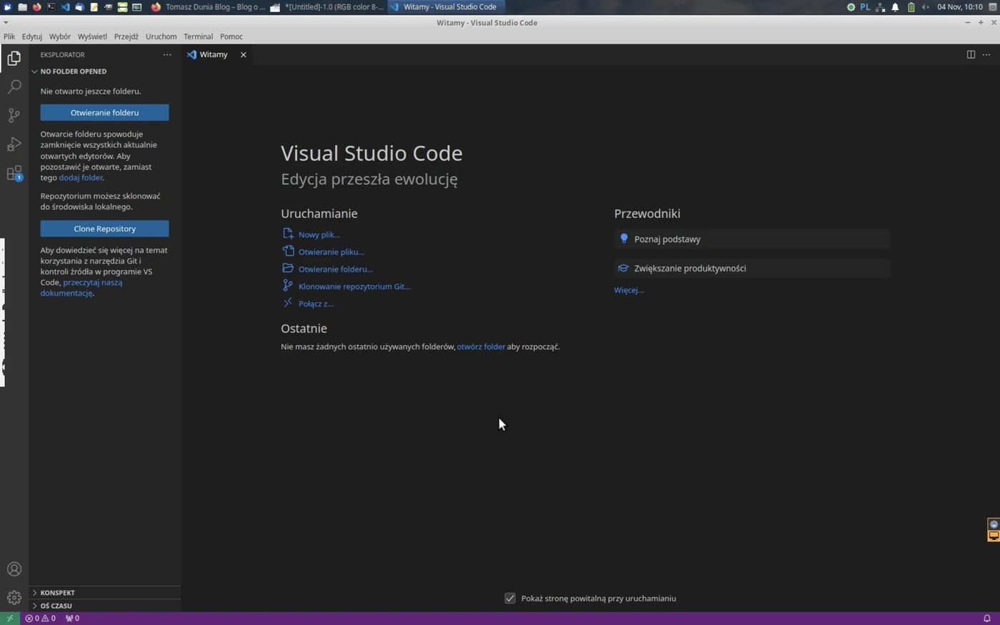
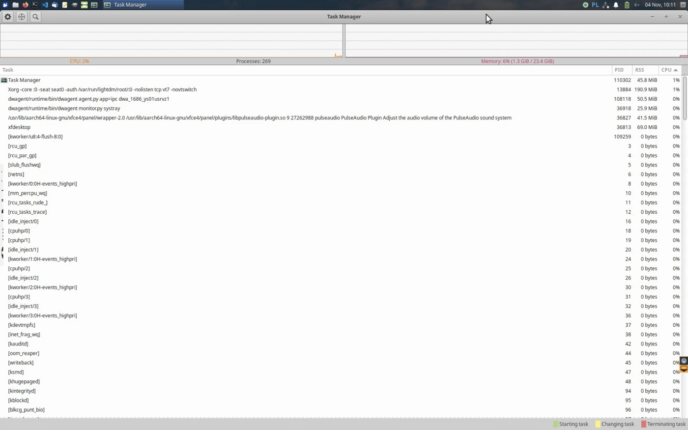

Spis treści:
* TOC
{:toc}

Czy uwierzył(a)byś, gdybym Ci powiedział, że możesz mieć w pełni funkcjonalny komputer w przeglądarce? Zawsze przy sobie, jedyne czego potrzebujesz to dowolne urządzenie z dostępem do internetu, i co najciekawsze - za darmo. Brzmi mało prawdopodobnie, prawda? A jednak jest to możliwe i w tym wpisie opiszę jak w prosty sposób można sobie sprawić taką zabawkę!

## 1\. Darmowy VPS od Oracle

Pierwszym krokiem jest pozyskanie w pełni darmowej _maszyny wirtualnej_ (_VPS_) od _Oracle_. Cały proces krok po kroku i z obrazkami opisałem w [tym wpisie](https://blog.tomaszdunia.pl/oracle-free-tier/). Przypomnę jedynie, że jest to maszyna o następujących parametrach:

- 4x _OCPU_ (procesor _Ampere A1_ w architekturze _ARM_) - można to porównać do **procesora 4-rdzeniowego**

- **24GB _RAM_** (pamięć operacyjna)

- **200GB** pamięci na dane (dysk)

Jak widać są to parametry odpowiadające całkiem niezłemu komputerowi. Myślę, że wiele osób ma laptopy o znacznie gorszych parametrach.

## 2\. Instalacja interfejsu graficznego

Tak utworzony _VPS_ ma w standardzie jedynie interfejs tekstowy i o ile do zastosowań serwerowych jest to normalne, a nawet wskazane, tak dla nas jest to sytuacja niepożądana, bo my chcemy _normalny_ komputer. Ja na swoim _VPS_ od _Oracle_ preinstalowałem system _Ubuntu 22.04_ (system wybiera się podczas tworzenia _Instancji_) i postawiłem na interfejs _[XFCE](https://www.xfce.org/)_, który lubię za prostotę i jego największą zaletę jaką jest lekkość, tj. nie wykorzystuje on dużo zasobów sprzętowych urządzenia. Pokażę instalację właśnie dla takiej konfiguracji, ale każdy może wybrać coś innego, w zależności od preferencji, a proces będzie wyglądał analogicznie.

Zacznijmy od połączenia się do serwera poprzez _SSH_. Ten proces opisałem we wpisach:

- [Darmowy VPS z 4 OCPU, 24GB RAMu i dyskiem 200GB](https://blog.tomaszdunia.pl/oracle-free-tier/)

- [Serwer domowy – podstawowa konfiguracja](https://blog.tomaszdunia.pl/serwer-domowy-podstawowa-konfiguracja/)

Pierwsze co musimy zrobić po uzyskaniu dostępu do przejście na użytkownika _root_:

```bash
sudo su
```

i zmienić hasła dla użytkowników _root_ i _ubuntu_, a raczej je ustawić, bo domyślnie obaj ci użytkownicy nie posiadają haseł.

```bash
passwd
   [dwa razy podać hasło dla roota]
passwd ubuntu
   [dwa razy podać hasło dla użytkownika ubuntu]
```

Następnie instalujemy pakiet _tasksel_, który służy do instalowania gotowych pakietów, takich jak między innymi interfejsy graficzne.

```bash
apt install tasksel -y
```

Teraz zalecana jest aktualizacja wszystkich pakietów znajdujących się na serwerze. Polecam do tego skorzystać z mojego gotowe skryptu, o którym pisałem w [tym wpisie](https://blog.tomaszdunia.pl/serwer-domowy-podstawowa-konfiguracja/). Jeżeli jednak nie chce Ci się bawić w żadne skrypty automatyzujące to wystarczy, że wykonasz te podstawowe polecenia:

```bash
apt update
apt upgrade -y
```

To może niestety chwilę potrwać, dlatego lepiej uzbroić się w cierpliwość. Gdy proces aktualizacji zostanie zakończony, możemy przejść do części właściwej, czyli instalacji interfejsu graficznego, który nazywany jest również środowiskiem desktopowym. Jak wspomniałem wcześniej, używam _Ubuntu_ i mój wybór padł na _XFCE_, więc zainstaluje pakiet o nazwie _xubuntu-desktop_. Innymi opcjami mogą tutaj być środowiska takie jak _[GNOME](https://www.gnome.org/)_ czy _[KDE](https://kde.org)_.

```bash
apt install xubuntu-desktop -y
```

Znowu trzeba się przygotować na chwilę oczekiwania, jednakże tym razem nie możemy całkowicie opuścić stanowiska pracy, bo podczas instalacji wymagana będzie interakcja. Instalator poprosi nas o wybór _Display Manager'a_, tj. programu, którego zadaniem jest zarządzanie interfejsem logowania. Ja zawsze wybieram _lightdm_, czyli opcję, która powinna być jako druga na liście pod _gdm3_. Od teraz aż do końca instalacji nie powinno być już konieczności robienia czegokolwiek, więc śmiało można pójść i zrobić sobie kawę.

## 3\. Pulpit zdalny

Mamy _VPSa_ z zainstalowanym interfejsem graficznym, który tylko czeka, aby się do niego podłączyć. W jaki sposób to zrobić? Tutaj podejść może być wiele. Można skorzystać z rozwiązań takich jak _Team Viewer_, _AnyDesk_ lub dowolny program działający w oparciu o protokół _VNC_, czy nawet _RDP_ (_Microsoft Remote Desktop_). Jednakże w tytule i wstępie tego wpisu obiecałem, że będzie to rozwiązanie, do którego pracy będziemy potrzebować jedynie przeglądarki. Takim rozwiązaniem jest już wcześniej przeze mnie opisywany [_DWService_](https://blog.tomaszdunia.pl/dwservice/). Nie będę powtarzał tego jak założyć konto w tym serwisie, zainstalować agenta czy połączyć się z nim, bo to wszystko już opisałem w podlinkowanym wyżej wpisie.

## Efekt końcowy

Skutkiem powyższych działań jest posiadanie komputera, który:

- jest **darmowym** _VPSem_ od _Oracle_,

- działa **24/7**,

- **nie zżera naszego domowego prądu**,

- jest dla nas **dostępny przy użyciu dowolnego komputera** z dostępem do internetu i przeglądarką,

- ma całkiem **mocne parametry**, które pozwolą na normalną pracę i wielozadaniowość

- ma zainstalowany **pełnoprawny system operacyjny** (_Linux_),

- może być **jednocześnie serwerem** do uruchamiania usług/narzędzi w tle,

- jest **bezpieczny**, bo z jednej strony zabezpiecza nas _Oracle_, a z drugiej łączymy się do niego przez narzędzie, które nie wymaga otwierania na świat żadnych dodatkowych portów i może być zabezpieczony przy użyciu uwierzytelnienia dwuskładnikowego, a komunikacja z nim przebiega po _HTTPS_,

- ma **200GB pamięci na dane** do wykorzystania.

Czego chcieć więcej? Zobacz jeszcze jak to wygląda w praktyce na zrzutach ekranu, które sam zrobiłem na potrzeby tego wpisu.


    

    

    

    

    

Na potwierdzenie, że _XFCE_ jest bardzo oszczędnym środowiskiem, mam jeszcze zrzut ekranu z menedżera zadań, który pokazuje jakie jest aktualne wykorzystanie zasobów. W trybie _idle_ (maszyna jest włączona i nie robi nic spektakularnego poza podstawowymi rzeczami) zużycie procesora zostało obliczone na 2%, a pamięci operacyjnej _RAM_ na 1.3GB z 24GB (6%). Pozostały nadmiar zasobów można wykorzystać do uruchamiania tego czego się potrzebuje lub ma się ochotę uruchomić.


