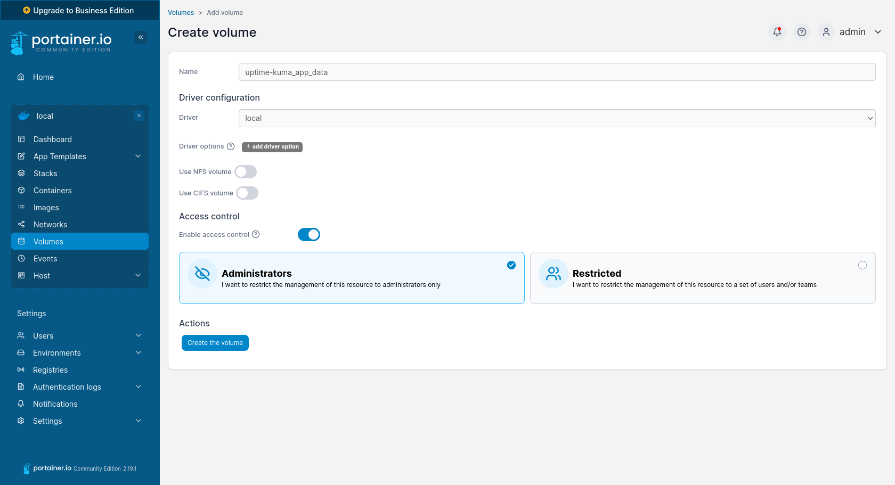
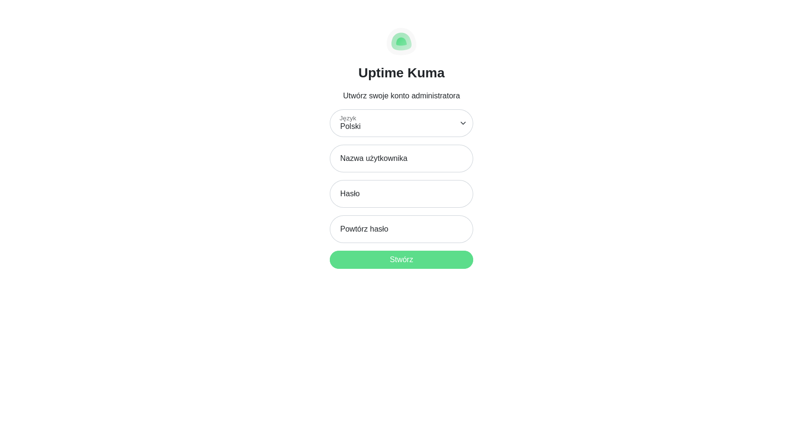
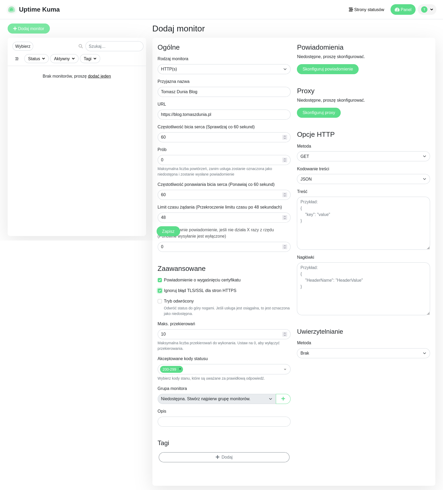
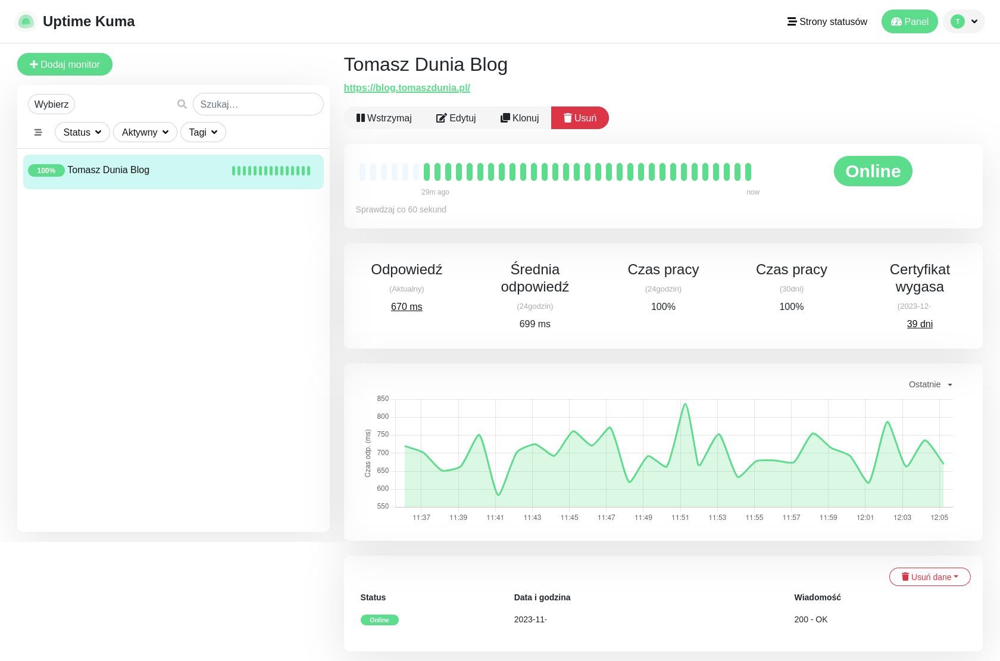
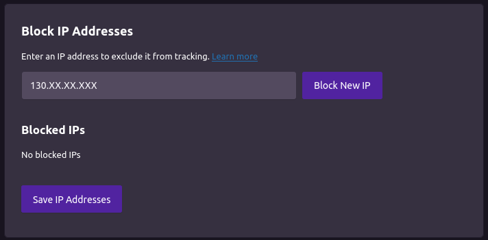

Spis treści:
* TOC
{:toc}

W tytule chciałem ująć to krótko, więc użyłem słowa _usług_, co w tym miejscu chciałbym rozszerzyć jako strony, aplikacje i serwery, a w zasadzie praktycznie wszystko co jest dostępne w sieci i może z jakiegoś powodu nie działać. Do monitorowania właśnie tych rzeczy służy narzędzie _[Uptime Kuma](https://github.com/louislam/uptime-kuma)_. Jest to rozwiązanie _self-hosted_, które jest szalenie proste w uruchomieniu i późniejszej obsłudze, a przy tym niezmiernie funkcjonalne.

## Jak uruchomić Uptime Kuma

Uruchomienie _Uptime Kuma_ na swoim serwerze jest możliwe na wiele sposobów. Jednym z nich jest dostępność tego narządzia w [bibliotece aplikacji](https://github.com/YunoHost-Apps/uptime-kuma_ynh) _[Yunohost](https://blog.tomaszdunia.pl/yunohost-oracle/)_. W tym wpisie pokaże jednak jak uruchomić to narzędzie jako kontener _[Docker'a](https://blog.tomaszdunia.pl/docker/)_, a konkretnie wykorzystam do tego ostatnio opisany przeze mnie _[Portainer](https://blog.tomaszdunia.pl/portainer/)_.

W pierwszej kolejności należy utworzyć wymagany wolumen. W dokumentacji _Uptime Kuma_ podane jest, że trzeba podmontować ścieżkę _/app/data_. Dlatego utwórzmy wolumen o nazwie _uptime-kuma\_app\_data_.



Możemy przejść do tworzenia kontenera:

- _Name_ - _Uptime-kuma_

- _Image_ - _[louislam/uptime-kuma:latest](https://hub.docker.com/r/louislam/uptime-kuma)_

- _Manual network port publishing_ (_host_ -> _container_):
    - _3001_ -> _3001_

- _Volumes_ (_container_ -> _volume_):
    - _/app/data_ -> _uptime-kuma\_app\_data - local_

- _Restart policy_ - _Unless stopped_

Wszystkie te ustawienia potwierdzamy przyciskiem _Deploy the container_. Jak ktoś nie lubi _Portainer'a_ to identyczny skutek osiągnąć można stosując poniższe komendy:

```bash
docker volume create uptime-kuma_app_data
```

```bash
docker run -d \
-p 3001:3001 \
-v uptime-kuma_app_data:/app/data \
--name Uptime-kuma \
--restart unless-stopped \
louislam/uptime-kuma:latest
```

Tak uruchomiona usługa dostępna będzie pod adresem:

> http://localhost:3001

Po wejściu na podany adres przywita nas standardowy instalator, w którym musimy określić język w jakim chcemy widzieć interfejs, nazwę i hasło dla administratora.



## Podstawowa obsługa

Cała zasada działania usługi _Uptime Kuma_ polega na tworzeniu monitorów, których zadaniem jest cykliczne badanie czy wskazana usługa, aplikacja, serwer czy nawet kontener Docker'a pracuje prawidłowo, tj. działa czy też jak kto woli - żyje. Jest to idea zarówno prosta jak i szalenie funkcjonalna. Stworzę zatem taki przykładowy monitor, aby pokazać jak to działa.

Najbardziej podstawowa funkcja jaka przyszła mi do głowy to utworzenie monitora, który będzie sprawdzał czy mój blog działa i ma się dobrze. Naciskamy przycisk _Dodaj monitor_ i następnie w wyświetlonym kreatorze wybieramy _Rodzaj monitora_ jako _HTTP(s)_, nadajemy mu nazwę np. _Tomasz Dunia Blog_ i wprowadzamy URL _https://blog.tomaszdunia.pl_, a resztę parametrów możemy zostawić jako domyślne. Chęć utworzenia monitora potwierdzamy przyciskiem _Zapisz_.



Tak utworzony monitor wykonuje bardzo proste zadanie. W interwale co 60 sekund odwiedza podany adres strony i pobiera nagłówek _HTTP_, w którym znajduje się kod statusu. Otrzymanie kodu zawierającego się w zakresie 200-299 oznacza, że strona działa prawidłowo. Ten fakt jest zapisywany w bazie danych i monitor czeka kolejne 60 sekund, aby znowu powtórzyć analogiczne działanie i tak w kółko. Zebrane dane prezentowane są w sposób pokazany na poniższym zrzucie ekranu.



Jak widać podstawowa informacja to aktualny status strony oraz pasek pokazujący zielone kreski (lub czerwone, gdy występowały jakieś przerwy w działaniu) informujące o wcześniejszych statusach. Do tego liczona i agregowana jest długość odpowiedzi strony (wraz z wykresem jak kształtował się w poprzednich iteracjach) oraz wyliczany jest średni czas pracy.

Oczywiście pokazałem jedynie podstawowe, najprostsze zastosowanie. _Uptime Kuma_ pozwala na wiele więcej. Można na przykład:

- zmienić częstotliwość sprawdzania,

- zmienić ilość prób jakie mają być podjęte przed uznaniem porażki,

- określić czas żądania, po którym uznajemy, że już nie otrzymamy odpowiedzi i przestajemy na nią czekać,

- włączyć powiadomienia informujące o tym, że monitorowana usługa nie działa, co możemy zrealizować przez ogromną ilość obsługiwanych przez _Uptime Kuma_ sposobów, jak np. wysyłanie powiadomień na telefon przez aplikacje do tego służące czy też chociażby komunikatory jak _Telegram_, _Discord_ czy _Signal_,

- określić proxy przez które mają być wysyłane zapytania,

- określić metodę, a może raczej typ, zapytania jakie ma zostać wysłane, kodowanie treści, treść i nagłówek zapytania,

- określić metodę uwierzytelnienia jakie ma zostać wykorzystane, aby uzyskać dostęp do monitorowanego zasobu,

- poprosić o sprawdzenie czy certyfikat _SSL_ jest aktualny,

- określić ile maksymalnie przekierowań jest dozwolonych (szczególnie istotne, gdy sprawdzamy strony, które przed wyświetleniem swojej zawartości przepuszczają nas przez niezłą pętlę przekierowań),

- określić akceptowalny kody statusu (nie musi to być zakres 200-299),

- grupować monitory,

- tworzyć opisy monitorów,

- dodawać tagi dla monitorów.

Jest trochę tych ustawień zaawansowanych, prawda? A wymieniłem tylko te dostępne dla rodzaju monitora _HTTP(s)_. Tych rodzajów jest o wiele więcej, ale nie będę ich wszystkich tutaj omawiał.

## Podpowiedź na koniec

_Uptime Kuma_ to niewątpliwie bardzo przydatne narzędzie! Jednakże ma jedną zasadniczą wadę. Jeżeli na swojej stronie prowadzisz statystyki odwiedzin to przez monitorowanie mogą one zostać zaburzone. Jak to? Zobacz, że domyślny monitor realizuje swoją pracę, poprzez odwiedzanie strony, dokładnie co 60 sekund. To aż 60 razy na godzinę i 1440 razy na dobę. Każde takie działanie wygląda i jest kalkulowane w statystykach jak normalne odwiedziny strony, np. przez czytelnika bloga. Na bardzo popularnych stronach to może być w ogóle niezauważalna kropla w morzu, ale na takich niszowych jak mój blog stanowiłoby to sporą część zliczonych odwiedzin. Pocieszające jest to, że w większości przypadków da się temu zaradzić! Ja na swoim blogu jako wtyczkę od statystyk wykorzystuję _[Independent Analytics](https://independentwp.com/)_. To dlaczego wybrałem tę konkretną wtyczkę opisałem [tutaj](https://blog.tomaszdunia.pl/rodo-gdpr/). Piszę o tym dlatego, że ma ona specjalną opcję, dzięki której mogę wyłączyć odwiedziny z określonego adresu _IP_ ze statystyk. W praktyce powinno się tam podać adres _IP_ serwera, na którym uruchomiliśmy _Uptime Kuma_ i po sprawie. Wierzę, że inne narzędzia do prowadzenia statystyk również posiadają taką funkcję, której należy poszukać w ich ustawieniach. Istotne jest jedynie, aby wyłączyć (po ang. _exclude_) dany adres _IP_ ze statystyk, a nie całkowicie zablokować mu dostęp do strony, bo wtedy monitor _Uptime Kuma_ przestanie działać.


