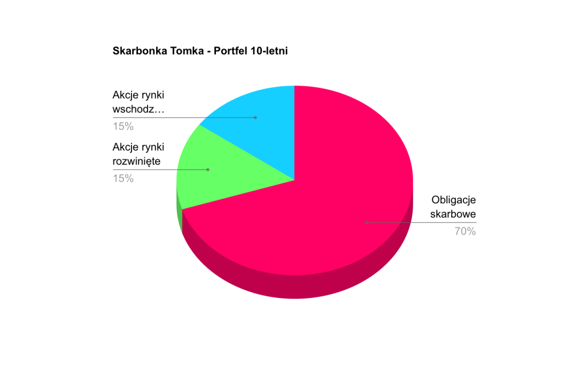
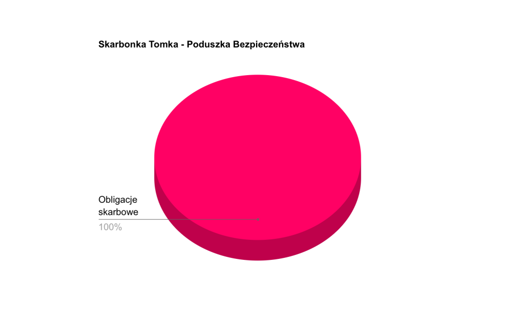
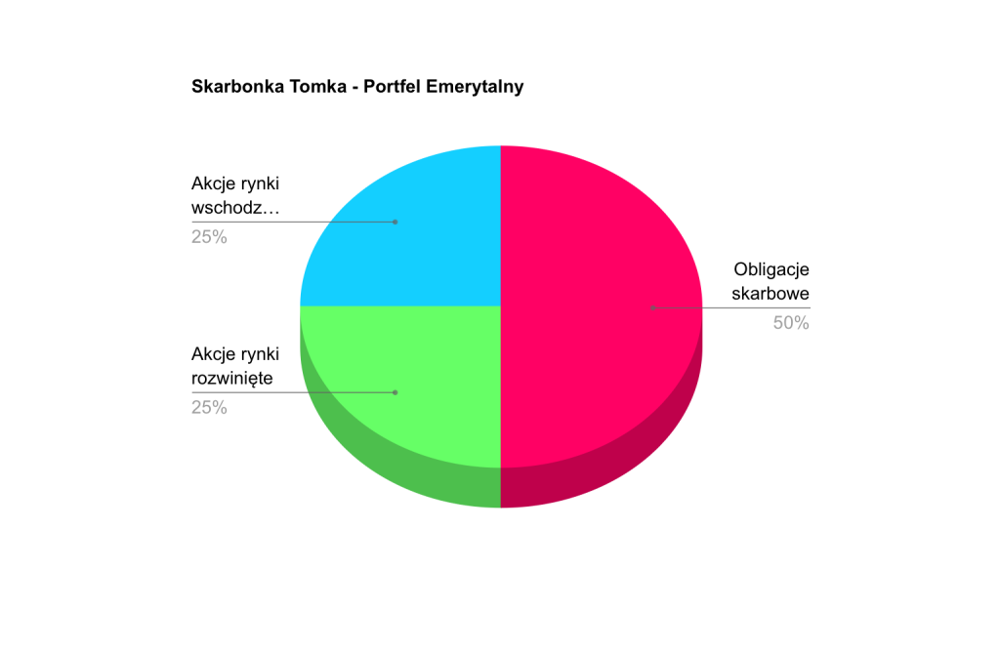

Spis treści:
* TOC
{:toc}

Oficjalnie stwierdzam, że stałem się Panem w średnim wieku... Ustatkowałem się, tj. mam żonę, doczekałem się potomstwa, kupiłem dom, nad karkiem wisi mi siekierka w postaci kredytu hipotecznego, nie jarają mnie już gierki, imprezy, ani szybkie samochody, a moje zainteresowanie skierowało się w kierunku... oszczędzania i pomnażania tych oszczędności. Jeżeli to czytasz i też tak masz to przybijam wirtualną pionę! Takie melancholijne przemyślenia, jak to powyżej, przekonały mnie do stworzenia nowego cyklu wpisów traktujących o tematyce szerokopojętych finansów, oszczędzania i inwestowania tych oszczędności. Czy mam w tym kierunku jakiekolwiek wykształcenie lub chociaż doświadczenie zawodowe? Jasne, że nie! Dlatego wpisy pod szyldem _Skarbonka Tomka_ można traktować bardziej jako odrady finansowe aniżeli porady.

## Skąd w ogóle ten pomysł?

Tak jak pisałem wcześniej, jestem aktualnie na takim etapie w życiu, w którym mam do podjęcia dość istotne decyzje. Kredyt hipoteczny i posiadanie dzieci zmusza człowieka do zastanowienia się co może przynieść przyszłość oraz przygotowania się na to w najlepszy możliwy sposób. Mając 32 lata w najlepszym wypadku zbliżam się nieuchronnie do połowy swojego życia, a w nieco gorszym już osiągnąłem ten poziom. Głębokie prawda? Ano głębokie, ale jakże prawdziwe. Wiek około 30 lat to idealny moment, żeby wziąć się w garść i nakreślić sobie sensowny plan dalszego działania. Okres na szaleństwa, życie na wariata zgodnie z filozofią _YOLO_ i rozpusta już się skończyły... a przynajmniej na razie, bo mam szczerą nadzieję, że ten klimat jeszcze wróci, gdy będę na emeryturze 😎 Jednakże, żeby starość była sielanką to już teraz muszę zacząć się zabezpieczać finansowo.

Wszystko zaczęło się od przypadkowego natrafienia na podcast i blog [_Finanse Bardzo Osobiste Marcina Iwucia_](https://marciniwuc.com/). Kiedy przeczytałem już wszystkie wpisy na blogu i przesłuchałem wszystkie odcinki podcastu, przyszła pora na zakup książki. Moja żona zawsze mówi, że kupowanie mi prezentów jest bardzo trudne, bo ja niczego nie potrzebuję, a jak potrzebuję to kupuję sobie to sam. Tym razem postanowiłem ułatwić jej sprawę i zasugerowałem, że mogłaby mi kupić pod choinkę książkę _[Finansowa Forteca](https://finansowaforteca.pl/)_, co też zrobiła. Przeczytałem ją od dechy do dechy w miesiąc i oto jestem! Nie twierdzę, że przeczytanie jednej książki i posłuchanie kilku odcinków podcastu robi ze mnie eksperta, ale na pewno poukładało mi to w głowie i już teraz wiem jakie działania chcę podjąć, aby zadbać o swoją przyszłość, a tutaj piszę o tym po to, żeby podzielić się choć trochę tą wiedzą lub komuś coś podpowiedzieć czy też nakierować w jakąś stronę.

## Nota prawna

Koniecznie się zapoznaj! - rozwiń aby zobaczyć zawartość

Opinie i informacje zawarte na tym blogu nie stanowią porady inwestycyjnej, a w szczególności "rekomendacji" w rozumieniu przepisów Rozporządzenia Ministra Finansów z dnia 19 października 2005 r. w sprawie informacji stanowiących rekomendacje dotyczące instrumentów finansowych, lub ich emitentów (Dz. U. z 2005 r. Nr 206, poz. 1715).

Celem tego typu wpisów jest opisanie moich przemyślenia na temat inwestowania i dzielenie się tym jak ja to robię i jaka jest moja strategia. Każdy ma inną sytuację finansową i inne skłonności do podejmowania ryzyka, a co za tym idzie inaczej zniesie poniesione straty, ale także uzyskane zyski. Dla niektórych często to drugie jest gorsze, bo jednorazowy złoty strzał (przypadek) może skłonić do zainwestowania jeszcze większej sumy pieniędzy, a nawet zadłużenia się w celu zwiększenia skali inwestycji, co przy mniejszym szczęściu niż za pierwszym razem może doprowadzić do bankructwa i popadnięcia w poważne kłopoty. Dlatego należy inwestować tylko posiadając odpowiednią do tego wiedzę i zrozumienie zagadnienia. Jeżeli nie rozumiesz tematu w pełni to nie inwestuj w dane aktywa do momentu zrozumienia zasady ich działania lub w ogóle przerzuć się na bardziej bezpieczne formy pomnażania swoich zaoszczędzonych pieniędzy.

## Strategia dopasowana do sytuacji - Portfel 10-letni

Każdy jest w innej sytuacji finansowej, ma inne priorytety, skłonność do podejmowania ryzyka i przede wszystkim inne cele i plan na ich osiągnięcie. Moja sytuacja jest taka, że właśnie zaciągnąłem kredyt hipoteczny na zakup domu, który formalnie będzie ze mną przez następnych 30 lat. Jednakże, jeszcze na długo przed podpisaniem cyrografu w banku, postanowiliśmy wraz z żoną, że zrobimy wszystko, aby spłacić go najpóźniej po 20 latach (lub oczywiście jeżeli będzie to możliwe to jeszcze wcześniej, lecz pozostańmy przy 20 latach). Planujemy to osiągnąć poprzez sumienne, comiesięczne odkładanie ustalonej sumy pieniędzy na poczet nadpłaty, której dokonamy po zakończeniu 10-letniego okresu objętego dopłatami z programu _Bezpieczny Kredyt 2%_, a która poskutkuje skróceniem okresu kredytowania z 360 do 240 miesięcy. Dlaczego akurat po 10 latach? Okres dopłat w programie _BK2_ trwa dokładnie tyle i przez ten okres wynikowe oprocentowanie naszego kredytu będzie wynosić ok. 2%. Jednakże po jego zakończeniu przechodzimy na oprocentowanie zmienne, które będzie wynosić _WIBOR_ (lub _WIRON_ jeżeli do tego czasu zostanie wprowadzony) + marża banku, która jest określana już w momencie podpisywania umowy i będzie dla nas wynosić 2.1%. Tak więc nawet jeżeli wskaźnik _WIBOR_ będzie wynosił 0% (co jest mało prawdopodobne) to i tak oprocentowanie nam wzrośnie. Ze względu na to wszystko naszym planem jest nadpłacić i zmniejszyć kapitał pozostały do spłaty, co poskutkuje tym, że to większe oprocentowanie będzie liczone od mniejszej kwoty pozostałej do zwrotu bankowi, a więc będzie odpowiednio mniejsze.

Strategia polega nie tylko na odkładaniu, ale także pomnażaniu zebranej sumy przez okres tych 10 lat. Z wyliczeń wyszło mi, że aby zrealizować nasz plan potrzebujemy przez 10 lat, czyli 120 miesięcy, odkładać równo 1000 zł i tym samym zebrać sumę w wysokości 120 tysięcy złotych, a wszystko to co uda nam się wypracować ponad tę kwotę będzie bardzo miłym dodatkiem. Wydaje mi się, że przyjąłem przy tym dość realny cel inwestycyjny, który zakłada, że mój portfel będzie osiągał zyski przebijające inflację o 3%. Nie da się przewidzieć jaka będzie inflacja w najbliższych miesiącach, a co powiedzieć latach, więc czysto teoretycznie przyjmijmy, że przez okres 10 lat będzie ona wynosiła średnio 2.5%, czyli pułap, do którego powinien dążyć _NBP_ (_Narodowy Bank Polski_). W takim przypadku modelowy portfel, czyli taki będący odzwierciedleniem moich założeń, powinien w 10 lat osiągnąć wartość ok. 150 tysięcy złotych.

Podsumowując, możemy przyjąć następujące **założenia dla _Portfela 10-letniego_**:

- Cel - pozbyć się kredytu hipotecznego o 10 lat wcześniej.

- Czas na realizację tego celu - 10 lat.

- Sposób realizacji - nadpłata kredytu przy użyciu oszczędności skumulowanych przez ten okres oraz pomnożonych poprzez inwestowanie.

- Kwota niezbędna do osiągnięcia celu - 120 000 zł.

- Sposób na zebranie tej kwoty - odkładanie 1000 zł miesięcznie przez 120 miesięcy (10 lat).

- Oczekiwany (modelowy) zysk - 3% ponad inflację.

- Prognozowany końcowy rezultat - zebranie 150 000 zł przy założeniu średniej inflacji na poziomie 2.5%.

- Prawdopodobieństwo osiągnięcia celu - myślę, że spore.

To jak będę inwestował w ramach tego portfela pewnie będzie się zmieniać, bo 10-letniego portfela raczej nie można nazwać długoterminowym, a więc raczej nie sprawdzi się tutaj metoda ustalenia stałych wag poszczególnych aktywów i trzymanie się tego w oczekiwaniu na to, że rynki są cykliczne i prędzej czy później każde aktywo trafi na górkę. Sposób inwestowania muszę zoptymalizować tak, aby dokładnie po tych 10 latach mieć skumulowane maksymalnie dużo środków, które wycofam i nadpłacę nimi kredyt hipoteczny poprzez jednorazowy strzał wykonany dokładnie pomiędzy 120 a 121 ratą mojego kredytu. Wydaje mi się, że na początku będę korzystał z tego, że można jeszcze dorwać wysoko oprocentowane obligacje, co zapewne niedługo będzie już nieaktualne, bo inflacja ewidentnie leci w dół. Toteż wpompuję w obligacje tyle ile będzie się dało, póki są dobre, a potem zobaczę. Myślę, że finalny portfel modelowy, czyli ten do którego będę dążył, **będzie się składał w 70% z obligacji, w 15% z akcji światowych rynków rozwiniętych i w 15% z akcji światowych rynków wschodzących**.

## Poduszka Bezpieczeństwa

Z książki _Finansowa Forteca_ dowiedziałem się, że poza głównym portfelem inwestycyjnym potrzebuję również, a może wręcz w pierwszej kolejności, czegoś co zabezpieczy mnie i moją rodzinę na wypadek wystąpienia nieprzewidzianych zdarzeń. _Marcin Iwuć_ (autor książki) bardzo trafnie nazwał taki kapitał _Poduszką Bezpieczeństwa_. Taka poduszka bezpieczeństwa to nic innego jak pewna suma pieniędzy stanowiąca rezerwę, której używamy tylko w naprawdę kryzysowych przypadkach. Można ją inwestować, ale w sposób nakierowany na utrzymanie jej wartości oraz ograniczone ryzyko utraty. Do tego dostęp do tych pieniędzy powinien być niemalże natychmiastowy, więc nie lokujemy ich w aktywach, których upłynnienie będzie trudne lub wymagające czasu. Niektórzy założą, że musi być to maksymalnie 1-2 dni, ale ja przyjąłem, że akceptowalnym dla mnie czasem na uzyskanie dostępu do całej wartości poduszki bezpieczeństwa będzie 5 dni. To pozwala mi na ulokowanie całej wartości mojej _Poduszki Bezpieczeństwa_ w obligacjach skarbowych, nawet tych długoterminowych, ale o tym w innym wpisie poświęconym obligacjom.

No dobrze, ale jakiej wielkości powinna być taka poduszka bezpieczeństwa? To jest sprawa totalnie indywidualna. Każdy musi sobie określić jaka kwota odłożona na czarną godzinę da mu spokój ducha. Dla jednych będzie to 5 000 zł, a dla innych 50 000 zł. Ja założyłem, że potrzebuję zabezpieczenia w wysokości ok. 30 000 zł, co powinno pozwolić mi przetrwać nawet 6 trudnych miesięcy, gdyż przyjąłem, że fundamentalne koszty miesięczne jakie ponoszę to ok. 5 000 zł.

Podsumujmy sobie teraz **założenia dotyczące _Poduszki Bezpieczeństwa_**:

- Cel - ma być zabezpieczeniem pozwalającym na przetrwanie 6 miesięcy w przypadku trudnej sytuacji.

- Wysokość - ok. 30 000 zł, która może być w przyszłości modyfikowana.

- Dostęp - ma być lekko utrudniony, żeby nie korciło ruszać tych pieniędzy poza sytuacjami awaryjnymi, ale w nagłych przypadkach możliwie jak najszybszy, nie dłuższy niż 5 dni.

- Zabezpieczenie przed utratą wartości na skutek inflacji, tj. zamiast odkładać na nieoprocentowane konto lub do skarpety należy inwestować tak, żeby wartość szła przynajmniej równo z inflacją.

- Inwestować w sposób bezpieczny, tj. zminimalizować do minimum ryzyko całkowitej utraty tych środków lub nawet większych spadków wartości.

Wiemy już jakie są podstawowe zadania _Poduszki Bezpieczeństwa_, jaki musi być do niej dostęp i jaka powinna być jej wielkość, więc teraz trzeba się zastanowić w jakiej formie ją przechowywać. _Marcin Iwuć_ w swojej książce sugeruje ulokować 25% tej sumy w lokaty i/lub konta oszczędnościowe, a 75% w obligacje skarbowe indeksowane inflacją. Ja jednak nienawidzę produktów finansowych jakimi są konta oszczędnościowe, a lokaty nigdy nie pozwolą nawet dogonić inflacji, a co powiedzieć o przegonieniu jej. Rozumiem podejście o lokowaniu 25% wartości poduszki bezpieczeństwa w te formy inwestowania, bo pozwalają one na bardzo szybkie wycofanie i dostęp do tych pieniędzy. Jednakże pamiętajmy, że ma to również taki minus, że o ile lokatę można zerwać w każdym momencie to niestety wiąże się to z utratą wszystkich wypracowanych do tej pory odsetek (w teorii nie całkowicie wszystkich, bo oprocentowanie spada np. do 0.1% i jakieś tam odsetki będą, ale to grosze, więc nie warto w ogóle brać tego pod uwagę). Przy obligacjach jest nieco inaczej, bo może i nie wyciągnie się z nich pieniędzy w 1-2 dni, a bardziej w 5-7, ale przy wcześniejszym wykupie obligacji tracimy jedynie ustaloną w liście emisyjnym kwotę, np. 0.7-2 zł od każdego 100-złotowej obligacji, ale wszystkie wypracowane zyski do momentu wcześniejszego zakończenia są nam wypłacane. Dlatego ja **całą swoją _Poduszkę Bezpieczeństwa_ zamierzam trzymać w obligacjach skarbowych indeksowanych inflacją**.

## Portfel emerytalny

Poza _Portfelem 10-letnim_ i _Poduszką Bezpieczeństwa_ postanowiłem prowadzić jeszcze trzeci, który roboczo nazwałem _Portfelem Emerytalnym_. Moje zdanie o emeryturze z _ZUS_ dla mojego pokolenia przedstawiłem już we wpisie [_Plan na emeryturę – PPK, PPE, IKE i IKZE (cz. 1)_](https://blog.tomaszdunia.pl/emerytura1/), a konkretnie w podrozdziale _Polski system emerytalny_. W skrócie, patrząc na obecną demografię i system podatkowy w Polsce nie wierzę, że będę mógł liczyć na świadczenia emerytalne, które pozwolą mi na godne życie w sędziwym wieku, nawet pomimo tego, że pracuję w oparciu o umowę o pracę i odprowadzam całkiem duże składki. Dlatego już teraz muszę zacząć działać i odkładać pieniądze, które będę przepalał po 65. roku życia.

**Założenia _Portfela Emerytalnego_**:

- Cel - zapewnienie sobie godnego życia na emeryturze.

- Czas na realizację - do osiągnięcia 65. roku życia i odejścia na emeryturę, czyli licząc od teraz 33 lata.

- Sposób realizacji - regularne, comiesięczne odkładanie pewnej sumy pieniędzy, która przez lata będzie pomnażana i dzięki procentowi składanemu po latach pozwoli na uzbieranie całkiem niezłej sumki.

- Oczekiwany zysk - inflacja + 5%.

- Dostęp - awaryjnie przed 65. rokiem życia, ale modelowo nie wcześniej.

Ten portfel będzie z założenia nieco bardziej agresywnym jako, że mam jeszcze trochę czasu do osiągnięcia 65. roku życia i mogę trochę poeksperymentować. Jest to znana taktyka, która zakłada dobieranie poziomu ryzyka w zależności od tego ile ma się lat. System ten zakłada, że 20-latek powinien inwestować jedynie 20% swoich oszczędności w aktywa uznawane za bezpieczne (np. obligacje, lokaty czy złoto), a aż 80% w aktywa o znacznie większym poziomie ryzyka (np. akcje, surowce czy waluty). Analogicznie dla 80-latka ta proporcja była by odwrotna, tj. 80% bezpiecznie, a 20% ryzykowanie. Przyjmując takie założenia dopiero 100-latek powinien przerzucić wszystko w obligacje. Ja oczywiście nie zamierzam być aż tak szalony i postanowiłem podzielić ten portfel 50/50. 50% jego wartości mają stanowić obligacje skarbowe ubrane w parasol podatkowy jakim jest [_IKE_ (o którym pisałem już wcześniej)](https://blog.tomaszdunia.pl/emerytura2/), a druga połowa będzie ulokowana w akcjach w sposób możliwie jak najbardziej zdywersyfikowany. Ten temat na pewno rozszerzę jeszcze w jednym z następnych wpisów, które mam w planach. Tak więc modelowy **skład _Portfela Emerytalnego_ widzę tak - 50% obligacje skarbowe, 25% akcje światowych rynków rozwiniętych, 25% akcje światowych rynków wschodzących**.

## Czy to dobry plan?

Co myślisz o moich planach inwestycyjnych? Z wielką przyjemnością przeczytałbym opinie bardziej doświadczonych w tej tematyce. Natomiast jeżeli są jakieś pytania to równie chętnie na nie odpowiem, oczywiście w miarę moich możliwości. W następnych wpisach zamierzam poruszyć głębiej tematy obligacji skarbowych, inwestowania w akcje poprzez zakup _ETF’ów_ oraz fundusze indeksowe, a także może napiszę kilka słów o złocie. Reszta aktywów nie leży w obszarze moich zainteresowań, więc na ten moment nie przewiduje pisania o nich.
