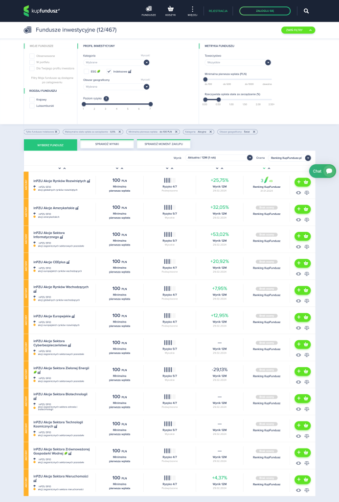

Spis treści:
* TOC
{:toc}

W poprzednim wpisie z serii _[Skarbonka Tomka](https://blog.tomaszdunia.pl/tag/skarbonkatomka/)_ pisałem o [obligacjach, w szczególności tych skarbowych](https://blog.tomaszdunia.pl/skarbonka-tomka-obligacje-skarbowe/), które są filarem mojego inwestowania. W ramach tego wpisu skupię się na akcjach, które również goszczą w moich portfelach i stanowią tą mniej stabilną, ale potencjalnie bardziej dochodową część. Od razu na wstępie chciałbym zaznaczyć, że nie będę niżej pisał o takim hardcore'owym inwestowaniu w akcje, które zakłada siedzenie w każdej wolnej chwili na stronach z wykresami, analizowanie zachowań rynku, kondycji spółek i ciągłe zlecanie dyspozycji zakupu i sprzedaży. Omówię tutaj moją strategię, która jest bardzo pasywna.

## Nota prawna

Koniecznie się zapoznaj! - rozwiń aby zobaczyć zawartość

Opinie i informacje zawarte na tym blogu nie stanowią porady inwestycyjnej, a w szczególności "rekomendacji" w rozumieniu przepisów Rozporządzenia Ministra Finansów z dnia 19 października 2005 r. w sprawie informacji stanowiących rekomendacje dotyczące instrumentów finansowych, lub ich emitentów (Dz. U. z 2005 r. Nr 206, poz. 1715).

Celem tego typu wpisów jest opisanie moich przemyślenia na temat inwestowania i dzielenie się tym jak ja to robię i jaka jest moja strategia. Każdy ma inną sytuację finansową i inne skłonności do podejmowania ryzyka, a co za tym idzie inaczej zniesie poniesione straty, ale także uzyskane zyski. Dla niektórych często to drugie jest gorsze, bo jednorazowy złoty strzał (przypadek) może skłonić do zainwestowania jeszcze większej sumy pieniędzy, a nawet zadłużenia się w celu zwiększenia skali inwestycji, co przy mniejszym szczęściu niż za pierwszym razem może doprowadzić do bankructwa i popadnięcia w poważne kłopoty. Dlatego należy inwestować tylko posiadając odpowiednią do tego wiedzę i zrozumienie zagadnienia. Jeżeli nie rozumiesz tematu w pełni to nie inwestuj w dane aktywa do momentu zrozumienia zasady ich działania lub w ogóle przerzuć się na bardziej bezpieczne formy pomnażania swoich zaoszczędzonych pieniędzy.

## Moja strategia dotycząca akcji

Jakbym miał w trzech słowach scharakteryzować mój plan na inwestowanie w akcje to użyłbym - _dywersyfikacja_, _pasywność_ i _dyscyplina_. Poprzez **_dywersyfikację_** rozumiem rozproszenie kapitału, które ma zmniejszyć ryzyko i tym samym zoptymalizować zyski. Realizuję to poprzez inwestowanie w wiele spółek z całego świata, a konkretnie w aktywa takie jak _ETF'y_ (spokojnie w dalszej części wpisu będę próbował wyjaśnić co to jest) i _fundusze indeksowe_, która podążają za globalnymi _indeksami giełdowymi_. Z **_pasywnością_** chodzi o to, że na inwestowanie zamierzam poświęcać możliwie jak najmniej czasu, tj. nie analizować, spekulować czy kombinować co i czy uda mi się kupić w dołku a sprzedać na górce, bo takim ludziom jak ja, z podstawową wiedzą i niewielkim doświadczeniem w zakresie finansów, nigdy nie wychodzi to na dobre. Na koniec **_dyscyplina_**, czyli określenie sobie konkretnych zasad i trzymanie się ich bez względu na to co dzieje się na rynku i jak reaguje na to moja psychika. Najlepszym remedium na panikę jest posiadanie jasnego i sensownego planu, którego trzeba się trzymać bez względu na wszystko. Najwygodniej będzie mi to przedstawić na przykładzie.

Zakładam, że 25% mojego portfela będę trzymał w akcjach rynków rozwiniętych i 25% w akcjach rynków wschodzących. Do tego każdego 20. dnia miesiąca będę wpłacał do portfela 1 000 zł, które będę dystrybuował tak, aby po zakupie nowych aktywów być jak najbliżej założonych modelowo proporcji portfela. Chodzi w tym o to, że jeżeli w ostatnim miesiącu, któreś aktywo poszło w górę i stanowi teraz 30% całkowitej wartości portfela zamiast modelowego 25%, a drugie spadło i stanowi 20% zamiast 25%, to powinienem dokupić odpowiednio więcej tego, którego wartość spadła i w miarę możliwości, tj. jeżeli wystarczy mi na to wpłacone w danym miesiącu 1 000 zł, przywrócić modelową równowagę części portfela. Nazywa się to _**rebalancing**'iem_. Przyjmuję taką zasadę, że staram się robić dwa rodzaje _rebalancing'u_. Pierwszy to **comiesięczny**, który opisałem wyżej, a drugi to **kwartalny**, który jest potrzebny tylko jeżeli proporcje pomiędzy częściami mojego portfela rozjechały się na tyle, że nie jestem w stanie ich wyrównoważyć przy użyciu miesięcznych wpłat i dokupowania aktywów, których mam za mało. Po prostu raz na 3 miesiące siadam do arkusza kalkulacyjnego, podliczam wartości wszystkich aktywów i obliczam jaką część sumy zainwestowanego kapitału stanowią. Jeżeli ich waga nie mieści się w zakresie +/- 3% założonej wartości modelowej to dokonuję _rebalancing'u_ sprzedając aktywa, których mam za dużo i za uzyskaną w ten sposób sumę dokupuję brakujących. Jaki to w ogóle ma sens? Na pierwszy rzut oka wygląda to tak jakbym wyprzedawał aktywa, które znoszą mi złote jaja, a w ich miejsce kupował te znoszące cuchnące zbuki. Myślę, że nie jedna osoba dokładnie tak to postrzega. Ja jednak patrzę na to w inny sposób. Rynki są cykliczne i wszystkie aktywa wpadają w dołki tylko po to, żeby za chwilę odbić. Próbowanie przewidzenia kiedy jest dołek (dolina _bessy_), a kiedy górka (szczyt _hossy_) to nic innego jak **spekulacja, którą można porównać nawet do hazardu**. _Rebalancing_ jest swego rodzaju systemem, który sprawia, że **sprzedaję drogie aktywa, a kupuję tanie**, a gdy przejdziemy przez cały cykl okaże się, że za jakiś czas to co dopiero kupowałem, bo taniało, trzeba będzie sprzedawać, bo rośnie nieproporcjonalnie do pozostałych aktywów w moim portfelu, które powinienem dokupić. Ekstra dodatkiem do tego wszystkiego jest to, że przez przywracanie odpowiednich proporcji w portfelu **przywracam też poziom ryzyka do założonego poziomu**. Załóżmy, że mój portfel to w 50% bezpieczne obligacje i w 50% akcje, który stanowią ten bardziej ryzykowny człon. Gdy obligacje powoli rosną, a akcje wystrzelą może się zdarzyć sytuacja, w której będę miał 40% obligacji i 60% akcji, co ewidentnie przekłada się na to, że portfel jest bardziej ryzykowny, bo większy kapitał spoczywa w bardziej ryzykownych aktywach.

Reasumując:

- **_dywersyfikacja_** - wolę postawić na wiele aktywów na różnych rynkach i wyliczać z nich średnią niż postawić wszystko na jedną kartę i liczyć, że nie stracę całego kapitału w jednym momencie,

- **_pasywność_** - dobrze zainwestowane pieniądze to takie, które pracują same na siebie i nie trzeba ich co chwilę doglądać,

- **_dyscyplina_** - ustalenie prostych zasad i przestrzeganie ich.

Powyższa strategia wynika w głównej mierze z przesłania płynącego z książki _[Finansowa Forteca Marcina Iwucia](https://finansowaforteca.pl/)_. Reklamowałem ją już tutaj kilka razy i możecie pomyśleć, że mam coś z tego za kulisami, jednak prawda jest taka, że tak nie jest. Po prostu uważam, że warto polecać twórczość, która wniosła coś przydatnego do mojego życia.

## Indeksy giełdowe

Nie jestem ekspertem w dziedzinie finansów i nie zamierzam takiego udawać, dlatego nie będę chował się za zasłoną trudnych definicji, pojęć i skrótów, które oczywiście brzmią turbo profesjonalnie, ale w praktyce tylko utrudniają. Zawsze podobała mi się maksyma - _**prawdziwą sztuką jest mówić łatwo o trudnych rzeczach**_. No to zobaczymy jaki ze mnie sztukmistrz...

Jeżeli miałbym posilić się na zdefiniowanie czym są _**indeksy giełdowe**_ to powiedziałbym, że są to **twory, których zadaniem jest wyliczenie zbiorczej wartości dla pewnego zbioru spółek giełdowych, czego efektem ma być określenie stanu danego rynku lub segmentu, który mają odzwierciedlać**. Rynki odpowiadają podziałowi geopolitycznemu, a segmenty odnoszą się do podziału według branży czy też gałęzi przemysłu lub usług. Chodzi bardziej o to, że w skład pojedynczego indeksu wchodzą spółki, które mają ze sobą coś wspólnego. Może to być 500 najwyżej kapitalizowanych spółek amerykańskich tak samo jak i zbiór największych spółek z sektora informatycznego (zajmujących się przede wszystkim sprzętem komputerowym, oprogramowaniem i usługami IT, a także półprzewodnikami) z 20 krajów uznawanych za rynki rozwinięte. Jak można sobie wyobrazić takich indeksów może być cała masa i mogą one odzwierciedlać bardzo różne rynki i segmenty.

Co jest tak naprawdę prawdziwym celem istnienia _indeksów giełdowych_? Na giełdach światowych notowanych jest naprawdę **bardzo dużo akcji różnych spółek. Niewykonalne jest efektywne śledzenie notowań** każdej z nich i bycie na bieżącą z ich aktualną wyceną, a o analizie tej wyceny już nie wspominając. I tutaj całe na biało wchodzą _indeksy giełdowe_, które nie są instrumentami finansowymi możliwymi do kupienia, a jedynie wskaźnikami, które obrazują dane rynki lub segmenty, pokazując ich ogólną wartość bez wchodzenia w poszczególne spółki zawierające się w ich obszarze.

Z kronikarskiego obowiązku wymieńmy sobie kilka najbardziej rozpoznawalnych i liczących się _indeksów giełdowych_:

- **_DJIA_** (_Dow Jones Industrial Average_, tłum. _Średnia Przemysłowa Dow'a-Jones'a_) - średnia arytmetyczna liczona na podstawie cen 30 najważniejszych spółek, notowanych na _NYSE_ (_New York Stock Exchange_), czyli amerykańskiej giełdzie,

- **_S&P500_** (_Standard and Poors_, nazwa własna agencji ratingowej) - 500 największych spółek w Stanach Zjednoczonych,

- **_NASDAQ-100_** (_National Association of Securities Dealers Automated Quotations_, tłum. _Zautomatyzowane notowania Krajowego Stowarzyszenia Dealerów Papierów Wartościowych_) - 102 spośród największych spółek notowanych na amerykańskiej giełdzie _NASDAQ_,

- **_DAX_** (_Deutscher Aktienindex_, tłum. _Niemiecki Indeks Akcji_) - 30 największych spółek notowanych na giełdzie we Frankfurcie (niemiecka),

- **_Euro Stoxx 50_** - 50 największych firm z Europy spośród państw strefy euro,

- **_**CAC40**_** (_Cotation Assistée en Continu_, tłum. _Notowanie Ciągłe_) - 40 spółek z paryskiej giełdy (francuska),

- **_MSCI World_** (_Morgan Stanley Capital International_, nazwa własna firmy finansowej) - indeks globalny, 1500 spółek z 23 rynków rozwiniętych,

- _**FTSE 100**_ (_Financial Times Stock Exchange_) - 100 spółek z _LSE_ (_London Stock Exchange_, tłum. _Londyńskiej Giełdy Papierów Wartościowych_).

A teraz coś z lokalnego podwórka, czyli kilka rozpoznawalnych polskich _indeksów giełdowych_:

- **_WIG20_** (_Warszawski Indeks Giełdowy_) - 20 największych spółek akcyjnych notowanych na warszawskiej _GPW_ (_Giełda Papierów Wartościowych_),

- _**mWIG40**_ - 40 średnich (tych, które nie weszły do _WIG20_) spółek notowanych na _GPW_,

- **_sWIG80_** - 80 małych (tych, które nie weszły do _WIG20_ i _mWIG40_) spółek notowanych na _GPW_.

No dobrze, ale skoro _indeksy giełdowe_ **nie są instrumentami finansowymi**, w które można inwestować to po co w takim razie w ogóle wspominam o nich we wpisie o inwestowaniu w akcje? Otóż wszystko rozchodzi się o to, że **są one podstawą w _inwestowaniu pasywnym_**.

## Fundusze inwestycyjne

Zanim przejdziemy do opisania istoty pasywnego inwestowania w akcje musimy najpierw zrozumieć czym są _**fundusze inwestycyjne**_. W telegraficznym skrócie, **fundusz to instytucja finansowa, która zbiera pieniądze od określonej grupy ludzi (członków) i w ich imieniu zarządza nimi**, tj. inwestuje je. Fundusze są rozwiązaniem idealnym dla osób, które nie mają wielkiego kapitału do rozdysponowania, bo jest swego rodzaju **zrzutką wielu mniejszych inwestorów**, której celem jest **stworzenie jednego większego portfela**, który będzie mógł sobie pozwolić na nieco więcej niż taki pojedynczy inwestor.

Można znaleźć fundusze, które **inwestują w dosłownie wszystko** (nie tylko akcje), ba!, są nawet takie, które inwestują jednocześnie w więcej niż jeden instrument finansowy. Jeżeli chodzi o decyzyjność to po **poza wyborem funduszu nie ma się praktycznie żadnej kontroli**. To tak jakby zdecydować się na stworzenie dla siebie portfela inwestycyjnego, wpłacić do niego pieniądze i oddać władzę nad nim osobie trzeciej. O tym w jaki sposób dany fundusz inwestuje można się dowiedzieć z tego _Polityki inwestycyjnej_, ale przeważnie są to jedynie bardzo ogólne informacje, a o bardziej szczegółowych ruchach członek nie jest informowany na bieżąco.

Dla leniwych plusem funduszy jest to, że **poza zakupem udziałów nie trzeba robić nic więcej**, cała reszta pracy jest wykonywana przez zarządzających. Skoro już mowa o zarządzaniu to jest to jednocześnie plus i minus. Plusem jest to, że fundusz **zarządzany jest przeważnie przez zespół ekspertów**, którzy mają większą wiedzę niż przeciętny inwestor indywidualny, a więc w teorii można założyć, że będą oni inwestować lepiej. Natomiast minusem jest to, że **za to zarządzanie oczywiście trzeba płacić prowizję** i to **bez względu na to czy fundusz przynosi zyski czy straty**. To największy minus wszystkich funduszy, bo nawet przy rosnącej wartości **prowizja zjada część zysków**, a gdy wartość funduszu spada to członek **traci na tym podwójnie**.

Do tego wszystkiego doch**odzi jeszcze czynnik ludzki, tj. zarządzający to też ludzie i mogą popełniać błędy**, oraz to, że **niekiedy cele funduszu i członków nie są zbieżne**. Należy pamiętać o tym, że fundusz ma przyciągać możliwie największą liczbę ludzi, którzy w niego zainwestują i będą płacić prowizję. Jak jest to realizowane? Ano poprzez **śrubowanie wyników najbardziej jak się da, co nie zawsze idzie w parze z optymalizacją ryzyka i dbaniem o wynik w perspektywie długoterminowej**. Nie jestem pewien czy dobrze się wyraziłem. Jeżeli fundusz inwestuje dobrze i przynosi zyski to jest to korzyść obopólna, tj. jego wyniki są obiecujące, więc przyciąga nowych inwestorów, a obecni członkowie bogacą się na tym, że jego wartość rośnie. Natomiast chęć kręcenia coraz lepszych wyników, żeby wypaść dobrze w porównaniu do innych funduszy i przekonywać ludzi wyższymi zyskami często kończy się tym, że **zarządzający po prostu w pewnym momencie przeholują** i stracą na tym wszyscy, a w szczególności członkowie, bo tak na dobrą sprawę realne **ryzyko zarządzających w porównaniu do inwestorów jest znikome**. W najgorszym dla nich wypadku fundusz po prostu zbankrutuje, a zarządzający przestaną dostawać prowizję i zostaną zwolnieni z _TFI_ (_Towarzystwo Funduszy Inwestycyjnych_), natomiast to **członkowie są tymi, którzy tracą kapitał**.

## Pasywne inwestowanie w akcje

Ideą **pasywnego inwestowanie w akcje** jest zakup instrumentów finansowych, które swoim składem starają się jak najwierniej odzwierciedlać _benchmark'i_ (co można przetłumaczyć jako punkt odniesienia lub wzorzec), czyli _indeksy giełdowe_. Takie instrumenty nazywają się _**fundusze pasywne**_. Jest to inne podejście do inwestowania niż to reprezentowane przez _fundusze aktywne_, które dążą do pobicia wyniku danego _benchmark'u_.

Wymienię teraz kilka argumentów, które przekonały mnie do tego, że _fundusze pasywne_ są dla mnie lepszym od _aktywnych_ rozwiązaniem:

- przez to, że ślepo podążają za _bechmark'iem_ **zarządzanie nimi zostało ograniczone do minimum a wraz z nim wysokość opłat** za tego typu usługę,

- **nie próbują na siłę prześcignąć _benchmark'u_**, co przeważnie przynosi odwrotny skutek,

- inwestując w _fundusze pasywne_ **doskonale wiemy w co inwestujemy**, w przeciwieństwie do aktywnych, których skład może zmieniać się bardzo dynamicznie i bez informowania o tym na bieżąco,

- dzięki temu, że dokładnie wiemy w co inwestujemy to **możemy pod siebie dobrać poziom ryzyka i dywersyfikacji**.

Jakbym miał wybrać z powyższej listy najistotniejszy argument przemawiający za _funduszami pasywnymi_ to postawiłbym na **niskie opłaty za zarządzanie** takim instrumentem. W środowisku finansistów istnieje powiedzenie, że **_dobry instrument finansowy to tani instrument finansowy_** i w zupełności się z nim zgadzam.

Oczywiście wszystko ma zarówno zalety jak i wady, a _fundusze pasywne_ nie są od tego wyjątkiem. Minusy jakie przychodzą mi do głowy to fakt, że ich ślepe podążanie za _indeksami giełdowymi_ nie jest w żaden sposób kontrolowane, więc **jeżeli _benchmark_ ma tendencje spadkowe to nikt z tym nic nie robi i fundusz też zachowuje się tak samo**. Do tego próbują one jak najwierniej odwzorowywać _indeksy giełdowe_, ale z wielu przyczyn **idealne odwzorowanie nie jest możliwe**, co potencjalnie przełoży się na nawet spory rozjazd wyników funduszu i _benchmark'u_.

Przykładami pasywnych instrumentów finansowych są:

1. _**fundusze indeksowe**_,

3. _**ETF**_ (_Exchange-Traded Fund_, tłum. _fundusz notowany na giełdzie_).

Różnice pomiędzy tymi dwoma instrumentami postanowiłem przedstawić w postaci prostej tabeli:

|  | **fundusze indeksowe** | **ETF** |
| --- | --- | --- |
| **_notowane na giełdzie_** | nie | tak |
| **_sposób zakupu_** | poprzez TFI lub dystrybutora | poprzez rachunek maklerski |
| **_częstotliwość wyceniania_** | raz dziennie | w czasie rzeczywistym jak akcje |
| **_prowizje i opłaty_** | roczna za zarządzanie | przy każdej transakcji dowolnego typu (kupno i sprzedaż) do tego przewalutowanie i spread (różnica pomiędzy ceną kupna i sprzedaży) |

Z perspektywy mojej strategii istotną różnicę pomiędzy _funduszami indeksowymi_ a _ETF'ami_ stanowią w zasadzie tylko rodzaje prowizji/opłat i muszę przyznać, że jest to na tyle istotne, że przynajmniej **w początkowej fazie mojego inwestowania musiałem całkowicie zrezygnować z _ETF'ów_**. Wszystko rozchodzi się o to, że **na początku nie inwestuje się dużych kwot, a w przypadku _ETF'ów_ jest to po prostu nieopłacalne**, bo o ile prowizja bazowa (procent od kwoty transakcji w wysokości np. 0.29%) może być akceptowalna, tak minimalna kwota prowizji (np. 14 zł) jest zabójcza przy małych kwotach, bo po prostu stanowi jej dużą część.

Spróbuję zobrazować to w tabeli, dla następujących założeń (wartości odpowiadają opłatom obowiązującym aktualnie w [_domu maklerskim Bossa_](https://bossa.pl/oferta/rynek-zagraniczny/kid)):

- prowizja bazowa od zlecenia - 0.29% kwoty na jaką zlecenie zostało złożone

- prowizja minimalna od zlecenia - 14 zł, obowiązuje gdy 0.29% z kwoty zlecenia jest mniejsze

| **Kwota transakcji** | **Prowizja** | **Procent \*** |
| --- | --- | --- |
| 100 zł | 14 zł | 14% |
| 500 zł | 14 zł | 2.8% |
| 1 000 zł | 14 zł | 1.4% |
| 2 000 zł | 14 zł | 0.7% |
| 4 000 zł | 14 zł | 0.35% |
| 4 827.59 zł \*\* | 14 zł | 0.29% |
| 5 000 zł | 14.5 zł | 0.29% |
| 10 000 zł | 29 zł | 0.29% |

_\* wyliczone z wzoru: **prowizja / kwota transakcji**_ 
_\*\* wyliczone z wzoru: X \* 0.29% = 14 zł >>> **X = 14 / 0.29%**_

Jak widać dopiero przy zakupie za 4 827.59 zł dochodzimy do momentu, w którym do obliczeń brana jest prowizja bazowa (0.29%), a nie minimalna prowizja (14 zł). W teorii, żeby zoptymalizować koszty powinniśmy dążyć do tego, żeby każde nasze zlecenie było większe od tej wyliczonej kwoty. Jednakże tak jak napisałem już wcześniej, na początku inwestowania taka kwota może stanowić sporą część portfela lub nawet być większa od całej jego wartości, a w założeniach mojego _Portfela 10-letniego_ część akcyjna ma nie być większa niż jedynie 30% i do tego jest modelowo podzielona pomiędzy dwa oddzielne _ETF'y_ (rynki rozwinięte i wschodzące). Ponadto założeniem tego portfela jest to, że będę miesięcznie wpłacał jedynie 1 000 zł, z czego modelowo 70% powinno iść w obligacje, zatem tylko 300 zł miesięcznie mogłoby iść w akcje. Przy takich założeniach i przyjmując, że zdecydowałbym się tylko na jeden _ETF_ (zamiast dwóch) powinienem zlecać zakup dopiero po uzbieraniu kwoty ok. 4 800 zł, czyli **co 16 miesięcy**!

Tylko co z tymi pieniędzmi robić przez ten czas? **Inwestować w _fundusze indeksowe_**! Po rozdziale o _funduszach inwestycyjnych_ pewnie można zauważyć, że nie jestem ich fanem, jednakże ten konkretny typ jakim są _fundusze indeksowe_ jest w mojej ocenie naprawdę OK. Jest to akceptowalna forma pasywnego inwestowania w akcje. Podstawowe jej zalety to **stała prowizja od inwestowanego kapitału**, która sprawia, że nie ma znaczenia czy inwestuje się duże czy małe kwoty, bo jest ona proporcjonalna względem wielkości portfela. Tutaj istotne jest, żeby **znaleźć fundusz z możliwie jak najniższą prowizją**. Inwestowanie w _fundusze indeksowe_ można zacząć już **od 100 zł**. To wszystko sprawia, że ta forma inwestowania w akcje wydaje się idealnym przystankiem, który pozwoli na spokojnie kumulować kapitał w akcjach, dać mu pracować, po czym po osiągnięciu odpowiedniej kwoty wycofać go i przerzucić na _ETF'y_. Taki właśnie jest mój plan.

## Fundusze indeksowe

Zobaczmy teraz co ciekawego mamy dostępne do zakupu na polskim rynku, tj. w jakie _fundusze indeksowe_ możemy zainwestować. Tak jak wcześniej pisałem, do zakupu tego typu instrumentu finansowego **nie potrzebujemy rachunku maklerskiego**, a jedynie konta w jakimś _TFI_. Tylko jak znaleźć najbardziej opłacalną ofertę? Polecę w tym miejscu świetną platformę [_KupFundusz.pl_](https://www.kupfundusz.pl/) powiązaną z portalem [_Analizy Online_](https://www.analizy.pl/), który jest bardzo przydatnym źródłem wiedzy o inwestowaniu, nakierowanym głównie na fundusze.

Przejdźmy od razu do działania, czyli poszukajmy ciekawego _funduszu indeksowego_. Wchodzimy na _KupFundusz.pl_, naciskamy na górze na zakładkę _FUNDUSZE_ i naszym oczom pojawia się zestawienie 467 (aktualna liczba na moment pisania tego wpisu) funduszy znajdujących się w bazie. Zacznijmy od wybrania odpowiednich filtrów, które ograniczą nam liczbę wyników do tych, które powinny nas najbardziej interesować. Ogromnym plusem tej porównywarki jest to, że jednym z kryteriów wyszukiwania jest _Rzeczywista opłata stała za zarządzanie (%)_. Ja przyjąłem następujące ustawienia filtrów:

- **_Kategoria_** - _Akcyjne_,

- **_Indeksowe_** - zaznaczone,

- **_Obszar geograficzny_** - _Świat_,

- **_Poziom ryzyka_** - pozostawiam domyślnie (od 1 do 7), odfiltruję to na późniejszym etapie,

- **_Towarzystwo_** - _wszystkie_,

- **_Minimalna pierwsza wpłata (PLN)_** - _do 100_, bo szukamy funduszu, w który przynajmniej na początku będziemy wrzucać raczej małe kwoty,

- **_Rzeczywista opłata stała za zarządzanie (%)_** - _od 0.00 do 0.50_, stwierdziłem, że zacznę od tych, które mają najniższe prowizje za zarządzanie i jeżeli nie będzie żadnych wyników, lub nie będą mi one pasowały, to będę zwiększał do 1.00, potem 1.50 i tak dalej.

Przy takich ustawieniach odfiltrowanych zostało tyle pozycji, że zostało jedynie 12 z 467 i tak się składa, że wszystkie są funduszami z oferty _[inPZU](https://in.pzu.pl/)_ (_TFI PZU S.A._), które jako jedyne posiada **opłaty za zarządzanie na poziomie 0.50%, co jest szalenie atrakcyjną ofertą**, którą zawojowali rynek patrząc po wszystkich aktualnych zestawieniach najlepszych _TFI_.

Jak widać nie dość, że _inPZU_ oferuje najniższe koszty za zarządzanie to jeszcze ma wszystkie _fundusze indeksowe_, które mnie interesują:

- _**[inPZU Akcje Rynków Rozwiniętych](https://www.kupfundusz.pl/profil-funduszu/pzu51a/inpzu-akcje-rynkow-rozwinietych)**_ - którego _benchmark'iem_ jest indeks _[MSCI World Net Total Return](https://www.msci.com/our-solutions/indexes/developed-markets)_,

- **_[inPZU Akcje Rynków Wschodzących](https://www.kupfundusz.pl/profil-funduszu/pzu66a/inpzu-akcje-rynkow-wschodzacych)_** - którego _benchmark'iem_ jest indeks _[MSCI Emerging Markets Net Total Return USD](https://www.msci.com/our-solutions/indexes/emerging-markets)_.

Do rozpoczęcia inwestowania w te fundusze potrzebne jest [założenie konta w portalu transakcyjnym _inPZU_](https://inpzu.pl/tfi/kup-lista-funduszy/index), później już tylko wystarczy zasilenie portfela wpłatą na podany numer konta, wybranie funduszy, w które chcemy zainwestować, potwierdzenie zlecenia i oczekiwanie na jego realizację. Niestety jest to **machina o dość dużej bezwładności**, bo cały proces od wpłaty środków do potwierdzenia zakupu jednostek funduszu **trwa średnio 3 dni robocze**. Przez to, że trwa to tak długo podczas zlecania zakupu jednostek niestety **nie wiemy w jakiej tak naprawdę cenie je finalnie kupimy**.

## ETF

Jakbym miał wskazać najlepsze źródło wszelkich informacji na temat _ETF_ to byłby to portal _[justETF.com](https://www.justetf.com/en/)_. **Rynek _ETF_ jest ogromny** i używanie takiego narzędzia jest konieczne, żeby choć trochę orientować się co się w nim dzieje. _justETF_ to naprawdę świetna baza dlatego w dalszej części wpisu będę linkował właśnie do niej.

Tak samo jak **wiele jest różnych _ETF'ów_ tak wielu jest też ich dostawców**. Ja dla uproszenia postanowiłem wspomnieć tylko o **trzech największych**:

- _BlackRock (iShares ETF)_,

- _Vanguard_,

- _State Street Corp. (SPRD ETF)_.

Natomiast jeżeli miałbym wskazać kilka _ETF'ów_, które według mnie są warte uwagi to wybrałbym:

- bazujące na **indeksach rynków rozwiniętych**:
    - _[iShares Core MSCI World UCITS ETF USD (Acc)](https://www.justetf.com/en/etf-profile.html?isin=IE00B4L5Y983)_
    
    - _[Vanguard FTSE Developed World UCITS ETF Acc](https://www.justetf.com/en/etf-profile.html?isin=IE00BK5BQV03)_
    
    - _[SPDR MSCI World UCITS ETF](https://www.justetf.com/en/etf-profile.html?isin=IE00BFY0GT14)_

- bazujące na **indeksach rynków wschodzących**:
    - _[iShares Core MSCI Emerging Markets IMI UCITS ETF (Acc)](https://www.justetf.com/en/etf-profile.html?isin=IE00BKM4GZ66)_
    
    - _[Vanguard FTSE Emerging Markets UCITS ETF Acc](https://www.justetf.com/en/etf-profile.html?isin=IE00BK5BR733)_
    
    - _[SPDR MSCI Emerging Markets UCITS ETF](https://www.justetf.com/en/etf-profile.html?isin=IE00B469F816)_

- bazujące na **indeksach globalnych**, które są dobrą opcją dla kogoś to chce dywersyfikować, ale nie bardzo interesują go proporcje tej dywersyfikacji (chodzi o proporcje pomiędzy rynkami rozwiniętymi i wschodzącymi):
    - _[iShares MSCI ACWI UCITS ETF USD (Acc)](https://www.justetf.com/en/etf-profile.html?isin=IE00B6R52259)_
    
    - _[Vanguard FTSE All-World UCITS ETF (USD) Accumulating](https://www.justetf.com/en/etf-profile.html?isin=IE00BK5BQT80)_
    
    - _[SPDR MSCI ACWI UCITS ETF](https://www.justetf.com/en/etf-profile.html?isin=IE00B44Z5B48)_

Sprytne oko zauważy, że wszystkie podane przeze mnie _ETF'y_ są typu _accumulating_ (tłum. akumulacyjne), a nie _distrubuting_ (tłum. dystrybucyjne). Chodzi o to **w jaki sposób wypłacanie są wszystkie uzyskane dywidendy lub odsetki**. Dla _ETF'ów_ typu dystrybucyjnego inwestorzy otrzymują normalne wypłaty w cyklu rocznym, natomiast dla typu akumulacyjnego wszystkie te środki **zamiast być wypłacane są reinwestowane, dzięki czemu inwestor zyskuje na zasadzie procentu składanego**. Ja preferuję właśnie taką strategię, więc wszystkie wybrane przeze mnie _ETF'y_ są typu _Acc_.

Oczywiście to tylko moje propozycje, a kto i w co będzie inwestował to już nie moja sprawa. Ja w swoim portfelach wybiorę, któreś z wymienionych powyżej z naciskiem na _iShares_.

## Tanie inPZU vs ETF w Bossa

_Fundusze indeksowe_ i _ETF'y_ niby należą do tej samej grupy - instrumentów pasywnych, jednakże łączy je w zasadzie tylko to, że ich zasadą działania jest podążanie za _indeksami giełdowymi_, ale poza tym to dwie bardzo różne formy inwestowania. Powtórzę się, ale wszystko rozchodzi się o prowizje i opłaty charakterystyczne dla każdej z nich. Rozpiszmy to sobie w tabeli dla lepszego zobrazowania:

| **Rodzaj prowizji / opłaty** | **Fundusze indeksowe** **np. inPZU** | **ETF** **np. DM BOSSA** |
| --- | --- | --- |
| **_za zarządzanie_** | 0.5% rocznie od całości kapitału | brak |
| **_za przechowywanie instrumentów zagranicznych_** | brak | 0% dla portfela o wartości niższej niż 1 mln zł |
| **_od transakcji (zakupu lub sprzedaży)_** | brak | 0.29%, ale nie mniej niż 14PLN / 4EUR / 4USD / 4GBP |
| **_koszt przewalutowania od transakcji (zakupu lub sprzedaży)_** | n/d | kupujemy w PLN za aktywa zagraniczne, więc przewalutowanie jest konieczne i przyjmijmy, że jest to 0.1% |
| **_spread (różnica pomiędzy ceną zakupu i ceną sprzedaży)_** | n/d | zależy w głównej mierze od płynności danego ETF, ale przyjmijmy, że będzie to średnio 0.1% |

Tutaj idealnie widać, że w przypadkach obu instrumentów pasywnych mówimy o prowizji rzędu 0.5%, ale jest ona pobierana w zupełnie innych przypadkach. Dla _funduszy indeksowych_ jest to **prowizja roczna**, a dla _ETF_ jest to **prowizja przy każdej transakcji** i nie ma tu znaczenia czy jest to zakup czy sprzedaż. To sprawia, że **_fundusze indeksowe_ są dobrym sposobem na cykliczne inwestowanie małych kwot**, ale **niezbyt nadają się na dłuższe przechowywanie w nich kapitału**. Natomiast _ETF'y_ działają zupełnie odwrotnie, czyli **nie nadają się do cyklicznego inwestowania małych kwot**, ale **w perspektywie długoterminowej nie są obciążone** żadnymi dodatkowymi kosztami.

Morał z tego jest taki, że zamiast porównywać _fundusze indeksowe_ i _ETF_ oraz próbować ustalić, które z nich jest lepsze, trzeba po prostu **skorzystać z obu opcji**, wykorzystując w ten sposób ich zalety, a ograniczając wady. Dlatego na początku mojego inwestowania kupuję jednostki _funduszy indeksowych_ i gdy skumuluję w nich kwotę powiedzmy 5 000 zł to wyciągnę je stamtąd i zainwestuję w certyfikaty _ETF_. Po tym wszystkim cały cykl zacznie się od nowa, a więc znowu będę kumulował kapitał w _funduszach indeksowych_ aż do osiągnięcia określonej kwoty, która będzie wartością graniczną definiującą kiedy będę przerzucać kapitał na _ETF_. Brzmi dość prosto, ale tak naprawdę przyszłość to zweryfikuje. Na pewno będę się tutaj dzielił postępami w moim inwestowaniu.

## Kilka słów na zakończenie

Czytając powyższy wpis w ramach ostatniej korekty przed publikacją stwierdziłem, że moja nauczycielka od polskiego z gimnazjum mogła mieć trochę racji. Mam wrodzony talent w laniu wody na tematy, o których nie mam zielonego pojęcia lub moja wiedza zahacza zaledwie o ich powierzchnię 😅 A tak serio to mam nadzieję, że może nie tyle wyjaśniłem o co chodzi z tymi akcjami, co chociaż nakierowałem Cię, drogi Czytelniku, w stronę przysłowiowego światełka w tunelu. Przyznam szczerze, że pisząc ten wpis sam poszerzyłem swoje horyzonty i zmieniłem kilka decyzji co do tego co robić z częściami moich portfeli, w których przewidziałem inwestowanie w akcje. Sam jestem jeszcze na początku mojej drogi jako inwestora i za jakiś czas, w następnych postach, będę z perspektywy czasu komentował te decyzje, które właśnie podejmuję. Z tego miejsca już zapraszam do przeczytania tych przyszłych postów. Jeszcze nie wiem czy ich częstotliwość będzie kwartalna, czy może półroczna, ale to wszystko wyjdzie w praniu.
