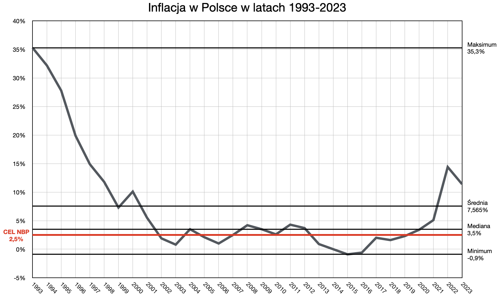
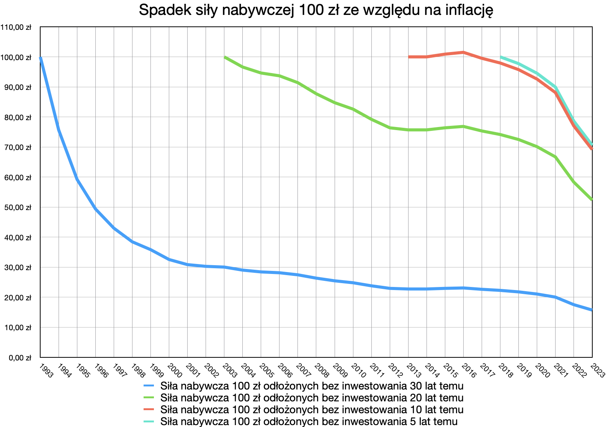
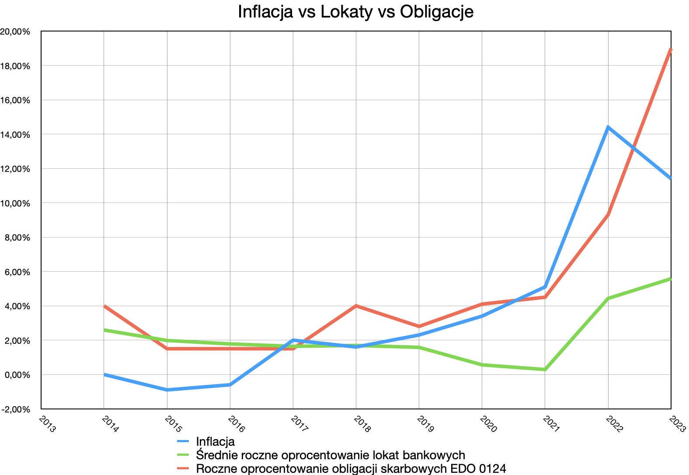
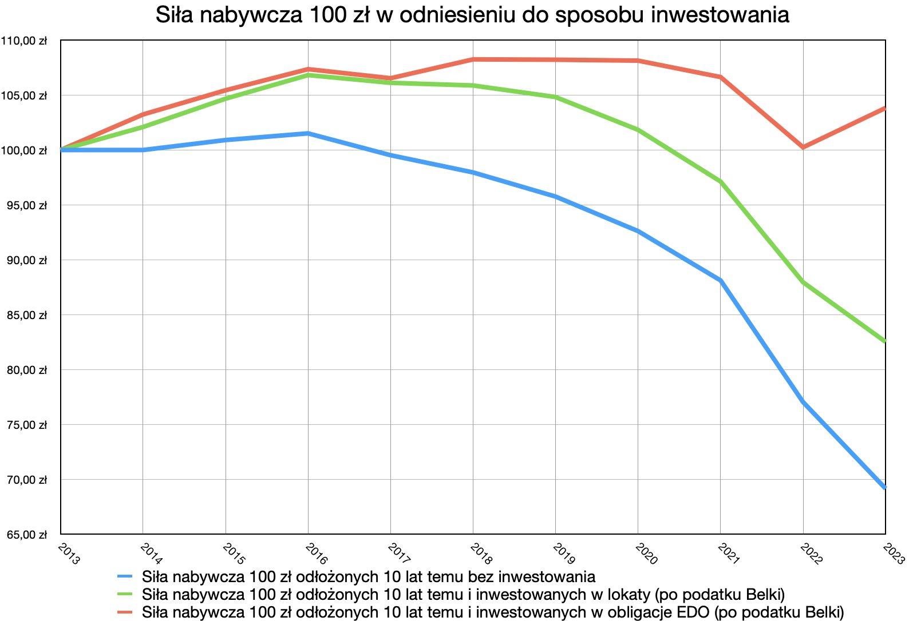

Table of contents:
* TOC
{:toc}

Surely you work hard for every earned penny. You buy necessary things for life from the earned money, maybe even have something left for pleasures, and ideally you're able to save some. It's these savings, or rather what you do with them, that I'd like to talk about today.

If you save and set aside this money, you are already a **hero**! However, if you keep them only in a non-interest-bearing bank account or proverbially under the mattress, in reality, **with each passing minute, these money lose their value**. All due to **_inflation_**. I assume that in most cases, refraining from investing your savings may have two reasons. The first is a **lack of time** to deal with all _these financial intricacies_, which I fully understand, however, in posts about [_my investment portfolios_](https://blog.tomaszdunia.pl/skarbonka-tomka-portfel-inwestycyjny-eng/), and later in more detailed posts about _[government bonds](https://blog.tomaszdunia.pl/skarbonka-tomka-obligacje-skarbowe/)_ and _[stocks](https://blog.tomaszdunia.pl/skarbonka-tomka-akcje/)_, I showed that **passive investing, which doesn't take much time and is very simple**, is a solution to this problem. The second and perhaps the main reason for the reluctance to invest savings is the **fear of the risk** of losing that money. I fully understand this argument as well, but here we come back to the topic of _inflation_ and how our capitalist world is structured. By not investing due to the fear of the risk of capital loss, you actually **condemn yourself to the loss of the value of that capital** with a 100% probability. Of course, it won't be a sudden loss, but one that will occur slowly, yet in my opinion, it's even worse because **_inflation_ is the silent killer** of the value of money, systematically stealing our savings in a way that we may not even notice for a long time.

It turns out that the introduction to this post is also the conclusion of its content. Despite having revealed the outcome already, I still think it's worth looking at what I'll present below. If the above reasoning has convinced you already, dear Reader, that you need to do something with your lying savings, then **don't wait**, go to the posts in the series [_Skarbonka Tomka_](https://blog.tomaszdunia.pl/skarbonka-tomka-portfel-inwestycyjny-eng/) and **take action** right now, you can come back to this post later. However, if you need a stronger incentive to convince you, I invite you to the further part of this post, where I'll present more tangible arguments confirming my above words.

## Legal Notice

Make sure to read it! - click to expand

The opinions and information contained on this blog do not constitute investment advice, especially "recommendations" within the meaning of the Regulation of the Minister of Finance of 19 October 2005 on information constituting recommendations regarding financial instruments or their issuers (Journal of Laws of 2005 No. 206, item 1715).

The purpose of such posts is to describe my thoughts on investing and share how I do it and what my strategy is. Everyone has a different financial situation and different risk-taking tendencies, which means they will tolerate losses differently, but also achieve different profits. For some, the latter is often worse, as a one-time lucky strike (coincidence) may lead to investing an even larger sum of money, or even getting into debt to increase the scale of investments, which, with less luck than the first time, can lead to bankruptcy and serious trouble. Therefore, you should only invest with the appropriate knowledge and understanding of the subject. If you do not fully understand the topic, do not invest in specific assets until you understand how they work, or switch to safer forms of multiplying your saved money altogether.

## What is inflation anyway?

If this isn't the first post you're reading on this blog, you probably already know that I don't like complicated definitions, so I'll explain what _inflation_ is in simple terms. **_Inflation_** is a general increase in the prices of goods and services in the economy, which **leads to a decrease in the purchasing power of money**. In other words, it's a situation where some time ago for the same amount of money, you could buy two loaves of bread before, but now only one.

As for historical levels of _inflation_ in Poland, I'm only considering the last 30 years for my further considerations. This is because around 1990, there was _**hyperinflation**_, meaning very high _inflation_, which even reached **685.8% on an annual basis**. I'll remind you here that the goal of the _NBP_ (_Narodowy Bank Polski_, ang. _National Bank of Poland_) is to **achieve inflation at a level of 2.5%** (+/- 1 percentage point). One could say that our currency and economy hit rock bottom then, from which they later recovered, but including this period in any calculations or statistics would render them meaningless. Therefore, all data presented hereafter will only reach as far as the year 1993.

Alright, so how has the level of inflation evolved over the past 30 years in Poland?

_Source of data: [GUS (Główny Urząd Statystyczny)](https://stat.gov.pl/obszary-tematyczne/ceny-handel/wskazniki-cen/wskazniki-cen-towarow-i-uslug-konsumpcyjnych-pot-inflacja-/)_

## Saving 100 PLN without investing

I won't beat around the bush and I'll get straight to the point. I decided to conduct a statistical experiment to illustrate what happens to a capital of 100 PLN when we set it aside and don't invest it. We'll see how much these 100 PLN will be worth after 30, 20, 10, and 5 years. Spoiler alert: we'll observe a significant decrease in the purchasing power of this amount, all due to _inflation_. The chosen amount is just a reference point. You can easily convert it to 1 000 PLN, 10 000 PLN, or even 1 000 000 PLN.

| **Year** | **Inflation** | **100 zł** **not invested** **30 years ago** \* | **100 zł** **not invested** **20 years ago** \* | **100 zł** **not invested** **10 years ago** \* | **100 zł** **not invested** **5 years ago** \* |
| --- | --- | --- | --- | --- | --- |
| **1993** | 35,3% | **100,00 zł** |     |     |     |
| **1994** | 32,2% | 75,64 zł |     |     |     |
| **1995** | 27,8% | 59,19 zł |     |     |     |
| **1996** | 19,9% | 49,36 zł |     |     |     |
| **1997** | 14,9% | 42,96 zł |     |     |     |
| **1998** | 11,8% | 38,43 zł |     |     |     |
| **1999** | 7,3% | 35,81 zł |     |     |     |
| **2000** | 10,1% | 32,53 zł |     |     |     |
| **2001** | 5,5% | 30,83 zł |     |     |     |
| **2002** | 1,9% | 30,26 zł |     |     |     |
| **2003** | 0,8% | 30,02 zł | **100,00 zł** |     |     |
| **2004** | 3,5% | 29,00 zł | 96,62 zł |     |     |
| **2005** | 2,1% | 28,41 zł | 94,63 zł |     |     |
| **2006** | 1% | 28,13 zł | 93,69 zł |     |     |
| **2007** | 2,5% | 27,44 zł | 91,41 zł |     |     |
| **2008** | 4,2% | 26,33 zł | 87,72 zł |     |     |
| **2009** | 3,5% | 25,44 zł | 84,76 zł |     |     |
| **2010** | 2,6% | 24,80 zł | 82,61 zł |     |     |
| **2011** | 4,3% | 23,78 zł | 79,20 zł |     |     |
| **2012** | 3,7% | 22,93 zł | 76,38 zł |     |     |
| **2013** | 0,9% | 22,72 zł | 75,70 zł | **100,00 zł** |     |
| **2014** | 0% | 22,72 zł | 75,70 zł | 100,00 zł |     |
| **2015** | \-0,9% | 22,93 zł | 76,38 zł | 100,91 zł |     |
| **2016** | \-0,6% | 23,07 zł | 76,85 zł | 101,52 zł |     |
| **2017** | 2% | 22,62 zł | 75,34 zł | 99,53 zł |     |
| **2018** | 1,6% | 22,26 zł | 74,15 zł | 97,96 zł | **100,00 zł** |
| **2019** | 2,3% | 21,76 zł | 72,49 zł | 95,76 zł | 97,75 zł |
| **2020** | 3,4% | 21,04 zł | 70,10 zł | 92,61 zł | 94,54 zł |
| **2021** | 5,1% | 20,02 zł | 66,70 zł | 88,11 zł | 89,95 zł |
| **2022** | 14,4% | 17,50 zł | 58,30 zł | 77,02 zł | 78,63 zł |
| **2023** | 11,4% | 15,71 zł | 52,34 zł | 69,14 zł | 70,58 zł |

_\* values calculated from the formula: X = previous year's value / (1 + inflation)_

If someone doesn't like tables, I've also prepared the results in the form of a chart:

Looking at this is almost physically painful, isn't it? 100 PLN saved 30 years ago would now be worth the equivalent of just under 16 PLN... In a similar situation but for a 20-year period, we lose nearly half of the capital's value. And over periods of 10 and 5 years, the decrease in value is about 30%. The principle of _inflation_ is similar to the compound interest principle in investing, only it works to our disadvantage. Even small amounts have a huge impact over a longer time horizon.

## So, how about investing after all?

I won't claim here that I have a brilliant way to multiply your money and only a fool wouldn't go that route. Something like slogans:

> He found a loophole in the financial system! Banks hate him! Click to learn his secret...

But at this point, I wanted to express perhaps a slightly lofty slogan - _**any sensible form of investment will be better than passively watching as inflation devours our money**_. I mean that even investing in deposits will be better than nothing. If your risk tolerance allows you to invest only in instruments like deposits, I fully understand that. **Just do it!** Maybe over time you'll become open to bonds, which have a very similar risk level, and will certainly yield better results. Contrary to appearances, there's much less hassle with them than with deposits because you place the order once and can relax for 10 years, while with deposits, you have to constantly renew them and look for the best interest rates.

To avoid being just talkative, I conducted a calculation, assuming that:

- there is the very beginning of **the year 2014**,

- we have in our hands **three 100 PLN banknotes** featuring King Władysław II Jagiełło,

- we proceed with them as follows:
    - we put the first one **into the sock** and do nothing more with it,
    
    - we give the second one to a gnome who will put this banknote (along with the interest earned from it) into a 12-month **deposit** for us every year,
    
    - we will invest the third one in 10-year **Treasury Inflation-Indexed Bonds** (_EDO_),

- I will end the simulation exactly after **10 years**, so **at the end of 2023**, and see what I have left from each of these banknotes, of course, I must remember to include the capital gains tax for deposits and bonds.

| **Year** | **Inflation** | **100 zł** **not invested** \* | **Avg. interest rate** **of deposits** | **100 zł** **invested in deposits** **(after taxes)** \*\* | **Interest rate** **of bonds** **EDO 0124** | **100 zł** **invested in bonds EDO** **(after taxes)** \*\*\* |
| --- | --- | --- | --- | --- | --- | --- |
| **START** |     | 100,00 zł |     | 100,00 zł |     | 100,00 zł |
| **2014** | 0,00% | 100,00 zł | 2,59% | 102,10 zł | 4,00% | 103,24 zł |
| **2015** | \-0,90% | 100,91 zł | 1,98% | 104,68 zł | 1,50% | 105,44 zł |
| **2016** | \-0,60% | 101,52 zł | 1,78% | 106,83 zł | 1,50% | 107,37 zł |
| **2017** | 2,00% | 99,53 zł | 1,64% | 106,12 zł | 1,50% | 106,54 zł |
| **2018** | 1,60% | 97,96 zł | 1,69% | 105,88 zł | 4,00% | 108,26 zł |
| **2019** | 2,30% | 95,76 zł | 1,58% | 104,83 zł | 2,80% | 108,23 zł |
| **2020** | 3,40% | 92,61 zł | 0,56% | 101,84 zł | 4,10% | 108,15 zł |
| **2021** | 5,10% | 88,11 zł | 0,29% | 97,13 zł | 4,50% | 106,65 zł |
| **2022** | 14,40% | 77,02 zł | 4,43% | 87,95 zł | 9,30% | 100,25 zł |
| **2023** | 11,40% | 69,14 zł | 5,58% | 82,51 zł | 19,00% | 103,84 zł |

_\* values calculated using the formula: X = value in the previous year / (1 + inflation)_ 
_\*\* values calculated using the formula: Y = value in the previous year / (1 + inflation) \* (1 + deposit interest rate \* 81%)_ 
_\*\*\* values calculated using the formula: Z = value in the previous year / (1 + inflation) \* (1 + bond interest rate \* 81%)_ 
_Source of data on historical deposit interest rates: [inflacja.pl](https://www.inflacja.pl/lokaty-dane-zrodlowe/)_ 
_Source of data on historical EDO 0124 bond interest rates: [obligacjeskarbowe.pl](https://www.obligacjeskarbowe.pl/archiwum-produktow/?table_id=16489)_

Of course, without charts, the calculation wouldn't be as professional! That's why I present the first chart, which compares the inflation rate with the interest rates of deposits and _EDO_ bonds from 2014 to 2023.

Meanwhile, the chart below shows how the value of our three hundred-zloty banknotes evolved for each scenario over the entire 10-year period.

The blue line isn't surprising, as we've already discussed what happens to money without investing in the previous section of this post. The green line represents the result of investing in **deposits**, and it's evident that investing in this financial instrument is a **poor way to protect your money from _inflation_**, as it doesn't surpass _inflation_ in the majority of periods. However, even such a result is better than doing nothing. To provide some consolation, the optimistic outcome is shown by the red line, which illustrates the result of investing in **EDO bonds**. It's clear that this way, **not only did we protect our savings from inflation, but we also achieved a slightly positive result**. A cumulative gain of 3.84% above _inflation_ over a 10-year period is truly a good result! Personally, I would expect something similar from parts of my investment portfolios where I hold bonds. Of course, **bonds, even inflation-indexed ones, should not be treated as a certain source of profit**, as even offering an interest rate equal to _inflation_ (calculated based on the previous year) + 1.5% may not be able to surpass inflation after deducting the 19% capital gains tax. Nevertheless, in my opinion, it's **the best form of investment for people who dislike risk and don't want to spend more than an hour per year on investing**.

## Summary

I hope this post opens the eyes of at least one person who is unaware of what _inflation_ does to their money. The presented results are based on historical data, so they are not some forecasts or speculations. I also didn't want to delve into other financial instruments like gold or stocks here, as it would only obscure the true message of this post.
