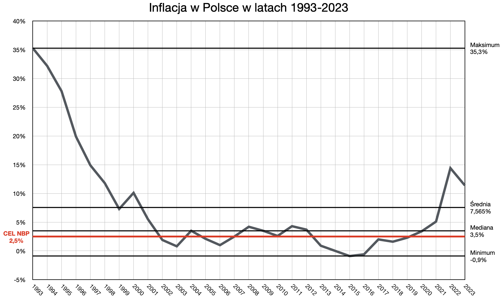
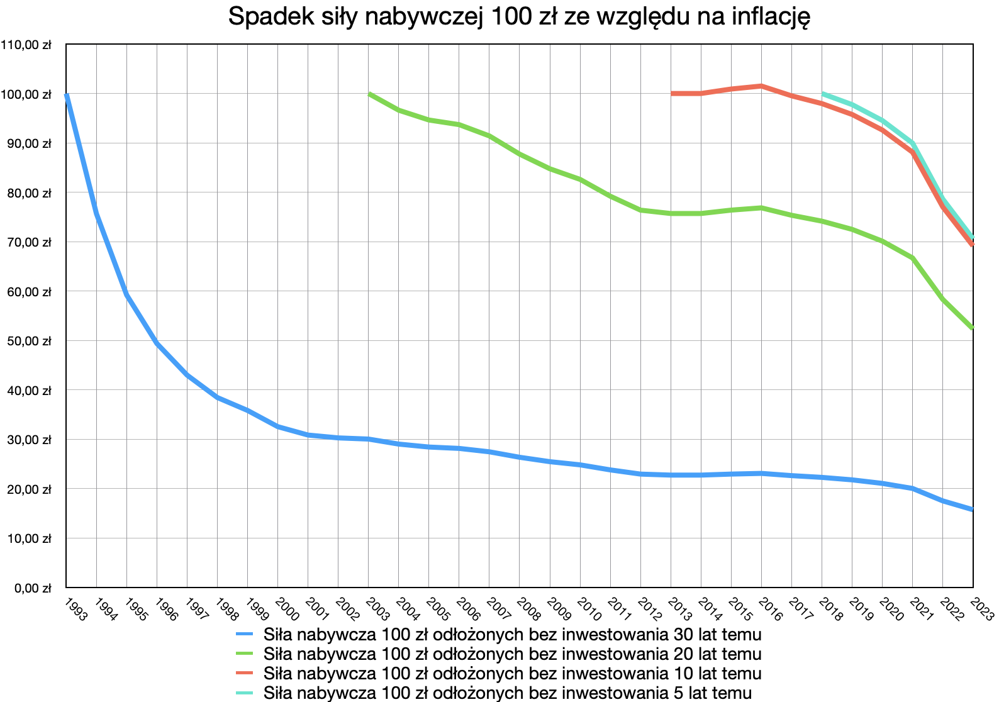
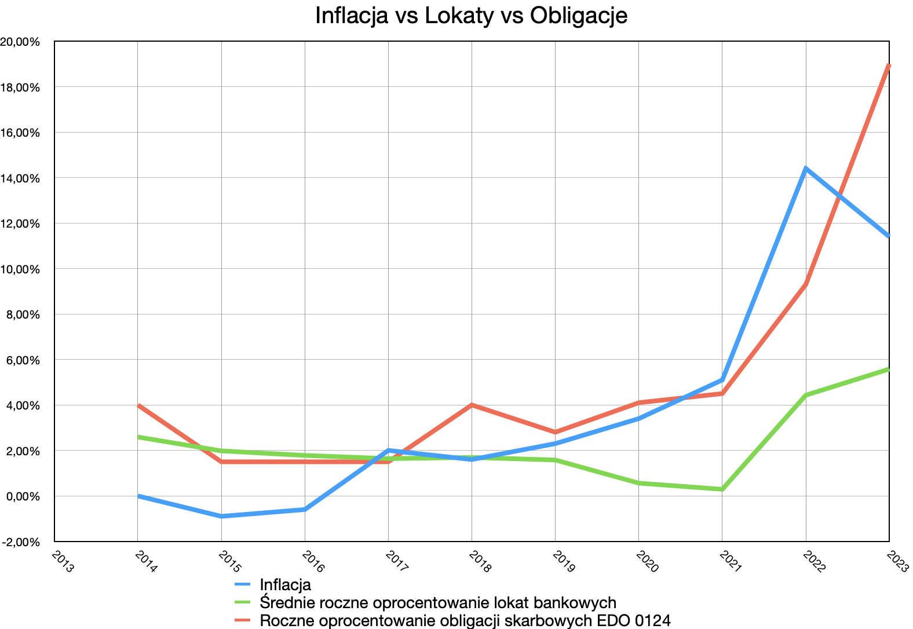
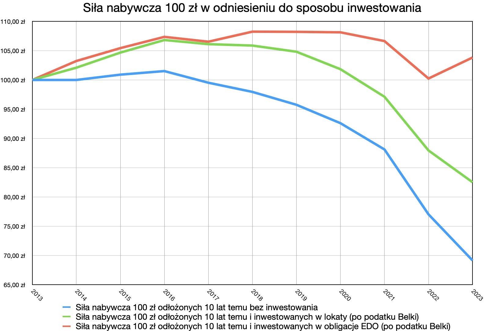

Spis treści:
* TOC
{:toc}

Na pewno ciężko pracujesz na każdą zarobioną złotówkę. Z zarobionych pieniędzy kupujesz rzeczy niezbędne do życia, może nawet coś zostaje Ci na przyjemności, a w idealnym przypadku jesteś w stanie nawet coś odłożyć. Właśnie o tych oszczędnościach, a raczej o tym czy coś z nimi robisz, chciałbym dzisiaj porozmawiać.

Jeżeli oszczędzasz i odkładasz te pieniądze to już **jesteś bohaterem**! Tylko, że jeżeli trzymasz je jedynie na nieoprocentowanym koncie w banku, czy też w przysłowiowej skarpecie pod materacem łóżka, to tak naprawdę **z każdą minutą te pieniądze tracą swoją wartość**. Wszystko to za sprawą **_inflacji_**. Zakładam, że w większości przypadków wstrzymywanie się od inwestowania swoich oszczędności może mieć dwie przyczyny. Pierwszą z nich jest **brak czasu** na bawienie się w _te wszystkie finansowe pierdoły_, co w pełni rozumiem, jednakże we wpisach o [_moich portfelach inwestycyjnych_](https://blog.tomaszdunia.pl/skarbonka-tomka-portfel-inwestycyjny/), a później również w bardziej szczegółowych wpisach o _[obligacjach](https://blog.tomaszdunia.pl/skarbonka-tomka-obligacje-skarbowe/)_ i _[akcjach](https://blog.tomaszdunia.pl/skarbonka-tomka-akcje/)_, pokazałem, że **inwestowanie pasywne, czyli takie które nie zabiera dużo czasu i jest bardzo proste**, jest rozwiązaniem tego problemu. Drugi i chyba główny powód braku chęci do inwestowania swoich oszczędności upatruję w **obawie przed ryzykiem** utraty tych pieniędzy. Ten argument również w pełni rozumiem, jednak tutaj wracamy do tematu _inflacji_ i tego jak zbudowany jest nasz kapitalistyczny świat. Nie inwestując w obawie przed ryzykiem utraty kapitału tak naprawdę **skazujesz się na utratę wartości tego kapitału** i to ze 100-procentowym prawdopodobieństwem. Oczywiście nie będzie to utrata gwałtowna, a taka która będzie następowała powoli, ale w mojej ocenie jest to nawet gorsze, bo **_inflacja_ to cichy zabójca** wartości pieniądza, która w sposób systematyczny kradnie nasze oszczędności w sposób, którego możemy nawet przez długi czas nie zauważyć.

Wyszło na to, że wstęp do tego wpisu jest jednocześnie puentą treści w nim zawartych. Mimo to, że zdradziłem już rezultat to myślę, że i tak warto spojrzeć na to co przedstawię poniżej. Jeżeli powyższa argumentacja już teraz przekonała Cię, drogi Czytelniku, do tego że musisz zrobić coś ze swoimi oszczędnościami, które leżą, to **nie czekaj**, już w tym momencie przejdź do wpisów z serii _[Skarbonka Tomka](https://blog.tomaszdunia.pl/skarbonka-tomka-portfel-inwestycyjny/)_ i **działaj**, a do tego wpisu możesz wrócić później. Natomiast jeżeli potrzebujesz mocniejszego bodźca, który Cię przekona, to zapraszam do dalszej części tego wpisu, w której przedstawię bardziej policzalne argumenty potwierdzające moje powyższe słowa.

## Nota prawna

Koniecznie się zapoznaj! - rozwiń aby zobaczyć zawartość

Opinie i informacje zawarte na tym blogu nie stanowią porady inwestycyjnej, a w szczególności "rekomendacji" w rozumieniu przepisów Rozporządzenia Ministra Finansów z dnia 19 października 2005 r. w sprawie informacji stanowiących rekomendacje dotyczące instrumentów finansowych, lub ich emitentów (Dz. U. z 2005 r. Nr 206, poz. 1715).

Celem tego typu wpisów jest opisanie moich przemyślenia na temat inwestowania i dzielenie się tym jak ja to robię i jaka jest moja strategia. Każdy ma inną sytuację finansową i inne skłonności do podejmowania ryzyka, a co za tym idzie inaczej zniesie poniesione straty, ale także uzyskane zyski. Dla niektórych często to drugie jest gorsze, bo jednorazowy złoty strzał (przypadek) może skłonić do zainwestowania jeszcze większej sumy pieniędzy, a nawet zadłużenia się w celu zwiększenia skali inwestycji, co przy mniejszym szczęściu niż za pierwszym razem może doprowadzić do bankructwa i popadnięcia w poważne kłopoty. Dlatego należy inwestować tylko posiadając odpowiednią do tego wiedzę i zrozumienie zagadnienia. Jeżeli nie rozumiesz tematu w pełni to nie inwestuj w dane aktywa do momentu zrozumienia zasady ich działania lub w ogóle przerzuć się na bardziej bezpieczne formy pomnażania swoich zaoszczędzonych pieniędzy.

## Czym w ogóle jest inflacja

Jeżeli nie jest to pierwszy wpis, który czytasz na tym blogu, to pewnie już wiesz, że nie lubię skomplikowanych definicji, dlatego to czym jest _inflacja_ przedstawię prosto. **_Inflacja_** to ogólny wzrost cen towarów i usług w gospodarce, co **powoduje spadek siły nabywczej pieniądza**. Innymi słowy, to sytuacja, gdy za te same pieniądze kiedyś można było kupić dwa chleby, a teraz tylko jeden.

Jeżeli chodzi o historyczne poziomy _inflacji_ w Polsce to do moich dalszych rozważań biorę jedynie ostatnich 30 lat. Wszystko ze względu na to, że w okolicach 1990 r. panowała _**hiperinflacja**_, czyli bardzo wysoka _inflacja_, która doszła nawet do poziomu **685.8% w skali roku**. Przypomnę tutaj, że celem _NBP_ (_Narodowego Banku Polskiego_) jest **dążenie do inflacji na poziomie 2.5%** (+/- 1 p.p.). Można powiedzieć, że nasza waluta i ogólnie gospodarka osiągnęły wtedy dno, z którego później się podniosły, ale wzięcie tego okresu do jakichkolwiek obliczeń czy statystyk spowodowałoby, że nie miałyby one większego sensu. Z uwagi na to, wszystkie dalej przedstawione dane będą sięgały najdalej do roku 1993.

No dobrze, to w takim razie jak kształtował się poziom inflacji w ostatnich 30 latach?

_Źródło danych: [GUS (Główny Urząd Statystyczny)](https://stat.gov.pl/obszary-tematyczne/ceny-handel/wskazniki-cen/wskazniki-cen-towarow-i-uslug-konsumpcyjnych-pot-inflacja-/)_

## 100 zł odłożone bez inwestowania

Nie będę owijał w bawełnę i od razu przejdę do konkretów. Postanowiłem przeprowadzić eksperyment statystyczny, którego wynik będzie obrazował to co dzieje się z kapitałem w wysokości 100 zł, gdy odłożymy go do skarpety i nie będziemy go inwestować. Sprawdzimy ile te 100 zł będzie warte po 30, 20, 10 i 5 latach. Spoiler alert: zaobserwujemy jak wysoki będzie spadek siły nabywczej tej kwoty, a wszystko to za sprawą jedynie _inflacji_. Przyjęta kwota jest tylko odniesieniem. Można to w prosty sposób przeliczyć na 1 000 zł, 10 000 zł czy nawet 1 000 000 zł.

| **Rok** | **Inflacja** | **100 zł** **nie zainwestowane** **30 lat temu** \* | **100 zł** **nie zainwestowane** **20 lat temu** \* | **100 zł** **nie zainwestowane** **10 lat temu** \* | **100 zł** **nie zainwestowane** **5 lat temu** \* |
| --- | --- | --- | --- | --- | --- |
| **1993** | 35,3% | **100,00 zł** |     |     |     |
| **1994** | 32,2% | 75,64 zł |     |     |     |
| **1995** | 27,8% | 59,19 zł |     |     |     |
| **1996** | 19,9% | 49,36 zł |     |     |     |
| **1997** | 14,9% | 42,96 zł |     |     |     |
| **1998** | 11,8% | 38,43 zł |     |     |     |
| **1999** | 7,3% | 35,81 zł |     |     |     |
| **2000** | 10,1% | 32,53 zł |     |     |     |
| **2001** | 5,5% | 30,83 zł |     |     |     |
| **2002** | 1,9% | 30,26 zł |     |     |     |
| **2003** | 0,8% | 30,02 zł | **100,00 zł** |     |     |
| **2004** | 3,5% | 29,00 zł | 96,62 zł |     |     |
| **2005** | 2,1% | 28,41 zł | 94,63 zł |     |     |
| **2006** | 1% | 28,13 zł | 93,69 zł |     |     |
| **2007** | 2,5% | 27,44 zł | 91,41 zł |     |     |
| **2008** | 4,2% | 26,33 zł | 87,72 zł |     |     |
| **2009** | 3,5% | 25,44 zł | 84,76 zł |     |     |
| **2010** | 2,6% | 24,80 zł | 82,61 zł |     |     |
| **2011** | 4,3% | 23,78 zł | 79,20 zł |     |     |
| **2012** | 3,7% | 22,93 zł | 76,38 zł |     |     |
| **2013** | 0,9% | 22,72 zł | 75,70 zł | **100,00 zł** |     |
| **2014** | 0% | 22,72 zł | 75,70 zł | 100,00 zł |     |
| **2015** | \-0,9% | 22,93 zł | 76,38 zł | 100,91 zł |     |
| **2016** | \-0,6% | 23,07 zł | 76,85 zł | 101,52 zł |     |
| **2017** | 2% | 22,62 zł | 75,34 zł | 99,53 zł |     |
| **2018** | 1,6% | 22,26 zł | 74,15 zł | 97,96 zł | **100,00 zł** |
| **2019** | 2,3% | 21,76 zł | 72,49 zł | 95,76 zł | 97,75 zł |
| **2020** | 3,4% | 21,04 zł | 70,10 zł | 92,61 zł | 94,54 zł |
| **2021** | 5,1% | 20,02 zł | 66,70 zł | 88,11 zł | 89,95 zł |
| **2022** | 14,4% | 17,50 zł | 58,30 zł | 77,02 zł | 78,63 zł |
| **2023** | 11,4% | 15,71 zł | 52,34 zł | 69,14 zł | 70,58 zł |

_\* wartości wyliczone z wzoru: X = wartość z poprzedniego roku / (1 + inflacja)_

Jak ktoś nie lubi tabelek to wyniki przygotowałem również w formie wykresu:

Patrzenie na to boli wręcz fizycznie, prawda? 100 zł odłożone 30 lat temu byłoby teraz wartę równowartość niecałych 16 złotych... Przy analogicznej sytuacji, ale dla okresu 20 lat, tracimy blisko połowę wartości kapitału. A w okresach 10 i 5 lat spadek wartości to ok. 30%. Zasada działania _inflacji_ jest podobna do zasady procentu składanego w inwestowaniu tylko działa na naszą niekorzyść. Nawet małe wartości mają ogromne znaczenie w przypadku szerszego horyzontu czasowego.

## To może jednak inwestowanie?

Nie będę tutaj prawił o tym, że mam genialny sposób na pomnażanie swoich pieniędzy i tylko głupiec nie poszedłby tą drogą. Coś w stylu sloganów:

> Znalazł lukę w systemie finansowym! Banki go nienawidzą! Kliknij, aby poznać jego sekret...

W tym miejscu chciałem jednak wygłosić może i trochę górnolotne hasło - _**każda rozsądna forma inwestowania będzie lepsza niż bierne patrzenie jak inflacja zżera nasze pieniądze**_. Chodzi mi o to, że nawet inwestowanie w lokaty będzie lepsze niż żadne. Jeżeli Twoja tolerancja ryzyka pozwala Ci na inwestycje tylko w takie instrumenty jak lokaty to w pełni to rozumiem. **Tylko rób to!** Może z czasem przekonasz się do obligacji, których poziom ryzyka jest bardzo zbliżony, a na pewno przyniosą lepsze wyniki i wbrew pozorom jest przy nich dużo mniej zachodu niż przy lokatach, bo raz zlecasz ich zakup i możesz mieć spokój na 10 lat, a lokaty trzeba stale odnawiać i szukać tych najlepiej oprocentowanych.

Żeby nie być gołosłownym przeprowadziłem kalkulację, której założeniem było, że:

- jest samiutki **początek roku 2014**,

- mamy w ręku **trzy 100-złotowe banknoty** z wizerunkiem króla Władysława II Jagiełło,

- postępuję z nimi w sposób następujący:
    - pierwszy odkładam **do skarpety** i nic więcej z nim nie robię,
    
    - drugi daję chochlikowi, który będzie za mnie ten banknot (wraz z wypracowanymi z niego odsetkami) co roku wrzucał na 12-miesięczną **lokatę**,
    
    - trzeci zainwestuję w 10-letnie **obligacje skarbowe** _EDO_ indeksowane inflacją,

- symulację zakończę dokładnie po **10 latach**, czyli **na koniec 2023 r.** i zajrzę co mi zostało z każdego z tych banknotów, oczywiście muszę przy tym pamiętać, żeby przy lokatach i obligacjach uwzględniać podatek od zysków kapitałowych (Belki).

| **Rok** | **Inflacja** | **100 zł** **bez inwestowania** \* | **Śr. oprocent.** **lokat** | **100 zł** **inwestowanych w lokaty** **(po podatku)** \*\* | **Oprocent.** **obligacji** **EDO 0124** | **100 zł** **inwestowanych w obligacje EDO** **(po podatku)** \*\*\* |
| --- | --- | --- | --- | --- | --- | --- |
| **START** |     | 100,00 zł |     | 100,00 zł |     | 100,00 zł |
| **2014** | 0,00% | 100,00 zł | 2,59% | 102,10 zł | 4,00% | 103,24 zł |
| **2015** | \-0,90% | 100,91 zł | 1,98% | 104,68 zł | 1,50% | 105,44 zł |
| **2016** | \-0,60% | 101,52 zł | 1,78% | 106,83 zł | 1,50% | 107,37 zł |
| **2017** | 2,00% | 99,53 zł | 1,64% | 106,12 zł | 1,50% | 106,54 zł |
| **2018** | 1,60% | 97,96 zł | 1,69% | 105,88 zł | 4,00% | 108,26 zł |
| **2019** | 2,30% | 95,76 zł | 1,58% | 104,83 zł | 2,80% | 108,23 zł |
| **2020** | 3,40% | 92,61 zł | 0,56% | 101,84 zł | 4,10% | 108,15 zł |
| **2021** | 5,10% | 88,11 zł | 0,29% | 97,13 zł | 4,50% | 106,65 zł |
| **2022** | 14,40% | 77,02 zł | 4,43% | 87,95 zł | 9,30% | 100,25 zł |
| **2023** | 11,40% | 69,14 zł | 5,58% | 82,51 zł | 19,00% | 103,84 zł |

_\* wartości wyliczone z wzoru: X = wartość w poprzednim roku / (1 + inflacja)_ 
_\*\* wartości wyliczone z wzoru: Y = wartość w poprzednim roku / (1 + inflacja) \* (1 + oprocent. lokaty \* 81%)_ 
_\*\*\* wartości wyliczone z wzoru: Z = wartość w poprzednim roku / (1 + inflacja) \* (1 + oprocent. obligacji \* 81%)_ 
_Źródło danych o historycznym oprocentowaniu lokat: [inflacja.pl](https://www.inflacja.pl/lokaty-dane-zrodlowe/)_ 
_Źródło danych o historycznym oprocentowaniu obligacji EDO 0124: [obligacjeskarbowe.pl](https://www.obligacjeskarbowe.pl/archiwum-produktow/?table_id=16489)_

Oczywiście bez wykresów kalkulacja nie byłaby tak profesjonalna! Dlatego prezentuję pierwszy wykres, który przedstawia porównanie wysokość inflacji oraz oprocentowania lokat i obligacji _EDO_ w latach 2014-2023.

Natomiast poniższy wykres pokazuje jak kształtowała się wartość naszych trzech stówek dla poszczególnych scenariuszy przez cały okres 10 lat.

Niebieska linia nie jest dla nas zaskoczeniem, bo to co dzieje się z pieniędzmi bez inwestowania omówiliśmy sobie już w poprzednim rozdziale tego wpisu. Linia zielona to wynik inwestowania w **lokaty** i widać jak na dłoni, że inwestowanie w ten instrument finansowy to **mizerny sposób na ochronę swoich pieniędzy przed _inflacją_**, bo w przeważającej ilości okresów jej nie pokona, jednakże nawet i taki wynik jest lepszy od nie robienia niczego. Na pocieszenie, optymistyczny wynik prezentuje linia czerwona, która obrazuje wynik inwestowania w **obligacje** _EDO_. Widać, że w ten sposób **nie tylko ochroniliśmy oszczędności przed _inflacją_, ale także wypracowaliśmy delikatnie dodatni wynik**. Skumulowany zysk na poziomie 3.84% ponad _inflację_ w okresie 10 lat to naprawdę niezły rezultat! Osobiście czegoś podobnego oczekiwałbym po częściach moich portfeli inwestycyjnych, w których trzymam obligacje. Oczywiście **obligacji, nawet tych indeksowanych inflacją, nie należy traktować jako pewne źródło zysku**, bo nawet oferując oprocentowanie w wysokości _inflacja_ (wyliczona na bazie poprzedniego roku) + 1.5% może ona nie być w stanie pokonać inflacji po odliczeniu 19% podatku od zysków kapitałowych (Belki). Jednakże mimo to w mojej ocenie jest to **najlepsza forma inwestowania dla osób, które nie lubią ryzyka i nie chcą poświęcać, więcej niż godziny rocznie na inwestowanie**.

## Podsumowanie

Mam nadzieję, że ten wpis otworzy oczy choć jednej osobie, która jest nieświadoma tego co _inflacja_ robi z jej pieniędzmi. Przedstawione wyniki bazują na danych historycznych, a więc nie są jakimiś wyssanymi z palca prognozami czy spekulacjami. Nie chciałem też tutaj wchodzić w inne instrumenty finansowe jak złoto czy akcje, bo to tylko zamgliło prawdziwy przekaz tego wpisu.
