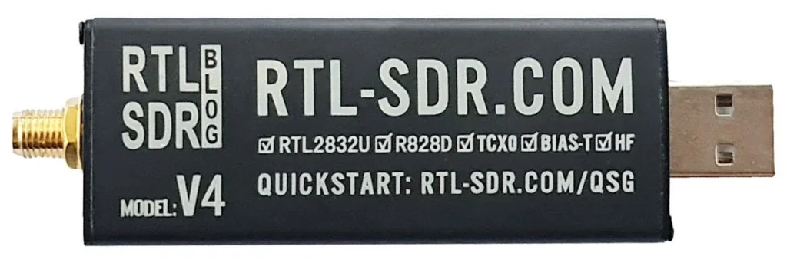

Kolejny wpis, w którym polecam bardzo ciekawy i szalenie geekowski artykuł i w sumie cały blog:

[Fifty Things you can do with a Software Defined Radio 📻](https://blinry.org/50-things-with-sdr/)  
autorstwa [@blinry@chaos.social](https://chaos.social/@blinry)

SDR to software-defined radio, czyli w skrócie radio programowalne. Wikipedia mówi, że jest to system komunikacji radiowej, w którym działanie podstawowych elementów elektronicznych (mieszaczy, filtrów, modulatorów i demodulatorów, detektorów) jest wykonywane za pomocą programu komputerowego. Jest to trafna definicja, więc nie będę się silił na jakieś zbędne mądrzenie się na ten temat z mojej strony, bo krótkofalowiec ze mnie żaden.

W podlinkowanym artykule autor sprawdza co można odkryć w spektrum elektromagnetycznym wykorzystując relatywnie taniego dongle'a USB - [RTL-SDR Blog V4](https://www.rtl-sdr.com/rtl-sdr-blog-v4-dongle-initial-release/). Okazuje się, że po dołożeniu do tego prostej anteny można mieć naprawdę sporo zabawy! Autor zrealizował swój wpis na bazie techniki "50 zastosowań \<czegoś\>" i stworzył następującą listę tematyczną:

1. Słuchanie radia FM

3. Słuchanie Freenet

5. Odbieranie warunków pogodowych z lotnisk

7. Słuchanie komunikacji samolotowej

9. Śledzenie samolotów przez ADS-B

11. Słuchanie stereofonicznego radia FM

13. Odbieranie informacji o ruchu drogowym

15. Słuchanie rozmów na 2-metrowym paśmie amatorskim

17. Słuchanie radia cyfrowego

19. Słuchanie PMR446

21. Odczytywanie czujników sąsiadów

23. Śledzenie statków morskich

25. Wykrywaj aktywność GSM

27. Odbieranie sygnałów z satelity

29. Podziwianie sygnałów TETRA

31. Słuchanie dyspozytorów taksówek

33. Zastanawianie się nad tajemniczymi sygnałami

35. Śledzenie balonów meteorologicznych

37. "Polowanie" na balony meteorologiczne!

39. Odbieranie amatorskich pakietów radiowych

41. Odbieranie kodu Morse'a z innych krajów

43. Odbieranie morskich raportów pogodowych

45. Odbieranie kodów cyfrowych z innych krajów

47. Wykrywanie, czy notebook jest ładowany

49. Oglądanie jonosond

51. Oglądanie sygnałów radarowych

53. Słuchanie rozmów w paśmie jednostronnym

55. Słuchanie radia AM z drugiego końca świata

57. Słuchanie CB radia

59. Ocena propagacji fal radiowych za pomocą nadajników

61. Odbieranie sygnału czasu

63. Odbieranie faksu pogodowego

65. Dekodowanie obrazów z satelity pogodowego!

67. Oszacuj prędkość satelitów

69. Słuchaj stacji numerycznych

71. Odbieranie obrazów od amatorskich operatorów radiowych

73. Słuchanie brzęczyka

75. Złap ćwierkanie LoRaWAN

77. Odczyt danych z liczników mediów

79. "Oglądanie" telewizji

81. Śledzenie samochodów i autobusów

83. Odbieraj kod Morse'a z satelity!

85. Odbieranie pagerów służb ratunkowych

87. Wykrywa, kiedy smartfon jest włączony

89. Komunikuje się bezprzewodowo za pomocą… książki

91. Odbieranie pomocy nawigacyjnych dla samolotów

93. Zobacz, jak nisko możesz zejść w widmie częstotliwości

95. Zobacz, jak wysoko możesz wejść w spektrum częstotliwości

97. Słuchaj radia morskiego

99. Bądź mobilny! (aplikacja na Androida)

Szalenie ciekawy artykuł, autora szanuję za pracowitość i pasję. Polecam zapoznać się jako lektura na wieczór lub weekend.

* * *

## 50 applications of SDR

Another post where I recommend a very interesting and extremely geeky article and basically the entire blog:

[Fifty Things you can do with a Software Defined Radio 📻](https://blinry.org/50-things-with-sdr/)  
by [@blinry@chaos.social](https://chaos.social/@blinry)

SDR stands for software-defined radio, in short, programmable radio. Wikipedia says it is a radio communication system in which the operation of basic electronic components (mixers, filters, modulators and demodulators, detectors) is performed using computer software. This is an accurate definition, so I won't try to be unnecessarily smart about it, because I'm no ham radio operator.

In the linked article, the author explores what can be discovered in the electromagnetic spectrum using a relatively cheap USB dongle - [RTL-SDR Blog V4](https://www.rtl-sdr.com/rtl-sdr-blog-v4-dongle-initial-release/). It turns out that after adding a simple antenna to it, you can have a lot of fun! The author realized his post based on the "50 uses of \<something\>" technique and created the following thematic list:

1. Listen to FM radio

3. Listen to Freenet

5. Receive weather conditions from airports

7. Listen to airplane communication

9. Track aircraft via ADS-B

11. Listen to stereo FM radio

13. Receive road traffic information

15. Listen to conversations on the 2-meter amateur radio band

17. Listen to digital radio

19. Listen to PMR446

21. Read your neighbors’ sensors

23. Track ships!

25. Detect GSM activity

27. Receive signals from a satellite!

29. Admire TETRA signals

31. Listen to taxi dispatchers

33. Ponder mysterious signals

35. Track weather balloons

37. "Hunt" weather balloons!

39. Receive amateur packet radio

41. Receive Morse code from other countries

43. Receive maritime weather reports

45. Receive digimodes from other countries

47. Detect whether your notebook is charging

49. See ionosondes

51. See radar signals

53. Listen to “single side band” conversations

55. Listen to AM radio from the other side of the world

57. Listen to CB radio

59. Assess the propagation of radio waves using beacons

61. Receive a time signal

63. Receive a weather fax

65. Decode images from a weather satellite!

67. Estimate the speed of satellites

69. Listen to number stations

71. Receive images from amateur radio operators

73. Listen to The Buzzer

75. Catch a LoRaWAN chirp

77. Read data from utility meters

79. “Watch” TV

81. Track cars and buses

83. Receive Morse code from a satellite!

85. Receive emergency service pagers

87. Detect when a smartphone is turned on

89. Communicate wirelessly using… a book

91. Receive navigational aids for airplanes

93. See how low you can go in the frequency spectrum

95. See how high you can go in the frequency spectrum

97. Listen to marine radio

99. Go mobile! (Android app)

An incredibly interesting article, I respect the author for his diligence and passion. I recommend checking it out as an evening or weekend read.
