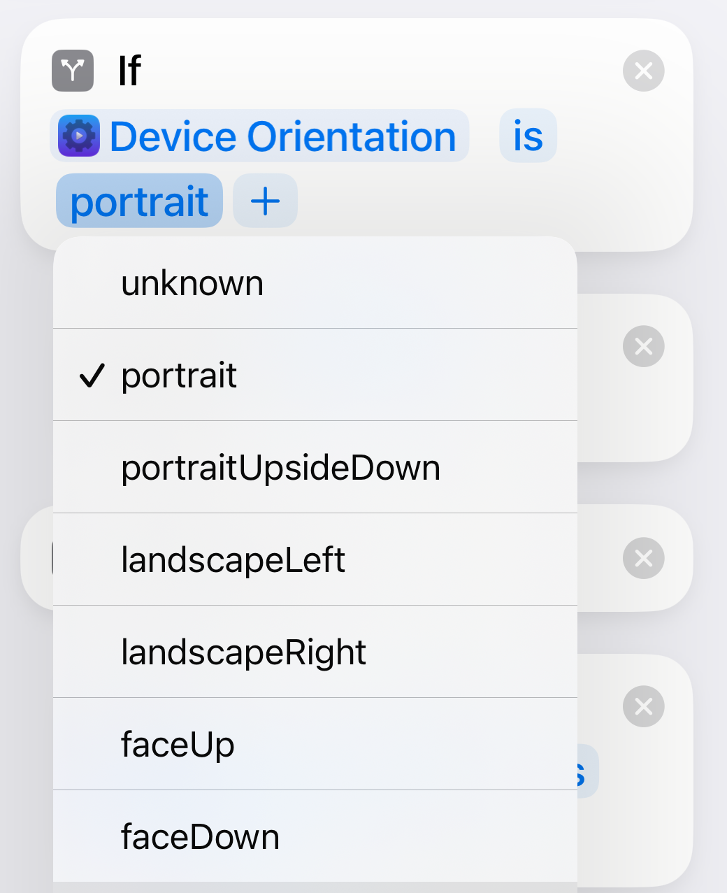
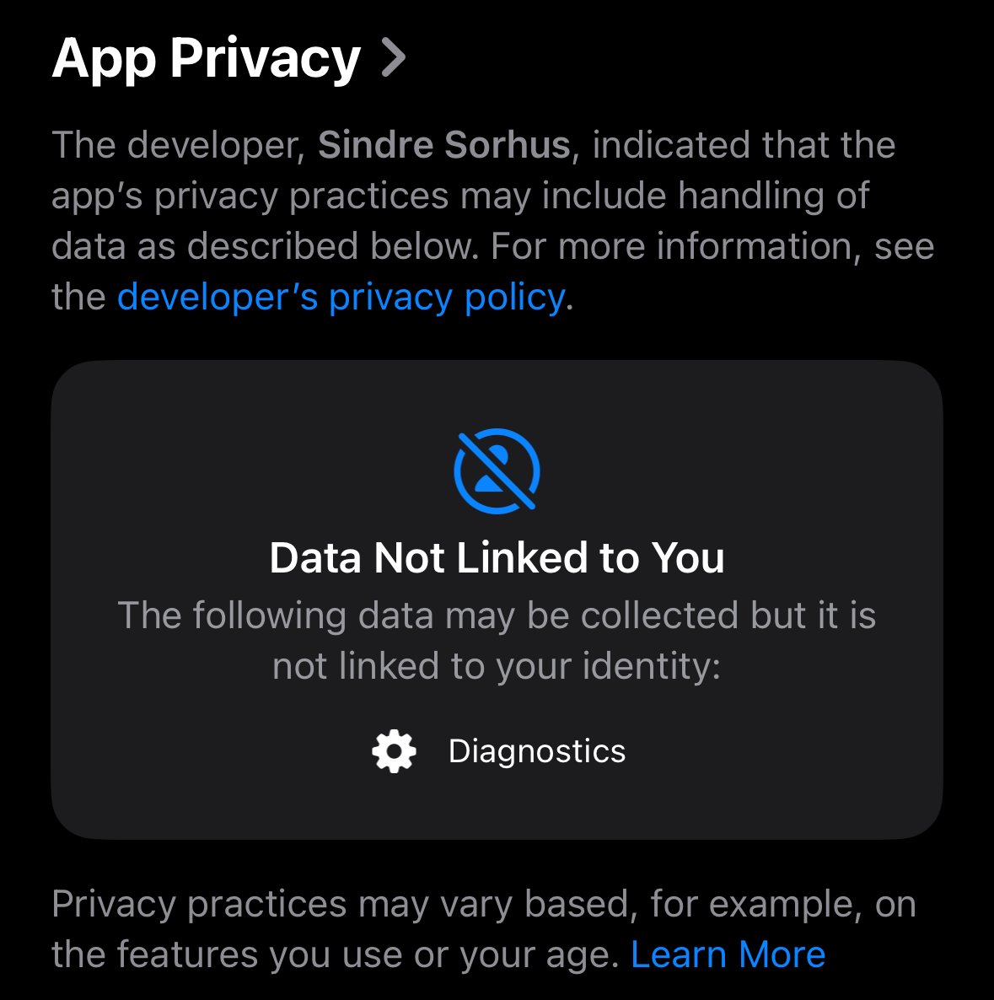
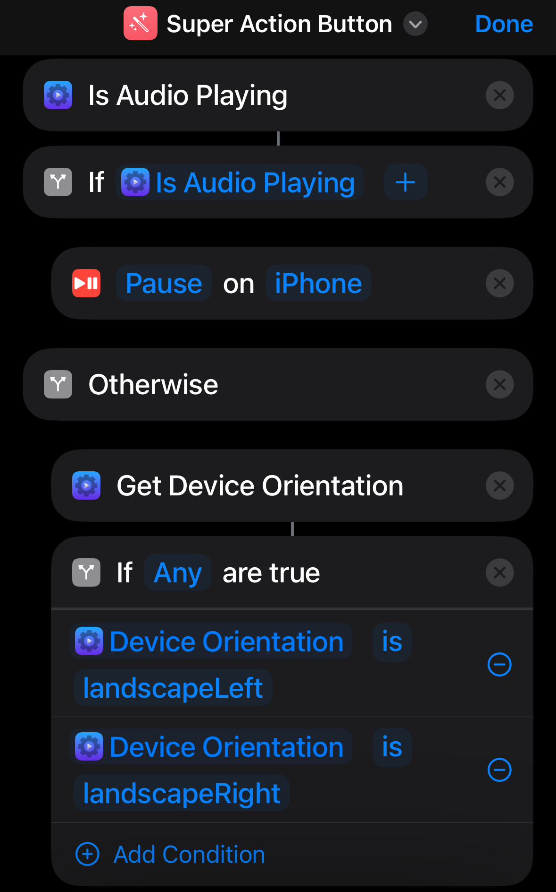
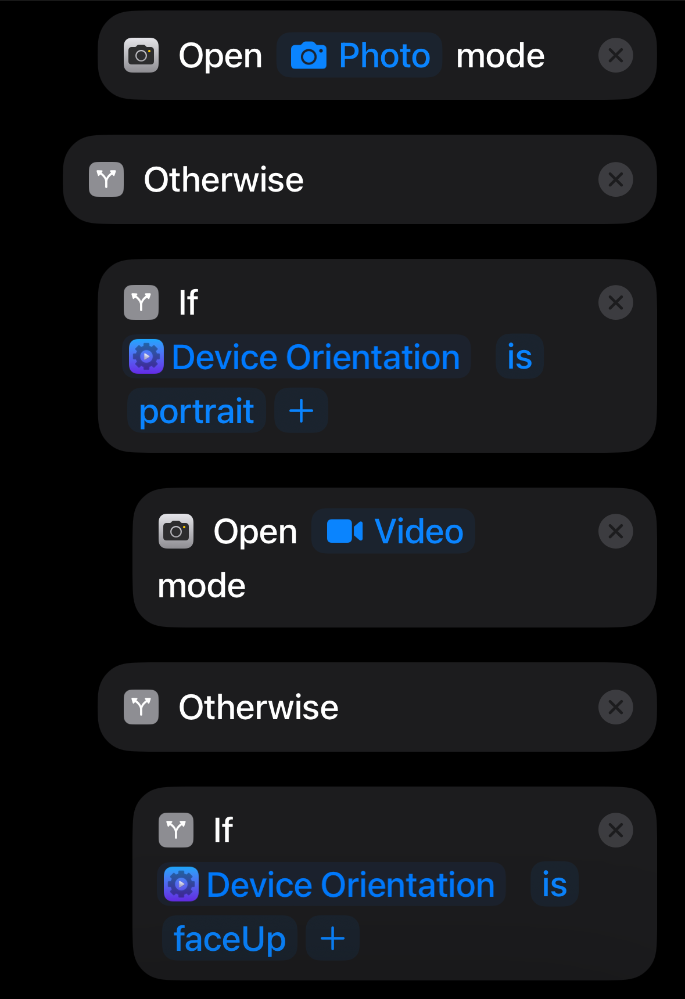
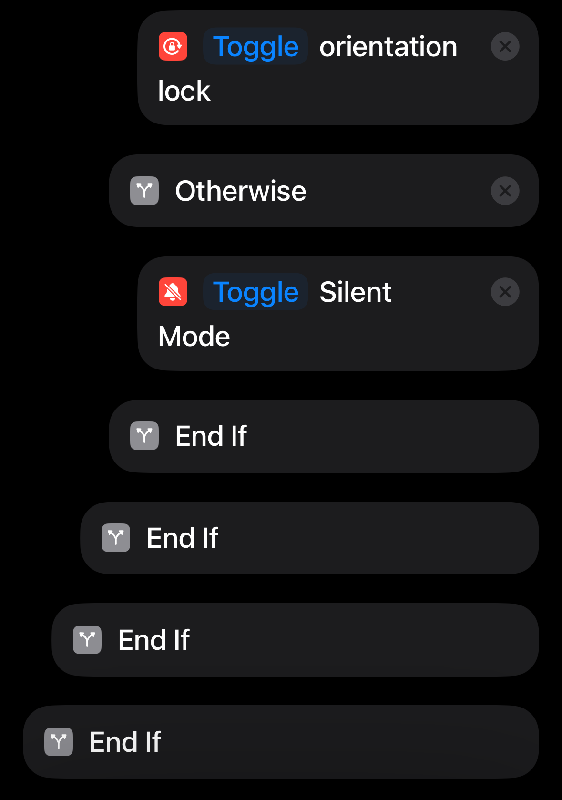
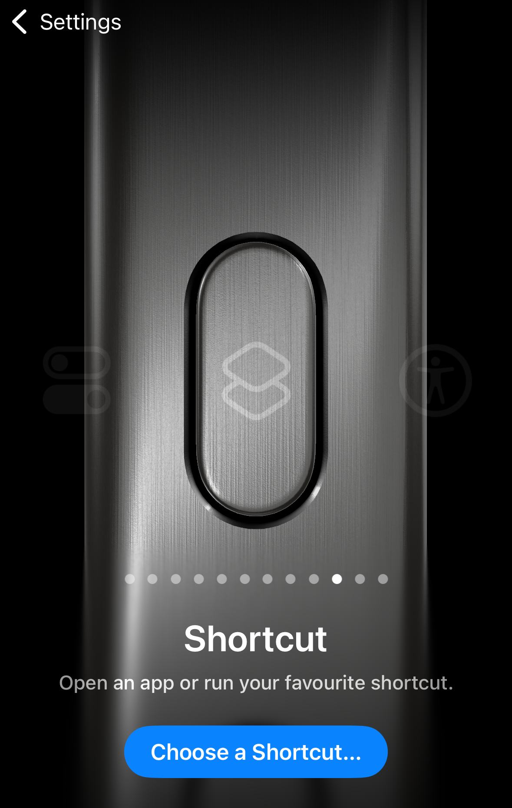
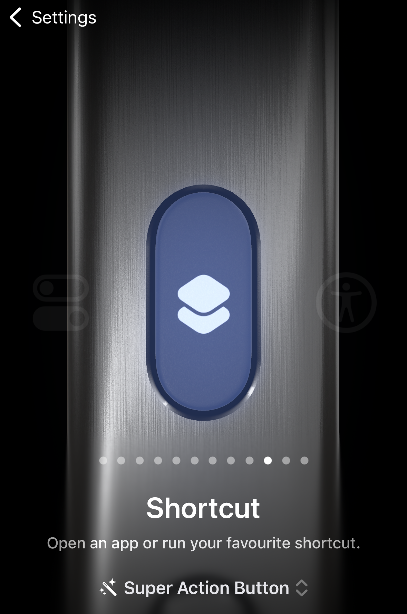
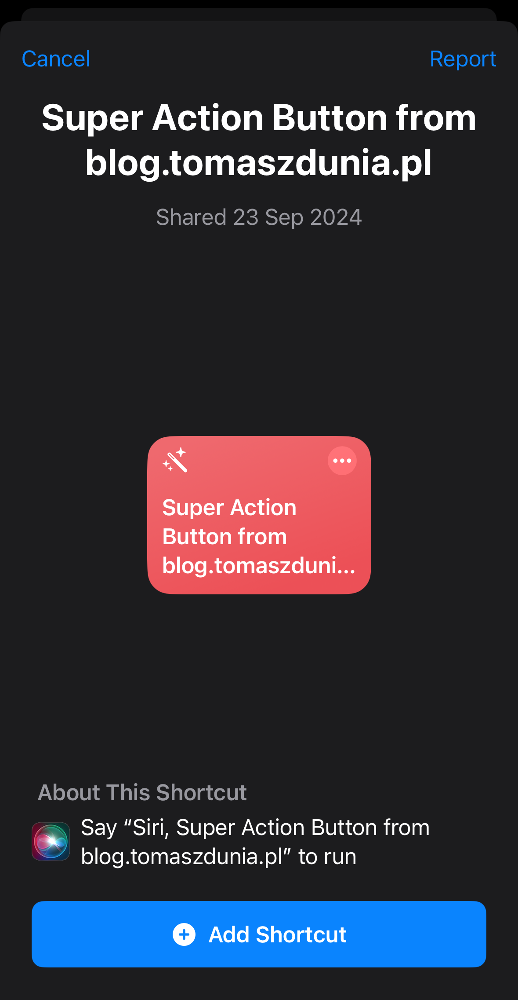

[🇬🇧->🇵🇱 Przejdź do polskiej wersji tego wpisu / Go to polish version of this post](https://blog.tomaszdunia.pl/super-action-button-iphone-shortcut/)

Table of contents:
* TOC
{:toc}

Starting from the iPhone 15 series, the famous silent mode switch has been replaced by a button called the _Action Button_. Initially, I was really frustrated when I saw this change during the conference (and earlier leaks). The two-state switch was a hallmark of the iPhone, which I found extremely useful and at the same time a brilliantly simple solution. The ease with which you could switch the phone to silent mode, even in your pocket, and how easy it was to tell what mode it was currently in, was a great feature for me. Hence, I didn’t understand at all why Apple decided to change it, especially in such an uncreative way as just replacing it with a button… Well, this isn’t the first incomprehensible decision from Apple. Let’s leave that aside though and focus on what we got with the new _Action Button_ and how to maximize its use.

Let’s start by noting that the _Action Button_ is really untapped potential because it triggers the assigned function only when held for a short time. I think everyone thought it was begging for an extended functionality, like being able to assign a different function for scenarios where it’s pressed twice or three times. Apple already has such a mechanism in the system, which we know from the multiple presses of the _Power_ button. For example, I have the notification menu (drop down) assigned to a double click, and switching the screen to black-and-white mode on a triple click. On the plus side, the _Action Button_ allows you to assign various functions, including triggering any shortcut created in the _Shortcuts_ app. This opens up a wide range of possibilities. This post will be about how to extend the functionality of the _Action Button_ in this way.

## Here’s how I use it

I’ll start from the end, by showing how I use the method presented in this post. I’ve configured everything so that depending on whether specific conditions are met (or not), using the _Action Button_ triggers a different action. When the phone is playing sound, such as listening to music/podcasts or watching videos, pressing the _AB_ stops playback. If the above condition isn’t met, I check the second one, which is the phone's current orientation. You can choose from the following:

Based on this, I’ve assigned the following actions:

- when the phone is in **landscape** (_landscapeLeft_ or _landscapeRight_) orientation, pressing the _AB_ **launches the camera in photo mode**,

- when the phone is in **portrait** orientation, pressing the _AB_ **launches the camera in video recording mode**,

- when the phone is **lying flat with the screen up** (_faceUp_), pressing the _AB_ **enables/disables Orientation Lock**,

- in **any other position**, pressing the _AB_ **enables/disables Silent Mode**.

## Instructions

- Download the [_Actions_](https://apps.apple.com/pl/app/actions/id1586435171) app, which is normally available in the _App Store_. It’s a very useful extension to the _Shortcuts_ app, developed by _Sindre Sorhus_. It’s not an app where you do anything through its interface. You just give it certain permissions, which it uses to gather useful information about the phone’s status. These can be easily imported and used in _Shortcuts_. I know not everyone will like the fact that this requires installing another app, and that it’s not from _Apple_ but from a private developer. However, to ease your concerns, I can say that the developer seems trustworthy, and the app doesn’t collect any suspicious data.

- The next step is to launch the _Shortcuts_ app and create a new shortcut. You do this by pressing the “+” button in the upper-right corner.

- Give it a name of your choice (expand the menu at the top center labeled _New Shortcuts_ and choose the _Rename_ option), and start building the formula. I won’t explain this in detail because I might write a separate post on it someday. Nevertheless, it’s intuitive enough that even without watching 69 tutorials, everyone should be able to figure it out. Basically, it involves searching the library for the right blocks, configuring them in a specific way, and arranging them in the correct order.

- The formula for my shortcut, whose functionality I described above, looks like this:

- This shortcut is saved by pressing the _Done_ button located in the top right corner.

- We then go to the phone settings, where we find the _Action Button_ section.

- We scroll right (or left) until we find the _Shortcut_ option.

- Press the _Choose a Shortcut…_ button and select the one we just created from the menu that pops up.

- That's it. Now, simply check if it works correctly and enjoy the fact that your _Action Button_ is now more than just a simple silent mode toggle.

## Want a ready-made solution?

For the lazy ones, I have prepared a ready-made shortcut for download, which I created. You can download it from [this link](https://blog.tomaszdunia.pl/files/Super-Action-Button.shortcut). All you need to do is launch it from the _Files_ app and import it into your _Shortcuts_ app by using the _Add Shortcut_ button. Enjoy!

