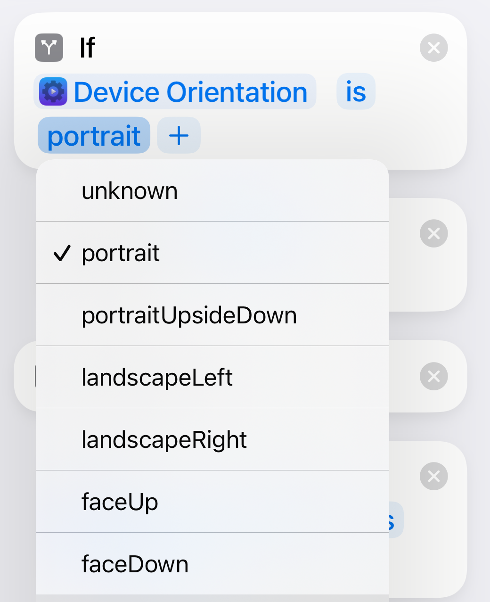
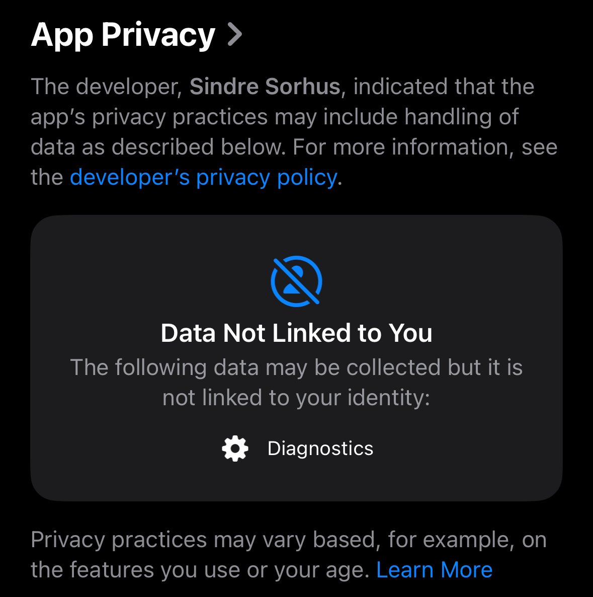
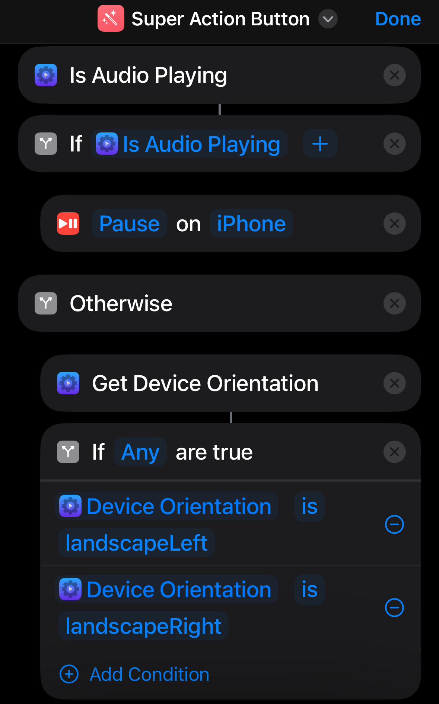
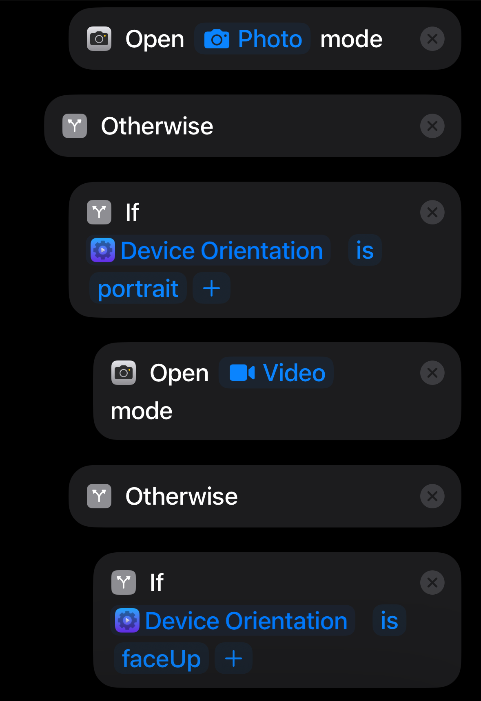
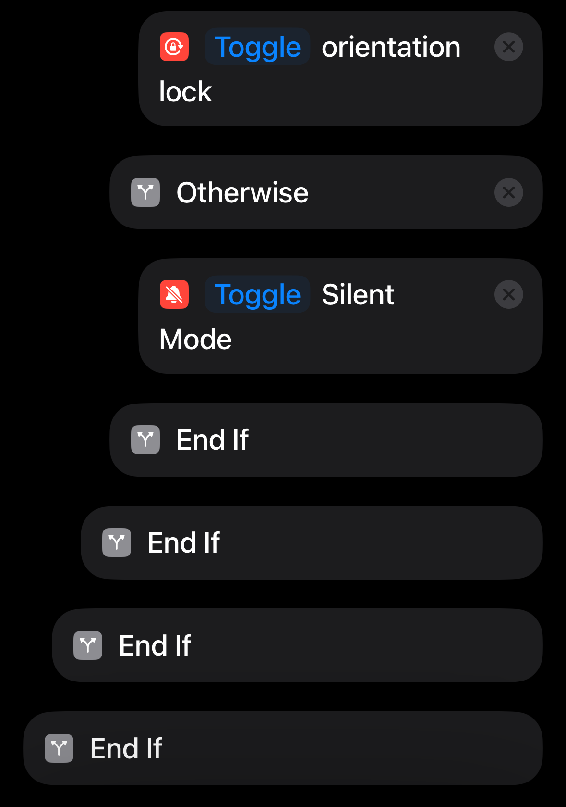
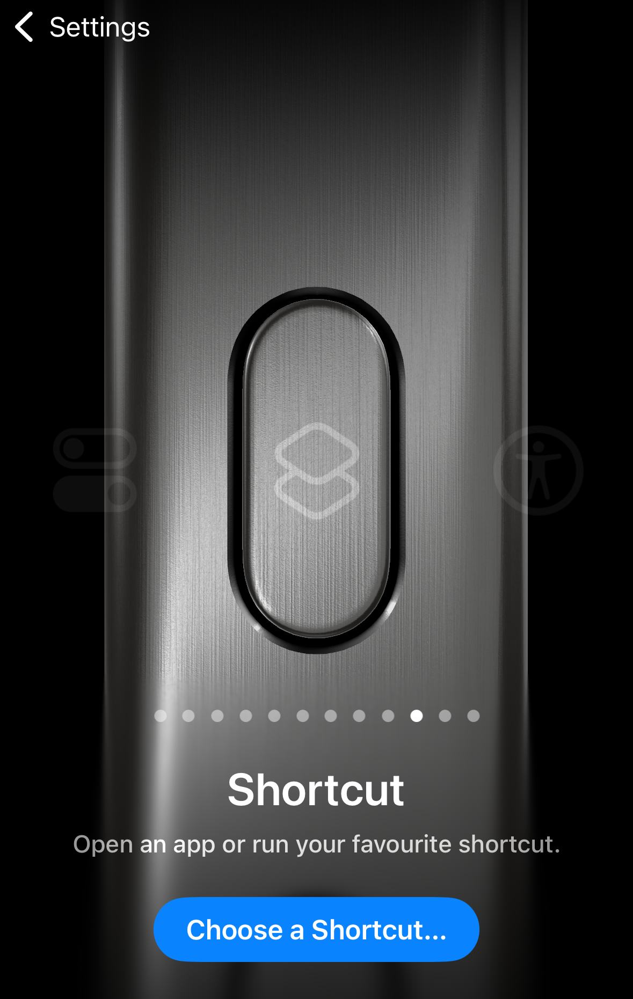
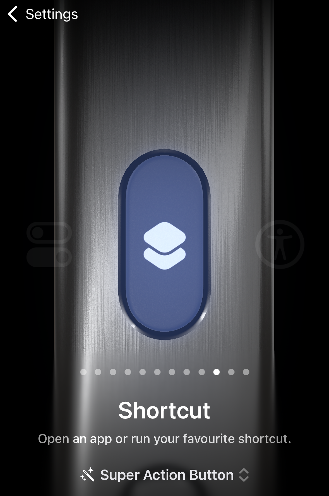
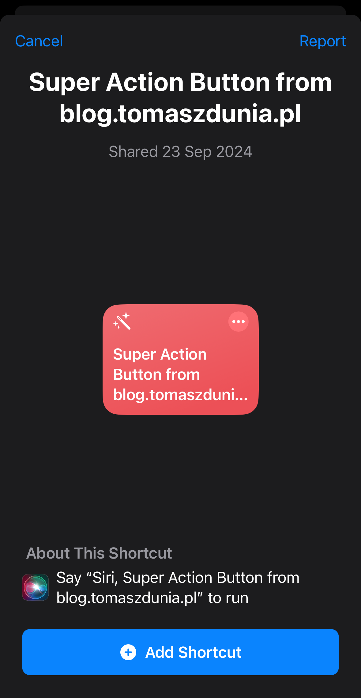

Spis treści:
* TOC
{:toc}

Od iPhone’ów serii 15 słynny przełącznik trybu cichego został zastąpiony przez przycisk, który nazwano _Action Button_. Na początku strasznie wkurzyłem się widząc tą zmianę na konferencji (oraz wcześniejszych przeciekach). Przełącznik dwustanowy był cechą koronną iPhone'a, którą uważam za szalenie użyteczne i jednocześnie banalnie proste rozwiązanie. Łatwość z jaką można było przełączyć telefon w tryb cichy, nawet w kieszeni, oraz to jak łatwo dało się poznać w jakim trybie aktualnie jest to dla mnie świetna rzecz. Stąd też zupełnie nie rozumiałem, dlaczego Apple postanowiło to zmienić i to w dodatku w tak mało kreatywny sposób jak po prostu przycisk… Cóż, na pewno nie jest to pierwsza niezrozumiała decyzja sadowników. Zostawmy to jednak i skupmy się na tym co dostaliśmy w ramach tego nowego przycisku _Action Button_ i jak wykorzystać go do maksimum.

Zacznijmy od tego, że _Action Button_ to tak naprawdę niewykorzystany potencjał, gdyż wyzwala przypisaną do niego funkcję tylko w przypadku przytrzymania go przez krótki czas. Myślę, że każdy pomyślał o tym, że aż prosiło się o rozszerzenie jego działania np. poprzez umożliwienie przypisania innej funkcji dla scenariuszy, w których zostanie naciśnięty dwu- i trzykrotnie. Apple przecież ma już w systemie taki mechanizm, który znamy z przyciskania kilkukrotnie przycisku _Power_. Ja mam po dwuklik przypisane otworzenie (drop down) menu powiadomień, a pod trzykrotne naciśnięcie zmianę kolorów ekranu na czarno-białe. Na plus jest jednak to, że pod _Action Button_ można przypisać różne funkcje spośród których jedną jest wywołanie dowolnego skrótu stworzonego w aplikacji _Shortcuts_. To otwiera dość spory wachlarz możliwości. O tym jak w taki sposób rozszerzyć funkcjonalność _Action Button_ będzie właśnie ten wpis.

## Ja to wykorzystuje tak

Zacznę od tyłu, czyli od przedstawienia jak ja wykorzystuję sposób, który przedstawię w tym wpisie. Wszystko mam skonfigurowane tak, że w zależności od spełnienia (lub nie spełnienia) konkretnych warunków użycie _Action Button_ wywołuje inną akcję. Gdy telefon odtwarza dźwięk, czyli słucham muzyki/podcastu lub oglądam wideo, to użycie _AB_ powoduje zatrzymanie odtwarzania. Jeżeli powyższy warunek nie jest spełniony to sprawdzam jeszcze drugi, czyli to w jakiej orientacji aktualnie znajduje się telefon. Można wybrać spośród poniższych:

Na tej bazie mam przypisane następujące akcje:

- gdy telefon jest **poziomo** (_landscapeLeft_ lub _landscapeRight_) to użycie _AB_ **włącza aparat w tryb robienia zdjęć** (_Photo_),

- gdy telefon jest **pionowo** (_portrait_) to użycie _AB_ **włącza aparat w tryb nagrywania wideo** (_Video_),

- gdy telefon jest na **płasko ekranem do góry** (_faceUp_) to użycie _AB_ **włącza/wyłącza blokadę obracania ekranu** (_Orientation Lock_),

- w **każdej innej pozycji** użycie _AB_ **włącza/wyłącza tryb cichy** (_Silent Mode_).

## Instrukcja

- Pobierz aplikację [_Actions_](https://apps.apple.com/pl/app/actions/id1586435171), która jest normalnie dostępna w _App Store_. Jest to bardzo przydatne rozszerzenie do aplikacji _Shortcuts_ od niejakiego _Sindre Sorhus_. Nie jest to aplikacja, w której interfejsie robi się cokolwiek. Po prostu dajemy jej pewne uprawnienia, na których podstawie zbiera ona przydatne informacje o stanie telefonu. Można je w prosty sposób importować i wykorzystywać w _Shortcuts_. Wiem, że nie wszystkim spodoba się to, że jest to kolejna aplikacja do zainstalowania i do tego nie jest to aplikacja od _Apple_ tylko od prywatnego dewelopera. Jednakże na pocieszenie mogę dodać, że deweloper wydaje się zaufany, a sama aplikacja nie zbiera żadnych podejrzanych danych.

- Następnym krokiem jest uruchomienie aplikacji _Shortcuts_ i stworzenie nowego skrótu. Robi się to poprzez naciśnięcie przycisku „+” znajdującego się w prawym górnym rogu.

- Nadajemy wybraną przez siebie nazwę (rozwijamy menu znajdujące się na górze na samym środku podpisane _New Shortcuts_ i wybieramy opcję _Rename_) i zaczynamy tworzenie formuły. Nie będę tego szczegółowo tłumaczył, bo może kiedyś zrobię o tym oddzielny wpis. Niemniej jednak jest to na tyle intuicyjne, że nawet bez obejrzenia 69 tutoriali każdy powinien dać sobie z tym radę. Wszystko polega w zasadzie na wyszukiwaniu w bibliotece właściwych klocków, konfigurowanie ich w konkretny sposób i ustawianie jeden pod drugim w odpowiedniej kolejności.

- Formuła mojego skrótu, którego zasadę działania opisałem powyżej wygląda tak:

- Tak zbudowany skrót zapisujemy przy użyciu przycisku _Done_ znajdującego się w prawym górnym rogu.

- Przechodzimy do ustawień telefonu, gdzie znajdujemy zakładkę _Action Button_.

- Przewijamy tak długo w prawo (lub lewo) aż trafimy na opcję _Shortcut_.

- Naciskamy przycisk _Choose a Shortcut…_ i wybieramy z menu, które wyskoczy, właśnie ten, który przed chwilą utworzyliśmy.

- To wszystko. Teraz wystarczy sprawdzić poprawność działania i cieszyć się, że nasz _Action Button_ to teraz coś więcej niż tylko zwykle włączanie lub wyłączanie trybu cichego.

## Chcesz gotowca?

Dla leniwych przygotowałem do pobrania gotowy skrót, który stworzyłem. Możesz go pobrać pod [tym linkiem](https://blog.tomaszdunia.pl/files/Super-Action-Button.shortcut). Jedyne co musisz zrobić to uruchomić go z poziomu aplikacji _Files_ i zaimportować do swojej aplikacji _Shortcuts_ używając przycisku _Add Shortcut_. Miłego użytkowania!

