Spis treści:
* TOC
{:toc}

Częstotliwość publikacji wpisów na tym blogu woła o pomstę do nieba. Jednakże mam przygotowanych kilka naprawdę poważnych argumentów na swoją obronę. Pierwszym z nich jest moja 2(i pół!)-letnia córeczka, do której niecałe pół roku temu dołączyła jeszcze druga pociecha. Jak się pewnie domyślasz, drogi Czytelniku, w domu mam naprawdę wesoło. A jak już jesteśmy przy temacie domu to właśnie jestem na etapie wykańczania świeżo wybudowanej nieruchomości, więc to też bardzo mocno zaprząta mi głowę. Do tego oczywiście praca i pozostaje jeszcze te marne 2-3 godziny na sen, ale to uznaję jako czas stracony. Dobra już sobie pomarudziłem teraz pora na mięsko, bo szkoda tracić czas skoro już postanowiłem usiąść i coś naskrobać.

Mimo braku czasu kłębi mi się w głowie naprawdę wiele pomysłów na nowe wpisy. Szczególnie to wykańczanie domu (i siebie) dostarcza mi sporo ciekawych tematów. To co ostatnio zrobiłem własnymi rękami to cała instalacja elektryczna i przede wszystkim "inteligentne" (osobiście uważam to za niefortunne tłumaczenie angielskiego słowa "smart", stąd cudzysłów) oświetlenie. Postanowiłem zastosować moduły firmy _[Shelly](https://www.shelly.com/)_. O tym właśnie będzie ten wpis. Postaram się w nim przekazać w zjadliwej pigułce jak zrobić to samemu. Będziemy musieli zahaczyć też trochę o podstawy z zakresu domowej instalacji elektrycznej.

## Elektryka domowa

> Na samym wstępie UWAGA - nieumiejętne postępowanie z prądem potrafi zabić lub poważnie zaszkodzić zdrowiu! Dlatego jeżeli nie czujesz się pewnie z pracą przy prądzie to po prostu tego nie rób i zostaw to profesjonalistom. Pamiętaj także, aby zawsze pracować na instalacji, która jest odłączona od sieci (np. poprzez bezpiecznik) i zawsze sprawdzaj czy w przewodach, których za chwilę będziesz dotykać nie płynie prąd.

Zacznijmy od tego, że w instalacjach domowych używa się obecnie najczęściej podtynkowe **przewody typu YDYp**, które mocuje się na ścianach i przykrywa tynkiem. Wydaje mi się, że od jakiegoś czasu odeszło się od bruzdowania, czyli robienia w ścianie zagłębienia na przewód elektryczny. Skrót YDYp oznacza, że:

- **Y** - przewód ma zewnętrzną otulinę wykonaną z polwinitu,

- **D** - żyły to drut jednożyłowy miedziany,

- **Y** - poszczególne żyły mają izolację z polwinitu,

- **p** - żyły są ułożony na płasko jedna obok drugiej.

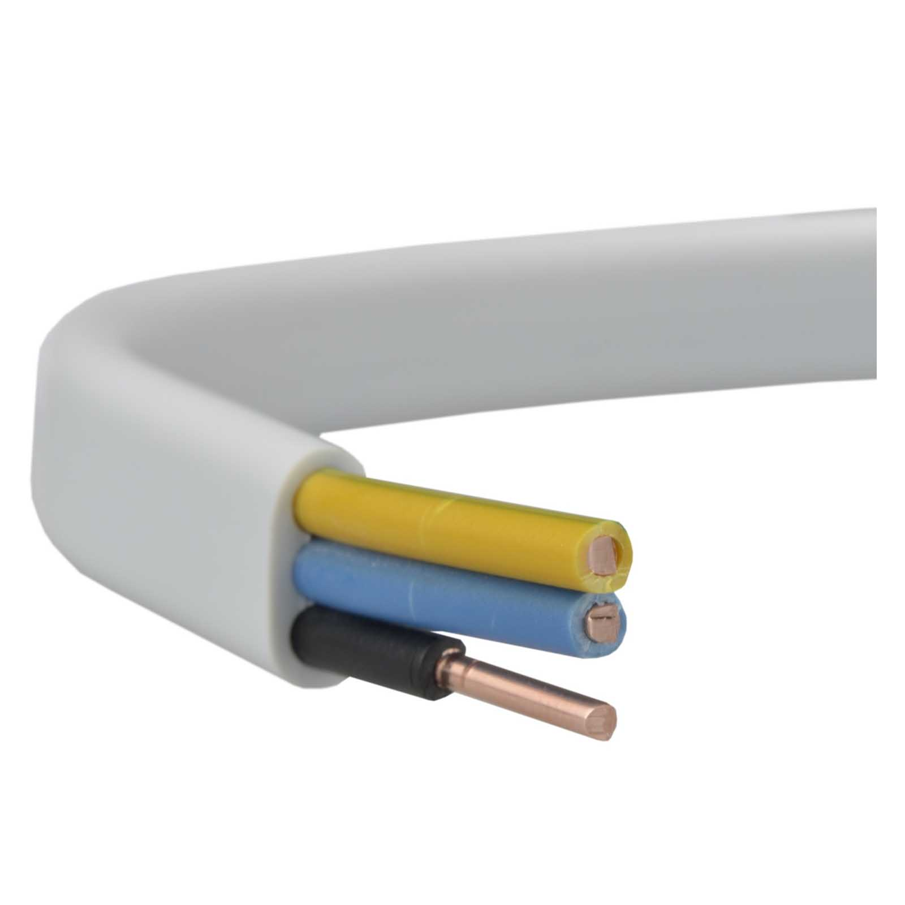

Jeżeli chodzi o konkretne rozmiary to w domowych zastosowaniach używa się w zasadzie tylko:

1. **3x2.5 YDYp** - przewód z **trzema** żyłami o przekroju **2.5mm2** (faza L - brązowy; neutralny N - niebieski; ochronny/uziemienie PE - żółto-zielony) - wykorzystuje się go do **gniazdek**,

3. **5x2.5 YDYp** - przewód z **pięcioma** żyłami o przekroju **2.5mm2** (fazy L1, L2 i L3 - brązowy, czarny i szary; neutralny N - niebieski; ochronny/uziemienie PE - żółto-zielony) - wykorzystywany w **instalacjach 3-fazowych**, czyli np. zasilanie płyty indukcyjnej lub pompy ciepła,

5. **3x1.5 YDYp** - przewód z **trzema** żyłami o przekroju **1.5mm2** (faza L - brązowy; neutralny N - niebieski; ochronny/uziemienie PE - żółto-zielony) - do **oświetlenia** tam gdzie mamy lampy pojedyncze,

7. **4x1.5 YDYp** - przewód z **czterema** żyłami o przekroju **1.5mm2** (faza L - brązowy i czarny; neutralny N - szary lub niebieski; ochronny/uziemienie PE - żółto-zielony) - do **oświetlenia** tam gdzie mamy lampy podwójne.

W dzisiejszych czasach standardem jest też puszczanie przewodów od puszki do puszki i dokonywanie łączenia właśnie wewnątrz nich, bez żadnych puszek łączeniowych pośrednich. W ten sposób najczęstszym przypadkiem jest sytuacja, w której w puszce podtynkowej dedykowanej dla włącznika światła mamy:

1. **zasilanie** - przewód 3x1.5,

3. **przewód idący do lampy** - tutaj mamy dwie możliwości, bo może to być 3x1.5 dla lampy pojedynczej lub 4x1.5 dla lampy podwójnej,

5. **przewód idący do następnej puszki**, na który musimy przekazać zasilanie (3x1.5),

7. **przewód idący do drugiego włącznika**, w przypadku schodówki, czyli gdy lampę mają włączać/wyłączać dwa przełączniki umieszczone np. na dole i na górze klatki schodowej (3x1.5 lub 4x1.5).

## Przygotowanie instalacji

Do grzebania w przewodach potrzebujesz w zasadzie tylko jednego narzędzia - **ściągacza izolacji**, czy też jak kto woli szczypiec do usuwania izolacji. Ja nie jestem profesjonalistą i moim planem było zrobić tylko instalację we własnym domu, więc postanowiłem nie przepłacać i zdecydowałem się na rozwiązanie marketowe, czyli [szczypce firmy _Dexter_ ze sklepu _Leroy Merlin_](https://www.leroymerlin.pl/produkty/szczypce-do-usuwania-izolacji-200-mm-dexter-82887285.html).

Ogólnie wytrzymały ze mną do końca, ale chyba nie mogę ich polecić z jednej przyczyny. Nie radzą sobie ze ściąganiem głównej (białej) warstwy izolacji z przewodów 3x2.5 YDYp, więc musiałem sobie radzić tapeciakiem i uważać, żeby nie poranić przewodów wewnątrz. Po kilku razach doszedłem do takiej wprawy, że nawet szybciej obierałem przewody tapeciakiem niż robiłbym to szczypcami, ale ogólnie jednak jakbym miał wybierać drugi raz to kupiłbym coś z nieco wyższej półki po uprzednim sprawdzeniu recenzji i obejrzeniu kilku filmików na _YouTube_, które potwierdzałyby, że dane szczypce radzą sobie w pełni z przewodami pokroju 3x2.5. Dość mocno polecane aktualnie są [ściągacze firmy _Hoegert_](https://hoegert.com/produkt/automatyczny-sciagacz-izolacji-210-mm-0-05-10-0-mm2/). Widzę teraz, że są blisko dwa razy droższe od _Dexter'a_, ale jednak cena ok. 85-90 zł (za tyle widziałem je na popularnym portalu aukcyjnym) nie jest zabójcza. Natomiast jeżeli chodzi o ściąganie izolacji z samych poszczególnych żył to ten ściągacz _Dexter'a_ w zupełności mi wystarczył, nie miałem z nim żadnego problemu.

Każdy ściągacz ma regulowany zderzak, który w prosty sposób ustala na jakiej odległości zdejmiemy izolację z żyły. Piszę o tym, gdyż od razu chciałbym podpowiedzieć konkretne **nastawy**, żeby oszczędzić Wam szukania:

- dla złączek **_WAGO_** 221-41X optymalna nastawa to ok. **11mm lub 1/2"**,

- dla modułów **_Shelly_** trzeba ustawić trochę mniej, żeby goła żyła za dużo nie wystawała, doświadczalnie wyszło mi, że jest to ok. **9mm lub 3/8"** (połowa między 1/4" i 1/2").

Wartości podałem zarówno w milimetrach jak i calach, gdyż różne szczypce mają różne skale.

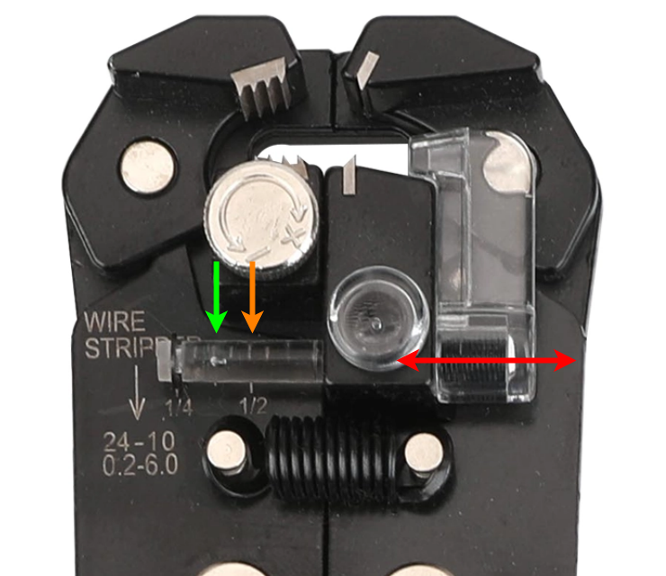

Wiemy już czym i jak przygotować przewody do łączenia. Przyszła pora na określenie sobie co je połączy. Ja postawiłem na **złączki firmy _WAGO_**, które są tematem dość kontrowersyjnym. Patrząc na opinie fachowców można znaleźć tyle samo zachwytów nad tym produktem co negatywnych opinii. Stara szkoła mówi skręć "na ryja", polutuj i zaaplikuj termokurczkę. Jest to na pewno najpewniejsze i niemalże wieczne rozwiązanie, o ile ktoś umie to dobrze zrobić. Jednakże jest bardzo czasochłonne i niezbyt wygodne. Z pomocą przychodzą tutaj złączki _WAGO_, którymi przewody można połączyć szybko, prosto i wygodnie.

Są wtykane złączki _WAGO_ 2273-20X, ale nie jestem ich zwolennikiem, bo ich konstrukcja polega na tym, że w środku jest sprężysta blaszka, która zacina się na żyle przewodu i mam do tego dwa zastrzeżenia. Pierwsze to, że po każdym takim zacięciu uszkadzana jest żyła, a po drugie te blaszki podobno mają po czasie tendencje do odginania się i luzowania co powoduje, że nie ma styku. Brak styku jest o tyle niebezpieczny, że pojawia się iskrzenie i podnosi się temperatura połączenia, co może nawet powodować zapłon. Z pozoru są to złączki jednorazowe, ale można je zdemontować poprzez kilkukrotne obrócenie przewodu w jej wnętrzu i wyrwanie go. Jednakże tak jak mówiłem wychodzi nam z niej przewód z mocno porysowaną żyłą. Sporym ich plusem jest jednak cena.

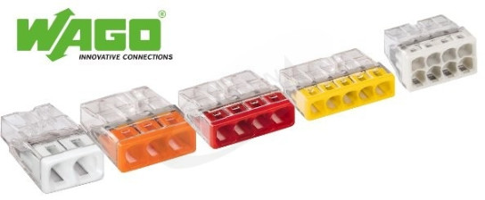

Z uwagi na powyższe ja postawiłem na nieco droższe, ale według mnie lepiej skonstruowane **złączki z oznaczeniem 221-41X, czyli z dźwigienkami**.

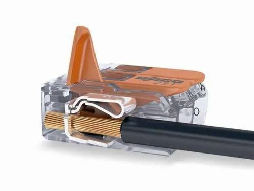

Tutaj nieco inaczej rozwiązane jest blokowanie przewodu wewnątrz złączki. W środku jest odpowiednio zagięta sprężynująca blaszka dociskana dźwigienką, która nie dość że dociska to jeszcze jest skonstruowana tak, aby stale utrzymywać odpowiednią siłę i co za tym idzie prawidłowy styk. Nie traktujcie mojej opinii jako pewnika, ale według mnie jest to lepsze rozwiązanie. Złączki _WAGO_ tego typu występują w **trzech rozmiarach** - 2X (221-412), 3X (221-413) i 5X (221-415). To oznacza, że można nimi łączyć dwa, trzy lub pięć przewodów na raz.

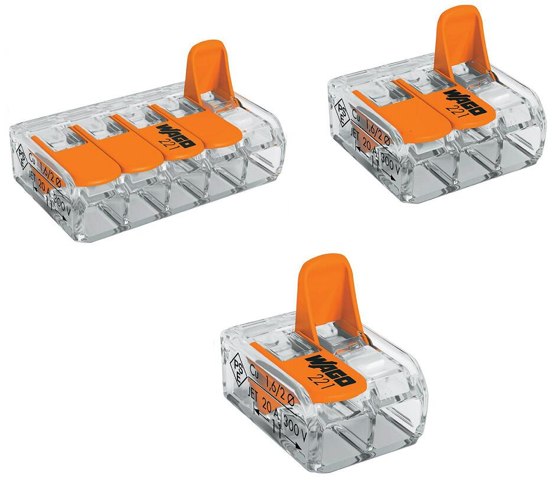

## Prawidłowe połączenie oświetlenia ze zwykłymi przełącznikami

Przejdźmy teraz do tego jak prawidłowo łączy się przewody instalacji oświetlenia w przypadku, gdy mamy **zwykłe przełączniki** (bez jakiejkolwiek automatyki). Można tutaj wyodrębnić w zasadzie dwa przypadki oświetlenia - z pojedynczą i podwójną lampą.

> _Drobne wtrącenie: używam w tym wpisie słowa przełącznik jako określenie elementu, który fachowo i prawidłowo powinno nazywać się łącznikiem. To celowe działanie, bo dla zwykłego zjadacza chleba łącznik wcale nie jest określeniem jednoznacznie określającym przełącznik światła, który czasem nazywany jest także po prostu włącznikiem._

Zacznijmy od tego z **pojedynczą lampą**. Trzeba przyznać, że w Internecie jest cała masa różnych schematów, jednakże naprawdę ciężko było mi znaleźć taki, który jest schludny i zarazem prosty na tyle, aby zaspokoić moją nerwicę natręctw. Dlatego po prostu siadłem i postanowiłem, że schematy na potrzeby tego wpisu zrobię sobie sam.

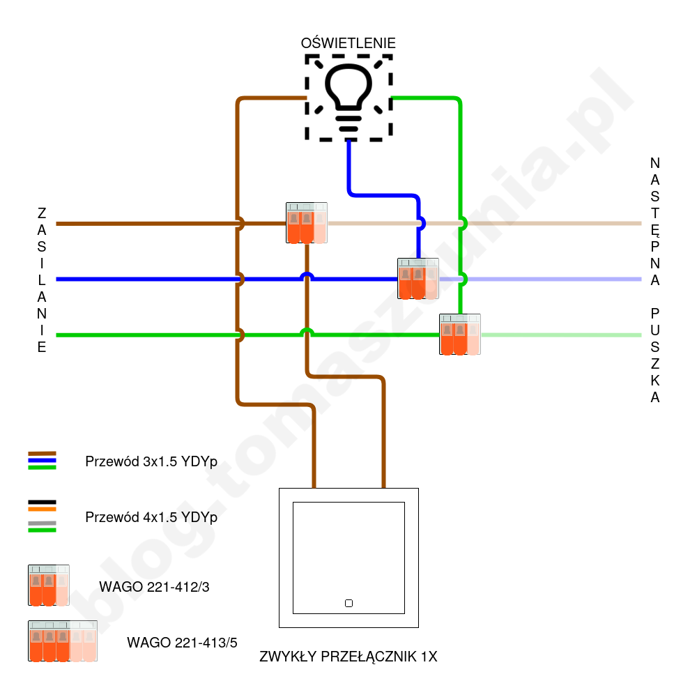

Dla osób, które nie przepadają za językiem obrazkowym przedstawię pokrótce pisemnie to co widać na powyższym obrazku. Od lewej strony do puszki wchodzi nam zasilanie składające się z fazy L, przewodu neutralnego N i przewodu ochronnego PE, który dalej będę dla uproszczenia nazywał uziemieniem. Jeżeli chodzi o fazę to mamy trzy opcje. Jeżeli dana puszka jest już ostatnią w obwodzie to wystarczy podłączyć fazę bezpośrednio do przełącznika lub zrobić to poprzez złączkę _WAGO_ 2X i dodatkowy przewód. Natomiast jeżeli musimy przekazać zasilanie do kolejnej puszki to stosujemy złączkę _WAGO_ 3X, do której podpięte będą faza wchodząca, przewód idący do przełącznika oraz faza wychodząca jako zasilanie następnej puszki. Podobna sytuacja jest z przewodami neutralnym i uziemieniem, ale te zamiast do przełącznika idą bezpośrednio do lampy. Tutaj musimy zastosować złączki _WAGO_ 2X lub 3X. Ostatnim krokiem jest połączenie do przełącznika przewodu brązowego idącego do lampy. Przełącznik to tak naprawdę szalenie proste narzędzie, które po prostu rozłącza lub zwiera obwód doprowadzający fazę do lampy.

Teraz pora na wariant z **dwoma lampami** (lub lampą podwójną) włączanymi z tego samego przełącznika, posiadającego dwa niezależne przyciski.

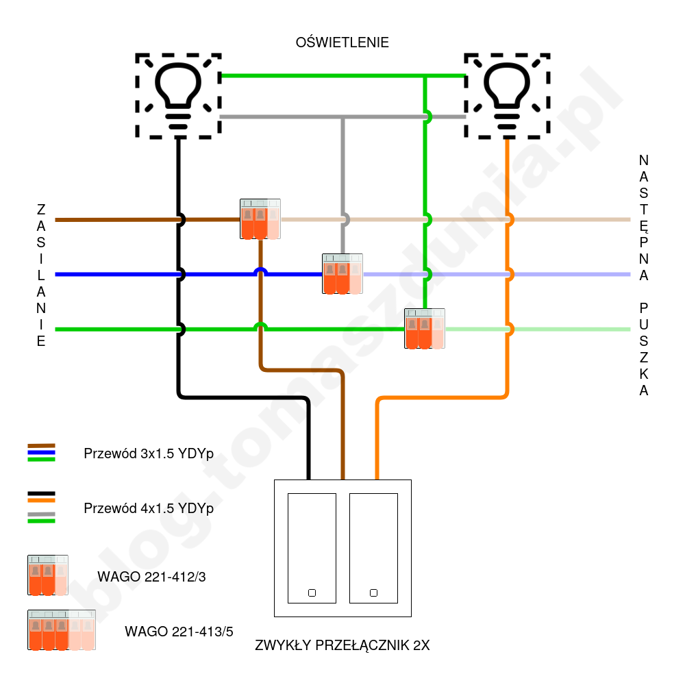

Tutaj główną różnicą jest to, że do lampy idzie przewód 4x1.5 YDYp, który posiada dwa przewody fazowe (brązowy i czarny), przewód neutralny (niebieski) i uziemienie (żółto-zielony). Do tego mamy przełącznik podwójny, do którego podłączanym trzy, a nie dwa przewody. Zaczynając od początku, fazę łączymy dokładnie tak samo jak wcześniej, czyli - _jeżeli dana puszka jest już ostatnią w obwodzie to wystarczy podłączyć fazę bezpośrednio do przełącznika lub zrobić to poprzez złączkę WAGO 2X i dodatkowy przewód. Natomiast jeżeli musimy przekazać zasilanie do kolejnej puszki to stosujemy złączkę WAGO 3X, do której podpięte będą faza wchodząca, przewód idący do przełącznika oraz faza wychodząca jako zasilanie następnej puszki._ Przewody neutralne łączymy analogicznie do tego jak robiliśmy to przy lampie pojedynczej, a jedyną różnicą jest to, że w 4x1.5 przewód neutralny ma zazwyczaj kolor szary zamiast niebieskiego. Uziemienie jest dokładnie tak samo i tutaj żadne kolory się nie zmieniają. Zatem w skrócie, jeżeli to ostatnia puszka w obwodzie to jedna złączka _WAGO_ 2X łączy przewód neutralny przychodzący do puszki jako zasilanie i przewód neutralny lampy, a drugą złączką _WAGO_ 2X łączymy uziemienie wchodzące do puszki i wychodzące do lampy. Natomiast jeżeli nie jest to ostatnia puszka w obwodzie to zamiast złączek _WAGO_ 2X musimy użyć 3X i dopiąć do tego jeszcze przewody neutralny i ochronny idące do następnej puszki. Na koniec zostaje jeszcze podpiąć dwa przewody fazowe (brązowy i czarny) idące do lampy bezpośrednio do przełącznika.

## Te produkty Shelly wykorzystamy

Chyba powinienem zacząć od tego czym w ogóle jest **_Shelly_**. Pozwolicie, że nie będę się skupiał na samej firmie, a raczej na produktach, które oferuje i to tylko tych, które będą nam potrzebne w temacie poruszanym w tym wpisie. Zacznijmy od modułów **_1PM Gen3_** i **_2PM Gen3_**.

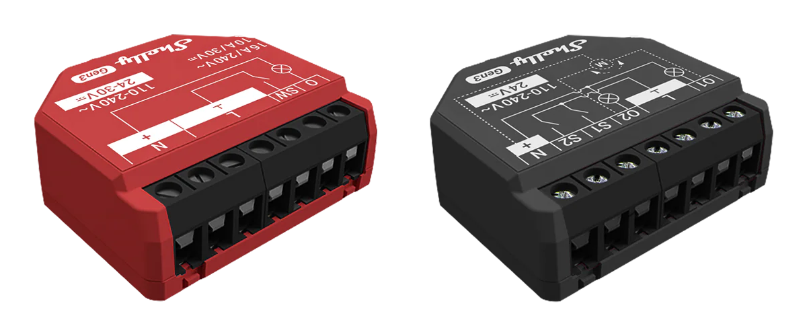

Są to kompaktowe, inteligentne **przekaźniki, które umożliwiają zdalne sterowanie urządzeniami** zasilanymi napięciem 110-240 VAC lub 24-30 VDC oraz monitorowanie ich zużycia energii. Ich wymiary to zaledwie 37x42x16 mm. Są stworzone do tego, aby podłączyć i schować je w puszkach podtynkowych za gniazdkami lub przełącznikami światła. Dzięki wbudowanym modułom Wi-Fi i Bluetooth są **łatwe do integrowania z praktycznie każdym systemem smarthome**. Wersja Gen3 jest aktualnie najnowsza (choć w momencie pisania tego wpisu są już pogłoski o wersji Gen4), a wnosi obsługę standardu komunikacji **_Matter_**, który jest swoistym przełomem w zakresie IoT, gdyż ma spajać jeszcze do niedawna bardzo pofragmentowany rynek różnych rozwiązań, które nie były ze sobą kompatybilne.

Kolejną fajnym produktem od _Shelly_ są **_Wall Switch'e_**, czyli przełączniki **dedykowane** właśnie do powyższych modułów. Istotne w ich kontekście jest to, że są to **przyciski monostabilne**, czyli takie które zmieniają swój stan tylko na krótki czas podczas naciśnięcia. Po zwolnieniu automatycznie wracają do pierwotnej pozycji. Przykładem może być przełącznik dzwonkowy. Mówię o tym, gdyż standardowy przełącznik światła jest bistabilny, czyli ma tak jakby dwie pozycje, w których można go ustawić (światło włączone lub wyłączone).

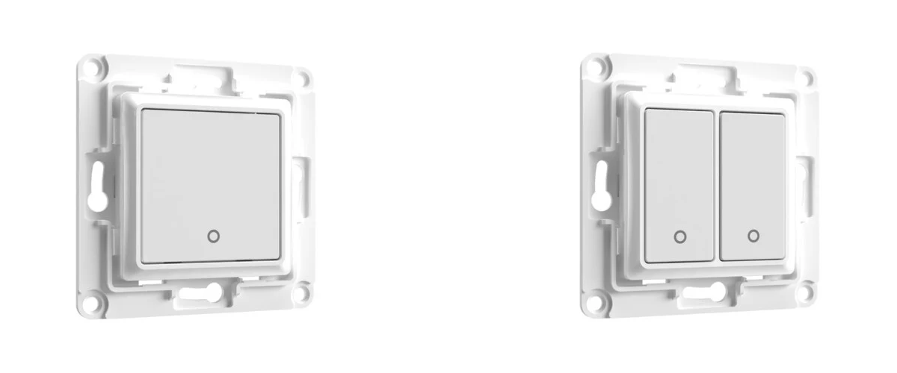

Na plus jest to, że do każdego takiego przycisku **dostajemy w zestawie dedykowane uchwyty** do odpowiednich modułów przekaźnikowych _Shelly_, co sprawia, że **zyskujemy naprawdę sporo miejsca wewnątrz puszki**. Każdy kto chociaż raz instalował coś w puszce podtynkowej wie jak ciasno tam jest i jak trudno ułożyć jest te wszystkie sztywne przewody. Zmieszczenie modułu przekaźnikowego _Shelly_ i do tego zwykłego przełącznika, który ma swoje bebechy (dupkę), jest przeważnie nie lada wyzwaniem. W przypadku tandemu przełącznika i modułu zamontowanego do niego na dedykowanym uchwycie ten problem jest dość istotnie zminimalizowany.

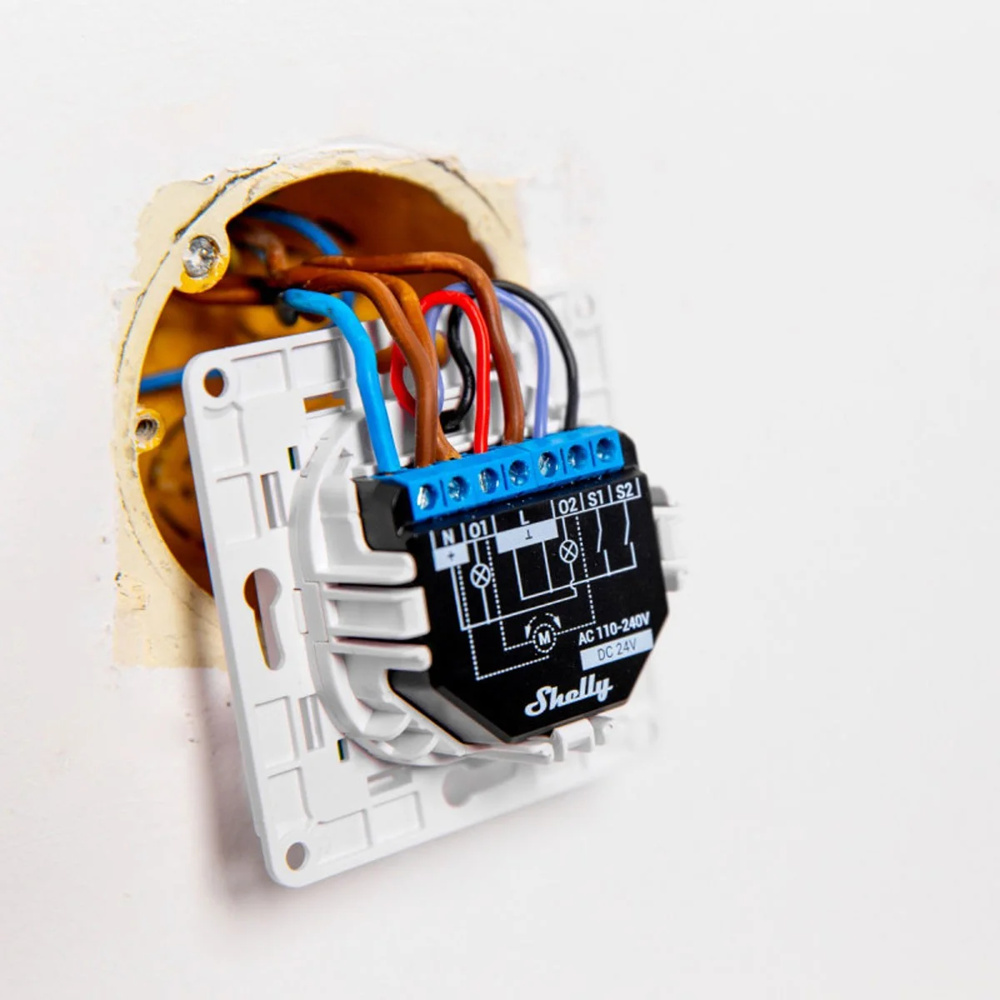

Warte wspomnienia jest także to, że _Wall Switch'e_ sprzedawane są oczywiście **bez ramek, więc trzeba je dokupić** osobno. Oczywiście musimy tutaj użyć ramek od _Shelly_, bo (chyba) tylko one pasują do przełączników tej firmy, chodzi głównie o mocowanie. Przestrzegam jednak, że istnieją tylko ramki pojedyncza, podwójna i potrójna. Większych krotności nie ma, a jednak do takich zwykłych przełączników i gniazdek standardowo występują jeszcze poczwórne i w niektórych instalacjach mają one zastosowanie. Ramki znajdziemy pod nazwą **_Wall Frame_**. To co jeszcze jest warte wspomnienia to to, że ramki _Shelly_ mają wykończenie szklane, tj. płytka wokół przycisku jest wykonana właśnie ze szkła. Mówię o tym, gdyż wielu osobom na pewno się to nie spodoba lub jest istotnym aspektem.

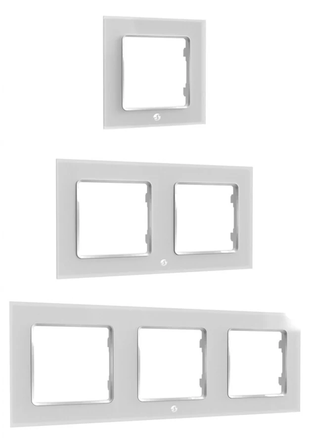

W swoim domu w oparciu o produkty _Shelly_ robię tylko oświetlenie, więc poszukiwałem zwykłych gniazdek i ramek, które będą możliwie jak najbardziej pasowały wyglądem. Jako ciekawostkę mogę zdradzić wyniki tych poszukiwań. Okazało się, że ramki z [serii _Flavia_ ze sklepu _Leroy Merlin_](https://www.leroymerlin.pl/produkty/ramka-pojedyncza-flavia-bialy-elektro-plast-87958185.html) najbardziej pasują w mojej ocenie do design'u _Shelly Wall Frame_. Porównałem wymiary, przekrój oraz odcień szkła.

## Implementacja modułów Shelly

Wracamy do kabelków i schematów połączenia. W pierwszej kolejności na tapet weźmy **oświetlenie pojedyncze, w którym wykorzystamy moduł przekaźnikowy _Shelly 1PM Gen3_**.

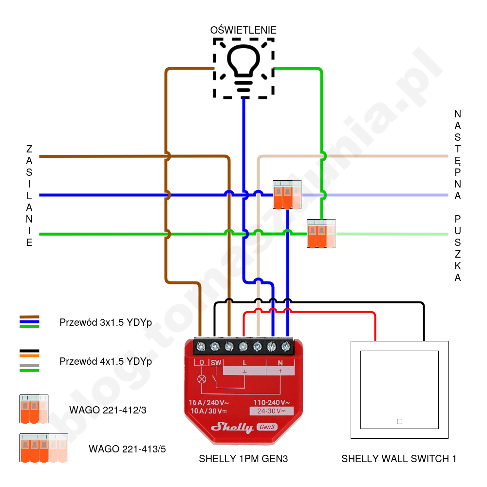

Moduł przekaźnikowy _Shelly 1PM_ ma następujące wejścia/wyjścia:

- **O** - wyjście dające zasilanie (fazę) na lampę,

- **SW** - wejście sterujące wyjściem O, na które podajemy sygnał z przełącznika,

- **3 x L** - trzy zmostkowane wejścia/wyjścia fazy,

- **2 x N** - dwa zmostkowane wejścia/wyjścia na przewody neutralne.

Na wstępie zaznaczę, że sposób połączenia zobrazowany przeze mnie na schemacie powyżej nie jest jedynym możliwym. Ja połączyłem tak swoją instalację i ten sposób będę rekomendował. A zatem łączymy to następująco:

- **O** - przewód brązowy (faza) idący do lampy,

- **SW** - przewód czarny z przełącznika _Shelly Wall Switch 1_, to na nim pojawia się impuls, gdy naciśniemy przycisk,

- **L (1)** - faza przychodząca do puszki,

- **L (2)** - przewód czerwony (czyli dopływ fazy do przełącznika, z którego przekazywany jest impuls po naciśnięciu przycisku) z przełącznika _Shelly Wall Switch 1_,

- **L (3)** - faza wychodząca do następnej puszki, jeżeli takowa występuje, a jak nie to zostaje nieużywane,

- **N (1)** - przewód neutralny idący do lampy,

- **N (2)** - przewód neutralny ze złączki _WAGO_, do której doprowadzamy przychodzący i wychodzący do następnej puszki przewód neutralny, tutaj można zrezygnować ze złączki _WAGO_, jeżeli dana puszka jest ostatnią w obwodzie, bo można wtedy połączyć przychodzący do puszki przewód neutralny prosto do modułu _Shelly_.

Dodam jeszcze, że przewody do przyłączy L i N można łączyć w dowolnej kolejności, bo są one po prostu wewnętrznie zmostkowane tak jak pisałem wcześniej. Istotne jest tylko, aby przewody fazowe trafiły do L, a neutralne do N.

Uziemienie łączymy tak samo jak przy zwykłym przełączniku, czyli w złączce WAGO schodzą się przewód ochronny przychodzący do puszki, ten idący do lampy i opcjonalnie ten idący do następnej puszki, jeżeli takowa występuje.

Jeżeli chodzi o **oświetlenie podwójne to wykorzystamy moduł przekaźnikowy _Shelly 2PM Gen3_** i podpinamy go następująco.

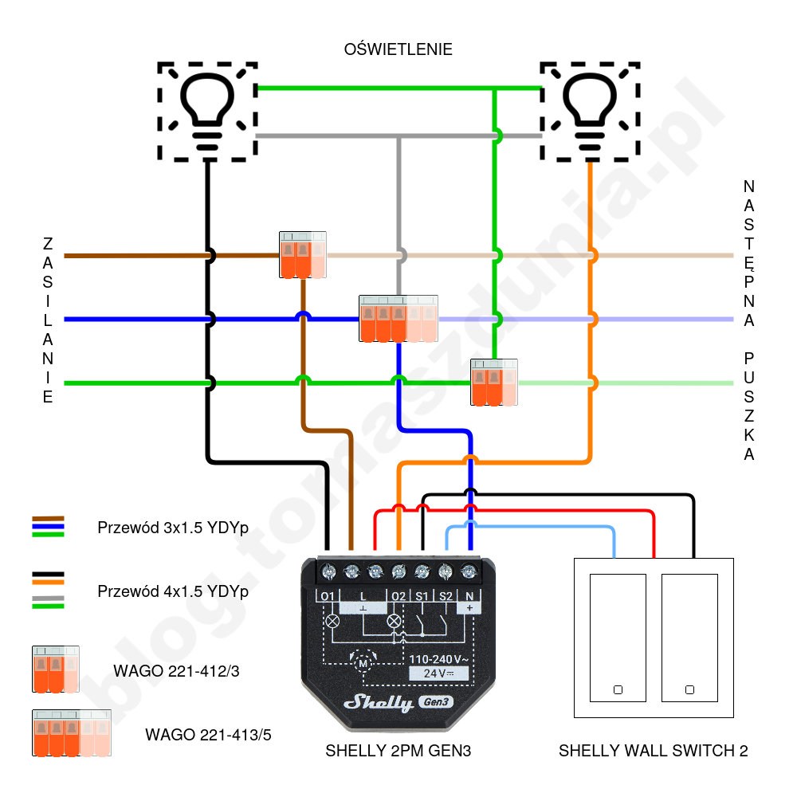

Jeżeli chodzi o główne różnice, które widać już na pierwszy rzut oka, to mamy tutaj dwa niezależne wyjścia na lampę (O1 i O2) oraz dwa wejścia sterujące (S1 i S2). Na minus jest to, że oba moduły mają tyle samo przyłączy, a więc moduł 2PM ma tylko dwa przyłącza fazowe i jedno neutralne, co indukuje potrzebę zastosowania większej ilości złączek _WAGO_, bo nie jesteśmy w stanie zmostkować tylu rzeczy w samym module przekaźnikowym. Z kosztowego punktu widzenia nie ma z tym większego problemu, ale większa ilość złączek _WAGO_ zawsze oznacza większe problemy z upchnięciem tego wszystkiego w puszce.

Moduł przekaźnikowy _Shelly 2PM_ ma następujące wejścia/wyjścia:

- **O1** - wyjście dające zasilanie (fazę) na lampę nr 1,

- **2 x L** - dwa zmostkowane wejścia/wyjścia fazy,

- **O2** - wyjście dające zasilanie (fazę) na lampę nr 2,

- **S1** - wejście sterujące wyjściem O1, na które podajemy sygnał z pierwszego przycisku przełącznika,

- **S2** - wejście sterujące wyjściem O2, na które podajemy sygnał z drugiego przycisku przełącznika,

- **N** - wejście na przewód neutralny, który jest potrzebny do pracy samego moduły bez przekazywania go dalej.

Wiedząc to wszystko łączymy przewody następująco:

- **O1** - przewód czarny (faza) idący do lampy nr 1,

- **L (1)** - faza ze złączki _WAGO_, do której doprowadzamy przychodzącą i wychodzącą do następnej puszki fazę, tutaj można zrezygnować ze złączki _WAGO_, jeżeli dana puszka jest ostatnią w obwodzie, bo można wtedy połączyć przychodzącą fazę prosto do modułu _Shelly_.

- **L (2)** - przewód czerwony (czyli dopływ fazy do przełącznika, z którego przekazywany jest impuls po naciśnięciu przycisków) z przełącznika _Shelly Wall Switch 2_,

- **O2** - przewód brązowy (faza) idący do lampy nr 2,

- **S1** - przewód czarny z przełącznika _Shelly Wall Switch 2_, to na nim pojawia się impuls, gdy naciśniemy pierwszy przycisk,

- **S2** - przewód niebieski z przełącznika _Shelly Wall Switch 2_, to na nim pojawia się impuls, gdy naciśniemy drugi przycisk,

- **N** - przewód neutralny ze złączki _WAGO_, w której poza nim schodzą się przewód neutralny przychodzący do puszki, idący do lampy (szary) i opcjonalnie idący do następnej puszki, jeżeli dana puszka nie jest ostatnią w obwodzie (od tego zależy czy musimy użyć złączki 3X czy 5X).

Z tego wszystkiego wychodzi na to, że w zakresie fazy moduł przekaźnikowy _Shelly_ zastępuje w sposób analogiczny zwykły przełącznik. Jeżeli chodzi o przewody neutralne to musimy dołożyć jeden idący do modułu przekaźnikowego _Shelly_. A uziemienie łączymy tak samo jak przy zwykłym przełączniku, czyli w złączce _WAGO_ schodzą się przewód ochronny przychodzący do puszki, ten idący do lampy i opcjonalnie ten idący do następnej puszki, jeżeli takowa występuje.

## Pierwsza konfiguracja

Po prawidłowym podłączeniu modułu przekaźnikowego _Shelly_ wystarczy po prostu włączyć prąd. Gdy dopłynie on do modułu to zostanie on automatycznie uruchomiony. Na podstawie domyślnej konfiguracji zacznie on rozgłaszać **otwartą sieć Wi-Fi**. Jest to standardowe rozwiązanie w świecie urządzeń smarthome. Wystarczy połączyć się z tym niezahasłowanym hotspotem. Jego SSID będzie zawierało frazę "shelly", więc nie będzie problemu z jego zidentyfikowaniem. Po uzyskaniu połączenia **wchodzimy do przeglądarki i wpisujemy [192.168.33.1](http://192168331)**. To domyślny adres, pod którym znajduje się **panel sterowania modułu**. Pokażę kilka rzeczy, które trzeba lub wypada zrobić w ramach podstawowej konfiguracji.

Zaczniemy od **ustawienia typu przycisku** jaki jest podłączony do modułu. Robimy to w zakładce _Home_ i sekcji _Switches and attached inputs_ musisz nacisnąć _Input (X)_. Następnie w sekcji _Input settings_ wchodzimy do _Input/Output settings_. Ukazuje nam się lista rozwijana _Select input mode for Input (X)_ na której możemy wybrać:

- Switch - jeżeli mamy zwykły przełącznik bistabilny,

- Button - jeżeli mamy przełącznik monostabilny, czyli np. _Shelly Wall Switch_.

Dla _Wall Switch_ polecam jeszcze poniżej wybrać:

- _Set output type for Output (X)_ - _Momentary_, to sprawi, że każde naciśnięcie zmieni stan wyjścia na przeciwny (włączone/wyłączone),

- _Action on power on for Output (X)_ - _Restore last known state of output/relay_, to oznacza, że po włączeniu modułu (np. po chwilowym braku prądu) zostanie przywrócony ostatni znany stan wyjścia, czyli jeżeli lampa była włączona przed zanikiem prądu to będzie też po jego przywróceniu.

Po ustawieniu tego wszystkie naciskamy oczywiście _Save settings_.

Następny krok to **zmiana nazwy urządzenia**, żeby lepiej rozpoznawać je w sieci lokalnej. Nazwa może być dowolna i najlepiej mieć jakiś swój system. Ogólnie myślę, że wszystko będzie lepsze od domyślnego ciągu znaków. Aby to zrobić przechodzimy do zakładki _Settings_ i dalej w sekcji _Device settings_ wybieramy _Device name_. Wprowadzamy swoją nazwę w pole tekstowe _Device name_ i zapisujemy przyciskiem _Save settings_.

Ja nie planuję wykorzystywać **komunikacji _Bluetooth_**, a przynajmniej na razie nie mam żadnego pomysłu do czego mogłaby mi się przydać, więc ze względów bezpieczeństwa postanowiłem ją wyłączyć na wszystkich zainstalowanych w moim domu modułach. Aby to zrobić należy w prawym górnym rogu odszukać ikonę _Bluetooth_ i nacisnąć ją. Następnie odznaczamy ptaszek przy _Enable Bluetooth_ i naciskamy _Save settings_. Zmiana tego ustawienia wymaga ponownego uruchomienia modułu, więc zostaniemy o to poproszeni. Możemy to wywołać skrótem _Reboot now_ dołączonym na końcu komunikatu.

Pora **połączyć moduł do sieci domowej**. W tym celu w prawym górnym rogu odnajdujemy ikonkę Wi-Fi i naciskamy ją. Przechodzimy do sekcji _Wi-Fi 1 settings_, zaznaczamy ptaszek przy _Enable_, wyszukujemy nazwę naszej sieci (SSID) na liście rozwijanej, podajemy hasło i potwierdzamy przyciskiem _Save settings_. Po chwili powinien się pojawić komunikat, że połączenie zostało nawiązane. Będzie w nim też informacja jaki został nadany lokalny adres IP dla tego konkretnego modułu. Przyda nam się to później, więc proponuję go sobie zapisać.

Jeżeli połączenie modułu do sieci domowej przebiegło pomyślnie to możemy przełączyć się na nią również komputerem, na którym dokonujemy niniejszej konfiguracji. Teraz, aby ponownie wejść do panelu sterowania należy **wpisać w pasek adresu przeglądarki nowy lokalny adres IP modułu**. Był on podany na etapie łączenia się lub można go odczytać z poziomu routera, który jest naszym serwerem DHCP. Jeżeli wszystko przebiegnie pomyślnie to wrócimy z powrotem do tego samego panelu sterowania. Na tym etapie **nie potrzebujemy już, aby moduł _Shelly_ pracował w funkcji hotspota i to w dodatku otwartego, więc ze względów bezpieczeństwa po prostu to wyłączymy**. Kolejny raz kierujemy się w okolice prawego górnego rogu i wybieramy ikonę pierwszą od lewej, która wygląda mniej więcej tak ((o)). To _Access Point settings_, czyli ustawienia punktu dostępowego. Zmieniamy pozycję suwaka na wyłączony przy _Enable Access Point_. Jeżeli ktoś nie chce całkowicie wyłączać hotspota to zdecydowanie rekomenduję przynajmniej ustawić hasło, aby nie był on po prostu otwartą siecią, gdyż byłaby to otwarta brama do naszej domowej sieci.

To w zasadzie tyle jeżeli chodzi o podstawową konfigurację. Ja dalej swoje moduły _Shelly_ zintegrowałem jeszcze z domowym serwerem _**Home Assistant**_, ale to już temat na oddzielny wpis. Poniżej załączam jeszcze kilka zrzutów ekranu, które powinny wizualnie dopełnić powyższy opis.

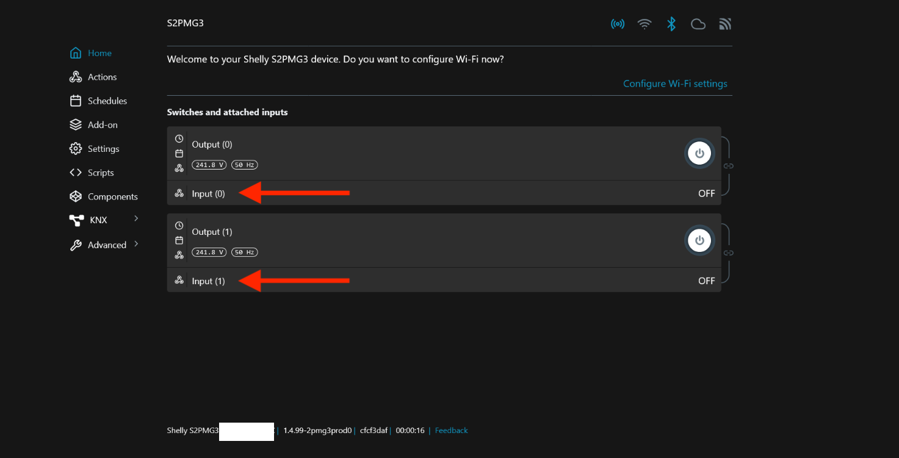
    
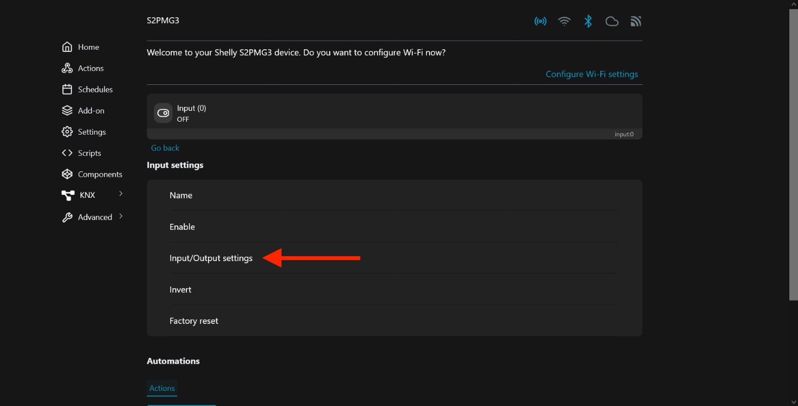
    
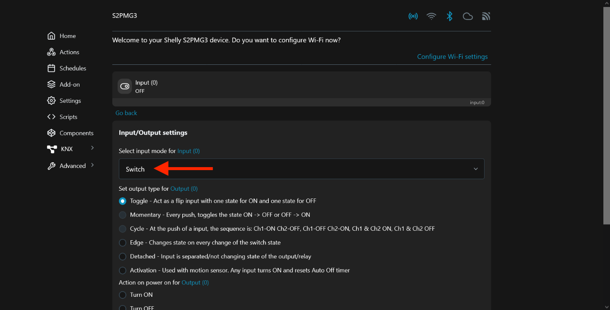
    
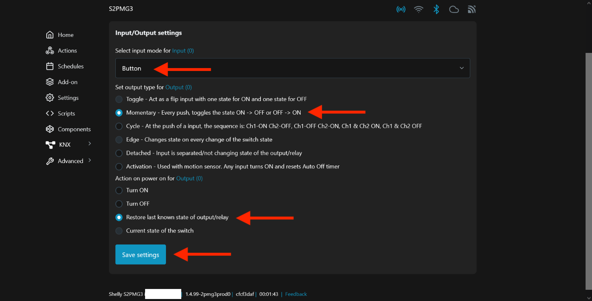
    
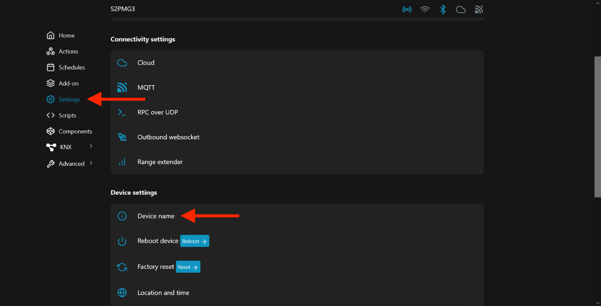
    
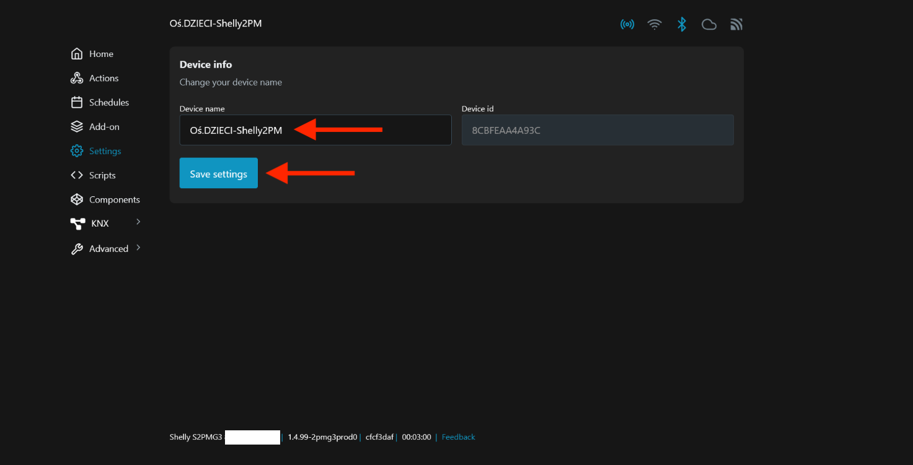
    
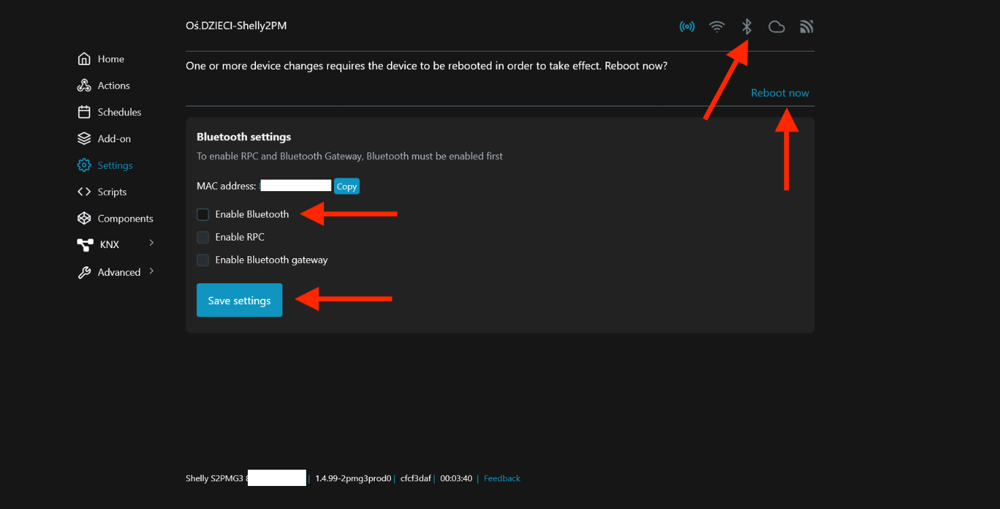
    
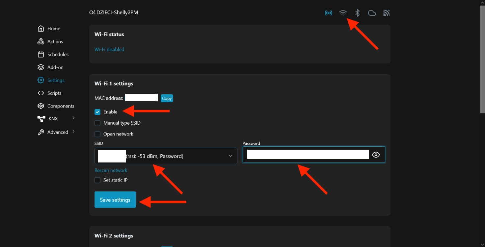
    
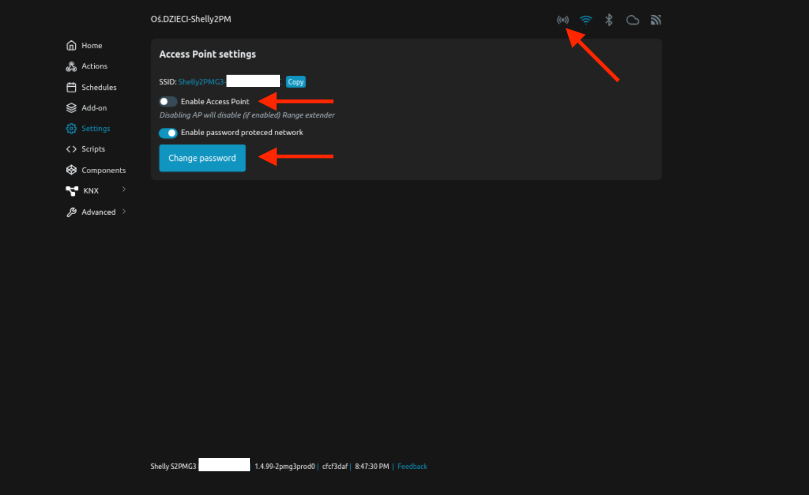
    

## No dobrze, ale ile to kosztuje?

Aktualnie ceny produktów _Shelly_ kształtują się następująco:

- moduł przekaźnikowy _1PM Gen3_ - ok. 90 PLN,

- moduł przekaźnikowy _2PM Gen3_ - ok. 145 PLN,

- przycisk _Wall Switch 1_ - ok. 40 PLN,

- przycisk _Wall Switch 2_ - ok. 40 PLN,

- ramka _Wall Frame 1_ - ok. 25 PLN,

- ramka _Wall Frame 2_ - ok. 40 PLN,

- ramka _Wall Frame 3_ - ok. 55 PLN.

Złączki _WAGO_ to koszt ok. 1.50 PLN/szt. za rozmiary 2X i 3X oraz 2.50-3 PLN/szt. za 5X.

Zestawmy sobie teraz ceny dla najbardziej popularnych przypadków:

|  | Zwykłe przełączniki marketowe | Zwykłe przełączniki marketowe + moduły przekaźnikowe _Shelly_ | Wszystko od _Shelly_ |
| --- | --- | --- | --- |
| Oświetlenie z lampą pojedynczą | 18 zł   (54 zł z ramką szklaną) | 108 zł   (144 zł z ramką szklaną) | 155 zł |
| Oświetlenie z lampą podwójną | 20 zł   (56 zł z ramką szklaną) | 165 zł   (201 zł z ramką szklaną) | 210 zł |

Cóż mogę powiedzieć... W porównaniu do standardowego rozwiązania to bazujące na _Shelly_ dość znacznie odstaje kosztowo. To tak naprawdę cena za zastosowanie rozwiązania smart. Tutaj każdy musi sobie odpowiedzieć czy wieczorem chce mu się wstawać z ciepłego łóżka i wyłączać światła w domu, czy też może woli wykonać dwa kliknięcia na telefonie. Jeżeli jesteś takim leniuszkiem jak ja i uważasz, że Twój komfort równoważy taką różnicę w cenie to znaczy, że minuty poświęcone na przeczytanie tego wpisu nie są czasem zmarnowanym :)
